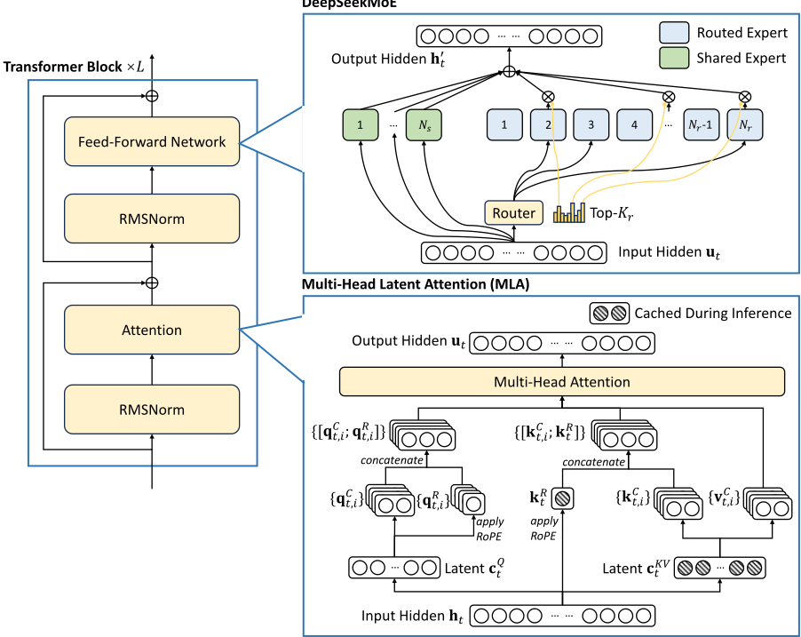
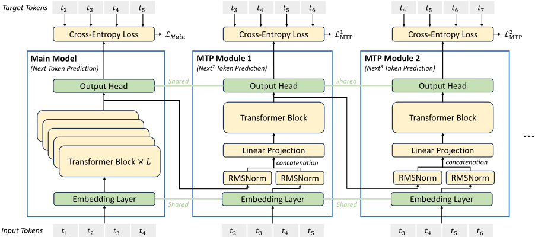
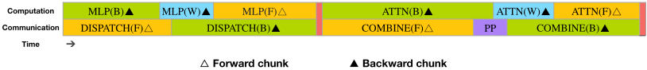
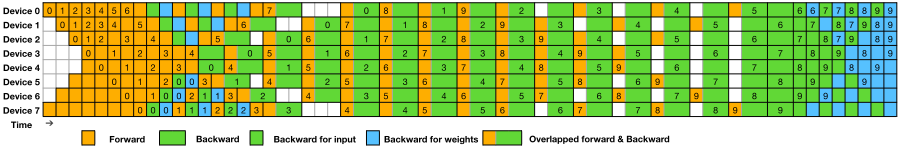
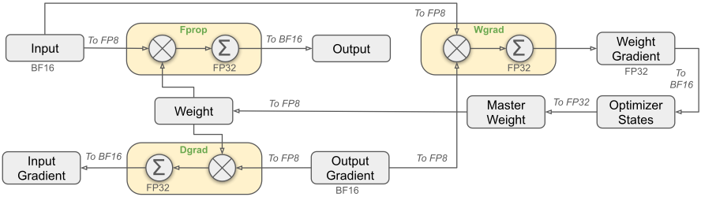
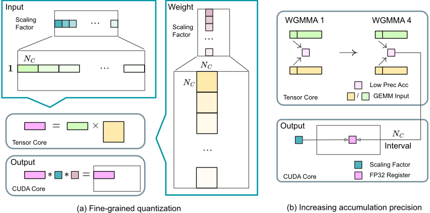
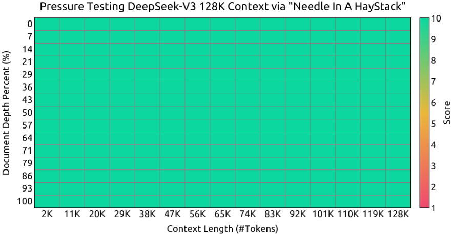
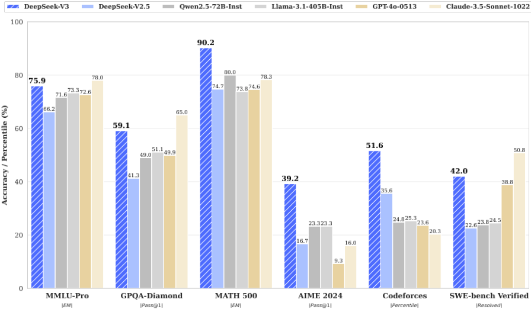
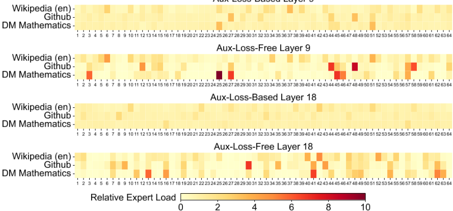
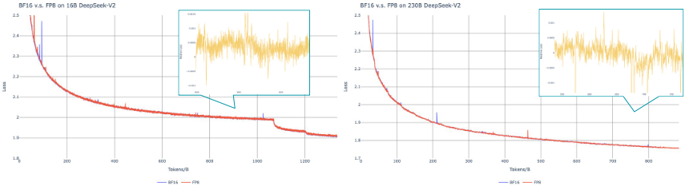

# 01 · DeepSeek-V3 Technical Report 深度解读：把"贵"变成工程问题来解

> 本篇是「论文解读」系列第 01 篇，方向：**大模型架构**。所有数字均与 arXiv 2412.19437 PDF 原文核对；图片截取自原论文（版权归 DeepSeek-AI，仅作学习解读之用）；标注"解读视角"的内容为本文推断。

## 1. 论文档案

| 项目 | 内容 |
| --- | --- |
| 标题 | DeepSeek-V3 Technical Report |
| 机构 | DeepSeek-AI（研究/工程与数据标注团队共约 150+ 人署名，按姓氏字母序） |
| 发表处 | arXiv 预印本（未投会议/期刊），2024-12-26 提交 |
| arXiv | [2412.19437](https://arxiv.org/abs/2412.19437)（约 53 页） |
| 开源仓库 | [deepseek-ai/DeepSeek-V3](https://github.com/deepseek-ai/DeepSeek-V3)：代码 MIT（LICENSE-CODE）；权重走单独的 DeepSeek Model License（LICENSE-MODEL），官方声明"支持商业使用" |
| 权重可得性 | HuggingFace `deepseek-ai/DeepSeek-V3`（Chat）与 `DeepSeek-V3-Base`；仅提供 FP8 权重（原生 FP8 训练产物），总计 685B 参数 = 671B 主模型 + 14B MTP 模块；BF16 需用仓库内 `fp8_cast_bf16.py` 自行转换 |

## 2. 速览

**一句话 TL;DR**：DeepSeek-V3 用 671B 参数（每 token 激活 37B）的 MoE 模型，靠 MLA 压 KV cache、无辅助损失负载均衡保住模型质量、FP8 混合精度砍训练成本、DualPipe 藏住跨节点通信，把整个训练压到 **2.788M H800 GPU 小时（约 557.6 万美元租金当量）**，跑出对标 GPT-4o / Claude-3.5-Sonnet 的开源模型。

| 维度 | 内容 |
| --- | --- |
| 问题 | 千亿级 MoE 模型的训练/推理成本：KV cache 过大、MoE 负载均衡损失伤性能、BF16 训练贵、跨节点 EP 通信重、流水线气泡 |
| 创新 | ① MLA 多头潜在注意力；② 无辅助损失的负载均衡（bias 只影响路由不进梯度）；③ 首次在超大模型上验证 FP8 混合精度训练；④ MTP 多 token 预测目标；⑤ DualPipe 流水线并行与计算通信全重叠 |
| 证据 | 14.8T tokens 预训练后，Base 模型 MMLU 87.1 / BBH 87.5 / HumanEval 65.2 全面领先开源；Chat 模型 MMLU 88.5、MATH-500 90.2、AIME 2024 39.2、Codeforces 51.6 百分位，与 GPT-4o-0513 / Claude-3.5-Sonnet-1022 同档 |

## 3. 背景与动机

**2024 年底的开源格局**：LLaMA-3.1 405B（稠密）代表"堆参数"路线——405B 全激活，训练成本巨大；Mixtral、DeepSeek-V2（236B 总参/21B 激活）代表 MoE 路线——推理便宜但当时最强开源模型仍与 GPT-4o 有明显差距。DeepSeek 的选择是：继续沿自己验证过的 V2 架构路线放大到 671B/37B，同时把"省"作为一等设计目标。

**训练前 V2 时代遗留的五个具体瓶颈**（每一条对应本文一项创新）：

1. **KV cache 墙**：MHA 每 token 每层要缓存 $2 n_h d_h$ 个元素（V3 配置下 32768 个），长上下文下推理显存爆炸；GQA/ MQA 是"砍头数"的妥协，有质量损失。
2. **MoE 负载均衡的两难**： routed expert 倾斜会导致路由坍缩（routing collapse）和 EP 下算力空转；传统解法是加辅助均衡损失，但该损失对主损失是干扰项，权重大了明显伤模型质量（Wang et al., 2024a 的观察）。
3. **BF16 训练的算力账**：GEMM 占训练算力大头，BF16 算力上限就是 H800 Tensor Core 的 BF16 FLOPS；FP8 理论翻倍，但激活/权重中的 outlier 使直接 FP8 训练不稳定，此前没有在千亿级验证过的先例。
4. **跨节点专家并行的通信墙**：256 个 routed expert 分布在 8 节点 64 卡上，每层 all-to-all 的通信量与计算量比接近 **1:1**，串行执行等于一半时间在等网。
5. **流水线气泡**：1F1B 类调度的气泡随 stage 数线性增长；且传统 PP 里面，通信（PP 传输 + all-to-all）与计算是错开排布的，重叠度有限。

**时机点**：DeepSeek-R1 系列的长思维链模型已就绪，使得 V3 成为第一个把"长 CoT 推理蒸馏进通用 chat 模型"的正面大样本案例（这直接铺垫了后续 R1 论文）。

## 4. 核心创新拆解

### 4.1 MLA（Multi-head Latent Attention）：把 KV cache 压成一个低秩潜向量

- **是什么**：不缓存每个 head 的 K/V，而是把 h 投影成一个 $d_c$ 维的联合潜向量缓存，注意力的 K/V 用上投影矩阵现算；RoPE 位置信息单独走一条 $d_h^R$ 维的解耦通道。
- **为什么之前不行**：直接对 K/V 做低秩压缩会把 RoPE 的"逐位置旋转"信息抹掉——潜向量是跨 token 共享的基，位置相关的旋转无法在压缩域内保持正交性（V2 论文的核心动机）。
- **怎么做到**：KV 联合压缩 + 解耦 RoPE（公式见 §5.1）。V3 配置下每 token 每层只需缓存 $d_c + d_h^R = 512 + 64 = 576$ 个元素，而 MHA 需要 $2 n_h d_h = 32768$ 个——**约 57 倍压缩**（解读视角：由论文超参数直算）。
- **代价与权衡**：Q/K/V 各多一套投影矩阵（参数与训练期激活略增，Q 侧低秩压缩只省训练激活内存不省推理 KV）；推理框架要专门实现 MLA kernel，生态兼容性差（见 §8）。

### 4.2 无辅助损失的负载均衡：bias 只管路由，不进梯度

- **是什么**：给每个 expert 维护一个标量偏置 $b_i$，**只在 top-K 选路时**加到亲和度分数上；门控权重仍由原始亲和度计算。每个训练步结束时，超载的 expert 把 $b_i$ 减 $\gamma$，欠载的加 $\gamma$。
- **为什么之前不行**：辅助均衡损失直接改变梯度方向，为了均衡付出质量代价；调小了没效果，调大了伤模型——这是个长期两难。
- **怎么做到**：把"均衡"从损失函数项变成对路由分数的**在线控制**（类似控制系统里的积分调节），主梯度完全不受污染。
- **代价与权衡**：批级均衡对"单条序列内的极端失衡"无约束，因此 V3 保留一个极小系数（$\alpha = 0.0001$）的序列级辅助损失兜底；$\gamma$ 要调度（前 14.3T tokens 用 0.001，最后 500B 降到 0 防止训练末期路由抖动）。

### 4.3 MTP（Multi-Token Prediction）：训练信号致密化，顺手送一个投机解码加速器

- **是什么**：除主模型预测下一 token 外，串行接 $D$ 个浅层 MTP 模块（V3 取 $D=1$），每个模块在保留完整因果链的前提下多预测一个未来 token。
- **为什么之前不行**：Gloeckle et al. (2024) 的多 token 预测用独立输出头并行预测，各深度之间没有因果链，表示学习上互相打架；纯为投机解码设计的 EAGLE 又不以提升主模型质量为目标。
- **怎么做到**：模块 $k$ 把"上一深度对位置 $i$ 的表示"与"位置 $i+k$ 的 embedding"拼接后过自己的 Transformer block，共享主模型的 embedding 与输出头（公式见 §5.3），训练目标是 $\mathcal{L}_{Main} + \mathcal{L}_{MTP}$。
- **代价与权衡**：训练多 14B 参数的开销（HF 权重总 685B 的来源）；推理时可以整体丢弃，也可拿来做投机解码（第二 token 接受率 85%–90%，解码 TPS 提升 1.8 倍）。

### 4.4 FP8 混合精度训练：首次在超大规模上验证

- **是什么**：所有 Linear 相关 GEMM（Fprop/Dgrad/Wgrad）用 FP8（E4M3），配合**激活 1×128 tile、权重 128×128 block 的细粒度缩放**；每 $N_C=128$ 个元素把部分和提升（promote）到 CUDA Core 上做 FP32 累加。
- **为什么之前不行**：① FP8 动态范围小，激活 outlier 直接导致溢出/严重量化误差；② Hopper Tensor Core 的 FP8 累加只有约 14 位尾数精度，$K=4096$ 的 GEMM 相对误差可达 2%；③ 以前只有 E4M3/E5M2 混用的推理/小规模训练经验。
- **怎么做到**：细粒度缩放"摊薄"指数位压力（组内共享 exponent，允许全 E4M3）；FP32 累加策略解决精度；敏感性高的组件（embedding、输出头、MoE 门控、norm、attention 核心）保持 BF16/FP32；优化器一、二阶矩存 BF16，master weights 与梯度仍 FP32。
- **代价与权衡**：Dgrad 的激活梯度不能用 128×128 block 量化（附录 B.2：16B 模型 300B tokens 直接发散）；Wgrad 可 FP8 缓存激活省显存但注意力后激活需定制 E5M6 格式；scale 因子取 2 的整数幂以避免反量化误差。

### 4.5 DualPipe：双向流水线 + 计算/通信全重叠

- **是什么**：把每个 micro-batch 的前向/后向切成 attention、all-to-all dispatch、MLP、all-to-all combine 四段，与 PP 通信一起重排，使 all-to-all 与 PP 通信都被计算完全遮盖；同时从流水线两端喂 micro-batch（双向调度）。
- **为什么之前不行**：1F1B/ZB1P 只优化气泡不处理通信重叠；Chimera 是双向但对 micro-batch 数有整除约束；EP 跨节点 all-to-all 在 V3 的算通比下串行执行会浪费近一半时间。
- **怎么做到**：手动调 SM 配比（20/132 个 SM 专门跑通信 kernel），配合 token 限节点路由（每 token 最多 4 节点）让 IB（50GB/s）与 NVLink（160GB/s）流量解耦并各自打满。
- **代价与权衡**：参数要存两份（大 EP 下分摊可忽略）；峰值激活内存比 1F1B 多 1 份 PP 级（$PP+1$ vs $PP$）；实现复杂度极高（定制 PTX、warp specialization）。

## 5. 方法细节（公式均从原文重写）

### 5.1 MLA：压缩与上投影（原文式 1–11）

KV 联合压缩（只缓存 $\mathbf{c}_t^{KV}$ 与 $\mathbf{k}_t^R$）：

$$\mathbf{c}_t^{KV} = W^{DKV}\mathbf{h}_t, \qquad \mathbf{k}_t^C = W^{UK}\mathbf{c}_t^{KV}, \qquad \mathbf{k}_t^R = \mathrm{RoPE}\left(W^{KR}\mathbf{h}_t\right)$$

$$\mathbf{k}_{t,i} = \left[\mathbf{k}_{t,i}^C;\ \mathbf{k}_t^R\right], \qquad \mathbf{v}_t^C = W^{UV}\mathbf{c}_t^{KV}$$

其中 $\mathbf{c}_t^{KV} \in \mathbb{R}^{d_c}$，$d_c \ll d_h n_h$；$W^{DKV} \in \mathbb{R}^{d_c \times d}$，$W^{UK}, W^{UV} \in \mathbb{R}^{d_h n_h \times d_c}$，$W^{KR} \in \mathbb{R}^{d_h^R \times d}$。Q 侧同样做低秩压缩（只省训练期激活内存）：

$$\mathbf{c}_t^Q = W^{DQ}\mathbf{h}_t, \qquad \mathbf{q}_t^C = W^{UQ}\mathbf{c}_t^Q, \qquad \mathbf{q}_t^R = \mathrm{RoPE}\left(W^{QR}\mathbf{c}_t^Q\right), \qquad \mathbf{q}_{t,i} = \left[\mathbf{q}_{t,i}^C;\ \mathbf{q}_{t,i}^R\right]$$

注意力输出（内积分母是 $d_h + d_h^R$，因为 key 同时含压缩与 RoPE 两段）：

$$\mathbf{o}_{t,i} = \sum_{j=1}^{t} \mathrm{Softmax}_j\left(\frac{\mathbf{q}_{t,i}^{\top}\mathbf{k}_{j,i}}{\sqrt{d_h + d_h^R}}\right)\mathbf{v}_{j,i}^C, \qquad \mathbf{u}_t = W^O\left[\mathbf{o}_{t,1};\ \dots;\ \mathbf{o}_{t,n_h}\right]$$



**解读视角**：MLA 本质是对 K/V 空间做了一次"先降秩再升秩"的重参数化——缓存的是秩为 $d_c=512$ 的潜向量，每层 KV cache 相对 MHA 的压缩比 = $2 n_h d_h / (d_c + d_h^R) = 32768/576 \approx 57$。这也是第 9 节里用 SVD 视角理解它的原因。

### 5.2 DeepSeekMoE 与无辅助损失均衡（原文式 12–20）

MoE 前向（细粒度 expert + 共享 expert 隔离）：

$$\mathbf{h}_t' = \mathbf{u}_t + \sum_{i=1}^{N_s}\mathrm{FFN}_i^{(s)}(\mathbf{u}_t) + \sum_{i=1}^{N_r} g_{i,t}\,\mathrm{FFN}_i^{(r)}(\mathbf{u}_t)$$

门控值由原始亲和度归一化（V3 改用 sigmoid 而非 softmax 亲和度）：

$$g_{i,t} = \frac{g_{i,t}'}{\sum_{j=1}^{N_r} g_{j,t}'}, \quad g_{i,t}' = \begin{cases} s_{i,t}, & s_{i,t} \in \mathrm{Topk}\left(\{s_{j,t} \mid 1 \le j \le N_r\},\ K_r\right) \\ 0, & \text{otherwise} \end{cases} \quad s_{i,t} = \mathrm{Sigmoid}\left(\mathbf{u}_t^{\top}\mathbf{e}_i\right)$$

**无辅助损失均衡**：top-K 选择改用带偏置的分数，偏置 $b_i$ 不进任何梯度、不进门控值：

$$g_{i,t}' = \begin{cases} s_{i,t}, & s_{i,t} + b_i \in \mathrm{Topk}\left(\{s_{j,t} + b_j \mid 1 \le j \le N_r\},\ K_r\right) \\ 0, & \text{otherwise} \end{cases}$$

偏置更新规则（原文为文字描述，解读视角整理为）：每个训练步结束后，若 expert $i$ **超载**则 $b_i \leftarrow b_i - \gamma$；**欠载**则 $b_i \leftarrow b_i + \gamma$。V3 取 $\gamma = 0.001$（前 14.3T tokens），末 500B tokens 降为 0。

兜底的序列级均衡损失（系数极小，防单序列内极端失衡）：

$$\mathcal{L}_{Bal} = \alpha \sum_{i=1}^{N_r} f_i P_i, \qquad f_i = \frac{N_r}{K_r T}\sum_{t=1}^{T} \mathbb{1}\left(s_{i,t} \in \mathrm{Topk}\left(\{s_{j,t} \mid 1 \le j \le N_r\},\ K_r\right)\right), \qquad P_i = \frac{1}{T}\sum_{t=1}^{T} \frac{s_{i,t}}{\sum_{j=1}^{N_r} s_{j,t}}$$

V3 取 $\alpha = 0.0001$。

### 5.3 MTP：串行模块、共享 embedding 与输出头（原文式 21–25）

第 $k$ 个 MTP 模块（$M_k \in \mathbb{R}^{d \times 2d}$，拼接前各自过 RMSNorm）：

$$\mathbf{h}_i^{\prime k} = M_k\left[\mathrm{RMSNorm}\left(\mathbf{h}_i^{k-1}\right);\ \mathrm{RMSNorm}\left(\mathrm{Emb}(t_{i+k})\right)\right], \qquad \mathbf{h}_{1:T-k}^{k} = \mathrm{TRM}_k\left(\mathbf{h}_{1:T-k}^{\prime k}\right)$$

共享输出头给出第 $k$ 个附加 token 的分布并计算损失（对 D 个深度取平均、乘权重 $\lambda$）：

$$P_{i+k+1}^{k} = \mathrm{OutHead}\left(\mathbf{h}_i^{k}\right), \qquad \mathcal{L}_{MTP}^{k} = -\frac{1}{T}\sum_{i=2+k}^{T+1} \log P_{i}^{k}\left[t_{i}\right], \qquad \mathcal{L}_{MTP} = \frac{\lambda}{D}\sum_{k=1}^{D} \mathcal{L}_{MTP}^{k}$$

总损失 $\mathcal{L} = \mathcal{L}_{Main} + \mathcal{L}_{MTP}$。V3 取 $D=1$、$\lambda=0.3$（前 10T tokens）→ $0.1$（后 4.8T tokens）。



### 5.4 DualPipe 的气泡账（原文表 2）

| 方法 | 流水线气泡 | 参数显存 | 激活显存 |
| --- | --- | --- | --- |
| 1F1B | $(PP-1)(F+B)$ | 1× | $PP$ |
| ZB1P | $(PP-1)(F+B-2W)$ | 1× | $PP$ |
| DualPipe（本文） | $(PP/2-1)(F\&B+B-3W)$ | 2× | $PP+1$ |

$F$：前向 chunk 耗时；$B$：完整后向 chunk 耗时；$W$："只对权重求导"的后向 chunk 耗时；$F\&B$：一对互相重叠的前后向 chunk 耗时。气泡里随 micro-batch 数增长不增加、且不要求 micro-batch 数被 stage 数整除（Chimera 需要）。





### 5.5 FP8 混合精度框架





精度设计三件套：① E4M3 用于所有张量（打破以往 Fprop E4M3 + 反向 E5M2 的惯例），靠细粒度分组摊薄动态范围压力；② Tensor Core 内每 128 个元素（4 个 WGMMA）把部分和搬到 CUDA Core FP32 寄存器继续累加，同时 scale 因子在 CUDA Core 上完成反量化；③ 在线量化（每个 tile/block 现算 max-abs），不用 delayed scaling 的历史统计。

## 6. 实验证据复盘

### 6.1 训练成本（原文表 1）

| 训练成本 | 预训练 | 长上下文扩展 | 后训练 | 总计 |
| --- | --- | --- | --- | --- |
| H800 GPU 小时 | 2664K | 119K | 5K | **2788K** |
| 租金当量（$2/GPU 小时） | $5.328M | $0.238M | $0.01M | **$5.576M** |

关键换算：每万亿 tokens 约 180K GPU 小时 = 2048 卡集群跑 3.7 天；整个 14.8T tokens 预训练不足两个月。**注意原文脚注：该成本只含 V3 的正式训练，不含架构/算法/数据的先期研究与消融**（见 §8 争议 1）。

### 6.2 Base 模型评测（原文表 3，全部数字与 PDF 核对）

| 基准（指标） | Shots | DeepSeek-V2-Base | Qwen2.5 72B-Base | LLaMA-3.1 405B-Base | DeepSeek-V3-Base |
| --- | --- | --- | --- | --- | --- |
| 架构 / 总参 / 激活 | - | MoE 236B/21B | Dense 72B | Dense 405B | MoE **671B/37B** |
| Pile-test (BPB) | - | 0.606 | 0.638 | 0.542 | 0.548 |
| BBH (EM) | 3 | 78.8 | 79.8 | 82.9 | **87.5** |
| MMLU (EM) | 5 | 78.4 | 85.0 | 84.4 | **87.1** |
| MMLU-Redux (EM) | 5 | 75.6 | 83.2 | 81.3 | **86.2** |
| MMLU-Pro (EM) | 5 | 51.4 | 58.3 | 52.8 | **64.4** |
| DROP (F1) | 3 | 80.4 | 80.6 | 86.0 | **89.0** |
| ARC-Easy / ARC-Challenge (EM) | 25 | 97.6 / 92.2 | 98.4 / 94.5 | 98.4 / 95.3 | **98.9 / 95.3** |
| HellaSwag (EM) | 10 | 87.1 | 84.8 | **89.2** | 88.9 |
| PIQA (EM) | 0 | **83.9** | 82.6 | 85.9 | 84.7 |
| WinoGrande (EM) | 5 | **86.3** | 82.3 | 85.2 | 84.9 |
| RACE-Middle / RACE-High (EM) | 5 | 73.1 / 52.6 | 68.1 / 50.3 | **74.2 / 56.8** | 67.1 / 51.3 |
| TriviaQA (EM) | 5 | 80.0 | 71.9 | 82.7 | **82.9** |
| NaturalQuestions (EM) | 5 | 38.6 | 33.2 | **41.5** | 40.0 |
| AGIEval (EM) | 0 | 57.5 | 75.8 | 60.6 | **79.6** |
| HumanEval (Pass@1) | 0 | 43.3 | 53.0 | 54.9 | **65.2** |
| MBPP (Pass@1) | 3 | 65.0 | 72.6 | 68.4 | **75.4** |
| LiveCodeBench-Base (Pass@1) | 3 | 11.6 | 12.9 | 15.5 | **19.4** |
| CRUXEval-I / CRUXEval-O (EM) | 2 | 52.5 / 49.8 | 59.1 / 59.9 | 58.5 / 59.9 | **67.3 / 69.8** |
| GSM8K (EM) | 8 | 81.6 | 88.3 | 83.5 | **89.3** |
| MATH (EM) | 4 | 43.4 | 54.4 | 49.0 | **61.6** |
| MGSM (EM) | 8 | 63.6 | 76.2 | 69.9 | **79.8** |
| CMath (EM) | 3 | 78.7 | 84.5 | 77.3 | **90.7** |
| CLUEWSC (EM) | 5 | 82.0 | 82.5 | **83.0** | 82.7 |
| C-Eval (EM) | 5 | 81.4 | 89.2 | 72.5 | **90.1** |
| CMMLU (EM) | 5 | 84.0 | **89.5** | 73.7 | 88.8 |
| CMRC (EM) | 1 | **77.4** | 75.8 | 76.0 | 76.3 |
| C3 (EM) | 0 | 77.4 | 76.7 | **79.7** | 78.6 |
| CCPM (EM) | 0 | **93.0** | 88.5 | 78.6 | 92.0 |
| MMMLU-non-English (EM) | 5 | 64.0 | 74.8 | 73.8 | **79.4** |

读法：数学（MATH 61.6 vs 54.4）、代码（HumanEval 65.2）、多语言三个方向拉开决定性差距；英文常识类（RACE、PIQA、WinoGrande）反而略低于 LLaMA-3.1 405B——37B 激活的模型在"覆盖面"上确实有边界。

长上下文：预训练结束后用 YaRN 两阶段扩展（各 1000 步，32K → 128K，配置 s=40, α=1, β=32），NIAH 测试在最长 128K 下全绿：





### 6.3 MTP 消融（原文表 4）

| 基准 | Small MoE | Small + MTP | Large MoE | Large + MTP |
| --- | --- | --- | --- | --- |
| 推理激活参数（两两相同） | 2.4B | 2.4B | 20.9B | 20.9B |
| 总参数 | 15.7B | 15.7B | 228.7B | 228.7B |
| 训练 tokens | 1.33T | 1.33T | 540B | 540B |
| Pile-test (BPB) | 0.729 | 0.729 | 0.658 | 0.657 |
| BBH (EM) | 39.0 | **41.4** | 70.0 | **70.7** |
| MMLU (EM) | 50.0 | **53.3** | 67.5 | 66.6 |
| DROP (F1) | 39.2 | **41.3** | 68.5 | **70.6** |
| TriviaQA (EM) | 56.9 | **57.7** | 67.0 | **67.3** |
| HumanEval (Pass@1) | 20.7 | **26.8** | 44.5 | **53.7** |
| MBPP (Pass@1) | 35.8 | **36.8** | 61.6 | **62.2** |
| GSM8K (EM) | 25.4 | **31.4** | 72.3 | **74.0** |
| MATH (EM) | 10.7 | **12.6** | 38.6 | **39.8** |

要点：推理时 MTP 模块被丢弃，对比双方推理成本完全一致——提升来自训练目标本身。代码（HumanEval +9.2/ +9.2）与数学（GSM8K +6.0）受益最大；MMLU 在大模型档出现了 -0.9 的回退，说明"普遍提升"并非逐项保证。

### 6.4 无辅助损失均衡消融（原文表 5）

| 基准 | Small 辅助损失 | Small 无辅助损失 | Large 辅助损失 | Large 无辅助损失 |
| --- | --- | --- | --- | --- |
| 激活 / 总参数 | 2.4B / 15.7B | 2.4B / 15.7B | 20.9B / 228.7B | 20.9B / 228.7B |
| 训练 tokens | 1.33T | 1.33T | 578B | 578B |
| Pile-test (BPB) | 0.727 | **0.724** | 0.656 | **0.652** |
| BBH (EM) | 37.3 | **39.3** | 66.7 | **67.9** |
| MMLU (EM) | 51.0 | **51.8** | 68.3 | 67.2 |
| DROP (F1) | 38.1 | **39.0** | 67.1 | 67.1 |
| TriviaQA (EM) | 58.3 | **58.5** | 66.7 | **67.7** |
| NaturalQuestions (EM) | 23.2 | **23.4** | 27.1 | **28.1** |
| HumanEval (Pass@1) | 22.0 | **22.6** | 40.2 | **46.3** |
| MBPP (Pass@1) | 36.6 | 35.8 | 59.2 | **61.2** |
| GSM8K (EM) | 27.1 | **29.6** | 70.7 | **74.5** |
| MATH (EM) | 10.9 | **11.1** | 37.2 | **39.6** |



补充证据（§4.5.3 正文）：1B MoE 验证损失——序列级辅助损失 2.258 / 无辅助损失 2.253 / **批级辅助损失 2.253**；3B MoE——2.085 / 2.080 / 2.080。这说明性能优势来自**批级均衡允许专家跨域特化**，而非"无损失"这个形式本身（把均衡粒度从序列改成 batch 的辅助损失同样能到 2.253）。

### 6.5 Chat 模型评测（原文表 6；输出限 8K）

| 基准 | DeepSeek-V2-0506 | V2.5-0905 | Qwen2.5 72B-Inst. | LLaMA-3.1 405B-Inst. | Claude-3.5-Sonnet-1022 | GPT-4o-0513 | DeepSeek-V3 |
| --- | --- | --- | --- | --- | --- | --- | --- |
| MMLU (EM) | 78.2 | 80.6 | 85.3 | 88.6 | 88.3 | 87.2 | **88.5** |
| MMLU-Redux (EM) | 77.9 | 80.3 | 85.6 | 86.2 | 88.9 | 88.0 | **89.1** |
| MMLU-Pro (EM) | 58.5 | 66.2 | 71.6 | 73.3 | **78.0** | 72.6 | 75.9 |
| English DROP (3-shot F1) | 83.0 | 87.8 | 76.7 | 88.7 | 88.3 | 83.7 | **91.6** |
| IF-Eval (Prompt Strict) | 57.7 | 80.6 | 84.1 | 86.0 | **86.5** | 84.3 | 86.1 |
| GPQA-Diamond (Pass@1) | 35.3 | 41.3 | 49.0 | 51.1 | **65.0** | 49.9 | 59.1 |
| SimpleQA (Correct) | 9.0 | 10.2 | 9.1 | 17.1 | 28.4 | **38.2** | 24.9 |
| FRAMES (Acc.) | 66.9 | 65.4 | 69.8 | 70.0 | 72.5 | **80.5** | 73.3 |
| LongBench v2 (Acc.) | 31.6 | 35.4 | 39.4 | 36.1 | 41.0 | 48.1 | **48.7** |
| HumanEval-Mul (Pass@1) | 69.3 | 77.4 | 77.3 | 77.2 | 81.7 | 80.5 | **82.6** |
| LiveCodeBench (Pass@1-COT) | 18.8 | 29.2 | 31.1 | 28.4 | 36.3 | 33.4 | **40.5** |
| LiveCodeBench (Pass@1) | 20.3 | 28.4 | 28.7 | 30.1 | 32.8 | 34.2 | **37.6** |
| Codeforces (Percentile) | 17.5 | 35.6 | 24.8 | 25.3 | 20.3 | 23.6 | **51.6** |
| SWE Verified (Resolved) | - | 22.6 | 23.8 | 24.5 | **50.8** | 38.8 | 42.0 |
| Aider-Edit (Acc.) | 60.3 | 71.6 | 65.4 | 63.9 | **84.2** | 72.9 | 79.7 |
| Aider-Polyglot (Acc.) | - | 18.2 | 7.6 | 5.8 | 45.3 | 16.0 | **49.6** |
| AIME 2024 (Pass@1) | 4.6 | 16.7 | 23.3 | 23.3 | 16.0 | 9.3 | **39.2** |
| MATH-500 (EM) | 56.3 | 74.7 | 80.0 | 73.8 | 78.3 | 74.6 | **90.2** |
| CNMO 2024 (Pass@1) | 2.8 | 10.8 | 15.9 | 6.8 | 13.1 | 10.8 | **43.2** |
| CLUEWSC (EM) | 89.9 | 90.4 | 91.4 | 84.7 | 85.4 | 87.9 | **90.9** |
| C-Eval (EM) | 78.6 | 79.5 | 86.1 | 61.5 | 76.7 | 76.0 | **86.5** |
| C-SimpleQA (Correct) | 48.5 | 54.1 | 48.4 | 50.4 | 51.3 | 59.3 | **64.8** |

开放域（原文表 7）：Arena-Hard 85.5（首个破 85 的开源模型，超 Claude-3.5-Sonnet-1022 的 85.2）、AlpacaEval 2.0 LC 70.0（超所有对照）。判别力（原文表 8）：RewardBench 平均 87.0，maj@6 投票后 89.6，对标 GPT-4o-0806/Claude-3.5-1022。

**哪些结论被后续工作验证/动摇**（解读视角）：① "FP8 可在超大规模稳定训练"被 V3 后续的 DeepSeek 官方披露与各家复刻（含 R1）实质确认，成为 2025 年新训练的默认选项之一；② MTP 作为"训练目标提升质量"的结论被部分第三方中立复现质疑幅度不如消融显著，但"作为投机解码模块接受率高"被 SGLang/vLLM 的 MTP 支持广泛采用；③ "成本仅 $5.6M"的口径争议持续发酵（见 §8）。

## 7. 开源仓库导读

仓库：[deepseek-ai/DeepSeek-V3](https://github.com/deepseek-ai/DeepSeek-V3)（代码 MIT；权重 DeepSeek Model License，支持商业使用）。

```
DeepSeek-V3/
├── inference/
│   ├── configs/config_671B.json   # 671B 推理配置
│   ├── convert.py                 # HF 权重 → demo 引擎格式
│   ├── fp8_cast_bf16.py           # FP8 → BF16 权重转换
│   └── generate.py                # 演示推理入口
├── figures/                       # README 配图
├── LICENSE-CODE                   # MIT
├── LICENSE-MODEL                  # DeepSeek 模型许可证（允许商用）
├── README.md / README_WEIGHTS.md
```

**要点**：官方仓库只是**最小推理演示**，不含训练框架（HAI-LLM 未开源）。生产部署走 vLLM（v0.6.6 起支持 FP8/BF16 两种模式与 TP/PP）或 SGLang（支持 FP8 W8A8、FP8 KV Cache、Torch Compile）：

```bash
# 最小部署路径（生产推荐）
huggingface-cli download deepseek-ai/DeepSeek-V3        # FP8 safetensors 权重
vllm serve deepseek-ai/DeepSeek-V3 --tensor-parallel-size 8 --max-model-len 32768
# SGLang 等价：python3 -m sglang.launch_server --model deepseek-ai/DeepSeek-V3 --tp 8
# 无 Hopper 卡或需 BF16：python inference/fp8_cast_bf16.py --input-fp8-hf-path ... --output-bf16-hf-path ...

# 官方 demo 引擎路径（依赖 torch==2.4.1, triton==3.0.0, transformers==4.46.3, safetensors==0.4.5）
python inference/convert.py --hf-ckpt-path /path/to/DeepSeek-V3 --save-path /path/to/demo --n-experts 256 --model-parallel 16
torchrun --nnodes 2 --nproc-per-node 8 generate.py --ckpt-path /path/to/demo --config configs/config_671B.json --interactive --temperature 0.7 --max-new-tokens 200
```

**工程亮点与周边生态**：仓库本身轻，但 V3 训练/推理所需的核心 kernel 在 2025 年 2 月"Open Source Week"以独立仓库补齐——FlashMLA（MLA 高效注意力 kernel）、DeepEP（MoE 跨节点 all-to-all 通信库）、DeepGEMM（支持 1×128/128×128 细粒度缩放的 FP8 GEMM）、3FS（训练存储）。这些才是论文 §3 的可运行对应物。MTP 模块权重（685B 总量中占 14B）官方说明"社区生态仍在活跃开发中"；Transformers 原生加载在发布时一度不支持，需依赖各推理框架更新。

## 8. 局限与争议

**论文自认的局限**（§6）：① 推荐部署单元太大（解码最小 40 节点 320 GPU），小团队不友好；② 端到端生成速度是 V2 的 2 倍以上但仍有提升空间。英文事实性（SimpleQA 24.9 vs GPT-4o 38.2）落后也是论文自己承认的设计取舍（把 token 预算更多分给了中文知识，C-SimpleQA 反超到 64.8）。

**社区真实批评**（均已查证出处）：

1. **训练成本口径**：SemiAnalysis《DeepSeek Debates》与 Interconnects（Nathan Lambert）《the actual cost of training》指出 2.788M GPU 小时只是"最后一次正式跑"的成本，架构消融、先期研究、数据管线建设、集群折旧与运维都不在内——论文脚注自己承认了这一点，但媒体传播中普遍被简化为"600 万美元训练出 GPT-4o 级模型"。
2. **新颖性质疑**：MLA（V2 已发）、DeepSeekMoE（Dai et al. 2024）、辅助损失无关均衡（Wang et al. 2024a）、FP8 训练（FP8-LM 等先行）都非首创；Wenzhe Shi 等从业者的公开评论认为 V3 的贡献是"在超大规模上把已知技术拼装到位"，工程含量高于科学新知。反方观点：首次超大规模 FP8 验证与 MTP 因果链设计仍是有信息量的增量。
3. **MLA 与现有 KV cache 生态不兼容**：MLA 的"潜向量 + 解耦 RoPE"缓存布局不是标准 per-head K/V，FlashAttention 系、各量化 KV 方案、TensorRT-LLM 等都无法直接复用；vLLM/SGLang 的 MLA 支持花了数月才稳定，FlashInfer 至今仍在为 MLA 的 FP8 KV、稀疏化变体提 issue 扩展（如 flashinfer #2426）。论文没有讨论向旧生态迁移的路径。
4. **FP8 细节披露有限、可复现性打折**：训练框架 HAI-LLM 未开源；发布时缺少论文 §3.3 对应的 GEMM kernel 实现（DeepGEMM 两个月后才补上）；关键工程参数（如 SM 配比调优的具体手法、warp 分配的动态策略）只有定性描述。第三方用 FP8 复训同规模模型时仍需自行踩坑。附录 B 只给了 FP8 vs BF16 的 loss 曲线（16B/1.33T 与 230B/0.9T 两个规模，相对误差 <0.25%），没有下游评测对比：


5. **评测选择性披露的担忧**：所有评测用"内部评测框架"跑（含闭源 API 模型），第三方难以完全复算；论文 §6 自己也承认要"防止针对固定基准集优化"的倾向。长思维链模型（o1 类）被排除在"非 long-CoT"对比口径之外，MATH-500 90.2 的"超过 o1-preview"需要带着这个限定词读。
6. **许可证不是 OSI 开源**：权重许可证允许商用但含品牌使用限制条款（转售/服务需遵守附加协议），社区按开放定义批评过"open weights ≠ open source"的表述混淆。

**后续改进线索**：R1（2025-01）解决了推理能力的产品化；V3 基础上的 MLA FP8 KV、稀疏注意力（DSA）等在 V3.2 系列继续演进——说明第 3、4 条批评 DeepSeek 自己也在用后续工作回应。

## 9. 与本知识库的衔接

| 主题 | 本库文件 | 衔接点 |
| --- | --- | --- |
| Attention 基线 | `/home/yyl/ObsidianLibraries/PyTorch与深度学习/08-Transformer从零实现.md` | 该章实现的是标准 MHA；把其中的 K/V 投影换成 MLA 的"压缩-上投影"重参数化（§5.1 公式）是最好的练手题 |
| 数值稳定性与优化器 | `/home/yyl/ObsidianLibraries/PyTorch与深度学习/09-训练稳定性与优化器.md` | FP8 训练的数值风险（outlier、累加精度、loss spike 与"零回滚"声明）正是该章"训练稳定性"主题的超大规模实例；AdamW 超参（β2=0.95）也可对照 |
| FP8/KV 量化 | `/home/yyl/ObsidianLibraries/模型性能优化/Stage 2-大模型进阶量化与 QAT/教程/第3周-FP8与NF4新一代数值格式与KVCache量化.md` | E4M3/E5M2 格式、tile/block 缩放、KV cache 量化——V3 把这章的"推理量化"技术前移到了"训练量化" |
| 推理引擎 | `/home/yyl/ObsidianLibraries/模型性能优化/Stage 5-vLLM 与 SGLang 推理引擎深潜/教程/第1周-KVCache与PagedAttention实现层.md` | MLA 的 576 元素/token 缓存如何装进 PagedAttention 的页框、vLLM-SGLang 的 MLA kernel 支持，是该章的进阶案例 |
| 投机解码 | `/home/yyl/ObsidianLibraries/模型性能优化/Stage 5-vLLM 与 SGLang 推理引擎深潜/教程/第3周-投机解码与解码加速全家桶.md` | MTP 是"训练期自带 draft 模型"的投机解码变体，与该章 EAGLE/Medusa 谱系直接对照（85%–90% 接受率、1.8× TPS） |
| SVD/低秩视角 | `/home/yyl/ObsidianLibraries/数学基础/03-特征值与SVD.md` | MLA = 对 K/V 联合分布做秩-512 的低秩近似 + RoPE 子空间正交解耦；用该章的 SVD 语言能把"为什么 512 够用"讲成谱衰减问题 |
| RLHF/GRPO | `/home/yyl/ObsidianLibraries/强化学习/10-RLHF-从奖励模型到PPO-DPO.md` 与 `/home/yyl/ObsidianLibraries/强化学习/11-现代RL前沿概览.md` | V3 后训练用 GRPO（式 26–28）：去掉 critic、组内相对优势归一化、加 KL 惩罚——是 PPO-DPO 谱系上的第三个坐标点，直接铺垫 02 号解读（DeepSeek-R1） |
| 分布式训练视角 | `/home/yyl/ObsidianLibraries/分布式系统/12-分布式存储案例与LLM时代的分布式.md` | V3 的 2048 卡集群（NVLink 域内 + IB 跨域）、通信 kernel 与存储（3FS）是"LLM 时代的分布式"的具象样本 |

## 10. 面试视角

**Q1：MLA 为什么能把 KV cache 压到 1/57？RoPE 为什么要解耦？**
答题要点：KV 联合压缩到 $d_c=512$ 潜向量，缓存 $512+64=576$ 元素/token/层，MHA 同配置要 32768；直接在潜向量上做 RoPE 不行——RoPE 是逐位置的相对旋转，要求 Q/K 在同一基下保持位置可分性，压缩域的共享基会破坏这一点，所以单独留 $d_h^R=64$ 维的解耦通道只作用在这 64 维上。追问点：为什么 Q 侧低秩压缩"省训练不省推理"（激活内存 vs KV cache 的区别）。

**Q2：无辅助损失的负载均衡，为什么不会像辅助损失那样伤模型？它有什么隐患？**
要点：均衡信号完全不走梯度——bias 只参与 top-K 的 argmax 排序，门控权重仍用原始 sigmoid 亲和度，主损失的优化方向不被污染；隐患：① 批级均衡对单序列内失衡无约束（所以保留 α=0.0001 的序列级兜底）；② bias 更新是滞后调节，训练末期需要把 γ 降到 0 防止路由抖动；③ 推理期负载分布会漂移，需要冗余 expert 部署兜底（prefill 32 个冗余 expert）。

**Q3：FP8 训练的三个数值坑分别是什么，V3 各用什么方法堵住？**
要点：① 动态范围/outlier → 激活 1×128 tile、权重 128×128 block 细粒度缩放，允许全 E4M3；② Tensor Core FP8 累加只有约 14 位尾数 → 每 NC=128 元素提升到 CUDA Core 做 FP32 累加；③ 反向激活梯度的 token 相关 outlier → Dgrad 禁用 block-wise（16B 模型直接发散的附录 B.2 反例），注意力后激活用定制 E5M6 + 2 的整数幂 scale。追问：哪些组件必须留高精度（embedding、输出头、门控、norm、attention），为什么。

**Q4：DualPipe 相比 1F1B/ZB1P/Chimera 到底省在哪里？代价是什么？**
要点：气泡 $(PP/2-1)(F\&B+B-3W)$ 比 ZB1P 的 $(PP-1)(F+B-2W)$ 再砍一半量级，且不随 micro-batch 数增长；核心不是"少气泡"而是把 all-to-all 与 PP 通信全部藏进计算（20/132 SM 跑通信，限 4 节点路由让 IB/NVLink 各自打满）；代价：参数存两份、峰值激活 +1 份 PP 级、实现复杂（PTX/warp specialization）。追问：为什么 Chimera 要求 micro-batch 数被 stage 数整除而 DualPipe 不用。

**Q5：671B 的 MoE 为什么训练成本反而低于 405B 稠密模型？拆一下账。**
要点：激活只有 37B（计算量省 11 倍）；FP8 GEMM 理论再翻倍；DualPipe + 定制 kernel 把 1:1 的算通比重叠掉；无 TP 的显存优化（RMSNorm/MLA 上投影重算、EMA 放 CPU、共享 embedding/output head）省掉 TP 通信；结果：每万亿 tokens 180K GPU 小时。同时要会反方口径：不含研究与消融成本（§8 争议 1）。

---

*上一篇：无（本系列首篇）｜下一篇：[02 · DeepSeek-R1](../02-DeepSeek-R1/解读报告.md)*
