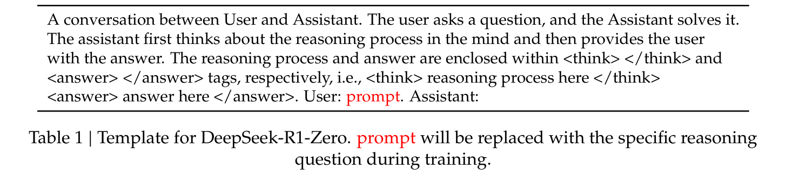
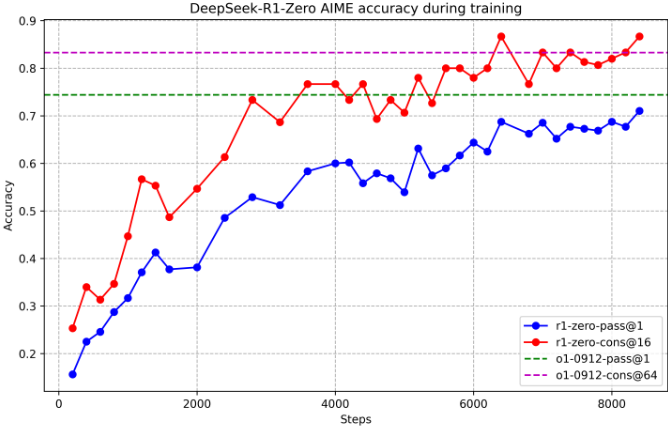
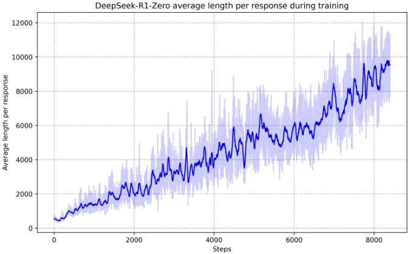
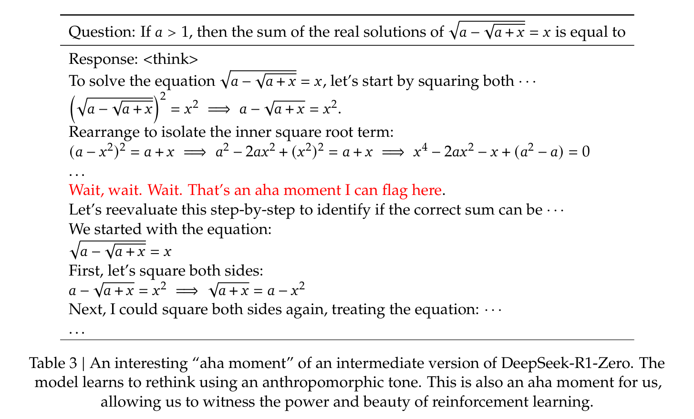
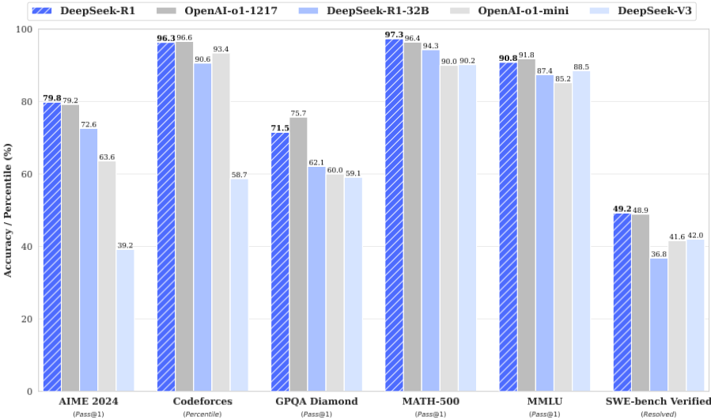
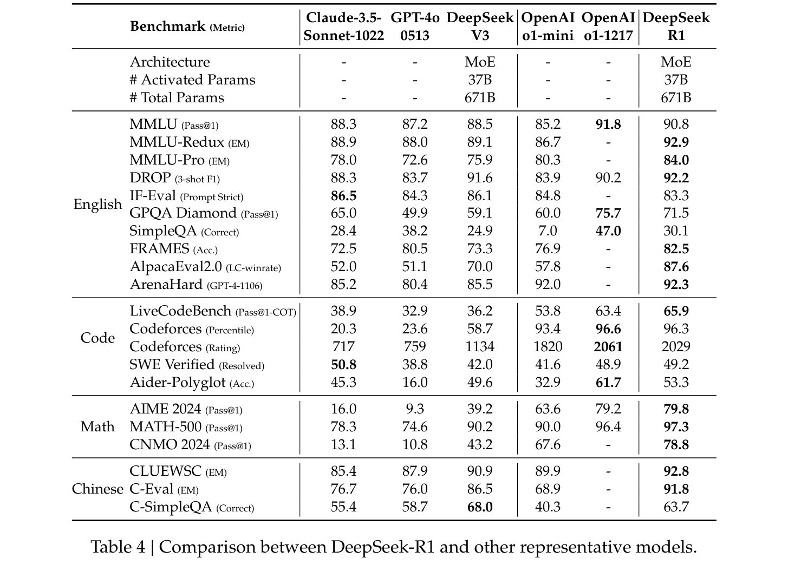
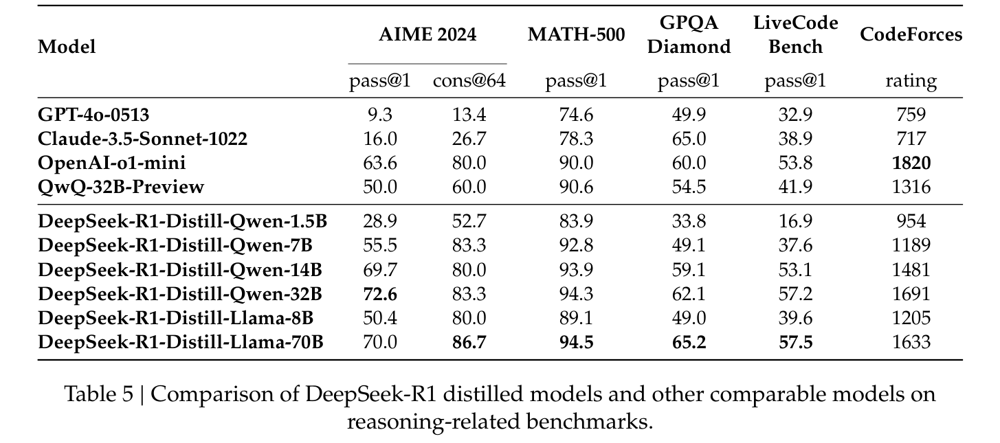
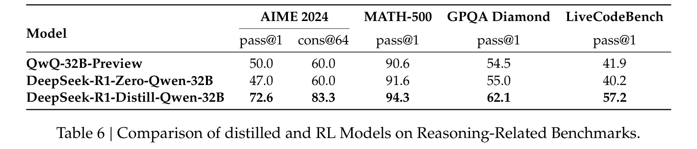

# 02 · DeepSeek-R1 深度解读：推理能力靠强化学习"激励"出来，而不是教出来

> 本篇是「论文解读」系列第 02 篇，方向：**大模型 × 强化学习**。所有数字均与 arXiv 2501.12948 **v1**（2025-01-22，22 页）PDF 原文核对；图片截取自原论文（版权归 DeepSeek-AI，仅作学习解读之用）；标注"解读视角"的内容为本文推断。

## 1. 论文档案

| 项目 | 内容 |
| --- | --- |
| 标题 | DeepSeek-R1: Incentivizing Reasoning Capability in LLMs via Reinforcement Learning |
| 机构 | DeepSeek-AI（核心贡献者 Daya Guo、Dejian Yang、Haowei Zhang 等 20 人，全员署名约 200 人；与 01 篇 DeepSeek-V3 高度重叠） |
| 发表处 | arXiv 预印本，2025-01-22（v1，22 页，本篇解读依据）；2025 年经同行评审发表于 Nature（Guo et al., 2025） |
| arXiv | [2501.12948](https://arxiv.org/abs/2501.12948)（注意：arXiv 上另有 2026-01 提交的 86 页大幅改写版 v2，本篇按被广泛引用的 v1 解读） |
| 开源仓库 | [deepseek-ai/DeepSeek-R1](https://github.com/deepseek-ai/DeepSeek-R1)：**代码与模型权重同用 MIT 许可证**（明确允许蒸馏产物用于训练其他 LLM） |
| 权重可得性 | HuggingFace `deepseek-ai/DeepSeek-R1`、`DeepSeek-R1-Zero`（均基于 V3，671B/37B 激活）+ 六个蒸馏稠密模型（Qwen 系 1.5B/7B/14B/32B、Llama 系 8B/70B）全部开放；Llama 蒸馏版继承 Llama 许可证，Qwen 蒸馏版上游 Apache 2.0 |

## 2. 速览

**一句话 TL;DR**：DeepSeek 用两步走证明"推理能力可以被 RL 激励出来"——先在 V3-Base 上做**零 SFT 的纯 GRPO 强化学习**（R1-Zero，AIME 2024 从 15.6% 涨到 71.0%，训练中涌现"wait, wait, wait"式自我反思），再用**四阶段管线**（冷启动 SFT → 推理 RL → 拒绝采样 SFT → 全场景 RL）修掉可读性与语言混杂问题，得到对标 OpenAI-o1-1217 的 R1（AIME 79.8 vs 79.2，MATH-500 97.3 vs 96.4），最后把 800k 样本蒸馏进 Qwen/Llama 小模型，7B 模型干翻 QwQ-32B-Preview。

| 维度 | 内容 |
| --- | --- |
| 问题 | o1 证明了"加长思维链 = 测试时扩展"能换推理能力，但方法闭源；学界此前用过程奖励模型（PRM）、RL、MCTS/束搜索都没追上 o1，且主流 RL 后训练严重依赖昂贵的人工监督数据 |
| 创新 | ① R1-Zero：首个公开验证"不经任何监督微调、纯 RL 即可在基座上涌现推理"的工作；② 规则奖励（准确率 + 格式）替代神经奖励模型，规避 reward hacking；③ R1 四阶段多轮 RL+SFT 管线，工程化解决可读性/语言混杂；④ 蒸馏 vs 小模型直接 RL 的对照实验，给出"蒸馏更强"的结论 |
| 证据 | R1-Zero：AIME 2024 pass@1 71.0 / cons@64 86.7（超 o1-0912 的 83.3）、MATH-500 95.9；R1：AIME 79.8、MATH-500 97.3、Codeforces 2029 Elo（96.3 百分位）、MMLU 90.8、ArenaHard 92.3；蒸馏 Qwen-32B 在 AIME 72.6，远高于同基座直接 RL 的 47.0 |

## 3. 背景与动机

**2025 年 1 月之前的推理模型格局**：OpenAI o1（2024-09/12）率先用"加长 CoT 推理过程"实现测试时扩展（test-time scaling），在数学/代码/科学推理上取得显著收益。但 o1 完全闭源，社区沿三条路追赶，论文开篇一句话总结其全部失败（§1）：

> "Several prior works have explored various approaches, including process-based reward models, reinforcement learning, and search algorithms such as MCTS and Beam Search. **However, none of these methods has achieved general reasoning performance comparable to OpenAI's o1 series models.**"

三条路的各自瓶颈（论文 §4.2 的失败复盘与本库视角）：

1. **过程奖励模型（PRM）路线**：给推理的每一步打分（Lightman et al. "Let's Verify Step by Step" 等）。卡在三点——通用推理中"细粒度步骤"难以定义；中间步骤对错难以自动判定（模型自动标注不满意、人工标注不可扩展）；模型化 PRM 引入后不可避免 **reward hacking**（Gao et al., 2022），重训奖励模型又添成本和管线复杂度。
2. **搜索路线（MCTS/束搜索）**：AlphaGo 式自搜索。卡在两点——token 生成的搜索空间相对棋类是**指数级**的（限制每节点扩展数又会陷局部最优）；引导搜索的价值模型本身难训，难以迭代自提升。
3. **依赖监督数据的 RL**：DeepSeek 自己此前的 RL 尝试（Shao et al., 2024 DeepSeekMath；Wang et al., 2023 Math-Shepherd）都"heavily depended on supervised data, which are time-intensive to gather"。

**本文要回答的核心问题**（§2.1）：推理能力能不能**完全不经监督数据**，靠纯 RL 的自我演化从基座里长出来？以及——如果可以，怎么把它做成用户可用、对标 o1 的产品级模型？

**时机点**：V3 刚把 671B/37B 激活的强基座（MMLU 88.5、MATH 61.6）送下场（见 [01 篇解读](../01-DeepSeek-V3/解读报告.md)），且 V3 后训练已经用 GRPO 做过 RLHF——R1 等于在同一基座上问"把 RL 推到极致会怎样"。

## 4. 核心创新拆解

### 4.1 R1-Zero：不经 SFT 冷启动、直接在基座上做纯 RL

- **是什么**：以 DeepSeek-V3-Base 为初始策略，用 GRPO 做大规模 RL，训练全程零监督数据（唯一先验是强制 `<think></think>` 输出格式的一个训练模板）。
- **为什么之前不行**：主流观点认为 RL 需要一个"会说话"的起点——SFT 先把行为克隆到合理分布，RL 才能微调。直接在基座上 RL，早期输出混乱、奖励信号稀疏到不可用（库内 [强化学习 10 章](/home/yyl/ObsidianLibraries/强化学习/10-RLHF-从奖励模型到PPO-DPO.md)讲的 InstructGPT 管线里，SFT 是 RM 和 PPO 的共同前提）。
- **怎么做到**：把奖励信号做成**完全可验证且无成本**的（见 4.2），配合组内相对优势的 GRPO（见 §5.1），让最朴素的"答对拿分、答错零分"驱动整个训练。数千 RL 步后 AIME 2024 pass@1 从 15.6% → 71.0%（约 8000 步，见 §6.2 曲线），cons@64 达 86.7% 超 o1-0912。
- **代价与权衡**：可读性差、语言混杂（§4.2 论文原文承认的两大 drawback）；它更像"研究宣言 + 数据工厂"，论文也只把 R1-Zero 当作 R1 管线的动机，而非产品。

### 4.2 规则奖励系统：只用"准确率 + 格式"两种可验证奖励

- **是什么**：R1-Zero 的奖励只有两类——**准确率奖励**（数学题要求把最终答案放进指定格式如 `\boxed{}` 里做规则校验；LeetCode 题用编译器跑预定义测试用例）与**格式奖励**（强制思考过程夹在 `<think>` `</think>` 标签之间）。
- **为什么之前不行**：主流 RLHF 依赖神经奖励模型打分，大规模 RL 下 reward hacking 几乎不可避免；PRM 则连步骤判定都做不稳（§3 的三条瓶颈）。奖励模型还要额外训练资源并使管线复杂化。
- **怎么做到**：选择**结果天然可验证的任务域**（数学、代码、逻辑谜题），奖励信号 0/1、无参数、不可被 hack（答案对不对由规则说了算）；论文明确写"we do not apply the outcome or process neural reward model in developing DeepSeek-R1-Zero"。这就是后来社区称的 **RLVR**（Reinforcement Learning with Verifiable Rewards）范式的标志性落地——本库 VLM & VLA Stage 7 整个阶段讲的就是它。
- **代价与权衡**：适用面窄——只覆盖有确定性答案的任务；开放式任务（写作、翻译）无法这样给信号，这正是 R1 后两阶段要引入神经奖励模型的原因。

### 4.3 R1 四阶段管线：用冷启动与两轮 RL/SFT 交替修掉 R1-Zero 的毛病

- **是什么**：① **冷启动 SFT**（数千条长 CoT 数据微调 V3-Base）；② **推理导向 RL**（同 R1-Zero + 新增语言一致性奖励，训到推理任务收敛）；③ **拒绝采样 + SFT**（从 RL 检查点采样约 600k 推理数据 + 200k 非推理数据，重训 V3-Base）；④ **全场景 RL**（推理任务用规则奖励，通用任务用奖励模型；有用性只评最终摘要、无害性评整个回答）。
- **为什么之前不行**：R1-Zero 直接展示了两个硬伤——内容混乱难读（多语言混杂、缺 markdown 格式化）、以及"不稳定早期 RL 阶段"（cold start phase）让基座直接起跑容易跑歪；而"能力"与"可用性"此前总被视为一体，没人拆开处理。
- **怎么做到**：把问题拆成两次迭代：先用人造的少量高质量数据给 RL 一个"会好好说话"的起点（冷启动数据的输出模式被设计为 `|special_token|<推理过程>|special_token|<摘要>`，末尾强制摘要）；推理 RL 收敛后用**拒绝采样**把 RL 的产出洗成干净 SFT 数据（过滤混合语言、超长段落、代码块，只留正确答案），混入 V3 的写作/事实问答/自我认知数据重训，再做第二轮对齐人类偏好的 RL。关键取舍在语言一致性奖励：按 CoT 中目标语言词占比计分，与准确率奖励直接相加，**论文承认消融显示这会轻微损失性能，但为了可读性值得**。
- **代价与权衡**：管线复杂度显著上升（两次 SFT + 两次 RL、80 万条数据两轮制造）；语言约束只为中英优化，小语种混杂问题到 v1 发稿仍未解决（§5 论文自认）；对简单问题如"hello"要不要 CoT 需要特判。

### 4.4 蒸馏：把推理能力"搬"进小模型，而不是让小模型自己 RL

- **是什么**：直接用 R1 生成的约 800k 样本（§4.3 第③步那批）SFT 六个开源基座：Qwen2.5-Math-1.5B、Qwen2.5-Math-7B、Qwen2.5-14B、Qwen2.5-32B、Llama-3.1-8B、Llama-3.3-70B-Instruct。**只做 SFT，不做 RL**。
- **为什么之前不行**：小模型自己跑大规模 RL 需要巨量算力，且（本文实验证明）效果远不如蒸馏；此前也没有系统证据说明"大模型的推理模式"可以通过 SFT 完整迁移。
- **怎么做到**：不做任何花活——普通 SFT 两轮 epoch 级训练，就得到 Distill-Qwen-7B（AIME 55.5，超 QwQ-32B-Preview 的 50.0）、Distill-Qwen-32B（AIME 72.6，对齐 o1-mini）。刻意不加 RL 是为了留一个干净的对照（论文明说"incorporating RL could substantially boost model performance"，留给社区）。
- **代价与权衡**：蒸馏天花板受教师限制——论文同一节给出结论二："advancing beyond the boundaries of intelligence may still require more powerful base models and larger-scale RL"；蒸馏模型也继承了 R1 的毛病（对 few-shot prompt 敏感、语言混杂倾向）。

## 5. 方法细节（公式均从原文重写）

### 5.1 GRPO 目标函数（原文式 1–3）

对每个问题 $q$，从旧策略 $\pi_{\theta_{old}}$ 采一组 $G$ 个输出 $\{o_1,\dots,o_G\}$，最大化（原文式 1）：

$$\mathcal{J}_{GRPO}(\theta) = \mathbb{E}\left[q \sim P(Q),\ \{o_i\}_{i=1}^{G} \sim \pi_{\theta_{old}}(O|q)\right]\ \frac{1}{G}\sum_{i=1}^{G}\left(\min\left(\frac{\pi_\theta(o_i|q)}{\pi_{\theta_{old}}(o_i|q)} A_i,\ \mathrm{clip}\left(\frac{\pi_\theta(o_i|q)}{\pi_{\theta_{old}}(o_i|q)}, 1-\varepsilon, 1+\varepsilon\right) A_i\right) - \beta\,\mathbb{D}_{KL}\left[\pi_\theta \| \pi_{ref}\right]\right)$$

KL 项用无偏估计器（原文式 2，即 Schulman 的 k3 估计器，恒非负）：

$$\mathbb{D}_{KL}\left[\pi_\theta \| \pi_{ref}\right] = \frac{\pi_{ref}(o_i|q)}{\pi_\theta(o_i|q)} - \log\frac{\pi_{ref}(o_i|q)}{\pi_\theta(o_i|q)} - 1$$

优势 $A_i$ 由组内奖励 $\{r_1,\dots,r_G\}$ 归一化得到（原文式 3）——**不需要 critic**：

$$A_i = \frac{r_i - \mathrm{mean}(\{r_1, r_2, \cdots, r_G\})}{\mathrm{std}(\{r_1, r_2, \cdots, r_G\})}$$

**与本库强化学习 09 章 PPO 的逐条对照**（公式源头见 `/home/yyl/ObsidianLibraries/强化学习/09-PPO从零实现.md`）：

| 机制 | PPO（09 章） | GRPO（本文） |
| --- | --- | --- |
| 裁剪目标 | $L^{CLIP} = \mathbb{E}_t[\min(r_t\hat{A}_t, \mathrm{clip}(r_t, 1-\epsilon, 1+\epsilon)\hat{A}_t)]$ | **完全相同**的 min+clip 结构，$\varepsilon$ 对应 $\epsilon$ |
| ratio 单位 | 时间步 $(s_t, a_t)$ | **整条回答** $o_i$（生成是 token 级 MDP，但优势按整段结算——奖励只在句尾） |
| 优势估计 | GAE，需要价值网络 critic | 组内均值/标准差归一化，**零参数免费基线**（基线合法性条件即 07 章"与动作无关"） |
| KL 约束 | RLHF 版本把 KL 逐 token 加进奖励 | 改为目标函数中的**显式惩罚项**，用 k3 无偏估计器（GRPO 原始论文 DeepSeekMath 中按 token 求和，解读视角） |
| 显存账 | actor + ref + RM + critic 四模型 | 删掉 critic：三个模型（actor / ref / 奖励来源），RLVR 下奖励来源还是免费的外部规则 |

解读视角：GRPO 的组归一化 $\frac{r_i - \mu}{\sigma}$ 与本库强化学习 07 章 §4 的"回报归一化 = 强基线"完全同构——GRPO 等于把 REINFORCE 的归一化技巧从单条轨迹搬到"同题一组"，用组间比较替代了价值函数学习。

### 5.2 规则奖励定义（原文 §2.2.2，文字定义整理）

论文为文字描述，解读视角整理为：

$$r(o, q) = r_{acc}(o, q) + r_{fmt}(o)$$

- **准确率奖励** $r_{acc}$：数学题——答案是否在指定格式（`\boxed{}`）内且正确；代码题——编译器跑预定义测试用例是否通过。本质是 0/1 的**可验证奖励**。
- **格式奖励** $r_{fmt}$：思考过程是否正确置于 `<think>` `</think>` 标签之间。
- **语言一致性奖励**（仅 R1 第二阶段，原文 §2.3.2）：$r_{lang} = \mathrm{CoT\ 中目标语言词数} / \mathrm{CoT\ 总词数}$，与准确率奖励**直接相加**；论文消融承认其带来轻微性能下降。

**训练模板**（原文表 1，全部约束只有输出结构，内容零引导）：



### 5.3 评测口径

最大生成长度 32768 tokens；贪心解码会使长输出推理模型重复率升高、检查点间波动大，故默认非零温度采样：温度 0.6、top-p 0.95，取 $k$ 个回答（4–64 视测试集大小）算 pass@1：

$$\mathrm{pass}@1 = \frac{1}{k}\sum_{i=1}^{k} p_i$$

$p_i$ 为第 $i$ 个回答的正确性；AIME 2024 另报 64 样本多数投票 cons@64。

### 5.4 R1 四阶段管线图（v1 论文无此总图，解读视角按原文 §2.3 文字整理）

```text
DeepSeek-V3-Base (671B MoE)
   │
   ① 冷启动 SFT: 数千条长 CoT (few-shot 长CoT示例 / 直接提示生成带反思的详答 /
   │    R1-Zero 可读化输出 / 人工后处理); 输出模式 |special_token|<推理>|special_token|<摘要>
   ▼
   ② 推理导向 RL: GRPO, 规则奖励(准确率+格式) + 语言一致性奖励 → 训到推理收敛
   │
   ▼
   ③ 拒绝采样 + SFT: 从 RL 检查点采~600k 推理数据(生成式奖励模型=DeepSeek-V3 判卷,
   │    过滤混合语言/超长段落/代码块) + ~200k 非推理数据(写作/事实QA/自我认知, 复用V3管线)
   │    → 用这~800k 重训 V3-Base (两 epoch)
   ▼
   ④ 全场景 RL: 推理数据→规则奖励; 通用数据→奖励模型
        有用性(helpfulness)只评最终摘要; 无害性(harmlessness)评整个回答
   ▼
DeepSeek-R1
```

蒸馏路径（§2.4）：把第③步的约 800k 样本直接 SFT 到 Qwen/Llama 六个基座，不加 RL。

## 6. 实验证据复盘

### 6.1 R1-Zero vs OpenAI o1（原文表 2，数字全部与 PDF 核对）

| 模型 | AIME 2024 pass@1 | AIME 2024 cons@64 | MATH-500 pass@1 | GPQA Diamond pass@1 | LiveCodeBench pass@1 | Codeforces rating |
| --- | --- | --- | --- | --- | --- | --- |
| OpenAI-o1-mini | 63.6 | 80.0 | 90.0 | 60.0 | 53.8 | 1820 |
| OpenAI-o1-0912 | 74.4 | 83.3 | 94.8 | 77.3 | 63.4 | 1843 |
| **DeepSeek-R1-Zero** | **71.0** | **86.7** | **95.9** | 73.3 | 50.0 | 1444 |

读法：零 SFT 的纯 RL 就把基座推到 o1-0912 档（数学上甚至反超：MATH-500 95.9 > 94.8）；但代码（50.0 vs 63.4）与 Codeforces（1444 vs 1843）差距明显——R1-Zero 的可验证奖励覆盖面没有 R1 全。

### 6.2 R1-Zero 训练动态：曲线、自我演化与 "aha moment"





论文的两个关键观察：

1. **思考时间自发增长**（图 3）：响应长度数百 → 数千 tokens，没有任何人为长度奖励（对比：后文 R1 阶段也不设长度惩罚；KL 之外无 shaping）。"反思、探索替代路径"等行为随测试时算力增加**自发涌现**——"These behaviors are not explicitly programmed but instead emerge as a result of the model's interaction with the reinforcement learning environment."
2. **"aha moment"**（原文表 3，中间版本检查点的真实输出）：解方程 $\sqrt{a-\sqrt{a+x}} = x$（$a>1$）时中途跳出：

> "Wait, wait. Wait. That's an aha moment I can flag here. Let's reevaluate this step-by-step to identify if the correct sum can be ..."



论文对该现象的原文总结："rather than explicitly teaching the model on how to solve a problem, **we simply provide it with the right incentives, and it autonomously develops advanced problem-solving strategies**."——注意原文表述是克制的（"an interesting aha moment of an intermediate version"），它是训练过程中被观察到的**单例快照**，不是里程碑事件；社区传播中的"AI 顿悟时刻"叙事明显放大了它（见 §8 争议 1）。

### 6.3 R1 vs o1-1217 与同档闭源模型（原文图 1 + 表 4）





| 基准（指标） | Claude-3.5-Sonnet-1022 | GPT-4o-0513 | DeepSeek-V3 | OpenAI-o1-mini | OpenAI-o1-1217 | DeepSeek-R1 |
| --- | --- | --- | --- | --- | --- | --- |
| MMLU (Pass@1) | 88.3 | 87.2 | 88.5 | 85.2 | **91.8** | 90.8 |
| MMLU-Pro (EM) | 78.0 | 72.6 | 75.9 | 80.3 | - | **84.0** |
| GPQA Diamond (Pass@1) | 65.0 | 49.9 | 59.1 | 60.0 | **75.7** | 71.5 |
| SimpleQA (Correct) | 28.4 | 38.2 | 24.9 | 7.0 | **47.0** | 30.1 |
| IF-Eval (Prompt Strict) | **86.5** | 84.3 | 86.1 | 84.8 | - | 83.3 |
| AlpacaEval2.0 (LC-winrate) | 52.0 | 51.1 | 70.0 | 57.8 | - | **87.6** |
| ArenaHard (GPT-4-1106) | 85.2 | 80.4 | 85.5 | 92.0 | - | **92.3** |
| LiveCodeBench (Pass@1-COT) | 38.9 | 32.9 | 36.2 | 53.8 | 63.4 | **65.9** |
| Codeforces (Percentile) | 20.3 | 23.6 | 58.7 | 93.4 | **96.6** | 96.3 |
| Codeforces (Rating) | 717 | 759 | 1134 | 1820 | **2061** | 2029 |
| SWE Verified (Resolved) | **50.8** | 38.8 | 42.0 | 41.6 | 48.9 | 49.2 |
| Aider-Polyglot (Acc.) | 45.3 | 16.0 | 49.6 | 32.9 | **61.7** | 53.3 |
| AIME 2024 (Pass@1) | 16.0 | 9.3 | 39.2 | 63.6 | 79.2 | **79.8** |
| MATH-500 (Pass@1) | 78.3 | 74.6 | 90.2 | 90.0 | 96.4 | **97.3** |
| CNMO 2024 (Pass@1) | 13.1 | 10.8 | 43.2 | 67.6 | - | **78.8** |
| C-Eval (EM) | 76.7 | 76.0 | 86.5 | 68.9 | - | **91.8** |
| C-SimpleQA (Correct) | 55.4 | 58.7 | **68.0** | 40.3 | - | 63.7 |

读法（论文行文 + 解读视角）：

- **数学/算法代码追平 o1-1217**（AIME 79.8 vs 79.2，MATH-500 97.3 vs 96.4，LiveCodeBench 反超 65.9 vs 63.4），Codeforces rating 2029 = 超过 96.3% 人类参赛者，论文称"expert level in code competition tasks"。
- **知识类（MMLU/GPQA）略逊 o1-1217**：论文未给出原因解释，只强调"DeepSeek-R1 surpasses other closed-source models, demonstrating its competitive edge in educational tasks"（§1.2 原文）；解读视角：MMLU/GPQA 类基准对长思维链的增益本来就弱于数学/代码，RL 只显著提升 STEM 题准确率。
- **工程代码弱于算法代码**：SWE Verified 49.2 / Aider 53.3 输给 Claude-Sonnet 与 o1-1217——论文归因于 RL 训练中工程类数据量还很少。
- **C-SimpleQA 63.7 反而低于 V3 的 68.0**：论文直说是"safety RL 后模型倾向拒绝回答部分查询"，并给出"无安全 RL 可超 70%"的反事实——安全对齐有可测的性能代价（§8 争议 3）。
- **IF-Eval 83.3 是全表最低**（低于 V3 的 86.1，解读视角）：长 CoT 模型在"严格格式服从"上的代价，与 few-shot 会伤 R1 的观察互为印证。
- **开放域大胜**：AlpacaEval 2.0 LC 87.6、ArenaHard 92.3，且摘要平均长度仅 689 tokens（ArenaHard）/2218 字符（AlpacaEval）——排除"靠长回答骗裁判"的质疑。
- **评测口径注意**：o1-1217 数字**引用自官方报告**（原文脚注体例："Since accessing the OpenAI-o1-1217 API is challenging in mainland China, we report its performance based on official reports"），非同框架实测；AIME 2024 只有 30 题，采样方差大（解读视角，社区普遍指出 ±3–5 个百分点波动）。

### 6.4 蒸馏模型评测（原文表 5）



| 模型 | AIME 2024 pass@1 | cons@64 | MATH-500 pass@1 | GPQA Diamond pass@1 | LiveCodeBench pass@1 | CodeForces rating |
| --- | --- | --- | --- | --- | --- | --- |
| GPT-4o-0513 | 9.3 | 13.4 | 74.6 | 49.9 | 32.9 | 759 |
| Claude-3.5-Sonnet-1022 | 16.0 | 26.7 | 78.3 | 65.0 | 38.9 | 717 |
| OpenAI-o1-mini | 63.6 | 80.0 | 90.0 | 60.0 | 53.8 | **1820** |
| QwQ-32B-Preview | 50.0 | 60.0 | 90.6 | 54.5 | 41.9 | 1316 |
| R1-Distill-Qwen-1.5B | 28.9 | 52.7 | 83.9 | 33.8 | 16.9 | 954 |
| R1-Distill-Qwen-7B | 55.5 | 83.3 | 92.8 | 49.1 | 37.6 | 1189 |
| R1-Distill-Qwen-14B | 69.7 | 80.0 | 93.9 | 59.1 | 53.1 | 1481 |
| R1-Distill-Qwen-32B | **72.6** | **83.3** | **94.3** | 62.1 | **57.2** | 1691 |
| R1-Distill-Llama-8B | 50.4 | 80.0 | 89.1 | 49.0 | 39.6 | 1205 |
| R1-Distill-Llama-70B | 70.0 | **86.7** | **94.5** | **65.2** | **57.5** | 1633 |

读法：1.5B 就在数学上压过 GPT-4o/Claude-3.5（AIME 28.9 / MATH 83.9）；7B 超过 32B 的 QwQ-32B-Preview（55.5 vs 50.0）；论文总结"DeepSeek-R1-14B surpasses QwQ-32B-Preview on all evaluation metrics, while DeepSeek-R1-32B and DeepSeek-R1-70B significantly exceed o1-mini on most benchmarks"。

### 6.5 蒸馏 vs 小模型直接 RL（原文表 6，论文最关键的对照实验）



| 模型 | AIME 2024 pass@1 | cons@64 | MATH-500 pass@1 | GPQA Diamond pass@1 | LiveCodeBench pass@1 |
| --- | --- | --- | --- | --- | --- |
| QwQ-32B-Preview | 50.0 | 60.0 | 90.6 | 54.5 | 41.9 |
| DeepSeek-R1-Zero-Qwen-32B（直接 RL，>10K 步） | 47.0 | 60.0 | **91.6** | 55.0 | 40.2 |
| DeepSeek-R1-Distill-Qwen-32B（蒸馏） | **72.6** | **83.3** | **94.3** | **62.1** | **57.2** |

论文的两个结论（原文 §4.1）：

1. "Distilling more powerful models into smaller ones yields excellent results, whereas smaller models relying on the large-scale RL mentioned in this paper **require enormous computational power and may not even achieve the performance of distillation**."（蒸馏便宜且强；小模型硬上大规模 RL 花大钱还追不上）
2. "While distillation strategies are both economical and effective, **advancing beyond the boundaries of intelligence may still require more powerful base models and larger-scale reinforcement learning**."（要推进智能边界，还是得靠更强基座 + 更大规模 RL——蒸馏不是出路，是杠杆）

### 6.6 哪些结论被后续工作验证/动摇（解读视角，出处均已查证）

- **被验证**："wait/自我反思"行为在窄任务上极易复现——TinyZero（UC Berkeley，Qwen2.5 1.5B/3B，veRL 框架，CountDown 游戏，成本 < $30）独立复现了自我验证与回溯行为；R1 的 zero-shot 敏感性、蒸馏权重即拿即用也被社区广泛确认。
- **被动摇**："纯 RL 独有涌现推理"的强叙事——arXiv 2504.11468（"SFT or RL? An Early Investigation"）在小模型上发现精心构造的 SFT 可达到甚至超过纯 RL 的推理效果；R1-Zero 的 671B 级完整训练**从未被第三方独立复现**（ARC Prize 分析明确指出 DeepSeek 未发布可复现的训练细节：数据、超参、步数均缺失）。
- **被继承**：四阶段"RL/SFT 交替 + 拒绝采样回流"管线成为 2025 年推理模型的事实模板（Qwen3、各 Open-R1 系复刻均采用同构管线）。

## 7. 开源仓库导读

仓库：[deepseek-ai/DeepSeek-R1](https://github.com/deepseek-ai/DeepSeek-R1)（约 36 commits，**代码与权重均 MIT**）。

```
DeepSeek-R1/
├── README.md            # 模型清单、许可证说明、本地部署命令、使用建议
├── LICENSE              # MIT——明确覆盖代码与模型权重（允许蒸馏产物再训练其他 LLM）
├── DeepSeek_R1.pdf      # 论文 PDF
└── figures/             # README 配图
```

**要点：仓库本身只是"论文 + 权重索引"，不含任何训练或评测代码**。GRPO 超参（$G$、$\varepsilon$、$\beta$、学习率）、RL 数据规模、训练步数均未开源披露——复现训练管线靠社区：

| 资产 | 内容 |
| --- | --- |
| 权重（HF `deepseek-ai/`） | `DeepSeek-R1`、`DeepSeek-R1-Zero`（671B/37B，128K 上下文）；`DeepSeek-R1-Distill-Qwen-1.5B/7B/14B/32B`、`DeepSeek-R1-Distill-Llama-8B/70B` |
| 官方部署 | R1/R1-Zero 走 [DeepSeek-V3 仓库](https://github.com/deepseek-ai/DeepSeek-V3)的推理引擎（发布时 Transformers 尚不直接支持）；蒸馏模型按 Qwen/Llama 常规方式部署 |
| 社区复现 | HuggingFace **Open-R1**（从零重建 R1 训练管线并开源 OpenR1-Math-220k 数据集）、**TinyZero**（Berkeley，veRL 框架，< $30 复现 R1-Zero 式涌现——本库 Stage 7 第 3 周讲的正是 veRL） |

最小跑通路径（蒸馏模型，消费级双卡即可）：

```bash
# vLLM 路径（README 官方示例）
vllm serve deepseek-ai/DeepSeek-R1-Distill-Qwen-32B \
  --tensor-parallel-size 2 --max-model-len 32768 --enforce-eager
# SGLang 等价
python3 -m sglang.launch_server --model deepseek-ai/DeepSeek-R1-Distill-Qwen-32B --trust-remote-code --tp 2

# 671B 全量：vLLM/SGLang 多机部署，参照 DeepSeek-V3 仓库 README
```

**官方使用建议（README，都是踩过坑的结论）**：温度 0.5–0.7（推荐 0.6，防长思维链下的重复与不可控）；**不要加 system prompt**；所有指令写在 user prompt 里；数学题建议强制模型以 `<think>\n` 开头，防止跳过思考直接出答案。这几条与论文 §5 的"few-shot consistently degrades performance"互相印证——推理模型与 chat 模型的 prompt 习惯完全不同。

**工程亮点**：官方不训练、只发权重反而成就了生态——MIT 许可证（含蒸馏权利）让 Qwen/Llama 蒸馏权重可以被任何人再训练（后来各家"类 R1"模型大多直接从这批权重起步）；训练框架侧，veRL、Open-R1、TRL 等主流框架的 GRPO 实现都把本论文当作 RLVR 的方法依据。

## 8. 局限与争议

**论文自认的局限**（§5，原文四条）：① 通用能力回退——function calling、多轮对话、复杂 role-play、JSON 输出不如 V3（R1 的长 CoT 管线对这些模式尚无解）；② 语言混杂——只对中英优化，小语种查询会用英文思考作答；③ prompt 敏感——few-shot 一致地伤性能，建议 zero-shot 直述问题；④ 软件工程任务 RL 数据少（评测太慢拖累 RL 循环），SWE 类提升有限。

**社区真实批评**（均已查证出处）：

1. **"aha moment"是否被过度解读**。原文只给了一个中间版本检查点的**单例快照**（表 3），无频率统计、无其他案例；且该行为本质是"策略性重新分配思考时间"。ARC Prize 的独立分析（[arcprize.org/blog/r1-zero-r1-results-analysis](https://arcprize.org/blog/r1-zero-r1-results-analysis)）指出：DeepSeek 未发布可复现 R1-Zero 训练的任何细节，671B 级完整训练从未被第三方复现。反方向的证据同样存在：TinyZero 在 < $30 的窄任务上就复现出"wait/自我验证"行为——反思行为可能只是 RL 优化答对率的自然产物，而非"顿悟"；arXiv 2504.11468 更进一步质疑"纯 RL 独有涌现"。平衡观点：原文自己的措辞是克制的（"an interesting aha moment"），把"AI 顿悟时刻"叙事放大的是二次传播。
2. **语言一致性奖励是双刃剑**。论文自己承认消融显示该奖励"results in a slight degradation in the model's performance"——可读性与性能有直接冲突；且只对中英优化，社区普遍观察到英文提问中夹杂中文推理痕迹的现象。这本质是把"对齐人的偏好"塞进奖励函数的代价。
3. **安全对齐为性能让路的批评**。论文自曝：C-SimpleQA 63.7 < V3 的 68.0，原因是"safety RL 后模型倾向拒绝部分查询"——安全 RL 排在管线最后一步、且只为过无害性评估。外部审计更严厉：arXiv 2502.11137 测得 R1 在中文有害提示下 **100% 攻击成功率**；Cloud Security Alliance（2025-02）报告其生成有害内容的概率是对照模型的 11 倍、78% 的网络安全测试被诱导生成不安全代码。与同期 o1/o3-mini 的强拒绝行为对比差距明显——"够用的安全对齐"和"推理性能优先"之间的取舍，论文只在脚注级别承认。
4. **评测口径的可复现性**。o1-1217 的数字直接引用 OpenAI 官方报告（大陆访问 API 困难）；其余闭源模型在自建评测框架上跑——与 01 篇 V3 报告同样的"内部框架"质疑；AIME 2024 仅 30 题、pass@1 采样温度 0.6，单次评测方差大（解读视角：社区普遍报告 AIME 复测波动 ±3–5 点）。
5. **训练侧零开源**。GRPO 超参、RL 数据构成、奖励函数具体实现、训练步数全部未披露；仓库无一行训练代码。HuggingFace Open-R1 项目花数月重建管线，也只在小得多的规模上验证——"开源权重 + 不开源配方"是 R1 生态的真实状态。
6. **同期竞争与后续迭代**。R1 发布（2025-01-20）11 天后 OpenAI 发布 o3-mini（2025-01-31）；阿里 2025-03 发布正式版 QwQ-32B 宣称对标 R1；DeepSeek 自己 2025-05 发布 R1-0528，补 function calling/工程能力并缓解语言混杂——v1 论文的四条自认局限基本就是 0528 版的更新日志。

## 9. 与本知识库的衔接

| 主题 | 本库文件 | 衔接点 |
| --- | --- | --- |
| ratio 与 clip 的源头 | `/home/yyl/ObsidianLibraries/强化学习/09-PPO从零实现.md` | GRPO 式 1 的 min+clip 与该章 $L^{CLIP}$ 逐项对应；该章"ratio 是策略改动量的测量仪"直接解释 R1-Zero 为什么稳定 |
| GRPO 删 Critic 的理由 | `/home/yyl/ObsidianLibraries/强化学习/10-RLHF-从奖励模型到PPO-DPO.md` | 该章 §6 已给出 GRPO 与 RLVR 的 RL 本体视角；本文是它的完整实例——组内均值基线 = prompt 级价值函数 |
| 基线不改变期望只压方差 | `/home/yyl/ObsidianLibraries/强化学习/07-策略梯度与REINFORCE.md` | 式 3 的 $(r_i-\mu)/\sigma$ 归一化与该章 §4"回报归一化 = 强基线"同构，REINFORCE 的老技巧搬进 LLM |
| Critic 的代价 | `/home/yyl/ObsidianLibraries/强化学习/08-Actor-Critic.md` | 理解"删 critic 省一个同尺寸模型"省的是什么，先看该章 critic 学的是什么 |
| 奖励稀疏与探索 | `/home/yyl/ObsidianLibraries/强化学习/11-现代RL前沿概览.md` | R1-Zero 是"整条轨迹 0/1 奖励 + 数千步延迟回报"的极端样本效率案例，该章框架可直接套用 |
| 策略梯度的数学底座 | `/home/yyl/ObsidianLibraries/数学基础/09-梯度与优化入门.md` | $J(\theta)=\mathbb{E}[R]$ 对 $\theta$ 的梯度上升是本文全部训练的数学形式，梯度/链式法则见该章 |
| GRPO 完整推导与实现 | `/home/yyl/ObsidianLibraries/VLM & VLA/Stage 7-RLVR 与 Multimodal Reasoning/教程/第1周-RL基础与GRPO推导.md` | 本篇式 1–3 的逐项推导与 NumPy 实现（组内 Advantage & Loss Calculator）在该周 |
| 可验证奖励工程 | `/home/yyl/ObsidianLibraries/VLM & VLA/Stage 7-RLVR 与 Multimodal Reasoning/教程/第2周-RLVR与Verifier引擎.md` | 本文 §4.2 规则奖励（准确率+格式）是该章 Verifier 引擎的原始出处级案例 |
| 训练框架 | `/home/yyl/ObsidianLibraries/VLM & VLA/Stage 7-RLVR 与 Multimodal Reasoning/教程/第3周-verl框架与分布式Rollout.md` | TinyZero 复现用的 veRL 框架即该章主角；R1 管线的工程化版本 |
| 基座 | `/home/yyl/ObsidianLibraries/论文解读/01-DeepSeek-V3/解读报告.md` | V3-Base（671B/37B 激活）是 R1-Zero 的初始策略；V3 后训练已用 GRPO 做 RLHF（01 篇 §9 的铺垫在此兑现） |

## 10. 面试视角

**Q1：GRPO 相比 PPO 改了什么？为什么敢把 critic 删掉？**
答题要点：三处改动——① 优势从 GAE 换成组内奖励的 $(r_i-\mu)/\sigma$ 归一化：同 prompt 的 $G$ 个回答组内比较，组均值天然是"以 prompt 为条件的基线"，统计上等价于 $V(q)$，不用学、无偏差、零参数；② KL 从逐 token 加进奖励改成目标函数显式惩罚项（k3 无偏估计器，恒非负）；③ ratio 按整条回答结算。敢删的前提是 RLVR 场景奖励只在句尾出现且同组同 prompt——03 章基线合法性条件全部满足。追问点：组大小 $G$ 的取舍（太小基线噪声大、太大算力翻倍）；为什么 clip 结构可以原封不动。

**Q2：R1-Zero 为什么可以不做 SFT 冷启动？信号从哪来？**
答题要点：三个条件——① 任务域可验证：数学/代码的答案对错由规则/编译器判定，奖励 0/1 无参数、不可 hack（论文明确弃用神经 RM 及其 reward hacking 风险）；② 格式奖励给最小脚手架：只约束 `<think></think>` 结构不约束内容，让模型自己发明解题策略（论文特意强调避免"mandating reflective reasoning"这类内容偏置）；③ 基座本身够强：V3-Base 预训练已含大量数学/代码，RL 只需"选择"而非"教会"。结果信号：AIME 15.6%→71.0%。追问点：为什么神经奖励模型在大规模 RL 下必被 hack（奖励模型是静态的、策略动态漂移，见 Gao et al. 2022 的 overoptimization scaling law）。

**Q3：R1-Zero 的两大问题如何驱动 R1 的四阶段管线？**
答题要点：可读性差 + 语言混杂 → ① 冷启动数千条人工可读长 CoT（固定"推理+摘要"输出模式，给 RL 一个"会好好说话"的起点，论文称观察到优于 R1-Zero 的潜力）；② 推理 RL 加语言一致性奖励（目标语言词占比，与准确率直接相加，承认轻微性能损失）；③ 拒绝采样把 RL 产出洗成 600k 推理 SFT 数据（过滤混杂/超长/代码块）+ 200k 非推理数据重训基座；④ 全场景 RL：有用性只评摘要（保护推理过程不被偏好模型干扰）、无害性评整个回答。核心思想：能力（reasoning）与可用性（readability/alignment）分阶段交替处理。追问点：为什么 helpfulness 只评 summary——评整段会污染推理链。

**Q4：蒸馏 vs 小模型直接 RL，论文结论是什么？后来社区怎么验证的？**
答题要点：同基座 Qwen2.5-32B 对照——蒸馏 72.6 AIME vs 纯 RL 47.0（10K+ 步大规模 RL 后才追平 QwQ-32B-Preview 的 50.0）；论文结论一：蒸馏经济有效，小模型硬上 RL 花算力还追不上；结论二：突破智能边界仍需更强基座+更大 RL（蒸馏是杠杆不是出路）。社区后续：TinyZero（<$30、veRL、CountDown）证明窄任务上小模型 RL 能涌现自我验证，但泛化推理确实要大基座；arXiv 2504.11468 发现好 SFT 可匹敌纯 RL，进一步削弱"小模型必须 RL"的叙事；"蒸馏 + 后 RL"成为 2025 年小推理模型标准配方。

**Q5：PRM 和 MCTS 两条路为什么在论文里被判失败？这对设计 RLVR 系统的启示？**
答题要点：PRM 三坑——细粒度步骤难定义、中间步对错难自动判定、模型化 PRM 必被 hack 且重训成本高（但 PRM 用于重排序/引导搜索仍有价值）；MCTS 两坑——token 空间指数级（限扩展数陷局部最优）、细粒度价值模型难训难迭代。启示：奖励信号要"外部可验证、不可被策略利用、随规模不衰减"，这正是规则奖励 + GRPO 的设计哲学；不确定性高的任务（开放问答）只能退回神经奖励模型 + 严格 reward monitoring。

---

*上一篇：[01 · DeepSeek-V3](../01-DeepSeek-V3/解读报告.md)｜下一篇：[03 · Qwen2.5-Omni](../03-Qwen2.5-Omni/解读报告.md)*
