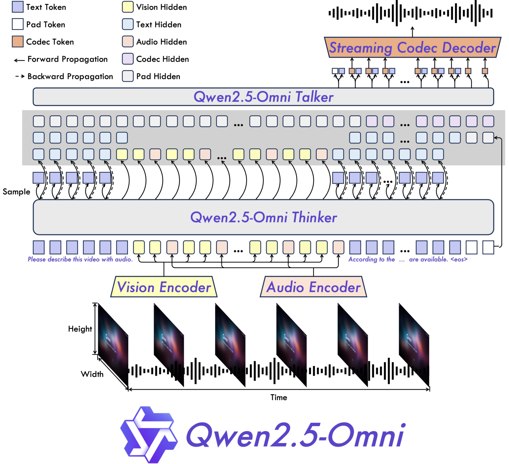
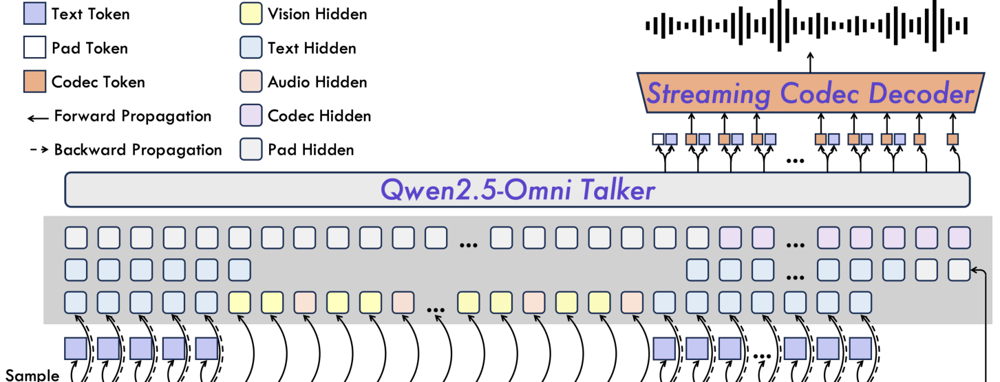
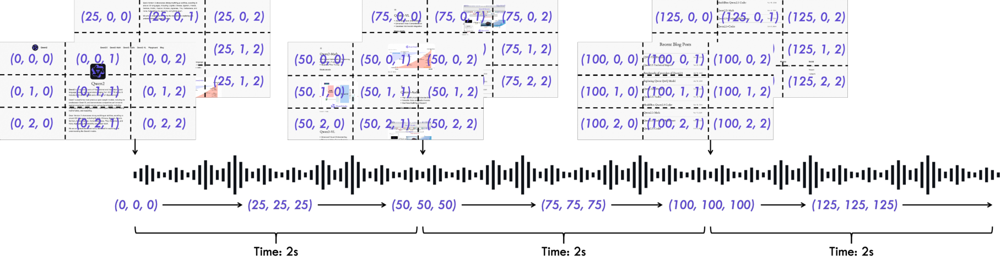
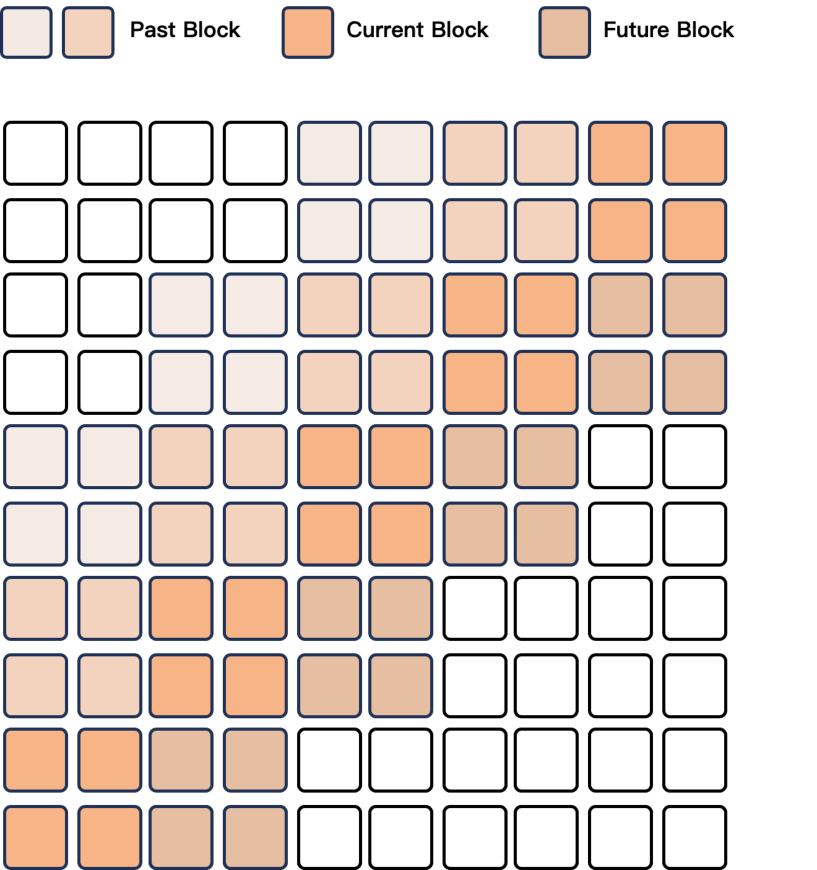

# 03 | Qwen2.5-Omni：单模型"听看说"的分脑架构

> **一句话**：用一个 7B 名义的模型把听、看、说塞进同一套端到端训练——文本思考走 Thinker，流式语音走 Talker，两条流并行解耦，再用 TMRoPE 把音视频的时间戳钉在同一根时间轴上。

---

## 1. 论文档案

| 项目 | 内容 |
| --- | --- |
| 标题 | Qwen2.5-Omni Technical Report |
| 作者与机构 | Qwen Team（阿里通义实验室）；核心贡献者 Jin Xu, Zhifang Guo, Jinzheng He, Hangrui Hu, Ting He, Shuai Bai, Keqin Chen, Jialin Wang, Yang Fan, Kai Dang, Bin Zhang, Xiong Wang, Yunfei Chu, Junyang Lin |
| 发表处 | arXiv 预印本（2025-03-26 提交），未投会议 |
| arXiv | [2503.20215](https://arxiv.org/abs/2503.20215) |
| 开源仓库 | [QwenLM/Qwen2.5-Omni](https://github.com/QwenLM/Qwen2.5-Omni) |
| 许可证 | 代码 Apache-2.0；模型权重 Apache-2.0（HF 模型卡 license_name: apache-2.0） |
| 权重可得性 | HF / ModelScope 开放 `Qwen/Qwen2.5-Omni-7B` 与 3B 版；7B 全 checkpoint 含 Thinker+Talker+双编码器共 **10,732,225,440 ≈ 10.7B** 参数（HF safetensors 元数据统计，"7B" 名义上指 Thinker 主干） |

> 勘误提示：网上流传本文 arXiv 号 2503.19798 实为一篇 SAR 图像翻译论文，Qwen2.5-Omni 正确编号是 **2503.20215**。

---

## 2. 速览

**TL;DR**：Qwen2.5-Omni 是单一端到端模型，输入文本/图像/音频/视频，**同时流式输出文本和自然语音**。理解侧对齐同尺寸 Qwen2.5-VL、超过 Qwen2-Audio；生成侧在 seed-tts-eval 上以 WER 1.42/2.33/6.54（中/英/难）超过 CosyVoice 2 与 MaskGCT。

- **问题**：级联方案（ASR→LLM→TTS）延迟高、错误累积；单流离散 token 方案（AnyGPT 等）文本与语音 token 相互干扰，且难做真流式；音视频对齐缺乏时间轴语义。
- **创新**：① Thinker-Talker 分脑架构——文本推理与语音合成双流并行、共享 Thinker 上下文；② TMRoPE——把 RoPE 拆成时间/高/宽三维并引入绝对时间位置（1 个时间 ID = 40ms），配合音视频 2 秒交错分块；③ 输入 2 秒块状注意力支持 chunked prefill，输出滑窗 DiT（4 blocks 感受野）流式解码波形。
- **证据**：OmniBench 平均 **56.13%**（超 Gemini-1.5-Pro 的 42.91% 与所有开源全模态模型）；VoiceBench 平均 **74.12**；语音指令跟随 MMLU* 65.6 / GSM8K* **85.4（反超文本输入的 82.3）**；seed-tts-eval 三项 WER 见上，NMOS 主观自然度接近真人录音。

---

## 3. 背景与动机

本文之前，"会听会说"的模型有三条路线，各有瓶颈：

1. **模块化级联**：ASR → LLM → TTS。语义无损、文本质量最高，但首包延迟是三段延迟之和，且 ASR 丢掉了副语言学信息（情绪、音色、停顿），错误逐级放大。
2. **语言-音频模型（LALM）**：Qwen2-Audio、SALMONN 等把音频编码器接到 LLM 上，只解决"听懂"，输出仍是文本。
3. **语音-文本统一 token 的端到端尝试**：Mini-Omni（并行听-说）、Moshi（多流并行 RQ-Transformer）、AnyGPT（离散 token 统一序列）证明可行，但普遍存在三个问题：
   - 文本 token 与语音 token 在同一自回归序列里**相互干扰**，文本能力明显掉点；
   - 语音合成需要词级/时间戳对齐，训练数据要求苛刻；
   - 多数方案不原生支持视频输入，更谈不上音画时间对齐。

Qwen 团队把"全模态统一"拆成三个正交难题（论文 §1）：多模态**联合训练**怎么互相增强、输出模态之间**怎么不打架**、架构怎么支撑**实时理解 + 流式语音**。Qwen2.5-Omni 的三大组件恰好一一对应：TMRoPE 对应第一个，Thinker-Talker 对应第二个，块状编码 + 滑窗 DiT 对应第三个。

---

## 4. 核心创新拆解

### 4.1 Thinker-Talker 分脑架构



- **是什么**：Thinker 是标准 Transformer decoder（Qwen2.5 初始化），负责多模态理解、文本生成，并向外吐出高层隐表示；Talker 是**双轨自回归** Transformer decoder（思想承自 Mini-Omni），接收 Thinker 的隐表示，流式生成离散语音 codec token。语音 token 再经"Streaming Codec Decoder"（Flow-Matching DiT + BigVGAN）转波形。整链路端到端联合训练与推理。
- **为什么之前不行**：单流方案里文本和语音 token 同序列竞争注意力，说话 token 会污染推理链；纯 hidden-state 方案（无离散 token 输入）又会在同音异义/同义异音处产生发音歧义。
- **怎么做到**：Talker 每步同时吃两路输入——Thinker 的高维隐表示（隐式携带语气、态度等未定文本信息，支撑"文本没写完就先开口"）+ Thinker 实际采样出的离散文本 token（消除发音歧义，因为语义空间相近的词发音可能差异很大）。论文特别强调：语音生成**不需要与文本做词级或时间戳级对齐**，大幅降低训练数据要求。
- **代价与权衡**：Talker 与 Thinker 必须联合训练（不能各自独立迭代）；双轨序列让 KV cache 翻倍；语音输出被绑定在 Thinker 的隐分布上，换 Thinker 就要重训 Talker；开源 checkpoint 仅内置 2 个音色（Chelsie/Ethan），音色扩展需走 speaker 微调流程。



### 4.2 TMRoPE：时间对齐的多模态位置编码



- **是什么**：在 Qwen-VL 的 M-RoPE（把旋转位置编码拆成 时间/高/宽 三段）基础上，给时间分量注入**绝对时间**：1 个时间 ID 恒等于 40ms 音频。
- **为什么之前不行**：M-RoPE 的时间轴是"帧序号"而不是真实时间，视频帧率不固定时，帧序号无法与音频的物理时间对齐；LVLM 索性不处理音画同步。
- **怎么做到**（详见 §5 公式）：文本三段 ID 相同（退化成 1D-RoPE）；音频用绝对时间 ID（t/40ms）；图像时间 ID 恒定、高宽 ID 独立编号；视频按每帧实际时间动态分配时间 ID（动态帧率采样保证 40ms 对齐），高宽沿用图像规则。多模态拼接时，下一模态的起始 ID = 上一模态最大 ID + 1。对带音轨的视频，按**每 2 秒实际时间**切块，块内"先视觉后音频"交错排列。
- **代价与权衡**：交错让序列变长（同一秒内容出现两份位置 ID 段）；2 秒粒度是延迟/质量的折中，块内音画对齐精度受块边界影响；对"无声视频"时间 ID 退化为帧序。

### 4.3 输入侧流式：块状编码支持 chunked prefill

- 音频编码器从"全长注意力"改为**按 2 秒分块的块内注意力**，可以随对话流式喂入；
- 视觉编码器沿用 Qwen2.5-VL：patch 14、相邻 2×2 token 经 MLP 合并成 1 个、flash attention，图/视频/多分辨率图可打包成一条序列；
- 每张图当作两张相同帧处理，与音频帧率量级一致。

### 4.4 输出侧流式：滑窗 DiT 解码



- **是什么**：语音 token → 波形的解码器用 Flow-Matching DiT 生成 mel 谱，再接改造过的 BigVGAN 转波形；DiT 的感受野被滑窗注意力**限制为 4 blocks（回看 2 + 当前 1 + 前瞻 1）**，BigVGAN 同样按块流式。
- **为什么之前不行**：DiT 全序列注意力意味着要等整段语音 token 生成完才能解码，首包延迟不可接受。
- **怎么做到**：相邻 codec token 分块，注意力掩码按块滑动，每块只要凑齐"前 2 块 + 后 1 块"上下文即可生成，块间流水推进。
- **代价**：感受野受限会损失长程韵律一致性（换气、语速漂移），这是流式换延迟的典型折中。

### 4.5 训练配方

- **预训练三阶段**：① 冻结 LLM，只训音频/视觉编码器（先 adapter 后 encoder；LLM←Qwen2.5，视觉←Qwen2.5-VL，音频←Whisper-large-v3 初始化）；② 全参数解冻，混入 **+800B 图像/视频 token、+300B 音频 token、+100B 带音轨视频 token**（此前阶段序列上限 8192）；③ 长序列阶段扩到 **32768** 训练长音视频。
- **后训练**：Thinker 用 ChatML 格式指令数据（纯文本/视觉/音频/混合对话）；Talker 走三阶段——ICL 上下文续写（语音续写 next-token + 音色解耦，防"罕见文本模式绑定特定嗓音"）→ **DPO**（三元组按 WER 与标点停顿错误率的 reward 排序）→ 多说话人指令微调。

---

## 5. 方法细节（公式）

### 5.1 论文唯一的显式公式：Talker 的 DPO 目标（原文 Eq. 1，§4.3）

$$
\mathcal{L}_{\mathrm{DPO}}(\mathcal{P}_\theta;\ \mathcal{P}_{\mathrm{ref}})
= -\,\mathbb{E}_{(x,\,y_w,\,y_l)\sim\mathcal{D}}
\left[
\log\sigma\!\left(
\beta \log\frac{\mathcal{P}_\theta(y_w\mid x)}{\mathcal{P}_{\mathrm{ref}}(y_w\mid x)}
-\beta \log\frac{\mathcal{P}_\theta(y_l\mid x)}{\mathcal{P}_{\mathrm{ref}}(y_l\mid x)}
\right)
\right]
$$

其中 $x$ 为输入序列（含输入文本），$y_w/y_l$ 是按 reward 排序的"好/坏"语音序列，reward 依据 **WER 与标点停顿错误率**构造。直觉：预训练语料的标签噪声和发音错误让 Talker 学会"幻觉发音"，DPO 用偏好对把它压下去——这是 test-hard WER 从 7.97（ICL）降到 6.54（RL）的直接来源。

### 5.2 TMRoPE 的时间/空间位置分配（形式化整理，原文 §2.2 为文字描述；标注"解读视角"）

记模态 $m$ 的 token 序列，RoPE 三段分量为 $(p_t, p_h, p_w)$，帧时长 $\Delta=40\mathrm{ms}$：

$$
\text{文本:}\quad (p_t,p_h,p_w)_i=(i,\,i,\,i) \qquad\text{（退化为一维 RoPE）}
$$

$$
\text{音频:}\quad p_t=\left\lfloor \frac{t}{\Delta} \right\rfloor,\quad (p_h,p_w)=\text{恒定共享 ID}
$$

$$
\text{图像:}\quad p_t=\text{const},\quad p_h=r,\ p_w=c\ \ (\text{按 token 在图中的行列})
$$

$$
\text{视频(带音轨):}\quad p_t=\left\lfloor \frac{\tau_{\text{frame}(r,c)}}{\Delta} \right\rfloor,\quad p_h=r,\ p_w=c
$$

多模态接缝的编号规则（解读视角的等价写法）：

$$
\text{start}(m_{k+1}) = 1 + \max_{\mathrm{comp}\in\{t,h,w\}}\ \text{end}(m_k, \mathrm{comp})
$$

带音轨视频按真实时间每 2 秒切块、块内"视觉在前、音频在后"：

$$
\text{seq} = \big[\,V_{[0,2s)},\ A_{[0,2s)},\ V_{[2s,4s)},\ A_{[2s,4s)},\ \dots\,\big]
$$

### 5.3 音频帧率与下采样推导（解读视角，数值全部取自原文 §2.2）

理解侧：原始波形重采样到 $f_s = 16\,\mathrm{kHz}$ → 128 通道 mel 谱，窗长 25ms、hop 10ms（每秒 100 帧 mel）→ 音频编码器（Qwen2-Audio 结构、Whisper-large-v3 初始化）内部对 mel 帧做约 $4\times$ 的聚合下采样：

$$
\text{编码帧率} = \frac{100\ \text{mel帧/s}}{4} = 25\ \text{帧/s} \;\Longleftrightarrow\; \text{每帧} \approx 40\,\mathrm{ms}
$$

这 40ms 正是 TMRoPE 的 1 个时间 ID 的物理含义，也决定了"音频序列长度 = 秒数 × 25"的显存账。生成侧：qwen-tts-tokenizer 输出的 codec token 经 DiT（Flow-Matching 生成 mel）+ BigVGAN 还原为 **24 kHz** 波形（采样率来自官方 README）。

> **查证**：社区常说本文有 "AuT 音频 tokenizer（12.5Hz）"——**本篇论文与官方 README 均未出现 AuT 或 12.5Hz**；12.5Hz 是后续 Qwen3 系列公开的语音 tokenizer 规格（Qwen3-TTS 开源 12Hz 档 tokenizer，社区讨论其与 Qwen3-Omni Talker 内置 tokenizer 的关系）。本文论文只披露了理解侧 40ms/帧（25Hz）。凡引用 12.5Hz 于本篇的均属张冠李戴。

---

## 6. 实验证据复盘

### 6.1 理解侧基准（全部数字经 PDF 原文核对）

**Text→Text**（论文表 1，7B 档对比，节选）：

| 基准 | Qwen2-7B | Qwen2.5-7B | Qwen2.5-Omni-7B |
| --- | --- | --- | --- |
| MMLU-Pro | 44.1 | 56.3 | 47.0 |
| MMLU-redux | 67.3 | 75.4 | 71.0 |
| GPQA | 34.3 | 36.4 | 30.8 |
| MATH | 52.9 | 75.5 | 71.5 |
| GSM8K | 85.7 | 91.6 | 88.7 |
| HumanEval | 79.9 | 84.8 | 78.7 |
| LiveCodeBench | 23.9 | 28.7 | 24.6 |

解读：纯文本能力整体落在 Qwen2-7B 与 Qwen2.5-7B 之间——多模态联合训练没有毁掉语言能力，但也没追平纯文本旗舰，这是"统一"的第一份代价。

**语音指令跟随 vs 文本指令**（论文表 4，* 表示约 90% 适合语音的文本指令；Omni/Qwen2-Audio 听语音，Qwen2-7B 读文本）：

| 基准 | Qwen2-7B（文本输入） | Qwen2-Audio | Qwen2.5-Omni-7B |
| --- | --- | --- | --- |
| MMLU* | 69.3 | 33.2 | 65.6 |
| CEval* | 78.4 | 38.6 | 61.1 |
| IFEval* | 53.3 | 15.6 | 41.7 |
| **GSM8K*** | **82.3** | 18.4 | **85.4** |
| Math23K* | 92.3 | 23.0 | 87.1 |
| Math401* | 75.5 | 20.4 | 62.2 |

解读：这是全篇最有说服力的表——相对 Qwen2-Audio 的灾难性掉点（MMLU 33.2），Omni 把语音指令与文本输入的差距收窄到个位数，且 **GSM8K 语音输入（85.4）反超文本输入（82.3）**，说明 DPO+ICL 的 Talker 链路没有拖累推理。CEval/IFEval/Math401 仍落后 11~17 分，说明中文知识类与精细指令跟随仍有损耗。

**音频理解/推理**（论文表 2、3 节选）：

| 任务/基准 | 对比 | Qwen2.5-Omni-7B |
| --- | --- | --- |
| LibriSpeech test-clean / test-other (WER↓) | Qwen2-Audio 1.6/3.6 | 1.8 / **3.4** |
| CommonVoice15 en/zh (WER↓) | Whisper-large-v3 9.3/12.8 | **7.6 / 5.2** |
| Fleurs zh/en (WER↓) | MinMo 3.0/3.8 | **3.0** / 4.1 |
| WenetSpeech test-net/test-meeting | MinMo 6.8/7.4 | **5.9** / 7.7 |
| CoVoST2 en-de/de-en/en-zh/zh-en (BLEU) | Qwen2-Audio 29.9/35.2/45.2/24.4 | 30.2/37.7/41.4/**29.4** |
| SER Meld (Acc) | Qwen-Audio 0.557 | **0.570** |
| VSC VocalSound (Acc) | Qwen2-Audio 0.939 | 0.939 |
| MMAU Sound/Music/Speech/Avg | Qwen2-Audio 54.95/50.98/42.04/49.20 | **67.87/69.16/59.76/65.60** |
| VoiceBench Avg | MiniCPM-o 71.69；Qwen2-Audio 55.35 | **74.12** |

解读：ASR 上 Omni 并非全面第一（LibriSpeech test-clean 略逊 Qwen2-Audio，Fleurs en 略逊 MinMo），但在 MMAU 音频推理上以 65.60 对 49.20 拉开 16 分——"理解"从转写能力转向了推理能力。

**图像/视频/多模态**（论文表 5、7、8 节选）：

| 基准 | Qwen2.5-VL-7B | 其他最佳 | Qwen2.5-Omni-7B |
| --- | --- | --- | --- |
| MMMU val | 58.6 | 53.9 (Baichuan-Omni-1.5) | **59.2** |
| DocVQA test | **95.7** | 93.5 | 95.2 |
| MME-RealWorld en | 57.4 | — | **61.6** |
| Video-MME w/ sub | 71.6 | 67.9 | **72.4** |
| EgoSchema test | 65.0 | 63.2 | **68.6** |
| RefCOCO val（grounding） | 90.0 | Grounding-DINO 90.6 | **90.5** |
| ODinW 开放词汇检测 (mAP) | 37.3 | Grounding-DINO 55.0 | 42.2 |

**OmniBench**（论文表 8，音画文三模态联合推理，完整对比）：

| 模型 | Speech | Sound Event | Music | Avg |
| --- | --- | --- | --- | --- |
| Gemini-1.5-Pro | 42.67% | 42.26% | 46.23% | 42.91% |
| MIO-Instruct (7B) | 36.96% | 33.58% | 11.32% | 33.80% |
| AnyGPT (7B) | 17.77% | 20.75% | 13.21% | 18.04% |
| video-SALMONN (13B) | 34.11% | 31.70% | 56.60% | 35.64% |
| MiniCPM-o | — | — | — | 40.5% |
| Baichuan-Omni-1.5 | — | — | — | 42.9% |
| **Qwen2.5-Omni-7B** | **55.25%** | **60.00%** | 52.83% | **56.13%** |

解读：以 AnyGPT 为代表的"统一离散 token"路线在音画联合推理上只有 18%，而 Omni 超过闭源 Gemini-1.5-Pro 13 分——这是"分脑 + TMRoPE"路线最直接的胜利证据。

### 6.2 生成侧基准（X→Speech）

**Zero-shot TTS**（论文表 9，seed-tts-eval，WER↓ / 说话人相似度 SIM↑）：

| 模型 | WER test-zh | WER test-en | WER test-hard | SIM zh/en/hard |
| --- | --- | --- | --- | --- |
| Seed-TTS (ICL) | 1.11 | 2.24 | 7.58 | 0.796/0.762/0.776 |
| Seed-TTS (RL) | **1.00** | **1.94** | **6.42** | 0.801/0.766/0.782 |
| MaskGCT | 2.27 | 2.62 | 10.27 | 0.774/0.714/0.748 |
| CosyVoice 2 | 1.45 | 2.57 | 6.83 | 0.748/0.652/0.724 |
| Qwen2.5-Omni (ICL) | 1.70 | 2.72 | 7.97 | 0.752/0.632/0.747 |
| Qwen2.5-Omni (RL) | 1.42 | 2.33 | **6.54** | 0.754/0.641/**0.752** |

解读：ICL 版本其实**逊于** CosyVoice 2（test-hard 7.97 vs 6.83）；是 DPO 阶段把 test-hard 从 7.97 拉到 6.54 才反超——论文坦诚地把 RL 前后两行都放出来，恰好证明"语音幻觉"是真实问题。SIM 上则始终略逊专门的 zero-shot TTS（Seed-TTS 0.801 vs 0.754），符合"对话模型音色保真不做最优"的定位。

**单说话人微调**（论文表 10）：4 个微调音色 A–D 的 WER（zh 1.28–1.37 / hard 6.43–7.25）稳定在 RL 基线附近；NMOS 主观自然度 zh 4.46–4.51、en 4.51–4.62，对照真人录音 zh 4.51——英文 NMOS（4.62）甚至高于真人对照（表中未给 en 真人值），可以说自然度这一项打平了人类。

### 6.3 被后续工作验证/推翻的部分

- 被验证：Thinker-Talker 隐传递 + TTS-Codec 的组合被后续 Qwen3-Omni 延续并加强；"语音指令接近文本"的结论也被 MinMo、Baichuan-Omni-1.5 等复现。
- 被刷新：本文在 Fleurs/CoVoST2 部分语言方向已逊于同期 MinMo（de-en 37.7 vs 39.9）；后续 Qwen3-Omni、MinMo 在 OmniBench/MMAU 等基准上进一步领先。
- 论文自认的遗留问题：视频 OCR、音画协同理解是"学术研究长期忽视"的方向（结论 §6），也预告了扩展输出模态（图像/视频/音乐）的后续工作。

---

## 7. 开源仓库导读

仓库 [QwenLM/Qwen2.5-Omni](https://github.com/QwenLM/Qwen2.5-Omni)（Apache-2.0），权重同步 HF / ModelScope。

**关键路径**：`web_demo.py`（Gradio 全模态 demo，`--flash-attn2` 启动）、`cookbooks/`（7 个场景 notebook：universal_audio_understanding、voice_chatting、screen_recording_interaction、video_information_extracting、omni_chatting_for_music/math、multi_round_omni_chatting）、`requirements.txt`、Docker 镜像 `qwenllm/qwen-omni:2.5-cu121`。

**最小跑通路径（transformers）**：

```bash
pip install transformers==4.52.3 accelerate
pip install "qwen-omni-utils[decord]" -U        # 视频解码后端可 FORCE_QWENVL_VIDEO_READER 切换
pip install flash-attn --no-build-isolation      # 推荐，需 bf16/fp16
```

```python
from transformers import Qwen2_5OmniForConditionalGeneration, Qwen2_5OmniProcessor
model = Qwen2_5OmniForConditionalGeneration.from_pretrained(
    "Qwen/Qwen2.5-Omni-7B", dtype="auto", device_map="auto",
    attn_implementation="flash_attention_2")
processor = Qwen2_5OmniProcessor.from_pretrained("Qwen/Qwen2.5-Omni-7B")
conversation = [{"role": "system", "content":
    "You are Qwen, a virtual human developed by the Qwen Team, ..."},   # 固定 system prompt，否则语音输出异常
    {"role": "user", "content": [{"type": "video", "video": "path"},
     {"type": "text", "text": "视频里的人在说什么？"}]}]
text = processor.apply_chat_template(conversation, add_generation_prompt=True, tokenize=False)
audio, image, video = process_mm_info(conversation, use_audio_in_video=True)   # use_audio_in_video 三处必须一致
inputs = processor(text=text, audio=audio, images=image, videos=video, ...)
out = model.generate(**inputs, use_audio_in_video=True,
                     speaker="Chelsie")            # 开源内置音色：Chelsie（默认）/ Ethan
sf.write("out.wav", out.audios.reshape(-1).detach().cpu().numpy(), samplerate=24000)
```

**语音输出调用链**（对应论文架构）：`generate(..., return_audio=True)` → Talker 流式吐 codec token → `code2wav`（Flow-Matching DiT 滑窗生成 mel）→ BigVGAN → **24 kHz** 波形。`model.disable_talker()` 可省约 2GB 显存并强制 `return_audio=False`（纯文本场景）；批量推理仅支持 `return_audio=False`。`use_audio_in_video=True` 必须在 `process_mm_info` / `processor` / `generate` 三处一致，多轮对话不一致会出错。

**vLLM 部署**：pip 安装的 `vllm>=0.8.5.post1` 长期**只支持 Thinker（纯文本输出）**；要音频输出需源码安装官方指路的 fork（`fyabc/vllm` 的 `qwen2_omni_public` 分支，指定 commit）并以 `--do-wave` 启动，支持 `--thinker-devices/--talker-devices/--code2wav-devices` 分卡部署。后续 vLLM 版本补齐了音频输出，但仍建议核对当时文档。

**显存账**（README，BF16 + flash-attn-2，7B）：15s 视频 31.11 GB、30s 41.85 GB、60s 60.19 GB（实际≥1.2 倍）；GPTQ-Int4/AWQ 降到 11.6/11.8 GB（15s）——量化优化包含按需加载权重、流式 code2wav、把 ODE 求解器从 RK4 降为 Euler。端侧 MNN：7B 峰值 5.8 GB，骁龙 8 Gen 1 解码 8.35 tok/s。

---

## 8. 局限与争议

以下均可在论文原文或官方渠道查证；标注"解读视角"的为本人推断。

1. **流式延迟"只讲机制、不给数"**：论文用四段式分析了首包延迟来源（输入编码、首 token→首语音 token、语音→波形、架构本身），但全文没有给出任何端到端首包延迟实测值。"实时感"停留在架构设计层面，无法横向验证。（解读视角：这是被社区诟病最多的"技术报告留白"。）
2. **音色控制能力弱**：开源 checkpoint 只有 Chelsie/Ethan 两个音色；论文的音色扩展路径是 speaker 微调（表 10 的 A–D 均为内测），且需要"音色解耦"技术防过拟合——对想做语音克隆/多角色对话的开发者是硬约束。
3. **评测缺口**：语音生成评测只覆盖"给定文本的 TTS 式合成"（论文自己承认 X→Speech 缺乏评测），**对话式语音质量、打断/轮替（duplex）行为没有基准**；与 Moshi 这类全双工模型不构成同场竞争。论文亦未报告 ELO 类人类偏好评分——部分文章把 "ELO/RtF" 归到本篇属于误引。
4. **路线之争：双流 vs 单流**：GLM-4-Voice、Step-Audio、AnyGPT 走"语音离散 token 进同一序列"，Moshi 走"多流并行 RQ-Transformer"。双流方案的隐表示传递保留了文本质量（表 1），但语音流没有独立的推理空间，不能"用语音思考"；且 Thinker 与 Talker 必须联合训练，社区难以单独替换升级 Talker。（解读视角，对比依据见本库 Stage 6 第 3 周横评。）
5. **关键 codec 参数不透明**：qwen-tts-tokenizer 的帧率、码率、codebook 规模论文均未披露；网上 "AuT 12.5Hz" 的说法出自后续 Qwen3 系列（Qwen3-TTS 开源 12Hz tokenizer），套在本文上是以讹传讹。
6. **部署生态滞后**：官方 vLLM 长期文本输出 only，音频输出要走 fork + `--do-wave`；transformers 侧语音输出绑定特定 system prompt 与 `use_audio_in_video` 三处一致性，工程易踩坑（README 均有明示）。
7. **音画理解的已知短板**：论文结论自述"视频 OCR 与音画协同理解被学术研究忽视"，OmniBench 56.13% 的绝对值离"解决"还远；2 秒交错块的粒度是延迟与对齐精度的折中。
8. **后续版本的方向印证**：Qwen3-Omni（2025-09）转向 MoE + 新音频编码器 + 多说话人 TTS，相当于官方承认 2.5-Omni 在帧率、音色扩展与推理效率上的改进空间。

---

## 9. 与本知识库的衔接

- **直系章节**：`/home/yyl/ObsidianLibraries/语音方向/Stage 6-语音大模型与 Omni 多模态/教程/第2周-Qwen2.5-Omni深度拆解.md`——本报告是其论文级底稿，架构图可直接复用 assets/。
- **范式脉络**：`/home/yyl/ObsidianLibraries/语音方向/Stage 6-语音大模型与 Omni 多模态/教程/第1周-Speech-LLM三种范式与Qwen-Audio.md`（本文音频编码器的上游 Qwen2-Audio 与三大范式分类）。
- **路线对比展开**：`/home/yyl/ObsidianLibraries/语音方向/Stage 6-语音大模型与 Omni 多模态/教程/第3周-MiniCPM-o-StepAudio-Moshi横评.md`——§8.4 双流 vs 单流之争的评测证据。
- **语音 codec 下游**：`/home/yyl/ObsidianLibraries/语音方向/Stage 6-语音大模型与 Omni 多模态/教程/第4周-音频离散化与语音Codec深挖.md`（qwen-tts-tokenizer 所属的 codec 谱系）。
- **TTS 对手盘**：`/home/yyl/ObsidianLibraries/语音方向/Stage 5-语音生成与零样本克隆/教程/第3-4周-CosyVoice2深度拆解.md`（表 9 直接对比对象 CosyVoice 2）；声码器与 Flow Matching 的原理铺垫在 `第1周-TTS全景与声码器演进.md`（同目录）。
- **视觉编码器与 M-RoPE 源流**：`/home/yyl/ObsidianLibraries/VLM & VLA/Stage 1-VLM 基础与架构深度拆解/教程/第1周-视觉编码器与表征基础.md`（675M ViT 的输入侧处理）；M-RoPE→TMRoPE 的演进对应 `第3周-主流VLM架构与图像Token全流程.md`。
- **DPO 公式出处**：`/home/yyl/ObsidianLibraries/强化学习/10-RLHF-从奖励模型到PPO-DPO.md`——§5.1 Eq.1 的理论底座。
- **推理工程**：`/home/yyl/ObsidianLibraries/模型性能优化/Stage 5-vLLM 与 SGLang 推理引擎深潜/`——§7 的 vLLM 部署限制与 chunked prefill 机制背景。

---

## 10. 面试视角

**Q1：为什么要拆成 Thinker-Talker 两条流，而不是像 AnyGPT 那样把语音 token 放进同一序列？**
要点：① 同序列自回归会模态互扰，文本推理被语音 token 污染（AnyGPT 类模型文本掉点明显）；② 双流让语音与文本并行产出，Talker 直接吃 Thinker 隐表示，文本没写完就能开口（流式低延迟）；③ 代价：必须端到端联合训练、KV cache 翻倍、Talker 与 Thinker 绑定。追问"为什么还要喂离散文本 token"——语义空间相近的词发音可能差异大，隐表示只表达语义相似性，需要采样 token 消除发音歧义。

**Q2：TMRoPE 相比 M-RoPE 改了什么？一帧音频/视频 token 对应多长时间？**
要点：M-RoPE 时间轴是帧序号，TMRoPE 注入绝对时间——1 个时间 ID 恒等于 40ms；文本三段 ID 相同退化为 1D RoPE；图像时间 ID 恒定、高宽独立；视频按每帧实际时间动态分配 ID（动态帧率采样对齐 40ms）；多模态接缝"上一模态最大 ID + 1"起始；带音轨视频按 2 秒切块、先视觉后音频交错。

**Q3：端到端语音对话的首包延迟有哪些来源？Qwen2.5-Omni 分别怎么压？**
要点：四段——输入编码延迟（音频 2s 块状注意力支持 chunked prefill、视觉 2×2 merge 减 token）；首文本 token 到首语音 token（Talker 吃 hidden，不等文本采样完）；首段语音到波形（滑窗 DiT：感受野 4 blocks = 回看 2 + 前瞻 1，BigVGAN 分块流式）；架构固有延迟（7B 规模、FLOPs）。能指出"论文没给实测延迟数值"是加分项。

**Q4：Talker 的三阶段训练各自解决什么问题？DPO 的偏好对怎么构造？**
要点：① ICL 上下文续写——建立语义表示→语音的单调映射，学韵律/情绪/口音，音色解耦防"罕见文本绑定嗓音"；② DPO——三元组 (x, y_w, y_l) 按 WER + 标点停顿错误率的 reward 排序，压语音幻觉（test-hard WER 7.97→6.54）；③ 多说话人指令微调——自然度与可控性（NMOS 接近真人）。

**Q5：语音指令跟随如何做到接近文本输入？哪个数字最能说明问题？**
要点：对比表 4——Qwen2-Audio 语音输入 MMLU 33.2 vs 文本 69.3，Omni 收窄到 65.6；最强证据是 GSM8K 语音输入 85.4 反超 Qwen2-7B 文本输入 82.3；同时坦承 CEval 61.1/IFEval 41.7 仍有差距，且该表用的是约 90% 适合语音化的指令子集（带 * 号），严谨性要指出。

---

## 附：图片资产清单

| 文件 | 来源 | 内容 |
| --- | --- | --- |
| `assets/fig1-capabilities.png` | 论文 Fig 1（第 1 页，高分辨率重渲） | 四类对话场景 + 中央流水线总览 |
| `assets/fig1b-pipeline-zoom.png` | Fig 1 局部裁切 | Codec Decoder→Talker→Thinker→编码器流水线 |
| `assets/fig2-thinker-talker.png` | 论文 Fig 2（第 3 页） | Thinker-Talker 架构总图（双轨 token、编码器输入） |
| `assets/fig2b-talker-codec-zoom.png` | Fig 2 局部裁切 | Talker 双轨输入 + 流式 Codec Decoder 放大 |
| `assets/fig3-tmrope.png` | 论文 Fig 3（第 4 页） | TMRoPE 三元位置分配与 2 秒交错时间轴 |
| `assets/fig4-sliding-window-dit.png` | 论文 Fig 4（第 5 页） | DiT 滑窗块注意力掩码（回看 2 / 前瞻 1） |

> 图片全部由 arXiv 原文 PDF（2503.20215v1）经 docling/pymupdf 提取与重渲染，版权归 Qwen Team，仅用于学习解读。
> 数字核对说明：本文所有表格数字均从 PDF 原文逐项核对（pymupdf 提取原文比对 docling 解析结果）；10.7B 参数统计来自 HF safetensors 元数据；部署细节来自官方 README（2025 年版本）。
