# 04 · NVIDIA Cosmos 深度解读：把"世界模型"做成一个平台工程问题

> 本篇是「论文解读」系列第 04 篇，方向：**世界模型**。所有数字均与 arXiv 2501.03575 PDF 原文核对（75 页版）；图片截取自原论文（版权归 NVIDIA，仅作学习解读之用）；标注"解读视角"的内容为本文推断。

## 1. 论文档案

| 项目 | 内容 |
| --- | --- |
| 标题 | Cosmos World Foundation Model Platform for Physical AI |
| 机构 | NVIDIA（按子团队署名：数据策划 / Tokenizer / 扩散 WFM / 自回归 WFM / 各后训练评测 / Guardrail，平台架构师 Ming-Yu Liu；致谢含 Jensen Huang、Bryan Catanzaro、Jim Fan、Marco Pavone 等） |
| 发表处 | arXiv 预印本，2025-01-03 提交（技术报告，未投会议） |
| arXiv | [2501.03575](https://arxiv.org/abs/2501.03575)（75 页） |
| 开源仓库 | 论文发布时为三仓家族：[NVIDIA/Cosmos-Predict1](https://github.com/nvidia-cosmos/cosmos-predict1)（扩散 + 自回归 + 后训练脚本）、[NVIDIA/Cosmos-Tokenizer](https://github.com/NVIDIA/Cosmos-Tokenizer)（2025-02 归档）、Cosmos-Autoregressive1（后并入 predict1，原地址已 404）；代码 Apache-2.0，权重 NVIDIA Open Model License（允许商用、允许发布衍生模型、产出物不归 NVIDIA 所有） |
| 权重可得性 | HuggingFace `nvidia/` 全系开放：Diffusion-7B/14B Text2World 与 Video2World、Autoregressive-4B/12B 与 5B/13B-Video2World、Tokenizer-CV8x8x8/DV8x16x16、Prompt-Upsampler-12B、7B-Decoder-DV8x16x16ToCV8x8x8、Guardrail（后者 gated） |
| 训练规模 | 论文中全部 WFM 在 **10,000 张 H100 上、3 个月内**完成（§5，无逐模型成本拆分） |

## 2. 速览

**一句话 TL;DR**：Cosmos 把"世界模型"从一个研究课题拆成一条**平台流水线**——2000 万小时视频的 curation 管线 → 一族因果视频 tokenizer（连续/离散）→ 扩散（7B/14B）与自回归（4B/12B）两条路线的预训练 WFM → 相机控制/机器人操作/自动驾驶三类后训练配方 → 护栏系统，全部开源开放权重，让 Physical AI 开发者拿通用世界模型去微调成自己场景的专用世界模型。

| 维度 | 内容 |
| --- | --- |
| 问题 | Physical AI（机器人/自动驾驶）需要的训练数据是"观测-动作交错序列"，在真实世界采集代价高且有危险；需要一个可安全交互的"数字孪生世界"（WFM）来评测/初始化/训练策略与合成数据 |
| 创新 | ① 因果小波 tokenizer 家族（4×8×8 到 8×16×16，连续潜空间 16 维、离散 FSQ 词表 64K）；② 同一 DiT/Llama3 式 Transformer 底座上并列扩散与自回归两条 WFM 路线并给出公平对比；③ 三类后训练"配方"（Plücker 相机条件 / 动作 MLP 嵌入 / 多视角 + 轨迹条件）；④ 自建 3D 一致性与物理对齐评测（而非通用视频基准） |
| 证据 | tokenizer 在 DAVIS/TokenBench 上 +4dB PSNR、快 2~12×；7B-Text2World 3D 一致性（Sampson 误差 0.355 vs VideoLDM 0.841，位姿估计成功率 62.6% vs 4.4%）；后训练相机控制位姿成功率 82% vs CamCo 43%；Bridge 操作 FVD 190 vs IRASim 593；AV 多视角 FID 32.16 vs VideoLDM 60.84 |

## 3. 背景与动机

**Physical AI 的数据墙**：LLM 的训练语料是互联网文本，采集零边际成本；Physical AI 需要的数据是"传感器观测 + 对世界施加的动作"成对出现——机器人每条探索性动作都可能撞坏自己或环境，真实采集既慢又贵。论文的立场是：**先数字化训练**（trained digitally first），策略模型需要自己的数字孪生，世界也需要一个数字孪生——后者就是 WFM。

**"世界基座模型"的定位**（§2）：WFM $\mathcal{W}$ 的形式化定义是——给定过去观测序列 $x_{0:t}$（RGB 视频）和当前扰动 $c_t$（动作 / 文本 / 随机扰动），预测下一时刻观测 $\hat{x}_{t+1}$。论文列出五种用途：策略评测（低成本淘汰坏策略）、策略初始化、策略训练（WFM+奖励模型当 RL 环境）、规划/MPC（模拟不同动作序列的未来）、合成数据生成（Sim2Real）。注意论文自己承认：**这些用途本文一个都没有做实验验证**（"this paper does not include empirical results in applying Cosmos WFMs to them"）——本文只负责把预训练 WFM 和后训练配方做出来。

**2025 年初的格局与空档**：视频生成侧 Sora/Dream Machine/Gen 3/Kling 已经刷屏，但都是闭源、面向消费创作；世界模型侧的先行者（Ha & Schmidhuber 2018 的世界模型、Dreamer 系 RNN 世界模型、Genie）要么规模小要么不开权重。论文的切入点是：**没有一个开放的、面向 Physical AI 的世界基座模型平台**——没人能拿一个通用世界模型去微调成自己机器人/车上的专用世界模型。Cosmos 的答案是平台化：数据管线、tokenizer、两类 WFM、后训练样例、护栏五件套全开放。

**为什么同时做两条技术路线**：论文 §8 的判断是"扩散模型画质更好，自回归模型能吃到 LLM 生态的全部工程红利"。与其押注单边，不如在同一数据、同一 tokenizer 家族上各建一族，把选择权交给下游开发者（详见 §4.2/§4.3 的对比拆解）。

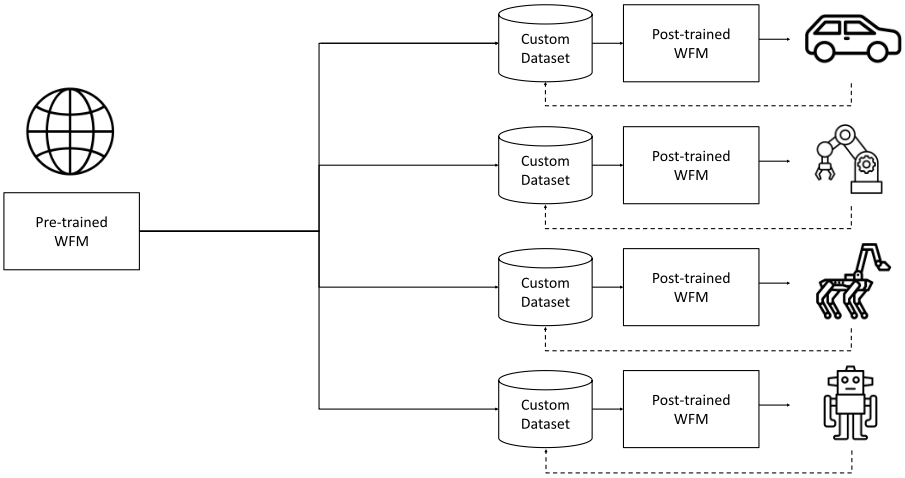

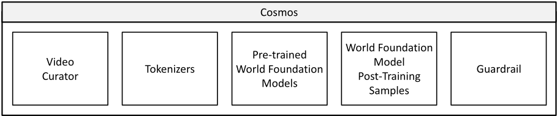

**数据管线先看一眼**（§3）：2000 万小时 → 1 亿段 2~60 秒片段只靠五步——TransNetV2 镜头切分、四重过滤（运动/画质 DOVER 后 15% 砍掉/字幕叠加/视频类型）、VILA-13B 逐段标注（8 帧采样、平均 559 字符）、语义去重（k=10,000 聚类，砍 30%）、按分辨率/长宽比分片。工程上靠 L40S 的 NVDEC/NVENC + PyNvideoCodec 把转码吞吐提到 6.5×（0.3702 视频/秒），标注用 FP8 TRT-LLM 引擎拿到 10×（0.21 → 1.96 段/秒）：

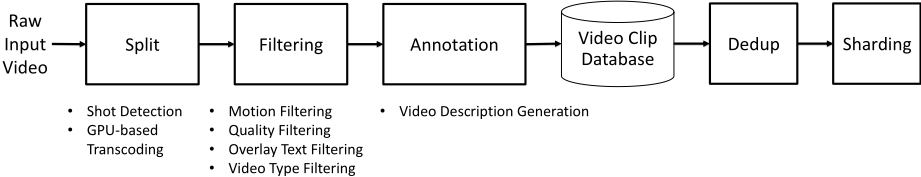

## 4. 核心创新拆解

### 4.1 视频 tokenizer：整个平台的地基

- **是什么**：Cosmos Tokenizer 是一族**因果**（causal）的图像-视频统一 tokenizer：图像 CI/DI 压缩 8×8、16×16；视频 CV/DV 压缩 4×8×8、8×8×8、8×16×16（时间×高×宽）。连续版潜空间每 token 是 16 维向量（AE 形式），离散版用 FSQ 量化到 6 维 levels (8,8,8,5,5,5)，词表恰好 $8^3 \cdot 5^3 = 64{,}000$。
- **为什么之前不行**：WFM 的训练算力随 token 数线性暴涨，视频又是极端冗余的数据——tokenizer 的压缩率直接决定模型能"看到"多长的世界。但已有的 tokenizer 各缺一角：FLUX/LlamaGen 只做图像、VideoGPT 不做因果、CogVideoX 只做连续、Omni-Tokenizer 不因果（原文表 4 逐项对照）。更重要的是视频 tokenizer 需要"压缩率-保真度-可解码性"三角同时及格：压得狠（省算力）会丢物理细节，丢得多则世界模型学到的物理就是错的。
- **怎么做到**：① **2 级 Haar 小波变换先行**，把输入按 (x,y,t) 各降 4 倍，先消灭像素冗余，让后续层专注语义压缩；② 因果时序卷积 + 因果时序注意力（左填充 k-1），当前帧 token 只依赖过去——由此**单帧输入时它同时就是图像 tokenizer**，图像和视频可以联合训练，也天然对齐 Physical AI 的因果时序场景；③ 时空分解 3D 卷积（1×k×k 空间 + k×1×1 时间）+ 因果全局注意力；④ LayerNorm 替代 GroupNorm 防止潜空间出现异常大值；⑤ 训练只用 decoder 端监督，不用 commitment/KL 等辅助损失（AE + FSQ 的组合天然不需要）。
- **代价与权衡**：压缩越狠重建越差——DV8×16×16 在 DAVIS 上 PSNR 只有 25.49 / rFVD 259.33（CV8×8×8 是 31.28 / 23.49），离散 token 的有损压缩正是自回归 WFM 输出模糊的根因，NVIDIA 为此专门再训一个 7B 扩散解码器来补救（§5.5）；tokenizer 只在 720p 训练，更高分辨率/极端域外内容仍可能失真。

**解读视角**：把 tokenizer 类比成"视频编解码器"（论文原话 video codec）是准确的——它的地位对应 LLM 里的 BPE：上面所有预训练、后训练、推理优化的自由度都被这一层的 (压缩率, 词表, 因果性) 锁死。Cosmos 选择"因果 + 小波 + FSQ"三件套，等于同时决定了：图像视频可联合训练、AR 路线可用交叉熵、token 预算可从 4×8×8 到 8×16×16 弹性伸缩。

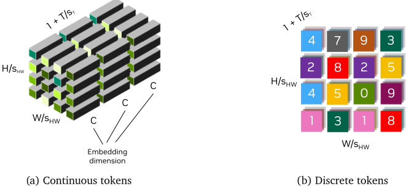

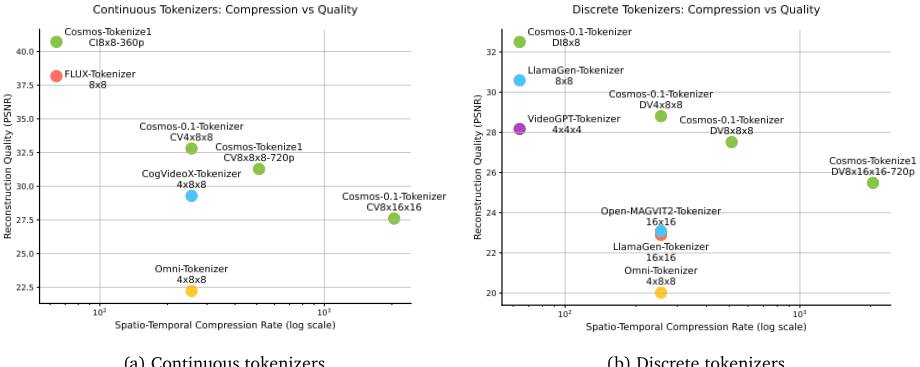

### 4.2 扩散路线 WFM：画质优先的通用世界生成器

- **是什么**：Cosmos-Predict1-7B/14B-Text2World，DiT 式 latent diffusion：CV8×8×8 tokenizer 把视频压到潜空间，3D patchify（$p_t{=}1, p_h{=}p_w{=}2$）成 token 序列，T5-XXL 文本经 cross-attention 注入，EDM 框架去噪；在 Text2World 之上拼接条件帧 + 二值 mask 通道得到 Video2World 版本。
- **为什么之前不行**：直接把 DiT 从图像搬到视频有四个坑：训练不稳（attention logits 爆炸）、AdaLN 吃参数（DiT 的 adaptive norm 参数占比高但 FLOPs 占比低）、图文潜分布不一致、推理 prompt 与训练 caption 分布错配。
- **怎么做到**：① **QK-Norm**（RMSNorm + 可学习缩放）压住 attention logits；② **AdaLN-LoRA** 把自适应 norm 的稠密投影分解为低秩（rank 256），7B 模型参数从 11B 降到 7B（**-36%**）而各评测持平；③ 图像-视频交替训练 + 分域统计归一化（潜空间各向同性化，附带"信噪比尺度不变"的理论收益），视频 batch 的噪声水平按帧数开根号放大以对齐收敛速度；④ **FPS-aware 3D RoPE**（时间轴频率按视频帧率缩放）+ 每 block 可学习绝对位置嵌入，支持任意分辨率/长宽比/帧率；⑤ 渐进训练 512p/57 帧（上下文 10,240）→ 720p/121 帧（上下文 56,320）→ 高质量数据微调；⑥ prompt upsampler（微调 Mistral-NeMo-12B，"长→短"造对数据）弥合训练/推理 prompt 分布差。
- **代价与权衡**：扩散采样天然串行多步，实时性差；Video2World 只靠"帧拼接 + mask 通道"注入观测，条件信号带宽有限（后训练里动作/轨迹要另加模块）；14B 训练需 280GB（参数+梯度+优化器）+ 310GB（激活）显存，靠 FSDP(64) + CP(8) 摊到单卡 ~4GB/~40GB。

### 4.3 自回归路线 WFM：LLM 生态的直系移民

- **是什么**：Cosmos-Predict1-4B/12B——Llama3 式 decoder-only GPT，但词表不是文字而是 **64,000 个视频 token**（DV8×16×16 tokenizer 输出的 FSQ 索引），纯 next-video-token 预测（4B：16 层、d=4096；12B：40 层、d=5120）；加 cross-attention 吃 T5 嵌入后得到 5B/13B-Video2World。
- **为什么之前不行**：视频 token 序列的 NLL 训练在长序列下极易不稳（logit 爆炸、梯度异常）；且视频上下文沿时间轴增长，固定 RoPE 外推不动。
- **怎么做到**：① **z-loss**（$\mathcal{L}_{z} = \lambda \sum_i z_i^2$，$\lambda = 3 \times 10^{-4}$）约束 logit 离零距离，作者强调这是"扩展到大量 GPU 节点时保住梯度范数"的关键；② QK-Norm + 可学习缩放因子；③ 3D RoPE（θ=500,000）+ 3D 正弦 APE 双通道，时间轴用 **YaRN** 随阶段扩展（17 帧 → 34 帧）；④ 三阶段课程：视频预测（17 帧）→ 视频预测（34 帧）→ 加 cross-attention 引入文本（34 帧，图文交替）；⑤ 高质量数据 cooling-down 3 万步（对齐 LLM 的 LR 衰减尾段习惯）。
- **代价与权衡**：离散 token 信息密度低 → 输出模糊（这是 tokenizer 层的债）；单帧条件生成失败率高（4B 图像条件失败率 15%，表现为物体从画面下方凭空冒出）；预训练以纯视频预测为主，模型"不太愿意"听文本指挥——论文实测 prompt upsampler 对 AR 模型**没有**提升。

**两条路线的裁决（论文自己的结论）**：3D 一致性与机器人后训练实验中，扩散系画质更好、控制信号（相机/动作/轨迹/多视角）更容易注入；自回归系的优势是还没兑现的期权——(1) 可继承 LLM 预训练权重、(2) KV cache/Medusa 等推理优化直接可用（本篇已实测 10 FPS 实时生成，§6.3 表 17）。论文特意点出两者边界正在模糊：双向注意力的扩散 Transformer 可蒸馏成带 KV cache 的因果模型，自回归模型也可加局部双向注意力 + 扩散头。

### 4.4 后训练：把通才世界模型变成专用世界模型

- **是什么**：三类"配方"示范，共同模式是——**保留 WFM 主干，把新控制信号编码后接入**：
  1. **相机控制**（CameraCond）：把相机位姿编码为 Plücker 射线嵌入，按 tokenizer 8 帧一组取第 4 帧的嵌入与潜 token 拼接（通道维）；模型学会"给定单张参考图 + 相机轨迹 → 生成 3D 一致的漫游视频"，变成可摇杆导航的虚拟世界。
  2. **机器人操作**：指令跟随版（T5 指令 + 首帧）；动作条件版（Bridge 数据集 7 维动作向量 $\Delta x,\Delta y,\Delta z,\Delta\theta_r,\Delta\theta_p,\Delta\theta_y,\Delta_{Gripper}$）——新增 action embedder MLP，5B 版走 cross-attention 注入，7B 版加到 DiT 的时间步嵌入上。
  3. **自动驾驶多视角**：RDS 数据集（360 万段 20 秒六相机环视片段 ≈ 2 万小时）微调 7B-Text2World 一次生成 6 视角 × 57 帧；**视角无关的 3D RoPE + 全局视角嵌入**替代在 RoPE 里加视角轴，cross-attention 改为"每视角只 attend 自己视角的描述"；可选轨迹条件（64 个 3D 点、0.1s 间隔）。
- **为什么之前不行**：直接从零训练一个相机可控/动作可控/多视角视频模型，每个方向都要海量域内数据（CamCo、IRASim、前代驾驶世界模型都是小数据专用模型）；通用 WFM 已经在 1 亿片段上学过"世界怎么动"，后训练只需教它"听谁的指挥"。
- **怎么做到**：预训练 WFM 提供物理先验，后训练数据只需覆盖目标场景的条件-视频对（Cosmos-1X 仅 200 小时人形机器人数据即可完成指令跟随微调）；条件注入位置按模态选路——空间型条件（相机射线）走特征拼接，语义型条件（指令/动作）走 attention 或嵌入相加。
- **代价与权衡**：论文反复强调 "-Sample" 后缀——这些只是配方样例而非生产系统；动作条件目前是"下一帧预测"粒度，未做到逐时间步动作向量控制（论文列为 future work）；多视角一致性依赖数据集的相机布置，换传感器布局需重新微调。

## 5. 方法细节（公式均从原文重写）

### 5.1 Tokenizer 的训练目标

编解码形式化（原文 §4.1 文字定义）：输入视频 $x_{0:T} \in \mathbb{R}^{(1+T)\times H \times W \times 3}$，编码器 $\mathcal{E}$ 输出潜 token 视频 $z_{0:T'} \in \mathbb{R}^{(1+T')\times H' \times W' \times C}$，其中 $s_{HW} = H/H' = W/W'$ 为空间压缩因子、$s_T = T/T'$ 为时间压缩因子，解码器 $\mathcal{D}$ 重建 $\hat{x}_{0:T}$：

$$z_{0:T'} = \mathcal{E}(x_{0:T}), \qquad \hat{x}_{0:T} = \mathcal{D}(z_{0:T'})$$

两阶段损失（原文文字描述，解读视角整理为标准形式）：

- 阶段一，像素 L1 + VGG-19 感知损失（$\mathrm{VGG}_l(\cdot)$ 为预训练 VGG-19 第 $l$ 层特征，$\alpha_l$ 为层权重）：

$$\mathcal{L}_{L1} = \left\| x_{0:T} - \hat{x}_{0:T} \right\|_1, \qquad \mathcal{L}_{VGG} = \sum_{l=1}^{L} \alpha_l \left\| \mathrm{VGG}_l(x) - \mathrm{VGG}_l(\hat{x}) \right\|_1$$

- 阶段二，加光流损失（Teed & Deng 2020，约束重建视频的时间平滑性）与 Gram 矩阵损失（Gatys et al. 2016，提升重建锐度），微调期再加对抗损失。

量化设计：连续 tokenizer 潜维 $C = 16$；离散 tokenizer 用 FSQ，levels $=(8,8,8,5,5,5)$，词表 $= 8 \times 8 \times 8 \times 5 \times 5 \times 5 = 64{,}000$。**无 commitment / KL 辅助损失**——AE + FSQ 组合的卖点之一（对比 VAE 需要 KL 先验、VQ-VAE 需要 commitment loss）。

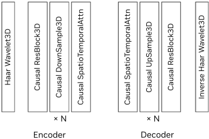

### 5.2 扩散 WFM：EDM + 不确定性加权

EDM 去噪评分匹配损失（原文 §5.1.1，$x_0 \sim p_{data}$，$n \sim \mathcal{N}(0, \sigma^2 I)$，$D_\theta$ 为噪声水平条件化的去噪网络）：

$$\mathcal{L}(D_\theta; \sigma) = \lambda(\sigma)\, \mathbb{E}_{x_0,\, n} \left[ \left\| D_\theta(x_0 + n; \sigma) - x_0 \right\|_2^2 \right]$$

$$\mathcal{L}(D_\theta) = \mathbb{E}_{\sigma \sim \mathcal{P}_{train}} \left[ \mathcal{L}(D_\theta; \sigma) \right], \qquad \ln \sigma \sim \mathcal{N}(P_{mean}, P_{std}^2)$$

其中 $\lambda(\sigma)$ 是 EDM preconditioning 的噪声水平权重（保证各噪声级初期贡献均等，具体形式沿用 Karras et al. 2022——论文声明遵循 EDM 的参数化设计）。关键改动：把多噪声级当**多任务学习**，引入 MLP 参数化的不确定性函数 $u(\sigma)$（解读视角：即 uncertainty weighting，$\mathrm{e}^{-u(\sigma)}$ 加权损失、同时对 $u$ 本身施惩罚）：

$$\mathcal{L} = \mathbb{E}_{\sigma} \left[ \mathrm{e}^{-u(\sigma)} \mathcal{L}(D_\theta; \sigma) + u(\sigma) \right]$$

直觉：模型在某个噪声级上"没把握"就自动调低该级权重，但低权重本身要付代价，防止 $u$ 无限抬高。

### 5.3 自回归 WFM：NLL + z-loss

视频 token 序列 $\mathcal{V} = \{v_1, \dots, v_n\}$（词表 64,000）上的负对数似然：

$$\mathcal{L}_{NLL} = -\sum_{i=1}^{n} \log P\left( v_i \mid v_1, \dots, v_{i-1};\ \Theta \right)$$

训练稳定性组合拳：z-loss 惩罚 logits 偏离零（$\mathcal{L}_{z\text{-loss}} = \lambda \sum_i z_i^2$，$\lambda = 3 \times 10^{-4}$）+ QK-Norm（归一化后用可学习 $\gamma$ 替代固定 $1/\sqrt{d_k}$ 缩放）。

### 5.4 后训练的条件注入

- 相机位姿 → Plücker 射线嵌入（原文公式未解析，按 Plücker 标准形式重写；$c$ 为相机中心、$d$ 为每个潜像素的单位射线方向，与原文变量定义一致）：

$$\pi = \left( d,\; c \times d \right)$$

  CV8×8×8 时间压缩 8×，每 8 帧取第 4 帧的 Plücker 嵌入（与潜帧同分辨率）在通道维与潜 token 拼接。
- 动作 → action embedder MLP：5B 版投影后经 cross-attention 注入；7B 版加到 DiT 时间步嵌入上。
- 轨迹 → 64 点 3D 序列（0.1s 间隔）的嵌入作为去噪器的条件输入。

### 5.5 扩散解码器：离散路线的画质补救

把 7B-Text2World 微调成离散→连续的"翻译器"：同一视频分别用 DV8×16×16（条件分支）与 CV8×8×8（噪声分支）编码，离散 token 经词表嵌入 + 2× 上采样后与带噪连续 token 通道拼接，训练去噪器从离散 token 的信息中还原连续 token；推理时 AR 输出先经 7B 去噪器翻成 CV8×8×8 潜码，再由 CV 解码器出 RGB——等于用扩散先验补偿离散 tokenizer 的有损压缩。

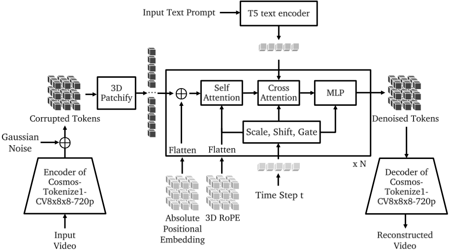

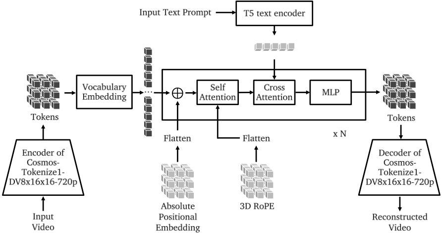

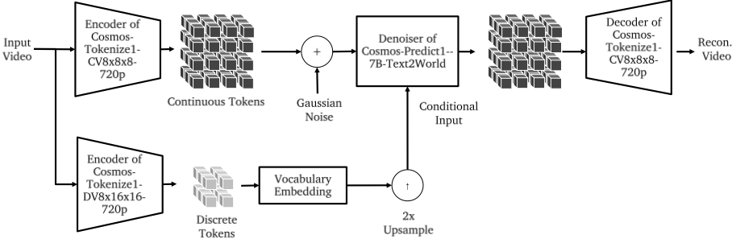

## 6. 实验证据复盘

**先说评测口径**：论文**没有**用 VBench/FVD 一把抓的通用视频基准，而是自建三套面向"世界模型"的评测——tokenizer 专用 TokenBench（500 段驾驶/机器人/第一人称/网络视频）、静态场景 3D 一致性（RealEstate10K 500 段 + 对极几何 + 3DGS 新视角合成）、物理对齐（Isaac Sim/PhysX 造 8 类牛顿力学场景 × 800 段 1080p 视频）。这个选择本身就是论点：世界模型的"好"不在画面好看，而在几何与物理站得住。

### 6.1 Tokenizer：压缩率-质量-速度三角（原文表 5/6/7/9 节选，全部数字与 PDF 核对）

| 视频 tokenizer | 压缩 | DAVIS PSNR↑ | DAVIS rFVD↓ | TokenBench PSNR↑ | TokenBench rFVD↓ |
| --- | --- | --- | --- | --- | --- |
| CogVideoX-Tokenizer 4×8×8 | 4×8×8 | 29.29 | 19.58 | 32.06 | 6.97 |
| Omni-Tokenizer 4×8×8 | 4×8×8 | 22.23 | 117.66 | 24.48 | 35.86 |
| **Cosmos-Tokenize1-CV4×8×8-360p** | 4×8×8 | **35.85** | **10.06** | **38.42** | **3.34** |
| **Cosmos-Tokenize1-CV8×8×8-720p** | 8×8×8 | 31.28 | 23.49 | 35.13 | 9.82 |
| Cosmos-0.1-CV8×16×16 | 8×16×16 | 27.60 | 93.82 | 31.61 | 43.08 |
| **Cosmos-Tokenize1-DV8×16×16-720p** | 8×16×16（离散） | 25.49 | 259.33 | 29.33 | 107.43 |

| 图像 tokenizer（1024 高） | MS-COCO PSNR↑ | MS-COCO rFID↓ | ImageNet PSNR↑ |
| --- | --- | --- | --- |
| FLUX-Tokenizer 8×8（VAE） | 24.00 | 2.501 | 20.09 |
| **Cosmos-Tokenize1-CI8×8-360p** | **32.79** | 1.874 | **32.91** |
| **Cosmos-Tokenize1-CI16×16-360p** | 31.28 | 4.294 | 31.29 |

| 运行时（A100 80GB，每帧/图） | 参数量 | 耗时 ms |
| --- | --- | --- |
| FLUX-Tokenizer 8×8 | 84M | 242 |
| Cosmos-0.1-CI8×8 | 77M | **62.7** |
| CogVideoX-Tokenizer 4×8×8 | 216M | 414 |
| Cosmos-0.1-CV4×8×8 | 105M | **34.8** |

读法：① 同压缩率下全面碾压（CV4×8×8 比 CogVideoX 高 6.6dB）；② **更高压缩下仍优于对手的低压缩档**（CV8×8×8 的 31.28 > CogVideoX 4×8×8 的 29.29）——这是"压缩-质量帕累托前沿整体外推"的证据；③ 离散档位（DV）的 rFVD 明显劣于连续档位，量化了"AR 路线画质债"的来源；④ 速度 2~12× 优势来自轻量架构（105M vs 216M）。单卡 A100 可一次编码 1080p×8s / 720p×10s。

### 6.2 预训练 WFM：3D 一致性（原文表 19，静态场景，RealEstate10K）

| 方法 | Sampson 误差↓ | 位姿估计成功率↑ | PSNR↑ | SSIM↑ | LPIPS↓ |
| --- | --- | --- | --- | --- | --- |
| VideoLDM | 0.841 | 4.4% | 26.23 | 0.783 | 0.135 |
| Cosmos-Predict1-7B-Text2World | **0.355** | **62.6%** | **33.02** | **0.939** | **0.070** |
| Cosmos-Predict1-7B-Video2World | 0.473 | 68.4% | 30.66 | 0.929 | 0.085 |
| Cosmos-Predict1-4B | 0.433 | 35.6% | 32.56 | 0.933 | 0.090 |
| Cosmos-Predict1-5B-Video2World | 0.392 | 27.0% | 32.18 | 0.931 | 0.090 |
| **真实视频（参照）** | 0.431 | 56.4% | 35.38 | 0.962 | 0.054 |

**最硬的一行**：7B-Text2World 的几何一致性指标（Sampson 0.355、位姿成功率 62.6%）**超过了真实视频本身**（0.431、56.4%）——因为真实手持视频有运动模糊与遮挡，而生成视频"过于干净"。这是论文被引用最多的证据（"生成世界已可被当成可重建的 3D 世界"），但注意测试集是静态场景，动态场景未测。

### 6.3 物理对齐：规模化没有自动带来物理（原文表 20 节选，33 帧平均）

| 模型 | 条件 | PSNR↑ | SSIM↑ | DreamSim↑ | Avg IoU↑ |
| --- | --- | --- | --- | --- | --- |
| 7B-Video2World | prompt + 1 帧 | 17.34 | 0.538 | 0.836 | 0.332 |
| 7B-Video2World | prompt + 9 帧 | **21.06** | **0.691** | 0.859 | **0.592** |
| 14B-Video2World | prompt + 9 帧 | 20.21 | 0.635 | **0.860** | **0.598** |
| 4B（AR） | 9 帧 | 18.13 | 0.482 | 0.859 | 0.481 |
| 12B（AR） | 9 帧 | 18.22 | 0.487 | **0.869** | 0.487 |

三个反直觉发现：① 更多条件帧（9 vs 1）的提升远大于模型变大（7B→14B）——物理预测靠的是"看到初始速度/加速度"，不是参数量；② **论文明说"结果不支持更大模型物理对齐更好"**；③ 所有模型同样挣扎，失败模式清单：物体凭空出现/消失（object impermanence）、形变、运动学不合理、重力违背。自回归系在像素级全面落后扩散系（离散压缩的画质债），但 DreamSim 语义级打平。

### 6.4 后训练 1：相机控制（原文表 22，RealEstate10K 测试）

| 方法 | 位姿估计成功率↑ | 旋转误差(°)↓ | 平移误差↓ | FID↓ | FVD↓ |
| --- | --- | --- | --- | --- | --- |
| CamCo（SOTA 专用模型） | 43.0% | 8.277 | 0.185 | 57.49 | 433.24 |
| **7B-Video2World-Sample-CameraCond** | **82.0%** | **1.646** | **0.038** | **14.30** | **120.49** |

一个通用 WFM 后训练后，把专用 SOTA（CamCo）在所有五个指标上打穿，且训练集（DL3DV-10K）与测试集（RealEstate10K）分布有显著偏移——通才先验带来了跨域鲁棒性。FID/FVD 差距（14.30 vs 57.49）主要来自 CamCo 的 256×256 低分辨率上限。定性对比里 CamCo 多次连相机位姿都无法重估（分布外崩溃），Cosmos 版本则一路跟住输入轨迹：

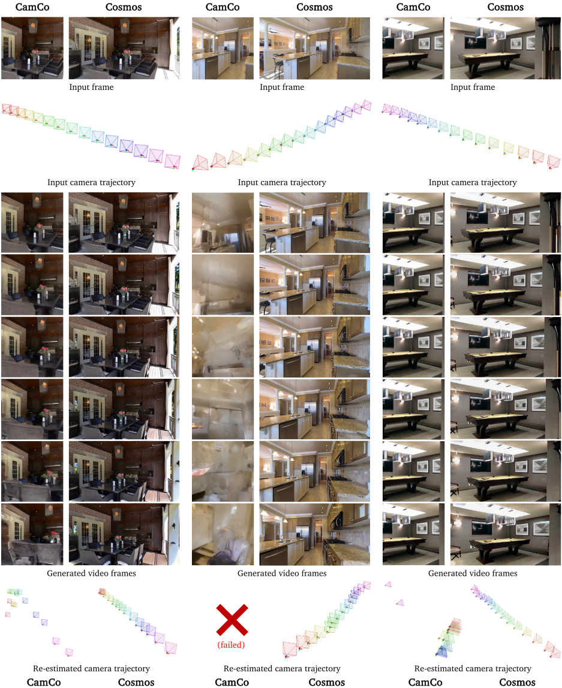

### 6.5 后训练 2：机器人操作（原文图 24 与表 23）

人类评测（10 名标注者 × 23 段测试，7B-Instruction vs 微调的 VideoLDM-Instruction）：Overall 偏好 **78.3% vs 13.0%**（其余为平票 8.7%），四个维度全胜——指令跟随 65.2%、物体恒存性 82.6%、真实性 73.9%。注意样本量很小（23 段），该结论的统计强度有限（解读视角）。

Bridge 数据集动作条件下一帧预测（自回归 rollout 出整段视频）：

| 方法 | PSNR↑ | SSIM↑ | Latent L2↓ | FVD↓ |
| --- | --- | --- | --- | --- |
| IRASim-Action（专用基线） | 19.13 | 0.64 | 0.38 | 593 |
| 5B-Video2World-Sample-ActionCond | 19.95 | 0.80 | 0.36 | 434 |
| **7B-Video2World-Sample-ActionCond** | **21.14** | **0.82** | **0.32** | **190** |

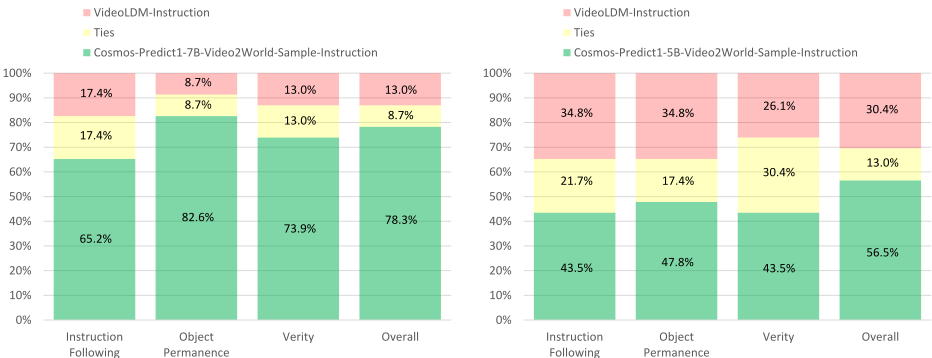

### 6.6 后训练 3：自动驾驶多视角（原文表 24/25，RDS 测试）

| 方法 | FID↓ | FVD↓ | TSE↓（时序） | CSE↓（跨视角） |
| --- | --- | --- | --- | --- |
| VideoLDM-MultiView | 60.84 | 884.46 | 1.24 | 6.48 |
| 7B-Text2World-Sample-MultiView | **32.16** | **210.23** | 0.68 | 2.11 |
| └ + 轨迹条件（TrajectoryCond） | - | - | **0.59** | **2.02** |
| 真实视频（参照） | - | - | 0.69 | 1.71 |

轨迹指标：轨迹一致性误差 TAE-ATE 0.54（真实 0.49）、轨迹跟随误差 TFE **20.20cm**（真实轨迹自洽上限 13.49cm，差距 <7cm）。附带人工核查：20 段生成视频的 157 个跟踪目标中**零**物理不可能事件。六视角 57 帧、848×480、可续写至 201 帧。

### 6.7 推理效率：AR 路线的护城河（原文表 15/17/18）

Medusa 投机解码（9 头最优，只微调最后两层 + unembedding）：4B 吞吐 444.95 → 894.67 tokens/s（**2.0×**），前向次数 7680 → 1812（**-4.2×**，12 头时 -4.6×）；5B 吞吐 303.61 → 982.77（**3.2×**，前向 -6.1×）。低分辨率适配（320×512 + 10FPS 域内微调）：**806.61 tokens/s = 10.08 帧/秒，实时生成**（8×H100）。这是扩散路线目前做不到的事。失败率表（100 个 Physical AI 输入人工检查）：图像条件 4B 15% / 5B 7% / 12B 2% / 13B 3%；9 帧视频条件全部 ≤2%——规模换稳定。

**哪些结论被后续工作验证/动摇**（解读视角）：① "通用 WFM + 后训练 > 从零专用模型"的配方被 NVIDIA 后续的 Cosmos-Transfer1（world-to-world 控制）、Cosmos-Reason1/2（物理常识推理）延续，并成为 GR00T 机器人合成数据管线的底座；② "扩散画质领先"随后被 AR 系（如 video GPT 类 + 更强 tokenizer）部分追平，两条路线的混合形态（蒸馏因果化扩散、AR 加扩散头）成为 2025 年的主流方向——论文 §9 自己预言了这个趋势；③ 物理对齐"规模不解决问题"的悲观结论，与后续物理专用数据/物理奖励的研究（如物理一致性微调）形成呼应。

## 7. 开源仓库导读

**仓库家族现状（2025-11 查证）**：主仓库 [NVIDIA/Cosmos](https://github.com/NVIDIA/Cosmos) 已升级为 **Cosmos 3 落地页**（omnimodal 双塔架构：Reasoner + Generator，Cosmos3-Nano 16B / Super 64B / Edge 4B，OpenMDW-1.1 许可，Diffusers 一键推理）。**论文对应的 Cosmos-1.0 家族**已分流：

```
nvidia-cosmos/cosmos-predict1    # 1.0 家族主仓（扩散+自回归+tokenizer+后训练样例）
  ├── cosmos_predict1/diffusion/   # Text2World / Video2World 7B/14B 推理与后训练
  ├── cosmos_predict1/autoregressive/  # 4B/12B 基座与 5B/13B-Video2World
  ├── cosmos_predict1/tokenizer/       # 连续/离散 tokenizer 权重拉取与推理
  └── examples/                        # post-training_diffusion_video2world.md 等配方（20 篇）
NVIDIA/Cosmos-Tokenizer          # 2025-02 归档；12 个 checkpoint（0.1 全家 + 1.0 两款）
NVIDIA/Cosmos-Autoregressive1    # 论文发布时的独立 AR 仓库，现已 404（解读视角：并入 predict1）
```

**权重清单**（HuggingFace `nvidia/`，NVIDIA Open Model License）：`Cosmos-1.0-Diffusion-7B/14B-Text2World` 与 `-Video2World`；`Cosmos-1.0-Autoregressive-4B/12B` 与 `-5B/13B-Video2World`；`Cosmos-1.0-Tokenizer-CV8x8x8` / `-DV8x16x16`；`Cosmos-1.0-Prompt-Upsampler-12B-Text2World`；`Cosmos-1.0-Diffusion-7B-Decoder-DV8x16x16ToCV8x8x8`；`Cosmos-1.0-Guardrail`（gated，需申请）。另有 0.1 全家桶 tokenizer 12 款。

**最小跑通路径**：

```bash
# 1) Tokenizer 编解码（最快验证入口，TokenBench 同款）
pip3 install -e cosmos-tokenizer
python3 -m cosmos_tokenizer.video_cli \
  --video_pattern 'test_data/video.mp4' \
  --checkpoint_enc pretrained_ckpts/Cosmos-1.0-Tokenizer-CV8x8x8/encoder.jit \
  --checkpoint_dec pretrained_ckpts/Cosmos-1.0-Tokenizer-CV8x8x8/decoder.jit
# Python API：(indices, codes) = encoder.encode(video)  # 离散：indices ∈ [1..64K]

# 2) WFM 推理（predict1 示例脚本，含 guardrail 前后拦截）
#    依赖：CUDA 12.x + 8×H100/A100 量级（14B Video2World 推荐 H100）
PYTHONPATH=$(pwd) python cosmos_predict1/diffusion/inference/video2world.py \
  --checkpoint_dir checkpoints/Cosmos-1.0-Diffusion-7B-Video2World \
  --input_image_or_video_path input.mp4 --num_input_frames 9
# AR 版对应：cosmos_predict1/autoregressive/inference/video2world.py（4B/5B/12B/13B）

# 3) 后训练（examples/ 共 20 篇 markdown 配方，其中 post-training 11 篇）
#    post-training_diffusion_video2world.md / _video2world_action.md / _video2world_multiview.md
#    post-training_diffusion_video2world_lowmemory.md / post-training_autoregressive_base.md 等
#    提供 AV 驾驶 / 机器人操作 / 无人机（droning）三域样例数据集下载与多节点训练脚本
```

**工程亮点**：① tokenizer 以 TorchScript JIT 发布（encoder/decoder/autoencoder 三件套），NeMo 生态可 `from_pretrained`；② 后训练脚本是论文 §6 配方的逐行对应物，且支持多节点；③ TokenBench（NVlabs/TokenBench）与 ShotBench 独立开源，评测可复现；④ 数据管线本身不开源，但 Cosmos-Curator（新版）承接了 curation 工具链。**许可证注意**：代码 Apache-2.0，权重 NVIDIA Open Model License（商用需遵守使用政策，输出物归用户）；Guardrail 依赖 Llama Guard 3，受其自身许可约束——二次分发时三个许可要分别核对。

**护栏（Guardrail）也是发布物的一部分**：前置层 = 关键词黑名单（WordNet 词元还原后匹配）+ Aegis（LlamaGuard 微调的防御版，13 类风险分类器）；后置层 = 帧级视频内容安全分类器（SigLIP 嵌入 + MLP，任一帧不安全即整段拒绝）+ RetinaFace 人脸像素化（>20×20 像素）。配套专职红队，发布前已标注 10,000+ 对抗 prompt-视频对：

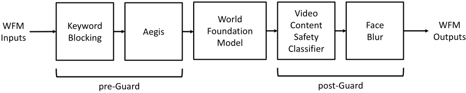

## 8. 局限与争议

**论文自认的局限**（§9）：① 当前 WFM（包括 Cosmos）**还不是可靠的物理世界模拟器**——物体恒存性缺失、接触富集动力学（contact-rich dynamics）不准、指令跟随不稳定、画面真实 ≠ 物理正确（重力/光学/流体仍会错）；② 评测本身是难题：人类评物理保真度受主观偏差影响，且与下游任务指标未必正相关——论文提出的方向是用多模态 LLM 当自动评测器、用物理模拟器做可复现交互评测（物理对齐那一节就是雏形）；③ AR 与扩散的全面对比被论文自己列为 future work。

**社区真实批评与争议**（均已查证出处）：

1. **"视频生成 = 世界模型"的路线之争**。LeCun 的公开立场是"通过生成像素来建模世界既浪费也注定失败"（wasteful and doomed to fail），"从 prompt 生成以假乱真的视频不代表理解物理世界"——JEPA 系主张在抽象表示空间预测，把算力花在可预测的语义上而非叶子晃动这类像素噪声。Cosmos 的回应姿态藏在数据管线里（按"动态信息丰富度"过滤、按物理相关性上/下采样），但理论上并未正面回答"像素级预测是否必要"。arXiv 2507.05169《Critiques of World Models》则进一步指出世界模型的核心应是"可推理的沙盒"而非视频生成器。
2. **"世界模型"称谓的营销化担忧**。社区（HN/Reddit 等长讨论）普遍警惕 video generator 包装成 world model 的宣传话术：真正的世界模型要求"交互式、可干预、状态一致"，而条件视频生成模型在你"动手"时并不保证反事实一致性。Cosmos 的多视角/轨迹条件实验部分回应了这一点（位姿/轨迹跟随误差逼近真实视频），但静态场景评测为主仍是软肋。
3. **闭源对照的代差压力**。Sora 2（OpenAI，2025-09）与 Genie 3（DeepMind，2025-08，720p@24fps 实时交互、数分钟世界一致性）都是闭源；Genie 3 的"实时可导航世界"形态恰好是 Cosmos 相机控制后训练想做的事，且体验完整度更高——开源阵营在能力上限上仍落后于闭源旗舰。反方观点：Cosmos 的价值在"可微调、可商用、全链路开放"，与闭源旗舰不在同一赛道。
4. **论文内部文本与表格不一致**（解读视角核查）：§5.2.2 文字称"与主流 LLM 不同，我们不用 MQA/GQA"，但表 14 明确列出 Key/Value Heads = 8（而 Attention Heads = 32），这正是 GQA 配置。两处必有一处笔误；对照 Cosmos-1.0-Autoregressive 权重配置应为 GQA。读论文引用架构细节时以表格为准。
5. **tokenizer 分辨率/压缩率天花板**。离散路线的画质债实打实写在表 6 里（DV8×16×16 rFVD 259），需要额外 7B 扩散解码器补救——多一阶段推理就多一份延迟与工程复杂度；720p 训练上限意味着 4K 域外内容风险自担。论文未讨论 tokenizer 升级时已训练 WFM 的迁移成本（扩散侧靠潜空间归一化部分缓解，AR 侧词表绑定 FSQ 配置）。
6. **数据与成本不透明**。2000 万小时原始视频与 1 亿片段只给了分布占比，未披露许可证构成（版权风险自担）；10,000 H100 × 3 个月只报总量，没有逐模型/逐阶段拆分，第三方复训成本无法估。RDS（驾驶）与 Cosmos-1X（人形机器人）数据集均不公开，AV 与机器人后训练结果第三方难以精确复现。
7. **物理对齐评测的"模拟器泄露"争议**。物理对齐用合成渲染视频评测、而预训练数据是真实视频，存在 sim-to-real 域差——论文自己在 §5.3.2 承认这一点（"photorealism to bridge the sim-to-real gap"列为改进项）；IoU/PSNR 类指标能否代表"物理理解"也在 2507.05169 等批评文章中被质疑。

## 9. 与本知识库的衔接

| 主题 | 本库文件 | 衔接点 |
| --- | --- | --- |
| Transformer 底座 | `/home/yyl/ObsidianLibraries/PyTorch与深度学习/08-Transformer从零实现.md` | 扩散 WFM = DiT（self-attn + cross-attn + AdaLN），AR WFM = Llama3 式 GPT——该章实现的骨架加 3D RoPE 与 QK-Norm 就是两者 |
| RL 视角的世界模型用途 | `/home/yyl/ObsidianLibraries/强化学习/10-RLHF-从奖励模型到PPO-DPO.md` | 论文 §2.1 的"策略训练"（WFM 当 RL 环境）与"策略评测"是 model-based RL 的超大规模版；Dyna 式思路对照 |
| RL 前沿 | `/home/yyl/ObsidianLibraries/强化学习/11-现代RL前沿概览.md` | GRPO/RLVR 之外的世界模型路线补全：Cosmos + 奖励模型 = 可扩展的仿真环境 |
| 相机成像与多视角 | `/home/yyl/ObsidianLibraries/自动驾驶/Stage 1-传感器原理与数据基础/教程/第1周-相机成像与视觉感知基础.md` | RDS 六相机环视布置、Plücker 射线嵌入的相机几何基础 |
| 时空标定 | `/home/yyl/ObsidianLibraries/自动驾驶/Stage 1-传感器原理与数据基础/教程/第4周-坐标系与时空同步.md` | 多视角时间同步（以前视 timestamps 为准）与外参——RDS 数据集构建的直接前提 |
| BEV 与多视角几何 | `/home/yyl/ObsidianLibraries/自动驾驶/Stage 5-BEV感知-稠密与稀疏/教程/第1周-为什么需要BEV与坐标变换基础.md` | 论文 3D 一致性评测的对极几何/Sampson 误差、多视角跨视角一致性 CSE，与 BEV 的坐标变换互为表里 |
| 合成数据范式 | `/home/yyl/ObsidianLibraries/VLM & VLA/Stage 4-数据合成与数据工程/教程/第1周-合成数据范式与Self-Instruct.md` | WFM 合成数据生成是"模型造数据"的下一级台阶；prompt upsampler 的"长→短造对"与 Self-Instruct 同构 |
| 数据清洗与去重 | `/home/yyl/ObsidianLibraries/VLM & VLA/Stage 4-数据合成与数据工程/教程/第4周-数据清洗语义去重与过滤.md` | Cosmos curation 的语义去重（k=10,000 聚类 + 簇内去重，砍 30%）是该章 SemDeDup 方法的万小时级实例 |
| 高吞吐数据管线 | `/home/yyl/ObsidianLibraries/VLM & VLA/Stage 4-数据合成与数据工程/教程/第5-6周-高吞吐Pipeline与闭环验证.md` | Ray 编排、多资源（NVDEC/NVENC/GPU/网络）协同调度、TRT-LLM FP8 标注加速——同一套工程方法论 |
| VLA 与动作离散化 | `/home/yyl/ObsidianLibraries/VLM & VLA/Stage 10-VLA 与具身智能/教程/第1-2周-VLA架构与动作离散化.md` | Bridge 7 维动作向量（Δx…ΔGripper）的离散化/嵌入注入，与 VLA 的 action token 思路对照 |
| Sim2Real | `/home/yyl/ObsidianLibraries/VLM & VLA/Stage 10-VLA 与具身智能/教程/第10周-SimToReal与结课总结.md` | WFM 作为"可微调的仿真器"是 Sim2Real 的新解法：先 WFM 生成、再真实数据校准 |

## 10. 面试视角

**Q1：视频 tokenizer 为什么是世界模型的地基？"压缩率、保真、可解码性"三角怎么权衡？**
答题要点：WFM 训练算力 ∝ token 数，tokenizer 决定"同样算力看多长的世界"（8×16×16 比 4×8×8 再省 4×）；但压狠了丢物理细节（离散 DV8×16×16 rFVD 259），世界模型学到错的物理。Cosmos 的三角解法：小波先验去像素冗余（省下的容量给语义）、因果架构让图像/视频统一训练、FSQ 免辅助损失；离散保真缺口用 7B 扩散解码器补。追问点：为什么 LayerNorm 换掉 GroupNorm（防潜空间异常大值）；为什么因果性对 Physical AI 重要（流式推理 + 与因果世界对齐）。

**Q2：连续 token 和离散 token 各服务哪条路线？取舍是什么？**
答题要点：连续 16 维向量 → 扩散（回归型损失，信息无损通道大，画质好）；离散 64K FSQ 索引 → 自回归（交叉熵 + next-token 范式，直接继承 LLM 全套推理优化：KV cache、TP、Medusa 投机解码实测 2~3.2×、低分辨率实时 10 FPS）。离散的代价：量化丢信息（画质债）+ 词表固定绑死 tokenizer 配置。追问点：FSQ vs VQ-VAE——FSQ 无 codebook collapse、无需 commitment loss；为什么连续 tokenizer 不能直接喂 GPT（回归目标 vs softmax 分类目标）。

**Q3：扩散 vs 自回归两条 WFM 路线，各自优劣与混合趋势？**
答题要点：扩散——画质与控制注入占优（本篇 3D 一致性、相机控制、多视角实验均扩散胜），但采样多步、实时难；自回归——吞吐/延迟/生态占优（KV cache、投机解码、可继承 LLM 权重），但离散压缩画质债 + 文本条件服从性弱（prompt upsampler 对 AR 无效）。论文预言边界模糊：双向扩散 Transformer 蒸馏成因果 KV cache 模型、AR 加局部双向注意力 + 扩散头。追问点：为什么 AR 单帧条件失败率高（15%）而 9 帧条件骤降（≤2%）——观测带宽决定初始速度/加速度可推断性。

**Q4：后训练是怎么把通用 WFM 变成专用世界模型的？三种条件注入方式有何不同？**
答题要点：共同模式 = 冻结/微调主干 + 新模态编码器接入。相机位姿 → Plücker 射线图与潜 token 通道拼接（空间型条件走特征拼接，每 8 帧取第 4 帧）；动作向量 → MLP 嵌入后走 cross-attention（5B）或加到时间步嵌入（7B）；轨迹 → 嵌入进去噪器。后训练数据量极小（Cosmos-1X 仅 200 小时）因为物理先验已在预训练。效果：相机控制 82% 位姿成功率 vs 专用 CamCo 43%，跨域（DL3DV→RealEstate10K）仍稳。追问点：多视角为什么不用 RoPE 加视角轴（视角无关 RoPE + 全局视角嵌入 + 每视角独立 cross-attention 的解耦设计）。

**Q5：为什么 Cosmos 不用 VBench 这类通用视频基准？它的评测方法论特殊在哪？**
答题要点：世界模型的"好"= 3D 几何一致 + 物理定律对齐，VBench 的美学/流畅度维度不回答这两个问题。Cosmos 自建三层：TokenBench（tokenizer 域覆盖）、静态场景 3D 一致性（对极几何 Sampson 误差 + 位姿估计成功率 + 3DGS 新视角合成）、物理对齐（Isaac Sim 造 800 段真值视频 + 像素/特征/目标三级指标）。代价：静态场景为主、合成评测有 sim-to-real 域差、人类评测样本小（23 段）——论文自己承认评测体系未完成，并把"MLLM 自动评测器 + 模拟器交互评测"列为方向。追问点：Sampson 误差超过真实视频说明了什么（生成内容"过度干净"导致的几何可重建性更高）与不能说明什么（不代表动态场景物理正确）。

---

*上一篇：[03 · Qwen2.5-Omni](../03-Qwen2.5-Omni/解读报告.md)｜下一篇：[05 · BitNet b1.58](../05-BitNet-b1.58/解读报告.md)*

*参考与争议出处：[arXiv 2501.03575](https://arxiv.org/abs/2501.03575) · [NVIDIA/Cosmos](https://github.com/NVIDIA/Cosmos) · [cosmos-predict1](https://github.com/nvidia-cosmos/cosmos-predict1) · [Cosmos-Tokenizer](https://github.com/NVIDIA/Cosmos-Tokenizer) · [TokenBench](https://github.com/NVlabs/TokenBench) · [LeCun 关于像素生成世界模型的批评](https://x.com/ylecun/status/1758740106955952191) · [Critiques of World Models (arXiv 2507.05169)](https://arxiv.org/html/2507.05169v2) · [Genie 3 (DeepMind)](https://deepmind.google/blog/genie-3-a-new-frontier-for-world-models)*
