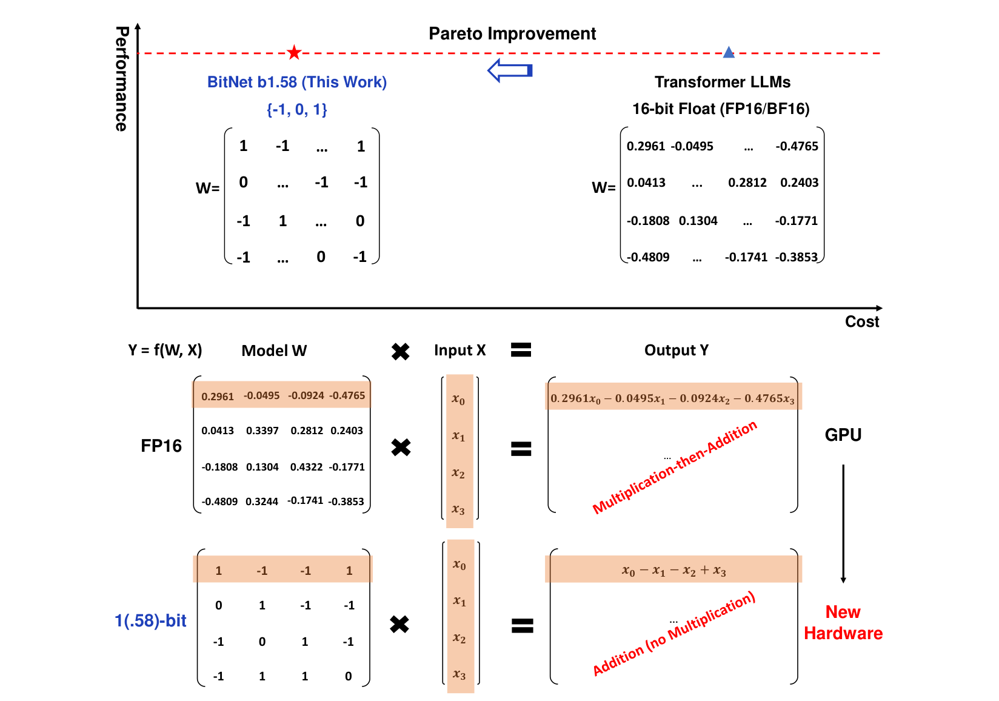
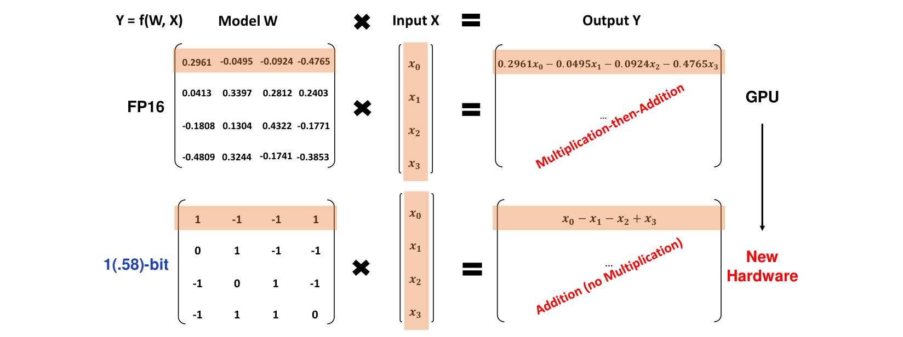
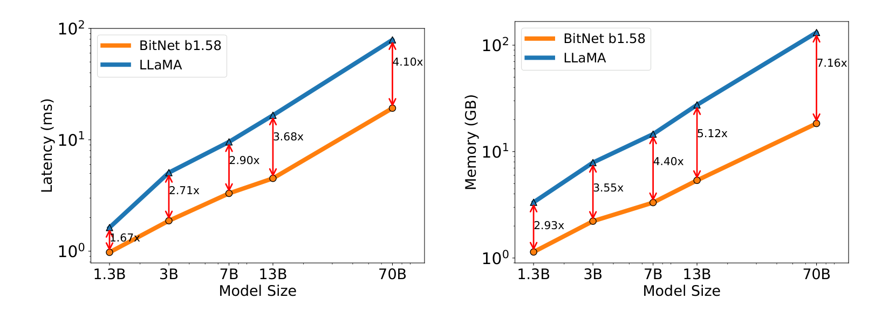
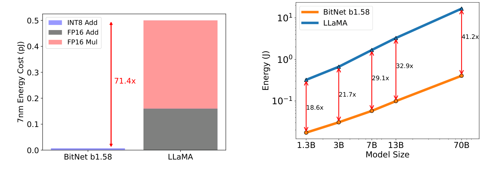

# 05 | BitNet b1.58：把 LLM 的每个权重钉死在 {-1, 0, +1}

> **一句话**：不走"PTQ 把 16 bit 压成 4 bit"的老路，而是把 LLM 的全部权重改成三值 {-1, 0, +1}（信息量 log2(3)≈1.58 bit）并**从头训练**——矩阵乘法退化成整数加减法，3B 规模起追平 FP16 基线，延迟/内存/能耗全线下降，这是一次"改计算范式"而非"压存储位数"的范式挑战。

---

## 1. 论文档案

| 项目 | 内容 |
| --- | --- |
| 标题 | The Era of 1-bit LLMs: All Large Language Models are in 1.58 Bits |
| 作者与机构 | Shuming Ma\*、Hongyu Wang\*（共同一作）、Lingxiao Ma、Lei Wang、Wenhui Wang、Shaohan Huang、Li Dong、Ruiping Wang、Jilong Xue、Furu Wei（通讯）——除 Hongyu Wang 与 Ruiping Wang 来自中国科学院大学外，其余均为微软研究院（MSRA） |
| 发表处 | arXiv 预印本（v1 提交于 2024-02-27），未标注会议/期刊；正文 6 页 + 参考文献 2 页 |
| arXiv | [2402.17764](https://arxiv.org/abs/2402.17764) |
| 开源仓库 | [microsoft/BitNet](https://github.com/microsoft/BitNet)（官方推理框架 **bitnet.cpp**，MIT 许可证；系统配套论文 "Bitnet.cpp: Efficient Edge Inference for Ternary LLMs", arXiv 2502.11880） |
| 权重可得性 | 本论文自身未发布权重；官方后续发布 `microsoft/BitNet-b1.58-2B-4T`（2.4B 参数、4T tokens 训练，GGUF 权重开源于 `BitNet-b1.58-2B-4T-gguf`）与 `BitNet-embedding-0.6B/270M`；社区有 `1bitLLM/bitnet_b1_58-large`（0.7B）、`1bitLLM/bitnet_b1_58-3B`、`HF1BitLLM/Llama3-8B-1.58-100B-tokens`、TII Falcon-E 系列等 |

> 提示：论文 PDF 共 8 页（正文 6 页），"6 页短文"指正文部分。前作 BitNet（arXiv 2310.11453）是本文的架构基础，本文的量化函数与 BitLinear 细节多处引用它。

---

## 2. 速览

**TL;DR**：BitNet b1.58 把 LLM 中所有 `nn.Linear` 替换为 BitLinear，权重三值化 {-1, 0, +1}、激活 8-bit，**从头训练**。在相同模型规模与训练 tokens（100B，RedPajama）下，**3B 起在困惑度与下游任务上追平 FP16 LLaMA 复现基线**，同时 3B 档快 2.71×、省 3.55× 内存；70B 档快 4.10×、省 7.16× 内存、吞吐 8.9×、端到端能耗省 41.2×。

- **问题**：LLM 推理的大头是矩阵乘法（FP16 乘加）与大权重搬运（DRAM→SRAM 带宽压力）；PTQ（SmoothQuant/AWQ/GPTQ/QuIP 等）只能"压缩存储 + 换低位算术"，乘法器还在，且高压缩比下精度崩塌、对既有模型是"事后补救"。
- **创新**：① 权重三值 {-1,0,1}，在 BitNet 二值 {-1,+1} 基础上加回 0（显式特征过滤），信息量 log2(3)≈1.58 bit；② absmean 权重量化函数 + per-token absmax 的 8-bit 对称激活（去掉 zero-point）；③ 矩阵乘退化为整数加/减法（无乘法），按 7nm 能耗模型矩阵乘算术能耗省 **71.4×**；④ 从头训练 + LLaMA-alike 组件（RMSNorm/SwiGLU/RoPE/无 bias），可低成本接入 HF、vLLM、llama.cpp。
- **证据**：100B tokens 训练的 700M~3.9B 对照实验（表 1/2：3B 起追平）；7B/13B/70B 成本扩展曲线（图 2：延迟 1.67×→4.10×，内存 2.93×→7.16×）；吞吐对照（表 3：batch 11×、吞吐 8.9×）；2T tokens 对照 StableLM-3B 全任务占优（表 4：74.34 vs 73.22）；提出"等效 scaling law"：13B b1.58 ≈ 3B FP16、30B ≈ 7B、70B ≈ 13B（成本效率口径）。

---

## 3. 背景与动机

这篇论文出现之前，"给 LLM 提效"的量化主流是**后训练量化（PTQ）**，论文开篇点名 SmoothQuant、OPTQ(GPTQ)、QuIP、QuIP#、AWQ 一众工作：拿一个训好的 FP16 模型，把权重/激活压到更低比特（趋势是 16 bit → 4 bit），省内存、换 INT 算术。论文的判断很直接："post-training quantization is sub-optimal, even though it is widely used in industry LLMs"。

PTQ 路线的两个天花板：

1. **计算范式没变**。无论压到 8 bit 还是 4 bit，矩阵乘仍是"乘法-加法"流水线：FP16/INT4 乘法器、累加器一个不少。压低位只降低单次运算能耗与存储，不改变运算的**种类**。
2. **精度与压缩比的矛盾**。训练结束时权重分布是为 FP16 定制的，事后强行离散到极低比特（2-bit 档）误差难以收拾，因此工业界普遍停在 4-bit 档。

另一条被论文引为铺垫的路线是其前作 **BitNet（2310.11453）**：训练时就用二值权重 {-1, +1}，矩阵乘只涉及整数加法——"the matrix multiplication of BitNet only involves integer addition, which saves orders of energy cost"。同时论文算了一笔**访存账**：推理时把参数从 DRAM 搬到片上 SRAM 是大头，扩 SRAM 又比扩 DRAM 贵得多；1-bit 权重天然把"容量 + 带宽"两头的搬运成本一起压下来。而芯片的根本约束是功耗（"the fundamental limit to compute performance in many chips is power"），省能耗还能转化为更快的主频利用。

BitNet 二值版的短板是表达力：权重只有 ±1，没有"这个通道不参与"的选项。本文的核心动作就是**加回 0**——三值 {-1, 0, +1}，配合从头训练，把 1-bit 路线从"玩具"推到"3B 起追平 FP16"。

---

## 4. 核心创新拆解

### 4.1 权重三值化 {-1, 0, +1}：加一个 0，价值超过 0.58 bit



- **是什么**：LLM 每个 `nn.Linear` 的权重被约束为三值 {-1, 0, +1}。在二进制系统里表达 3 个状态需要 log2(3)≈1.585 bit，"1.58-bit"由此得名。
- **为什么之前不行**：二值 BitNet 只有 {-1, +1}，权重无法表达"置零/过滤"——每个输入通道都强行参与累加，噪声通道全部计入；而普通 PTQ 三值化是"事后离散"，误差没人兜底。论文原话：0 的加入带来"explicit support for feature filtering"，显著改善 1-bit LLM 的性能。
- **怎么做到**：不是对训好的模型做三值离散，而是**从头训练**——训练目标自己学会把哪些权重推到 0。前向用三值权重、反向用潜权重（latent weight）+ 直通估计器（STE，见前作 BitNet 论文）更新 FP16 主权重。
- **代价与权衡**：<3B 规模追不上 FP16（表 1：700M PPL 12.87 vs 12.33；表 2：700M 任务均分 44.3 vs 45.5），小模型容量不足以消化量化损失；且从头训练意味着**必须重花一份完整预训练预算**，存量 FP16 模型无法迁移。

### 4.2 absmean 量化函数 + per-token 对称 8-bit 激活

- **是什么**：权重量化用 absmean：先把权重矩阵除以其平均绝对值 γ，再 RoundClip 到 {-1, 0, +1}（公式见 §5）。激活沿用 BitNet 的 8-bit absmax，但**改成 per-token 对称缩放到 [-Qb, Qb]**，去掉了 BitNet 在非线性函数前把激活搬到 [0, Qb] 的 zero-point 偏移。
- **为什么之前不行**：zero-point 量化（INT8 非对称）需要额外维护零点、反量化时多一步偏移校正，对系统级优化不友好；权重若用 absmax 缩放（除以最大绝对值），单个离群权重会把整个矩阵压得过小，round 后大量元素被挤成 0，而 absmean 对"整体分布"更稳健。
- **怎么做到**：激活按 token 取绝对值最大值做缩放（absmax），对称区间 [-Qb, Qb] 免零点；论文实验称对性能影响可忽略（"negligible effects to the performance in our experiments"）。
- **代价与权衡**：激活仍是 8-bit（不是 1.58 bit），KV cache 也不在本篇的量化范围内——内存优势只来自权重一侧；embedding 层保持全精度（论文在解释图 2 内存倍数随规模变大时明确提到 "the embedding remains full precision"）。

### 4.3 计算范式改变：矩阵乘 → 整数加减法



- **是什么**：当权重只有 {-1, 0, +1}，$y_i = \sum_j W_{ij} x_j$ 变成"挑出正号通道求和、减去负号通道求和、0 号通道直接跳过"——**没有一次乘法**。
- **为什么之前不行**：PTQ 把 FP16 乘加换成 INT4/INT8 乘加，乘法器仍在——这是"压缩存储"；BitNet 把乘法从数据流里**删除**——这是"改变计算范式"。二者在硬件上的终点不同：前者靠通用 GPU 的 INT 张量核，后者可以直接造"加法器阵列"专用芯片。
- **怎么做到**：权重即"选择器"（+1 取 x、-1 取 -x、0 跳过），配合 8-bit 激活做 INT8 加法累加，最后按权重/激活缩放系数反量化（见 §5 BitLinear 前向）。图 1 右下角论文直接喊话 GPU→New Hardware。
- **代价与权衡**：能耗收益依赖"算术能耗模型"估算（71.4× 是矩阵乘算术能耗，7nm，见 §6）；通用 GPU 上没有原生三值/加法器指令时，实际加速靠 LUT 类内核（bitnet.cpp 的 TL1/TL2）或 2-bit 内核（论文实验用的是 Ladder 2-bit kernel），理论范式与落地内核之间有工程距离。

**两条路线的本质差异一张表**（解读视角整理，数字口径见 §6）：

| 维度 | PTQ（AWQ/GPTQ/SmoothQuant…） | BitNet b1.58 |
| --- | --- | --- |
| 对象 | 已训好的 FP16 存量模型 | 从头训练的新模型 |
| 权重 | 低位整数（4/3/2 bit 连续值域） | 三值 {-1, 0, +1} |
| 矩阵乘 | 低位乘法 + 累加（乘法器仍在） | 纯整数加/减法（无乘法） |
| 激活 | 通常 FP16 或 8-bit | 8-bit per-token 对称量化 |
| 精度风险 | 2-bit 档崩塌，4-bit 档几乎无损 | <3B 有损，3B 起追平（100B tokens） |
| 成本 | 数小时校准 | 一份完整预训练预算（100B~2T tokens） |
| 能耗口径 | 降低单次运算能耗 | 删除乘法运算本身（71.4× 算术能耗估算） |
| 终点 | 通用 GPU 的 INT 张量核 | 加法器阵列/查表内核/专用硬件（LPU 类） |

### 4.4 从头训练 + LLaMA-alike：为了"能被社区用"

- **是什么**：架构采用 RMSNorm、SwiGLU、rotary embedding、去除所有 bias——与 LLaMA 完全对齐；训练是 QAT 式从头训练（1.58-bit 权重 + 8-bit 激活）。
- **为什么之前不行**：早期 1-bit/低比特工作常用自定义组件与训练流程，难以进入主流推理栈。
- **怎么做到**：对齐 de-facto backbone，使 BitNet b1.58 "can be integrated into the popular open-source software (e.g., Huggingface, vLLM, and llama.cpp) with minimal efforts"。
- **代价与权衡**：留给后续工作的自由度变少（归一化、激活函数的定制空间被 LLaMA 兼容性锁死）；训练配方细节（超参、稳定性技巧）本文未完整展开。

---

## 5. 方法细节（公式）

### 5.1 权重三值化：absmean 量化函数（原文 Eq. 1-3，§2，符号已对照 PDF 原文）

$$
\widetilde{W} = \mathrm{RoundClip}\!\left(\frac{W}{\gamma+\epsilon},\ -1,\ 1\right)
\tag{1}
$$

$$
\mathrm{RoundClip}(x,\ a,\ b) = \max\big(a,\ \min(b,\ \mathrm{round}(x))\big)
\tag{2}
$$

$$
\gamma = \frac{1}{nm}\sum_{ij}\left|W_{ij}\right|
\tag{3}
$$

其中 $W \in \mathbb{R}^{n\times m}$ 是全精度潜权重（latent weight），$\gamma$ 是整个权重矩阵的平均绝对值（**absmean**），$\epsilon$ 防止除零。直觉：以"平均幅值"为标尺，比平均幅值明显大的推到 ±1，明显小的压成 0——0 的占比由权重分布自己决定，这正是"特征过滤"的来源。训练时反向传播不经过 round/clip（STE 直通估计器，前作 BitNet 论文 §2.1 的 latent weight 机制）。

### 5.2 激活量化：per-token absmax 对称区间（原文 §2 文字描述 + 前作公式）

本文只给了规则："the activations are all scaled to [-Qb, Qb] per token to get rid of the zero-point quantization"。结合前作 BitNet 的公式（标注**解读视角**整理，符号沿用其原文）：

$$
\gamma_x = \|x\|_\infty,\qquad
\widetilde{x} = \mathrm{Clip}\!\left(x \cdot \frac{Q_b}{\gamma_x},\ -Q_b,\ Q_b\right),
\qquad Q_b = 2^{\,b-1}\ (b=8 \Rightarrow Q_b = 128)
$$

对比前作：BitNet v1 在非线性函数（如 ReLU）之前把激活搬到非负区间 $[0, Q_b]$（zero-point 量化），b1.58 明确弃用这一步，全按对称 per-token 缩放。注意符号撞车：**前作里 $\beta$ 是权重的 absmean 尺度、$\gamma$ 是激活的 absmax 尺度；本文 Eq. 3 把 $\gamma$ 让给了权重的 absmean**——读两篇论文时别把 γ 混为一谈。

### 5.3 BitLinear 前向（依前作 BitNet 论文 Eq.，b1.58 口径下标注解读视角）

$$
y = \widetilde{W}\,\widetilde{x} \cdot \frac{\beta\,\gamma}{Q_b}
\;\;\Longleftrightarrow\;\;
y = \widetilde{W}\cdot \mathrm{Quant}\big(\mathrm{LN}(x)\big)\times \frac{\gamma_w\,\gamma_x}{Q_b}
$$

流程：`RMSNorm/LN → 激活 8-bit 量化 → 与三值权重做 INT 加法累加 → 乘回 (权重尺度 × 激活尺度)/Qb 反量化`。矩阵乘主体 $\widetilde{W}\widetilde{x}$ 中每个元素是整数加法；乘法只出现在标量反量化上——这就是"几乎无乘法的矩阵乘"。

### 5.4 为什么矩阵乘可以变成加减法（一维展开）

$$
y_i=\sum_{j=1}^{m}\widetilde{W}_{ij}\,x_j
=\underbrace{\sum_{\widetilde{W}_{ij}=+1} x_j}_{\text{整数加法}}
\;-\;\underbrace{\sum_{\widetilde{W}_{ij}=-1} x_j}_{\text{整数减法}}
\qquad(\widetilde{W}_{ij}=0\ \text{的项直接跳过})
$$

### 5.5 "为什么是 1.58 bit"：三道账（解读视角）

1. **信息量账**：三值每个权重携带 $\log_2 3 \approx 1.585$ bit 信息，论文据此命名 b1.58。但这是**信息论口径**：物理存储仍按 2 bit 容器装（bitnet.cpp 用 I2_S 2-bit 格式；若做紧凑打包，$3^5=243<256$，5 个三值可塞进 1 字节 ≈ 1.6 bit/权重）。所以真实内存收益是"16→2"约 8× 的量级（实测 7.16×，embedding 未量化），而不是"16→1.58"的 10×。宣传语里的 1.58 与硬件位宽不是一回事。
2. **计算账**：FP16 矩阵乘的能耗大头是乘法（图 3 左：LLaMA 桶里 FP16 Mul ≈ 0.34 pJ + FP16 Add ≈ 0.16 pJ，而 BitNet 的 INT8 Add 只剩 ≈ 0.007 pJ 量级，按 7nm 能耗模型读图）。删掉乘法，等于把每元素最贵的操作删了。
3. **表达力账**：0 的加入让"通道开关"成为可学参数——二值模型只能"全收"，三值模型可以"过滤"。这一项正是 3B 以下与 3B 以上表现分界的解释之一。

---

## 6. 实验证据复盘

### 6.1 困惑度与单 token 成本（论文表 1，100B tokens / RedPajama 预训练，FasterTransformer + Ladder 2-bit kernel 测得）

| 模型 | 规模 | 内存 (GB)↓ | 延迟 (ms/token)↓ | PPL↓ |
| --- | --- | --- | --- | --- |
| LLaMA LLM | 700M | 2.08 (1.00×) | 1.18 (1.00×) | 12.33 |
| BitNet b1.58 | 700M | 0.80 (2.60×) | 0.96 (1.23×) | 12.87 |
| LLaMA LLM | 1.3B | 3.34 (1.00×) | 1.62 (1.00×) | 11.25 |
| BitNet b1.58 | 1.3B | 1.14 (2.93×) | 0.97 (1.67×) | 11.29 |
| LLaMA LLM | 3B | 7.89 (1.00×) | 5.07 (1.00×) | 10.04 |
| BitNet b1.58 | 3B | 2.22 (3.55×) | 1.87 (2.71×) | **9.91** |
| BitNet b1.58 | 3.9B | 2.38 (3.32×) | 2.11 (2.40×) | **9.62** |

解读：**3B 是分水岭**——PPL 首次反超 FP16 基线（9.91 vs 10.04），同时快 2.71×、省 3.55× 内存；3.9B 进一步以更低成本显著优于 LLaMA 3B（9.62 vs 10.04）。700M/1.3B 档 BitNet 全线略差，说明小容量模型消化不了三值约束。另注：正文说 PPL 在 WikiText2 与 C4 两个验证集上报告，但表 1 只给出一列 PPL 且未注明口径（哪一数据集或是否平均）——引用时留意。

### 6.2 下游任务零样本精度（论文表 2，lm-evaluation-harness 流程）

| 模型 | 规模 | ARCe | ARCc | HS | BQ | OQ | PQ | WGe | Avg. |
| --- | --- | --- | --- | --- | --- | --- | --- | --- | --- |
| LLaMA LLM | 700M | 54.7 | 23.0 | 37.0 | 60.0 | 20.2 | 68.9 | 54.8 | 45.5 |
| BitNet b1.58 | 700M | 51.8 | 21.4 | 35.1 | 58.2 | 20.0 | 68.1 | 55.2 | 44.3 |
| LLaMA LLM | 1.3B | 56.9 | 23.5 | 38.5 | 59.1 | 21.6 | 70.0 | 53.9 | 46.2 |
| BitNet b1.58 | 1.3B | 54.9 | 24.2 | 37.7 | 56.7 | 19.6 | 68.8 | 55.8 | 45.4 |
| LLaMA LLM | 3B | 62.1 | 25.6 | 43.3 | 61.8 | 24.6 | 72.1 | 58.2 | 49.7 |
| BitNet b1.58 | 3B | 61.4 | **28.3** | 42.9 | 61.5 | **26.6** | 71.5 | **59.3** | **50.2** |
| BitNet b1.58 | 3.9B | **64.2** | **28.7** | **44.2** | **63.5** | 24.2 | **73.2** | **60.5** | **51.2** |

解读：差距随规模收窄（700M 差 1.2 分 → 3B 反超 0.5 分），且 3B 档在 ARC-Challenge、OpenbookQA、Winogrande 三个推理型任务上明显反超——与"0 提供特征过滤、表达力更强"的叙事一致。

### 6.3 成本扩展曲线：7B/13B/70B（论文图 2，log 轴）



| 规模 | 延迟加速 | 内存节省 |
| --- | --- | --- |
| 1.3B | 1.67× | 2.93× |
| 3B | 2.71× | 3.55× |
| 7B | 2.90× | 4.40× |
| 13B | 3.68× | 5.12× |
| 70B | **4.10×** | **7.16×** |

解读：加速比随规模单调增大，因为 `nn.Linear` 占比随规模上升、而 embedding 等全精度部分占比下降。论文坦承两处保守：延迟与内存都用的 2-bit kernel（"still room for optimization"），且 embedding 未量化。

### 6.4 吞吐（论文表 3，70B，两张 80GB A100 + 流水线并行，seq 512，batch 打满显存）

| 模型 | 规模 | Max Batch Size | 吞吐 (tokens/s) |
| --- | --- | --- | --- |
| LLaMA LLM | 70B | 16 (1.0×) | 333 (1.0×) |
| BitNet b1.58 | 70B | 176 (11.0×) | 2977 (8.9×) |

解读：batch 上限差 11 倍来自内存占用差 7.16 倍——内存省下来的钱直接兑换成并发容量，吞吐 8.9× 是"内存→batch→吞吐"的传导结果，而非单核算力的 8.9×。

### 6.5 能耗（论文图 3，7nm 能耗模型 [Hor14, ZZL22] 估算）



- **矩阵乘算术能耗**：BitNet b1.58 主体是 INT8 加法，LLaMA 是 FP16 加法 + FP16 乘法，7nm 工艺下省 **71.4×**（算术能耗估算，只覆盖矩阵乘）。
- **端到端能耗**（512 tokens）：1.3B 18.6× → 3B 21.7× → 7B 29.1× → 13B 32.9× → 70B **41.2×**，同样随规模增大。端到端倍数远小于 71.4×，因为矩阵乘之外还有归一化、softmax、访存等不可省的开销。
- 注意口径：这是**能耗模型推算**（Horowitz ISSCC'14 + PokeBNN 的 7nm 每操作能耗表），不是整卡实测功耗。

### 6.6 2T tokens 扩展性（论文表 4，对照 StableLM-3B 同配方 2T 训练）

| 模型 | Tokens | Winogrande | PIQA | SciQ | LAMBADA | ARC-easy | Avg. |
| --- | --- | --- | --- | --- | --- | --- | --- |
| StableLM-3B | 2T | 64.56 | 76.93 | 90.75 | 66.09 | 67.78 | 73.22 |
| BitNet b1.58 3B | 2T | **66.37** | **78.40** | **91.20** | **67.63** | **68.12** | **74.34** |

解读：这是全文最硬的一张表——对手不再是自己复现的 LLaMA，而是当期公认最强的开源 3B 模型之一，且训练 tokens 拉到 2T：五项全胜。三值权重的"通用能力天花板"至少在 2T tokens 内没有出现。

### 6.7 等效 scaling law 与后续验证

论文基于图 2/3 给出"等效换算"（**成本效率口径**，非任务质量口径）：

- 13B BitNet b1.58 比 3B FP16 LLM 更省（延迟/内存/能耗）；
- 30B BitNet b1.58 比 7B FP16 LLM 更省；
- 70B BitNet b1.58 比 13B FP16 LLM 更省。

**被后续工作验证/推进的部分**：官方随后发布 `BitNet-b1.58-2B-4T`（4T tokens 训练的 2.4B 原生三值模型）并开源 bitnet.cpp 推理框架（系统论文 arXiv 2502.11880）；BitNet a4.8（arXiv 2411.04965）把激活与 KV cache 进一步压向 4-bit 档，兑现了本文"激活可无损压到 4 bit"的 future work 承诺；社区出现 HF1BitLLM/Llama3-8B-1.58-100B-tokens（Llama3 8B 尺寸按本配方 100B tokens 从头训练）与 TII Falcon-E 系列原生三值模型。**未被复现的部分**：本文 7B/13B/70B 的延迟/内存/能耗数字没有配套的任务质量数字（质量结论只到 3.9B），"70B 匹敌/等效 13B"指的是成本，不等于 70B b1.58 的质量已对标任何真实 FP16 70B 模型。

---

## 7. 开源仓库导读

仓库 [microsoft/BitNet](https://github.com/microsoft/BitNet)，**MIT 许可证**，官方定位是 1-bit LLM 的推理框架 **bitnet.cpp**：基于 llama.cpp 构建，低比特内核源自微软 T-MAC 的查表（LUT）方法，配套系统论文 arXiv 2502.11880。

**核心组件**：三套内核对应不同平台——`I2_S`（llama.cpp 风格 2-bit 量化内核）、`TL1`/`TL2`（T-MAC 式查表内核）；支持 x86 与 ARM CPU，2025-05 起发布官方 GPU 内核，NPU 支持"coming next"。不同模型支持的内核矩阵不同（如 2B-4T 在 x86 支持 I2_S/TL2、在 ARM 支持 I2_S/TL1）。

**目录结构与关键路径**（GitHub 仓库实测）：

- 顶层入口：`setup_env.py`（权重校验 + 构建编译）、`run_inference.py` / `run_inference_server.py`（推理 / 起服务）、`CMakeLists.txt`、`requirements.txt`、`LICENSE`（MIT）；
- `src/`：`ggml-bitnet-lut.cpp`（查表内核）、`ggml-bitnet-mad.cpp`——三值乘加的 C++ 实现，配合 `3rdparty/` 的 llama.cpp 子模块；
- `utils/`：权重转换全家桶（`convert-hf-to-gguf-bitnet.py`、`preprocess-huggingface-bitnet.py`、`convert-helper-bitnet.py`、`quantize_embeddings.py`）、查表内核代码生成（`codegen_tl1.py` / `codegen_tl2.py`）、基准与验证（`e2e_benchmark.py`、`test_perplexity.py`、`test_power.sh`、`tune_gemm_config.py`）、`generate-dummy-bitnet-model.py`（假模型测内核）；
- `preset_kernels/`：`bitnet_b1_58-large`、`bitnet_b1_58-3B`、`Llama3-8B-1.58-100B-tokens` 的预调优内核参数（对应 `--use-pretuned`）；
- `gpu/`：官方 GPU 内核（2025-05 发布，含 checkpoint/safetensors 转换脚本）；`docs/`：embedding 模型 I2_S 转换指南等。

**最小跑通路径**（README 原命令，要求 python≥3.10、cmake≥3.22、clang≥18）：

```bash
git clone --recursive https://github.com/microsoft/BitNet.git
cd BitNet
conda create -n bitnet-cpp python=3.10
conda activate bitnet-cpp
pip install -r requirements.txt

# 获取量化权重（HF 官方 GGUF）
huggingface-cli download microsoft/BitNet-b1.58-2B-4T-gguf --local-dir models/BitNet-b1.58-2B-4T

# 构建索引并编译：-q 指定量化类型 i2_s / tl1
python setup_env.py -md models/BitNet-b1.58-2B-4T -q i2_s

# 推理（-cnv 进入聊天模式）
python run_inference.py -m models/BitNet-b1.58-2B-4T/ggml-model-i2_s.gguf \
    -p "You are a helpful assistant" -cnv
```

常用参数：`-n` 生成 token 数、`-t` 线程数、`-c` 上下文长度、`-temp` 温度、`-cnv` 对话模式；`setup_env.py` 另有 `--hf-repo`（直接从 HF 拉）、`--quant-type {i2_s,tl1}`、`--quant-embd`（把 embedding 也量化）、`--use-pretuned`（预调优内核参数）。还提供 `run_inference_server.py`（起服务）、`utils/e2e_benchmark.py -m <model> -n 200 -p 256 -t 4`（端到端基准）、`utils/convert-helper-bitnet.py`（把 bf16 safetensors 转 GGUF）、`utils/generate-dummy-bitnet-model.py`（生成假模型测内核）。

**量化权重的获取路径**：① 官方 GGUF 直接下载（`microsoft/BitNet-b1.58-2B-4T-gguf`，embedding 模型同理）；② 社区模型（`1bitLLM/bitnet_b1_58-large`、`1bitLLM/bitnet_b1_58-3B`、`HF1BitLLM/Llama3-8B-1.58-100B-tokens`、Falcon-E 系列）按 README 的支持表选内核后用 setup_env.py 转换；③ 自有 bf16 权重走 convert-helper 转 GGUF。

**端侧性能数据**（README 口径，均与 llama.cpp 对比）：ARM 加速 1.37×–5.07×、能耗降 55.4%–70.0%；x86 加速 2.37×–6.17×、能耗降 71.9%–82.2%；官方宣称 100B 级 BitNet b1.58 可在**单颗 CPU 上以 5–7 tokens/s** 运行（约人类阅读速度）。工程亮点：查表内核把三值乘加变成"取数-累加"，与本文"无乘法矩阵乘"的理论范式一脉相承；embedding 默认全精度，可用 `--quant-embd` 压缩。

---

## 8. 局限与争议

以下均可溯源（论文原文 / 官方 README / 公开社区讨论）；标注"解读视角"的为本人推断。

1. **从头训练是硬门槛，且是一份完整预训练预算**。PTQ 对任何现成 FP16 模型数小时即可出货；BitNet b1.58 的所有质量结论都建立在"RedPajama 100B tokens 从头训"（2T 验证也是从头训）之上。存量模型无法迁移，这是它与整个 PTQ 生态（AWQ/GPTQ/GGUF）根本的适用面差异——PTQ 压缩**已有资产**，b1.58 是**造新资产**。
2. **质量结论只在 ≤3.9B 上成立，7B+ 只有成本数字**。表 1/2 的对比最多到 3.9B；图 2/3 的 7B/13B/70B 只测了延迟/内存/能耗。媒体转述常见的"70B 1-bit LLM 追平 FP16"超出了本文的证据范围——70B b1.58 的任务质量本文未报告。（解读视角：这是引用本文时最常见的越界。）
3. **能耗数字是模型推算，不是实测**。71.4× 只覆盖矩阵乘的算术能耗（7nm 能耗模型 Hor14/ZZL22 推算）；端到端 18.6×–41.2× 也是估算（512 tokens）。真实整机收益取决于访存、调度与内核实现，bitnet.cpp README 的实测口径是"能耗降 55%–82%"，量级一致但远小于 71.4×。
4. **"1.58 bit"是信息论口径，不是存储位宽**。物理上权重按 2-bit 容器存（I2_S），16→2 约 8×，实测内存节省 7.16×（embedding 全精度拖低）。拿 1.58/16 ≈ 10× 做预期是误解。（解读视角：紧凑打包可到 ≈1.6 bit/权重，但 bitnet.cpp 未采用。）
5. **激活 8-bit、KV cache 未量化、embedding 全精度**。内存收益只来自权重侧；本文自己把"KV 压到 4-bit 或更低"列为 future work（后由 BitNet a4.8 接棒）。对长上下文场景，KV 侧的收益本篇没有兑现。
6. **与 PTQ 生态的精度对比从未同场进行**。本文对比对象是"自己复现的 FP16 LLaMA"，没有对比"同预算训练的 FP16 模型 + 2-bit PTQ（QuIP#/IQ2 等）"。社区（r/LocalLLaMA 等地）长期争论：同等有效位宽下 b1.58 QAT 是否真优于最优 PTQ——双方各有论据（QAT 训练时适应量化噪声 vs PTQ 继承大预算模型的知识），本文没有给出裁决性实验。（解读视角：截至本报告撰写，主流开源模型部署仍以 4-bit PTQ 为主流，没有任何一线模型被重训为三值发布。）
7. **端侧宣传数字的适用条件要抠清**。官方可查证口径：100B 模型单 CPU 5–7 tok/s（"约人类阅读速度"）、Apple M2 上小模型最高约 29 tok/s、Intel i7 约 11 tok/s。网传"BitNet 跑出 60 TPS"一类数字多指 2B/3B 级模型在较强 CPU 上的成绩，或与能耗降幅（T-MAC 的 60–70%）混淆；引用时必须同时给模型规模与硬件。
8. **训练配方未开源完整细节**。论文 6 页未给出超参、稳定性技巧的完整描述；官方仓库只含推理框架。复现依赖第三方（HF1BitLLM、Falcon-E 等），严格同条件复现的工作仍少。

---

## 9. 与本知识库的衔接

- **量化地基**：`/home/yyl/ObsidianLibraries/模型性能优化/Stage 1-剪枝与量化基础实战/教程/第1周-量化数学地基与手写量化器.md`——§5 的 absmean/absmax/RoundClip 正是这份"手写量化器"作业的企业级版本。
- **PTQ 对照面**：`/home/yyl/ObsidianLibraries/模型性能优化/Stage 1-剪枝与量化基础实战/教程/第2周-PTQ校准流程全拆解.md`（SmoothQuant/GPTQ 校准流程）与 `/home/yyl/ObsidianLibraries/模型性能优化/Stage 2-大模型进阶量化与 QAT/教程/第2周-AWQ与SmoothQuant.md`——§3 "PTQ sub-optimal" 论断的对手盘；本文与它们构成"QAT 从头训 vs PTQ 事后压"的路线对峙。
- **QAT 训练机制**：`/home/yyl/ObsidianLibraries/模型性能优化/Stage 2-大模型进阶量化与 QAT/教程/第4周-QAT量化感知训练全流程.md`——§4.1 的 latent weight + STE 直通估计器（源自 BitNet 前作）的系统讲解。
- **量化方案横评**：`/home/yyl/ObsidianLibraries/模型性能优化/Stage 2-大模型进阶量化与 QAT/教程/第5-6周-七方案大横评与量化推理落地复盘.md`——把本文放进七方案坐标系（唯一的三值 QAT 选手）。
- **CPU 内核实现**：`/home/yyl/ObsidianLibraries/模型性能优化/Stage 4-GGML-llama.cpp 与端侧推理/教程/第1周-GGUF格式与llama.cpp架构解剖.md`（bitnet.cpp 的宿主）与 `第2周-CPU量化内核与采样器.md`（I2_S/查表内核的同源思想）。
- **算子与硬件视角**：`/home/yyl/ObsidianLibraries/模型性能优化/Stage 3-CUDA 与算子优化入门到实战/教程/第2周-MatMul优化三阶.md`——为什么乘法贵、矩阵乘在 GPU 上怎么优化，是理解"删乘法"收益的前提。
- **手写高性能内核**：`/home/yyl/ObsidianLibraries/C++进阶/03-SIMD与向量化.md`（加法器阵列/查表内核的指令级基础）与 `/home/yyl/ObsidianLibraries/C++进阶/06-性能工程与代码优化.md`（吞吐 8.9× 背后的 cache/带宽工程）。
- **访存与分配器**：`/home/yyl/ObsidianLibraries/操作系统/06-内存分配器.md`——§3 "DRAM→SRAM 搬运成本"与推理显存/内存账的 OS 底层视角。
- **推理服务视角**：`/home/yyl/ObsidianLibraries/模型性能优化/Stage 5-vLLM 与 SGLang 推理引擎深潜/`——表 3 的"内存→batch→吞吐"传导链与 KV cache 管理的关系（本系列 06 篇 vLLM 主题论文的直接接口）。

---

## 10. 面试视角

**Q1：为什么叫 1.58 bit？0 的加入为什么是质变？**
要点：三值 {-1,0,1} 的信息量是 log2(3)≈1.585 bit，命名由此而来；但这是信息论口径，存储仍按 2-bit 容器。0 的三个作用：① 显式特征过滤（论文原话），通道可学"关断"；② 让矩阵乘仍是纯加减法（0 项跳过），表达力提升不付出乘法代价；③ 这是 b1.58 相比二值 BitNet 在小模型上掉点收窄、3B 起追平 FP16 的关键解释。能区分"信息量 1.58 bit"与"存储 2 bit"是加分项。

**Q2：BitNet b1.58 与 AWQ/GPTQ 等 PTQ 的本质区别？**
要点：① 范式：PTQ 压缩存储+换低位乘加，乘法器仍在；b1.58 把权重变成加减号选择器，矩阵乘退化为整数加减法，是计算范式改变；② 时机：PTQ 事后校准零训练成本，b1.58 必须从头训练（100B~2T tokens 完整预算），存量模型无法迁移；③ 精度：PTQ 在 2-bit 档崩溃、4-bit 档几乎无损，b1.58 在 1.58-bit 档（+8-bit 激活）通过训练适应量化噪声；④ 适用面：PTQ 服务已有资产，b1.58 是造新模型的配方。没有同场对比实验是双方争议的根源。

**Q3：absmean 和 absmax 的区别，为什么权重量化用 absmean、激活用 absmax？**
要点：absmax 除以单个最大值，一个离群权重就能把整个矩阵的尺度压小，round 到 {-1,0,1} 后大量元素挤成 0；absmean 用平均绝对值，对整体分布稳健，正负与零的比例由分布自然决定。激活用 per-token absmax 对称量化到 [-Qb,Qb]（Qb=2^7=128），去掉 zero-point，实现与系统优化更简单，论文称性能影响可忽略。注意符号：本文 Eq.3 的 γ 是权重 absmean，前作 BitNet 里 γ 是激活 absmax、β 才是权重尺度——两篇论文符号撞车。

**Q4：71.4× 能耗节省怎么算出来的？为什么端到端只有 41.2×？**
要点：71.4× 是矩阵乘**算术能耗**，基于 7nm 每操作能耗模型（Horowitz ISSCC'14 + PokeBNN）：INT8 加法比 FP16 乘法便宜一至两个数量级（图 3 左：LLaMA 桶 FP16 Mul≈0.34pJ + FP16 Add≈0.16pJ，BitNet 只剩 INT8 Add）；只覆盖矩阵乘，不含 softmax/归一化/访存。端到端（512 tokens）被这些不可省开销稀释，70B 档为 41.2×。bitnet.cpp 实测整机能耗降 55%–82%。答出"估算是模型推算而非实测、71.4× 有口径边界"是关键。

**Q5：这篇论文的 scaling law 和传统 scaling law 有什么不同？证据够吗？**
要点：传统 scaling law 讲"性能 ~ 规模×数据"，b1.58 给出"同等性能下成本→"的等效换算：13B b1.58 ≈ 3B FP16、30B ≈ 7B、70B ≈ 13B（延迟/内存/能耗口径）。证据边界要主动指出：质量结论只有 ≤3.9B/100B tokens（表 1/2）与 3B/2T（表 4），7B+ 的质量未报告；2T 验证只到 3B。后续官方 2B-4T（4T tokens）与 Falcon-E、HF1BitLLM 8B 是部分佐证，但"70B 原生三值模型"至今没有公开的质量数据。

---

## 附：图片资产清单

| 文件 | 来源 | 内容 |
| --- | --- | --- |
| `assets/fig1-pareto-computing-paradigm.png` | 论文 Fig 1（第 1 页，4× 重渲） | Pareto 改进主张 + FP16 vs 三值的权重矩阵与计算范式对照 |
| `assets/fig1b-matmul-to-addition.png` | Fig 1 下半部裁切 | FP16"乘后加" vs 1.58-bit"纯加减"的一维展开示例 |
| `assets/fig2-latency-memory-scaling.png` | 论文 Fig 2（第 4 页，4× 重渲） | 解码延迟（1.67×→4.10×）与内存（2.93×→7.16×）随规模扩展 |
| `assets/fig3-energy-7nm.png` | 论文 Fig 3（第 5 页，4× 重渲） | 7nm 矩阵乘算术能耗构成（71.4×）与端到端能耗（18.6×→41.2×） |

> 图片全部由 arXiv 原文 PDF（2402.17764v1）经 pymupdf 4× 缩放裁切重渲，版权归原论文作者（Microsoft Research / CAS），仅用于学习解读。
> 数字核对说明：本报告所有表格数字、公式符号均与 PDF 原文逐项核对（pymupdf 全文提取 vs docling 解析交叉验证）；仓库细节（bitnet.cpp 命令、内核矩阵、端侧性能、MIT 许可证）核对自 GitHub 官方 README；标注"解读视角"的段落为本人推断，非论文原文内容。
