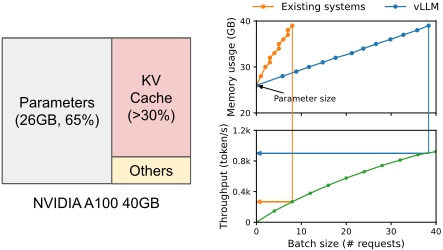
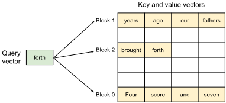
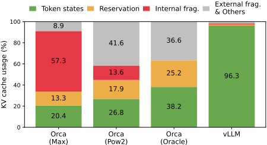
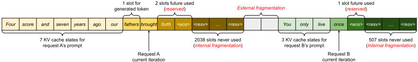
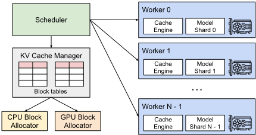
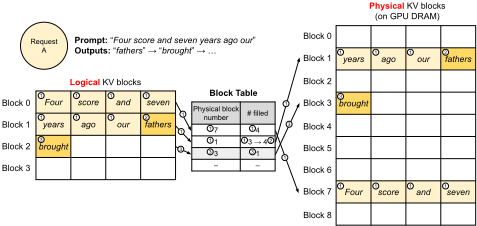
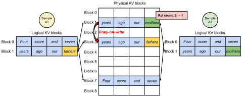
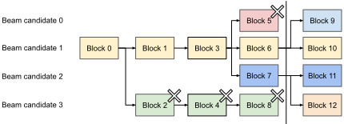
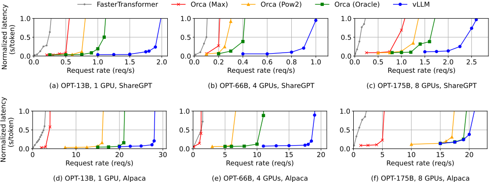
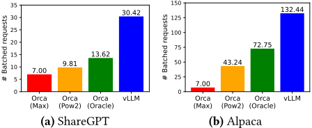

# 06 · vLLM / PagedAttention 深度解读：把操作系统的虚拟内存搬进 KV cache

> 本篇是「论文解读」系列第 06 篇，方向：**加速**。所有数字均与 arXiv 2309.06180（SOSP 2023）PDF 原文核对；图片截取自原论文（版权归原论文作者，仅作学习解读之用）；标注"解读视角"的内容为本文推断。

## 1. 论文档案

| 项目 | 内容 |
| --- | --- |
| 标题 | Efficient Memory Management for Large Language Model Serving with PagedAttention |
| 作者与机构 | Woosuk Kwon*、Zhuohan Li*（共同一作）、Siyuan Zhuang、Ying Sheng、Lianmin Zheng、Cody Hao Yu、Joseph E. Gonzalez、Hao Zhang、Ion Stoica；UC Berkeley / Stanford / UC San Diego / Independent |
| 发表处 | SOSP '23（ACM 操作系统原理研讨会，2023-10-23~26，德国 Koblenz），同时挂 arXiv |
| arXiv | [2309.06180](https://arxiv.org/abs/2309.06180)（16 页双栏） |
| 开源仓库 | [vllm-project/vllm](https://github.com/vllm-project/vllm)：**Apache-2.0**（截至 2025-11 约 96.7k stars，25000+ commits） |
| 权重可得性 | 不涉及模型权重；支持 GPT / OPT / LLaMA 等任意 HF 格式模型，论文时代即覆盖超单卡显存的大模型（TP 切分） |

## 2. 速览

**一句话 TL;DR**：vLLM 把操作系统虚拟内存的"分页"思想原样移植到 KV cache——逻辑块经 block table 映射到非连续的物理块、按需分配、引用计数 + copy-on-write 共享——把 KV cache 有效利用率从现有系统的 **20.4%–38.2%** 提到 **96.3%**，同延迟下吞吐较 FasterTransformer / Orca 提升 **2–4×**，此后成为几乎所有 LLM 推理引擎的事实标准地基。

| 维度 | 内容 |
| --- | --- |
| 问题 | KV cache 巨大且动态伸缩、生命周期未知；现有系统按"最大长度连续预分配"管理，内部/外部碎片 + 过度预留浪费 60%–80% 显存，batch size 上不去；并行采样/beam search 的天然共享机会也无法利用 |
| 创新 | ① PagedAttention：在非连续分块内存上做注意力的算法；② 分页 KV cache 管理器（block table + 按需分配 + 引用计数 COW）；③ 块粒度共享贯穿 parallel sampling / beam search / shared prefix；④ 与之协同的 FCFS 抢占调度（swap/recompute）与分布式统一内存管理 |
| 证据 | OPT-13B/66B/175B、LLaMA-13B，ShareGPT/Alpaca 真实轨迹：KV cache 有效利用率 96.3%；同时批量请求数最高 4.3×（13B ShareGPT）；共享 prefix 场景吞吐 3.58×；代价只是 attention kernel 20–26% 的额外延迟 |

## 3. 背景与动机

**Serving 为什么是 memory-bound**。自回归生成一次一个 token，decode 阶段每步只算一个位置，是矩阵-向量乘（GEMV），算力用不满、瓶颈在搬数据。提升 GPU 利用率的唯一杠杆是**加大 batch**：权重搬运被整个 batch 摊薄。而 batch 上限由什么决定？看 13B 模型在 A100 40GB 上的显存账：权重 26GB（65%）恒定、activation 只占小头，剩下约 30%（~12GB）全部给 KV cache——**KV cache 管理得好坏直接决定 batch size**。



**本文之前的主流做法**。Orca（OSDI 2022）已解决"调度粒度"问题——iteration-level scheduling（后被称为 continuous batching）让请求随到随进批、完成即出批，消除排队与 padding 浪费；但它对**内存**仍是老办法：受深度学习框架"张量必须连续存储"的约束，每个请求按**最大可能序列长度**（如 2048）预分配一整块连续显存。FasterTransformer 干脆连细粒度调度都没有。

把批处理这条线捋直（解读视角）：static batching（凑批等批，短请求陪跑长请求）→ cellular batching（EuroSys 2018，RNN 时代的细粒度批）→ Orca iteration-level scheduling（每迭代进出批）→ vLLM（内存层面跟上调度的细粒度）。Orca 把**时间维度**的浪费修掉了，但**空间维度**的浪费原封不动——调度越细，内存记账反而越难，这正是 vLLM 论文 §9 的论点："细粒度调度让内存管理更具挑战，使本文技术更加关键"。

**论文 §3 点名的三个具体瓶颈**（每条对应一项创新）：

1. **KV cache 太大**。OPT-13B 每 token 的 KV cache = 2 × 5120 × 40 × 2 字节 = **800 KB**；序列上限 2048 token 时单请求最高 **1.6 GB**。40GB 的 A100 即使把所有显存都给 KV cache 也只能容纳几十个请求，浪费一点就少跑一批。
2. **解码算法复杂且共享模式各异**。parallel sampling 共享 prompt 部分（实验中占 KV cache 总量 12%），beam search 的共享比例动态变化（可省 55%），现有"一请求一块连续空间"根本表达不了"部分共享"。
3. **输入输出长度未知**。输出长度生成前不可知，显存可能随时耗尽，系统必须能决定"抢谁的、怎么恢复"——这是 OS 页面置换的同构问题。

**问题的本质**（解读视角）：KV cache 和传统深度学习张量有两个本质区别——**它随时间动态伸缩**、**其长度与生命周期事先不可知**——恰好是 OS 早年管理"进程地址空间"时面对的同款问题。OS 六十年前给过答案：虚拟内存 + 分页。这就是全文的题眼。

## 4. 核心创新拆解

### 4.1 PagedAttention：允许 KV cache 非连续存放的注意力算法

- **是什么**：把每条序列的 KV cache 切成固定大小的 KV block（每块装 B 个 token 的 K/V），注意力计算改为逐块进行——先对第 j 块算出注意力分数行向量 $A_{ij}$，再与该块的 $V_j$ 加权求和，最后跨块累加。
- **为什么之前不行**：深度学习框架的算子假定张量连续；注意力要一次看完"整条历史"，历史上没人把它拆成不连续的块。
- **怎么做到**：把 $a_{ij}$ 的定义域从"位置"改成"块"（公式见 §5.2 式 4），kernel 按 block table 逐块取数、逐块归约。数学上与标准注意力**完全等价**——这是关键：不改模型输出，只改内存访问方式，所以"不影响模型精度"。
- **代价与权衡**：kernel 要多读 block table、多分支、支持变长，实测 attention kernel 延迟比 FasterTransformer 高 **20%–26%**（§7.1）；B 太小并行度不足、太大内部碎片回升，默认取 B=16（§7.2）。

### 4.2 分页 KV cache 管理器：block table 就是页表

- **是什么**：GPU 显存被 block engine 预切成物理块池；每个请求持有**逻辑块序列**（从左到右填充），block table 记录"逻辑块号 → 物理块号 + 已填充槽位数"。逻辑连续、物理离散。
- **为什么之前不行**：连续预分配下"逻辑=物理"，外部碎片（buddy 分配器凑不齐）与内部碎片（按上限预留）必然出现；实测现有系统只有 20.4%–38.2% 的 KV cache 显存在装真实 token 状态。
- **怎么做到**：块等大 → 外部碎片归零；按需分配 → 只在最后一个块满时才申请新块；请求浪费被**封顶在一个块内**。
- **代价与权衡**：一次内存间接寻址（逻辑→物理）；vLLM 通过把"读块 + 算注意力"、"切块 + 写块"、"批量拷贝"各自融进单个 kernel 来摊薄开销（§5.1）。

### 4.3 块粒度共享：引用计数 + copy-on-write

- **是什么**：物理块可被多个逻辑块映射（引用计数 >1）。parallel sampling 中多个样本共享 prompt 块；一旦某样本要写共享块，就分配新块、拷贝旧块、引用计数减一——**OS 的 fork + COW 原样复刻**。beam search 的共享结构随候选淘汰动态变化，像 OS 里"连环 fork 的进程树"；shared prefix 则等价于 OS 的共享库（多个进程 map 同一段只读代码）。
- **为什么之前不行**：连续空间无法表达"这两个请求前 4 块相同、第 5 块分叉"；现有系统只能靠整段 memcpy 来回拷。
- **怎么做到**：共享决策完全藏在"逻辑块→物理块"映射层，LLM kernel 只见物理块号列表，对共享模式无感知——因此不同解码算法可以混在同一 batch 里。
- **代价与权衡**：COW 只在"新 token 落进旧共享块"时触发，每次只拷一个块；但共享块成为热路径，引用计数管理错误会直接污染别的请求（解读视角：这是 vLLM 早期若干 correctness bug 的高发区）。

### 4.4 系统层：FCFS + all-or-nothing 抢占，swap 与 recompute 双恢复

- **是什么**：集中式调度器对请求 FCFS（防饿死）；显存耗尽时抢占最新请求，抢占粒度是**序列组**（同请求的多条序列 gang-scheduled，因为它们共享块）；恢复有两条路——**swap**（块搬去 CPU RAM）或 **recompute**（重算时把已生成 token 并入 prompt，一次 prefill 重建全部 KV）。
- **为什么之前不行**：通用页面置换启发式（LRU 等）在这里失效——序列的所有块要么全在、要么全不在；且 LLM 有 OS 没有的选项："重算比换出更便宜"。
- **怎么做到**：all-or-nothing 淘汰 + 序列组 gang 调度；swap 空间上界 = GPU 侧 KV cache 总量（先换出的量不可能超过 GPU 上的总量）。
- **代价与权衡**：FCFS 无优先级/SLO 概念，长请求会队头阻塞；swap 在小块下是海量小搬运、打不满 PCIe（§7.3），recompute 则与块大小无关且开销永不超 swap 的 20%——这也预示了后来 vLLM V1 默认 recompute 的选择。

## 5. 方法细节

### 5.1 核心映射：OS 虚拟内存 ↔ PagedAttention 逐概念对照（本文最有教学价值的部分）

| OS 虚拟内存 | vLLM / PagedAttention | 一句话对应 |
| --- | --- | --- |
| 进程 process | 请求 request（含一条或多条序列） | 内存记账的基本单位 |
| 逻辑地址空间（连续） | 逻辑 KV blocks（逻辑上连续，从左到右填充） | 程序/请求"以为"自己独占连续内存 |
| 物理页框 page frame | 物理 KV block（GPU DRAM 预切块池） | 真正存放数据、大小固定 |
| 页表 page table | block table（物理块号 + #filled） | 每请求一张，逐请求广播给 GPU worker |
| 页面大小 page size | KV block size B（默认 16 token） | 太小映射开销大，太大碎片大——两边都这么劝 |
| 按需调页 demand paging | 只预留 prompt 所需块，之后每写满一块才分配新块 | 用多少给多少 |
| 内部碎片（半页浪费） | 最后一个逻辑块的空槽 | 每序列浪费封顶 ≤1 块 |
| 外部碎片 | **归零**：所有块等大，无需紧凑（compaction） | OS 要 compaction，这里根本不需要 |
| 页共享 shared page（mmap / fork） | 物理块共享 + 引用计数 | shared prefix ≈ 共享库 |
| fork + 写时复制 COW | fork 原语 + 块级 COW | 引用计数 >1 时先复制再写 |
| swap 到磁盘 | swap 到 CPU RAM | 页面出走的第二归宿 |
| 缺页异常 page fault | 物理块耗尽 → 抢占（换出/重算） | "没有空闲页框了"的软件版 |
| 置换策略（LRU/Clock） | all-or-nothing + FCFS（最新请求先被抢） | 利用"序列所有块总是一起访问"的应用语义 |
| MMU/TLB 硬件查表 | PagedAttention kernel 软件读 block table | 没有硬件帮忙，靠 kernel 融合摊开销 |

**三点关键差异**（解读视角，面试常追问）：

1. **透明 vs 显式**：OS 分页对用户进程完全透明（硬件 MMU 自动翻译）；PagedAttention 的映射必须由 kernel 显式感知——所以才有 §5.1 的三个融合 kernel。
2. **异常 vs 轮询**：OS 缺页是硬件异常、按页惰性处理；vLLM 的"缺块"发生在迭代边界，调度器提前做记账决策，粒度粗但可预测。
3. **恢复手段多一个**：OS 页面脏了必须写回；KV cache 可以**直接重算**——这是 LLM 领域独有的第三选项，论文 §8 自己也把它列为"对 OS 思想的再诠释"。



### 5.2 公式（全部从原文重写，原文式 1–4）

自回归分解（原文式 1）与 Q/K/V 投影（式 2）：

$$P(x) = P(x_1)\cdot P(x_2 \mid x_1)\cdots P(x_n \mid x_1, \ldots, x_{n-1}), \qquad q_i = W_q x_i,\ k_i = W_k x_i,\ v_i = W_v x_i$$

标准自注意力（式 3）——注意分母按位置求和、输出按位置累加：

$$a_{ij} = \frac{\exp(q_i^{\top} k_j / \sqrt{d})}{\sum_{t=1}^{i} \exp(q_i^{\top} k_t / \sqrt{d})}, \qquad o_i = \sum_{j=1}^{i} a_{ij} v_j$$

PagedAttention 的块状改写（式 4）：第 $j$ 个 KV block $K_j = (k_{(j-1)B+1}, \ldots, k_{jB})$，$V_j$ 同理；分数行向量 $A_{ij} = (a_{i,(j-1)B+1}, \ldots, a_{i,jB})$：

$$A_{ij} = \frac{\exp(q_i^{\top} K_j / \sqrt{d})}{\sum_{t=1}^{\lceil i/B \rceil} \exp(q_i^{\top} K_t \mathbf{1} / \sqrt{d})}, \qquad o_i = \sum_{j=1}^{\lceil i/B \rceil} V_j A_{ij}^{\top}$$

分母里的 $K_t \mathbf{1}$ 是对整块 $K_t$ 的逐元素点积（B 个分数一次算出）；求和上界从"位置数"换成"块数" $\lceil i/B \rceil$——**这就是"非连续存放但数学等价"的全部秘密**。

### 5.3 KV cache 大小公式与浪费率计算（手写 LaTeX + 代入）

每 token 每层的 KV cache 字节数（K、V 各一份，故有系数 2）：

$$\text{KV}_{\text{per-token}} = \underbrace{2}_{K,V} \times\ n_{\text{layers}} \times n_{\text{heads}} \times d_{\text{head}} \times \text{bytes}_{\text{elem}}$$

代入 LLaMA-13B（$n_{\text{layers}}=40$，$n_{\text{heads}}=40$，$d_{\text{head}}=128$，FP16）：

$$\text{KV}_{\text{per-token}} = 2 \times 40 \times 40 \times 128 \times 2\,\text{B} = 819{,}200\,\text{B} = 800\,\text{KB}$$

单请求（序列长度 $L$）：$\text{KV}_{\text{seq}} = 800\,\text{KB} \times L$；论文设 $L \le 2048$，得**单请求最高 1.6 GB**——与论文对 OPT-13B 的算式 $2 \times 5120 \times 40 \times 2 = 800$ KB 完全一致（5120 = 40 头 × 128 维，两者是同一道乘法）。

**浪费率**。现有系统按最大长度预留：浪费率 $= (\text{max\_len} - \text{final\_len}) / \text{max\_len}$。论文图 3 的例子：请求 A 上限 2048，实际只用了 7（prompt）+ 1（当前）+ 2（预留）= 10 个槽，**2038 槽纯内部碎片（99.5%）**；请求 B 上限 512，507 槽从未使用。聚合实测：有效占比仅 20.4%–38.2%，即**浪费 61.8%–79.6%**。vLLM 的浪费被压进最后一块：$L$ 个 token 需要 $\lceil L/B \rceil$ 块，浪费率 $\le (B-1)/L$；实测有效占比 **96.3%**（博客口径：waste < 4%）。





### 5.4 系统架构与一次解码的生命周期



以论文图 6 的 7-token prompt 为例走一遍（块大小 B 取 4 时与图一致，vLLM 默认 B=16）：

1. **prefill**：不为 max_len 预留，只为 prompt 申请必要块——2 个逻辑块分别映射到物理块 7、1；prompt KV 用常规注意力算出，最后留 1 个空槽给解码。
2. **第一次 decode**：新 token 的 KV 落进最后逻辑块的空槽，更新 block table 的 #filled。
3. **块满**：新逻辑块诞生，分配新物理块（图中的物理块 3）并登记进 block table。
4. **每迭代全局流程**：调度器选批 → 为新逻辑块分配物理块 → 把整批输入拼成一条序列喂给模型 → PagedAttention kernel 按 block table 读历史 KV、写新 KV → 采样 token 回传调度器。
5. **结束**：请求完成后其物理块释放回池子；两个并发请求（图 7）的逻辑块在物理池里交错共存，互不需要相邻。

**分布式执行**（§4.6）：vLLM 支持 Megatron 式张量并行，但**只保留一个集中式 KV cache manager**——因为 TP 各分片处理相同的 token 序列、需要相同位置的 KV，各 worker 共享同一张 block table，只是各自存自己负责的 attention head 子集。于是内存管理信息随每迭代的控制消息广播一次即可，GPU worker 之间无需为内存同步额外通信（all-reduce 仅同步中间结果）。这个"调度器单点记账"的设计沿用至今。



### 5.5 三种共享场景与三个编程原语

vLLM 用 **fork / append / free** 三个原语表达所有解码算法：fork 复制序列（共享物理块、引用计数+1），append 写入新 token（触发 COW 判定），free 删除序列（引用计数归零即释放）。论文的判断是：**未来的解码算法也能由这三原语组合出来**——后来的投机解码（多 draft 序列 + 验证回滚）、tree attention 在 vLLM/SGLang 里的实现确实沿用了这套抽象。

第三种共享是 **shared prefix**：服务提供者为预定义前缀（系统提示词、few-shot 示例）预先缓存物理块，用户请求的逻辑块直接映射过去（仅末块标记 COW），prefill 只需计算用户输入部分——机制上等价于 OS 的**共享库**：多个进程 map 同一段只读代码页。





## 6. 实验证据复盘

### 6.1 实验设置（原文表 1 复述核对）

| 配置 | 13B | 66B | 175B |
| --- | --- | --- | --- |
| GPU | A100 40GB ×1 | A100 ×4（160GB） | A100-80GB ×8（640GB） |
| 参数显存 | 26 GB | 132 GB | 346 GB |
| KV cache 可用显存 | 12 GB | 21 GB | 264 GB |
| 最大 KV cache 槽位数 | 15.7K | 9.7K | 60.1K |

负载：ShareGPT（长）与 Alpaca（短）真实轨迹合成，ShareGPT 平均输入长 **8.4×**、输出长 **5.8×** 于 Alpaca，Poisson 到达。基线：FasterTransformer（配动态 batch 调度器）、Orca 三个变体——(Max) 按 2048 预留、(Pow2) 2 的幂上浮预留、(Oracle) 事先知道真实输出长度的**不可达上界**。指标：normalized latency（端到端延迟 ÷ 输出长度）随请求率的曲线——曲线"翘尾"越晚，可持续吞吐越高。

### 6.2 单样本采样（原文 §6.2 / 图 12、13）



**可持续请求率**（同延迟水平下）：ShareGPT 上 vLLM 比 Orca (Oracle) 高 **1.7×–2.7×**，比 Orca (Max) 高 **2.7×–8×**，比 FasterTransformer 最高 **22×**（FT 无细粒度调度，内存管理与 Orca (Max) 同级）。摘要的总结论：**比 SOTA 系统（FasterTransformer / Orca）吞吐 2–4×**。

**同时批量请求数**（OPT-13B，原文图 13 数字复述）：

| 轨迹 | Orca (Max) | Orca (Pow2) | Orca (Oracle) | vLLM | vLLM/Oracle |
| --- | --- | --- | --- | --- | --- |
| ShareGPT（2 req/s） | 7.00 | 9.81 | 13.62 | **30.42** | 2.2× |
| Alpaca（30 req/s） | 7.00 | 43.24 | 72.75 | **132.44** | 1.8×（4.3× vs Max） |



反直觉点（原文 §6.2 自己指出的边界）：OPT-175B + Alpaca（图 12f）上 vLLM 对 Orca (Oracle)/(Pow2) 优势不明显——KV 显存充裕 + 序列短时，瓶颈从 memory-bound 变成 compute-bound，分页省不出新并发。

### 6.3 共享收益：parallel sampling 与 beam search（原文 §6.3）

| 场景 | Alpaca 节省显存 | ShareGPT 节省显存 |
| --- | --- | --- |
| parallel sampling | 6.1%–9.8% | 16.2%–30.5% |
| beam search | 37.6%–55.2% | **44.3%–66.3%** |

对 Orca (Oracle) 的吞吐优势随共享机会放大：OPT-13B + Alpaca 从基础采样的 **1.3×** 涨到 beam width=6 的 **2.3×**。对照现有系统：beam 候选分叉时要整段 memcpy 对方的 KV cache，vLLM 只在写进旧共享块时拷**一个块**。

### 6.4 shared prefix 与 chatbot（原文 §6.4、§6.5）

| 场景 | 设置 | 结果 |
| --- | --- | --- |
| 共享 prefix（WMT16 英→德，LLaMA-13B） | 1-shot prefix（80 token） | 吞吐 **1.67×** vs Orca (Oracle) |
| | 5-shot prefix（341 token） | 吞吐 **3.58×** vs Orca (Oracle) |
| Chatbot（ShareGPT 历史 + 新问题） | prompt 普遍 1024 token | 比**全部三个** Orca 变体可持续率高 **2×** |

chatbot 场景的含义：prompt 越长、共享越普遍，分页 + 共享的红利越大——这正是今天 RAG / 多轮对话 / few-shot 系统提示词的标准形态。注意 chatbot 实验里三个 Orca 变体表现趋同的原因（原文自己分析了）：prompt 已 1024 token，buddy 分配器无论如何预测输出长度都得为其预留 1024 槽——**过预留的上限惩罚把三个基线拉到同一水平**，而 vLLM 靠按需分配直接越过这道墙。

### 6.5 消融（原文 §7）

| 消融 | 结论 | 数字 |
| --- | --- | --- |
| kernel 微基准 | PagedAttention kernel 比 FasterTransformer 的优化注意力慢 | **20%–26%**（ctx 64–256、bs 8/32） |
| block size | ShareGPT 最优区间 16–128；Alpaca 上 ≥64 显著劣化（序列短于块长） | 默认 **B=16** |
| swap vs recompute | 小块下 swap 被 PCIe 小搬运卡死；recompute 与块大小无关，开销**永不超 swap 的 20%**；块 16–64 两者端到端打平 | 两者都实现，B=16 时等价 |

### 6.6 哪些结论被后续验证 / 修正（解读视角）

1. **"分页 KV cache"作为范式**被全面验证：SGLang、TensorRT-LLM（paged KV cache）、HF TGI、MLC、MindIE 等全部跟进，vLLM 成为工程事实标准。
2. **20–26% kernel 开销**被后续 kernel 工作大幅消化：FlashAttention 系内核接入 vLLM 的分块布局、FlashInfer 的 paged kernel、V1 的 piecewise CUDA graph——今天分页注意力的 kernel 开销已远小于当年，部分场景反超连续布局（长序列下省去 padding）。
3. **recompute 优于 swap**被 V1 引擎采纳为默认抢占恢复路径；CUDA graph 化后 swap 的 Python 控制面开销更突出。
4. **FCFS 调度**被修正：V0 的 FCFS + all-or-nothing 抢占对延迟 SLO 不友好，V1 改为 always-on chunked prefill（prefill 切块与 decode 混跑，防长 prompt 阻塞 decode），见 §8。
5. **"吞吐优势不牺牲精度"**被广泛复现：PagedAttention 与标准注意力数学等价（式 4 只是重排求和顺序），论文用 GPT/OPT/LLaMA 权重直载验证零精度损失——这也是所有后续引擎敢直接采用它的根本原因。

## 7. 开源仓库导读

仓库：[vllm-project/vllm](https://github.com/vllm-project/vllm)（**Apache-2.0**；96.7k stars，2000+ 贡献者，源自 UC Berkeley Sky Computing Lab）。论文时代的实现仅 **8.5K 行 Python + 2K 行 C++/CUDA**；今天已是一个多硬件、多特性的大型工程。

```
vllm-project/vllm/          （顶层，2025-11 核实）
├── vllm/                    # Python 包：引擎、调度、模型执行
│   ├── v1/                  # V1 引擎（2025 起默认）：调度器、KV cache manager、核心走路径
│   ├── engine/  core/       # V0 引擎遗留路径（论文 §5 的 scheduler/block manager 即源于此）
│   ├── attention/           # 各后端 attention kernel 封装
│   ├── entrypoints/         # OpenAI 兼容 API server（LLM() 离线入口也在这里）
│   └── model_executor/      # 模型实现（200+ HF 架构）
├── csrc/                    # C++/CUDA 算子（论文时代 PagedAttention kernel 的后代）
├── examples/  benchmarks/  tests/  docs/
```

**最小跑通路径**（官方 README / docs quickstart，2025-11 核实）：

```bash
uv pip install vllm          # 推荐安装方式
vllm download-kernels        # 预编译 kernel，加速首次启动
```

```python
# 离线批量推理：LLM 类 + SamplingParams（对应论文的 frontend + engine 分层）
from vllm import LLM, SamplingParams

prompts = ["Hello, my name is", "The future of AI is"]
sampling_params = SamplingParams(temperature=0.8, top_p=0.95)
llm = LLM(model="facebook/opt-125m")     # 论文评测用的正是 OPT 家族
outputs = llm.generate(prompts, sampling_params)
print(outputs[0].outputs[0].text)
```

```bash
# 在线服务：OpenAI 兼容 server，一条命令
vllm serve Qwen/Qwen2.5-1.5B-Instruct
curl http://localhost:8000/v1/completions -H "Content-Type: application/json" \
    -d '{"model": "Qwen/Qwen2.5-1.5B-Instruct", "prompt": "San Francisco is a", "max_tokens": 7}'
```

**论文概念的现在时**（README 核实）：PagedAttention、continuous batching、chunked prefill、prefix caching 全部是一等公民特性；attention 后端含 FlashAttention / FlashInfer / FlashMLA / Triton / TRTLLM-GEN；量化覆盖 FP8 / MXFP4 / NVFP4 / GPTQ / AWQ / GGUF；并行支持 TP / PP / DP / EP / CP；另有投机解码（n-gram、EAGLE）、结构化输出、多 LoRA、P/D 分离。硬件从 NVIDIA/AMD/Intel GPU 扩展到 TPU、Gaudi、昇腾、Apple Silicon 等（插件生态）。

**引擎架构演进**：2025-01-27 官方博客发布 **V1 引擎**（对 V0.2.x 教训的全面重构），v0.8.0 起 V1 成为默认。对论文读者的三个直观变化：① 调度器零开销化（去多余 Python 同步，支持 CUDA graph 模式下的 overlap 执行）；② **chunked prefill 恒开**——论文时代"prefill 整段算"的行为被改为切块与 decode 交错，TTFT 长尾显著改善；③ **prefix caching 默认开启**——论文 §4.4 的 shared prefix 从"服务提供者手动预留物理块"变成全自动。

## 8. 局限与争议

**论文自认的局限**（§7、§8）：① PagedAttention kernel 有 20–26% 额外延迟，论文赌的是"只影响 attention 算子、换 batch 增长"划算；② block size 是两难参数（并行度 vs 碎片），16 只是对当时负载的经验最优；③ 虚拟内存思想**不可泛化到任意 GPU 负载**——张量形状静态的 DNN 训练、compute-bound 的非 LLM serving 上，间接寻址只会白白亏性能。

**社区真实批评与后续争议**（均已查证出处）：

1. **continuous batching 的归属**。iteration-level scheduling 是 **Orca（OSDI 2022，Yu et al.）**的原创贡献（其论文宣称比 NVIDIA Triton 高 36.9×）；"continuous batching"这个流行叫法是 Anyscale 2023-06 的博客给 Orca 技术起的外号。vLLM 论文在 §2.3、§9 都明确引用并称两者"互补"（Orca 管调度、vLLM 管内存），但社区传播中"continuous batching = vLLM 发明"的误归属长期存在。这不是论文的错，而是读二手资料的人的错——原论文反而是归因清楚的典范。
2. **极端低延迟场景的边际收益**。batch=1、延迟敏感（如实时语音、Agent 单流）时，没有"多请求并发"可换，分页省下的显存换不来吞吐，20–26% 的 kernel 开销与调度开销反而是净成本——这正是 FasterTransformer/TensorRT-LLM 在低延迟档仍有市场的原因。论文的评测全部是吞吐导向（normalized latency），没有覆盖 SLO 型负载。
3. **调度策略被时代修正**。FCFS + all-or-nothing 抢占在长 prompt 混合负载下会造成 decode 队头阻塞（长 prefill 独占一整个迭代）；V1 用恒开 chunked prefill 解决，并把抢占恢复默认切到 recompute。论文的调度设计是"与 PagedAttention 协同的最小可行方案"，不是终态。
4. **SGLang 的 RadixAttention 替代路线**。SGLang（NSDI 2025）用**基数树（radix tree）**管理 prefix 缓存：任意分支的公共前缀自动复用（多轮对话、agent 多次调用场景），而 vLLM 当时的 prefix cache 要求严格前缀匹配、需手动开启。SGLang v0.2 博客（2024-07）报告对 vLLM 0.5.2 最高 **3.1×** 吞吐（Llama-70B，prefix caching 关闭的纯底座对比；结构化/多调用负载下 NSDI 2025 论文报告对基线最高 8.3×）。值得注意：SGLang 的 KV cache **同样按块分页管理**——它替代的不是 PagedAttention 本身，而是"共享前缀发现"那一层。两条路线如今相互借鉴（vLLM V1 的 prefix caching 默认化即是对这条竞争线的回应）。
5. **数字口径要分清**。论文摘要的 **2–4×** 是对 Orca/FasterTransformer；正文最高 **22×** 是对无细粒度调度的 FasterTransformer；官方博客的 **14×–24×** 是对 HuggingFace Transformers（裸 pipeline），**2.2×–2.5×** 是对当时 TGI。三者基线不同，媒体传播里常被混用（顺带核对：本文评测数据集是 ShareGPT / Alpaca / WMT16，不存在所谓 TruBench 基准）。
6. **早期工程的正确性代价**（解读视角）：块共享 + 引用计数 + COW 把"内存管理"从一次性分配变成持续记账，调度器与执行器之间的状态同步是 vLLM 早期（V0 Python 调度器）大量 correctness/死锁 issue 的来源；V1 引擎重构的一个核心动机就是把记账路径做薄。

## 9. 与本知识库的衔接

| 主题 | 本库文件 | 衔接点 |
| --- | --- | --- |
| 分页思想源头 | `/home/yyl/ObsidianLibraries/操作系统/04-虚拟内存-地址空间.md` | 本文 §5.1 映射表的左半边全部出自该章：逻辑地址空间、页表、按需调页——先读它再看 PagedAttention 会非常丝滑 |
| 页与置换 | `/home/yyl/ObsidianLibraries/操作系统/05-内存管理-页与置换.md` | 页面置换算法（LRU/Clock）vs vLLM 的 all-or-nothing + FCFS：为什么应用语义能推翻通用启发式，是置换理论的最佳反例课 |
| 内存分配器 | `/home/yyl/ObsidianLibraries/操作系统/06-内存分配器.md` | Orca 假设的 buddy allocation、外部碎片从哪来、为什么等大块可以免 compaction——本文图 3 的 OS 原理注脚 |
| 引擎实现层 | `/home/yyl/ObsidianLibraries/模型性能优化/Stage 5-vLLM 与 SGLang 推理引擎深潜/教程/第1周-KVCache与PagedAttention实现层.md` | 本文的直接续篇：手算 KV cache 公式（与本文 §5.3 同款）、手写迷你 block manager、Prefix Caching 哈希键 vs RadixAttention |
| 调度器实现层 | `/home/yyl/ObsidianLibraries/模型性能优化/Stage 5-vLLM 与 SGLang 推理引擎深潜/教程/第2周-调度器与连续批处理状态机.md` | 本文 §4.4/§6.6 的现代版：V1 调度器 waiting/running 状态机、chunked prefill 预算、PD 分离的由来 |
| 解码算法扩展 | `/home/yyl/ObsidianLibraries/模型性能优化/Stage 5-vLLM 与 SGLang 推理引擎深潜/教程/第3周-投机解码与解码加速全家桶.md` | 论文的 fork/append/free 原语如何承载投机解码的多序列回滚与接受/拒绝 |
| 异步服务面 | `/home/yyl/ObsidianLibraries/Python语言精通/09-asyncio基础.md` 与 `/home/yyl/ObsidianLibraries/Python语言精通/10-asyncio进阶与实战.md` | FastAPI 前端 + 引擎的事件循环、OpenAI 兼容 server 的流式输出，是 asyncio 的高含金量实战样本 |
| IO 模型 | `/home/yyl/ObsidianLibraries/操作系统/09-IO模型与多路复用.md` | 调度器"每迭代广播 block table + 收集采样结果"的请求-响应节奏，本质是多路复用下的一轮事件分发 |

## 10. 面试视角

**Q1：算一下 LLaMA-13B、FP16、2048 上下文，单请求 KV cache 多大？由此说明推理瓶颈。**
答题要点：$2 \times 40 \times 40 \times 128 \times 2\,\text{B} = 800\,\text{KB/token}$，×2048 ≈ 1.6 GB/请求；A100 40GB 扣掉 26GB 权重只剩 ~12GB，理论最多 ~7 个 2048 长请求。追问点：GQA 会把 40 头改成 8 个 KV 头（再 ÷5）；为什么 decode 是 GEMV、为什么 memory-bound。

**Q2：PagedAttention 和 OS 分页的映射，哪里一样、哪里不一样？**
要点：逻辑块/物理块=页/页框，block table=页表，按需分配=demand paging，引用计数+COW=fork+COW，swap=页面换出，块耗尽→抢占=缺页处理；三点不同：映射由 kernel 软件显式感知（无 MMU/TLB）、"缺块"在迭代边界可预测处理（无硬件异常）、KV 可重算而脏页必须写回。追问：为什么所有块等大能消灭外部碎片、为什么每序列浪费 ≤1 块。

**Q3：continuous batching 是谁提出的？vLLM 的贡献边界在哪？**
要点：iteration-level scheduling 出自 Orca（OSDI 2022），"continuous batching"是 Anyscale 博客起的流行名；vLLM 论文明说两者互补——Orca 通过调度提高并行度，vLLM 通过内存利用率让更多请求装得进显存，并指出 Orca 式细粒度调度**让内存管理更难**，反衬 PagedAttention 的必要性。能分清这个归属说明读的是原文不是二手博客。

**Q4：attention kernel 慢 20–26%，为什么端到端反而快 2–4×？**
要点：① attention 只占单步耗时的一部分，Linear/FFN 不受影响；② 有效 KV 利用率从 20.4%–38.2% → 96.3%，同时批量请求数 ×2.2（Oracle 口径），计算密度提升远大于 kernel 变慢；③ 对照 Orca (Max)（2.7×–8×）与 FasterTransformer（最高 22×）分层比较。追问：什么场景这个赌不成立（batch=1 低延迟，见 §8 争议 2）。

**Q5：抢占后恢复，swap 还是 recompute？vLLM 为什么 swap 空间有上界？**
要点：recompute 把已生成 token 并入 prompt 一次 prefill 重建，开销与块大小无关、永不超 swap 的 20%（小块下 swap 是海量 PCIe 小搬运）；块 16–64 时端到端打平。swap 空间上界：换出量 ≤ GPU 上 KV 块总数（先有 GPU 上的才能换出），所以 CPU 侧缓冲可以按 GPU KV 容量封顶预算。追问：为什么抢占按序列组 gang 调度（组内共享块，拆开就漏引用计数）。

**Q6：prefix 共享，vLLM 的方案和 SGLang RadixAttention 差在哪？**
要点：vLLM（论文时代）= 服务提供者预留共享前缀物理块 + 严格前缀匹配（V1 起默认自动）；RadixAttention = 基数树自动发现任意历史分支的公共前缀，多轮/agent 场景复用率高一个量级；但两者的底层 KV cache 都是分块管理——竞争在"前缀发现"层，不在"分页"层。追问：COW 在共享前缀最后一个块上的作用。

---

*上一篇：[05 · BitNet-b1.58](../05-BitNet-b1.58/解读报告.md)｜下一篇：无（本系列第 06 篇）*
