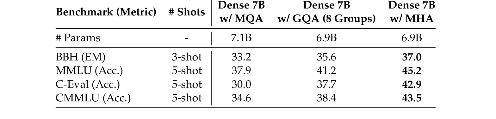
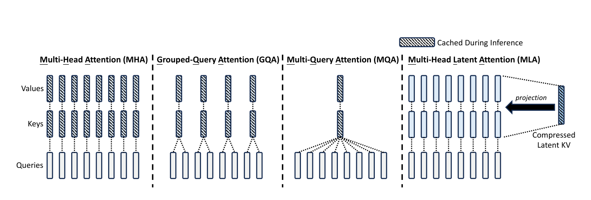
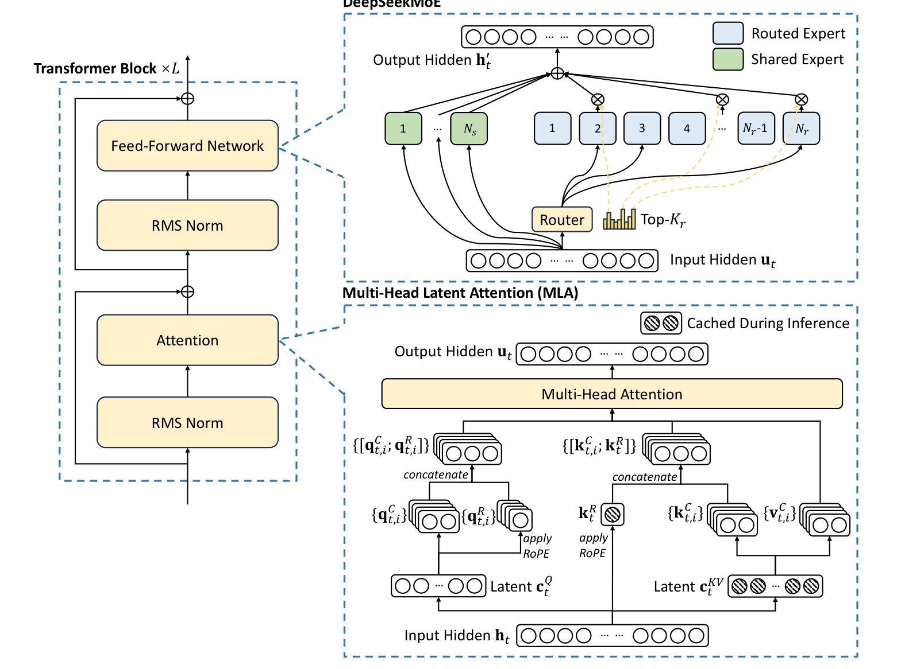
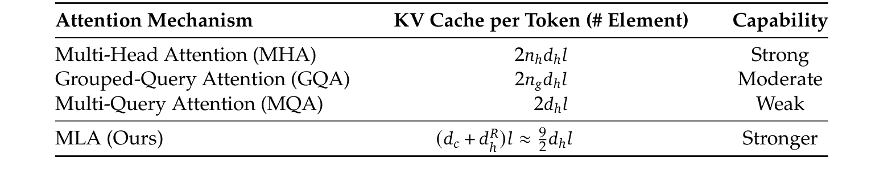
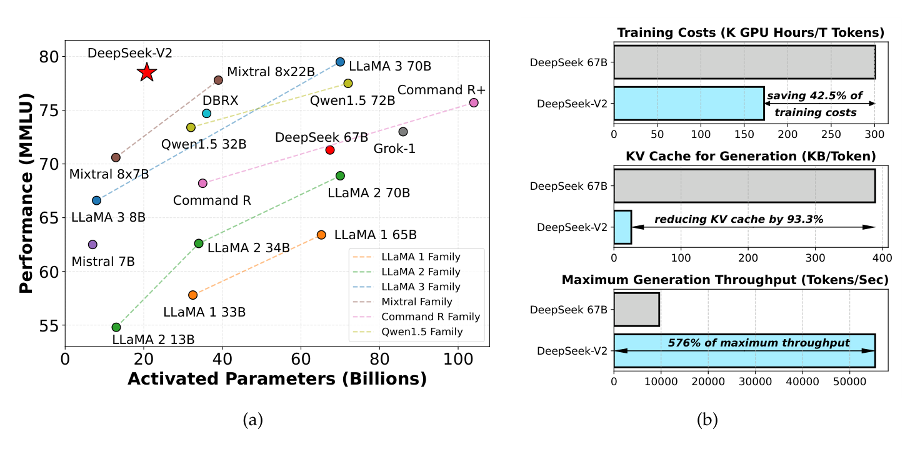
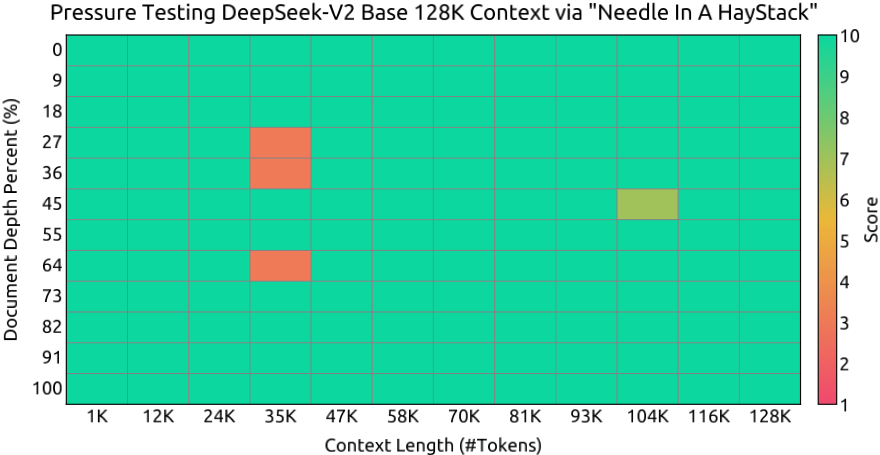
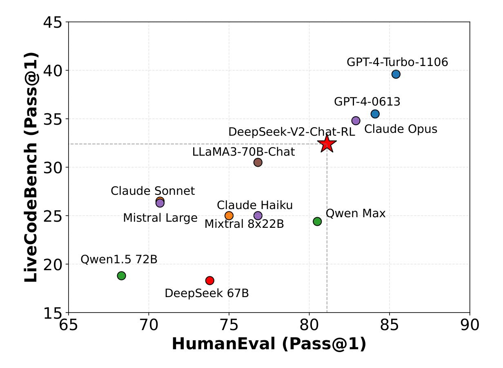
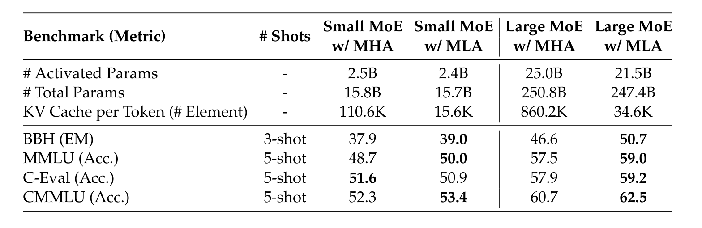

# 07 · DeepSeek-V2 深度解读：MLA——把 KV cache 压成一个低秩潜向量

> 本篇是「论文解读」系列第 07 篇，方向：**大模型架构**（MLA 专论，深化第 01 篇 DeepSeek-V3）。所有数字均与 arXiv 2405.04434 PDF 原文核对；图片截取自原论文（版权归 DeepSeek-AI，仅作学习解读之用）；标注"解读视角"的内容为本文推断。与 01 篇重复的背景（无辅助损失均衡的完整推导、V3 侧证据）用交叉引用带过，不重复展开。

## 1. 论文档案

| 项目 | 内容 |
| --- | --- |
| 标题 | DeepSeek-V2: A Strong, Economical, and Efficient Mixture-of-Experts Language Model |
| 机构 | DeepSeek-AI（署名按贡献者字母序，含研究与工程团队） |
| 发表处 | arXiv 预印本（未投会议/期刊），2024-05 提交 |
| arXiv | [2405.04434](https://arxiv.org/abs/2405.04434)（52 页，PDF 首页标题与 arXiv 号已核对一致） |
| 开源仓库 | [deepseek-ai/DeepSeek-V2](https://github.com/deepseek-ai/DeepSeek-V2)：代码 MIT（LICENSE-CODE）；权重走单独的 DeepSeek Model License（LICENSE-MODEL），README 明确"DeepSeek-V2 系列（含 Base 与 Chat）支持商业使用" |
| 权重可得性 | HuggingFace 提供 DeepSeek-V2（236B/21B，128K 上下文）、DeepSeek-V2-Chat（RL）、DeepSeek-V2-Lite（15.7B/2.4B，32K 上下文）、DeepSeek-V2-Lite-Chat 四组权重；BF16 推理需 8×80GB GPU |

## 2. 速览

**一句话 TL;DR**：DeepSeek-V2 首次提出 **MLA（Multi-head Latent Attention）**——把每个 token 的 KV cache 联合压缩成一个 512 维低秩潜向量外加 64 维解耦 RoPE 键，配合细粒度 DeepSeekMoE，用 **236B 总参 / 21B 激活**的配置跑出当时最强开源水平，同时相对自家稠密 67B：**训练成本省 42.5%、KV cache 降 93.3%、最大生成吞吐 5.76×**。

| 维度 | 内容 |
| --- | --- |
| 问题 | MHA 的 KV cache 是推理吞吐与最大 batch/上下文长度的第一瓶颈；MQA/GQA 靠砍 KV 头数省 cache 但有质量代价；MoE 走细粒度专家后通信与负载均衡又成为新瓶颈 |
| 创新 | ① MLA：低秩 KV 联合压缩 + 解耦 RoPE 键；② 细粒度专家分割 + 共享专家隔离（DeepSeekMoE）；③ device-limited routing 与设备级/通信级均衡损失；④ 两阶段 RL（先推理对齐、后人类偏好对齐） |
| 证据 | 8.1T tokens 预训练后，Base 模型以 21B 激活达到 MMLU 78.5 / BBH 78.9 / MATH 43.6 / C-Eval 81.7，超过 DeepSeek 67B 并跻身开源第一梯队；Chat（RL）HumanEval 81.1、MT-Bench 8.97、AlignBench 7.91（仅次于 GPT-4-1106-Preview 的 8.01） |

## 3. 背景与动机

**2024 年 5 月的开源格局**：LLaMA 3 70B（稠密，2024-04）刚发布、Mixtral 8x22B（MoE，39B 激活/141B 总参）刚亮相、Qwen1.5 72B 是当时最强的中英双语稠密模型；DeepSeek 自己的上一代是稠密 67B。DeepSeek-V2 要回答的问题是：**能不能同时做到"更强"与"更便宜"**——训练比 67B 便宜、推理比 67B 快，而质量全面反超。答案不在堆数据，而在改架构本身。

**这篇论文之前的两个具体瓶颈**（每条对应一项核心创新）：

1. **KV cache 墙**。MHA 推理时每个 token 每层要缓存 $2 n_h d_h$ 个元素（V2 的配置下是 $2\times128\times128=32768$ 个），60 层累计每 token 约 197 万元素；解码阶段每个生成步都要读全量 cache，显存与带宽双瓶颈，直接封顶 batch size 和序列长度（06 篇 vLLM 的 PagedAttention 管理 cache 的"摆放"，但不减少 cache 的"总量"）。已有两条压缩路线：MQA（所有头共享 1 组 K/V）与 GQA（分组共享），但二者都以质量为代价——V2 在附录 D.1 用 7B 模型给出了系统性证据（见 §6.4）。
2. **MoE 的专业化与通信两难**。GShard 式粗粒度专家（每专家即整个 FFN）下专家数少、每个专家被迫"什么都学"，专家特化不足；而细粒度专家（DeepSeekMoE，Dai et al. 2024）增加专家数后，每 token 覆盖的设备数上升，EP all-to-all 通信成本随之膨胀，且负载不均会导致路由坍缩与算力空转。

**时机点**：DeepSeekMath 已验证 GRPO 可以低成本做 RL 对齐；DeepSeekMoE 已在 16B 规模验证细粒度专家的收益。V2 是把这两块积木 + 一个新的注意力机制放大到 236B 的第一次体系化整合，直接铺垫了 V3（01 篇）与 R1（02 篇）。

## 4. 核心创新拆解

### 4.1 MLA：低秩 KV 联合压缩 + 解耦 RoPE

- **是什么**：不缓存每个头的 K/V，而是把 $\mathbf{h}_t$ 下投影成一个 $d_c$ 维联合潜向量缓存，K/V 用上投影矩阵按需恢复；RoPE 位置信息单独走一条 $d_h^R$ 维"解耦键"通道，两者拼接后做注意力。推理期每 token 每层只缓存 $d_c + d_h^R = 576$ 个元素，是同配置 MHA（32768）的 **1/56.9**。
- **为什么之前不行**：MQA/GQA 只能省 cache 不能保质量（附录 D.1 消融：同预算 7B 模型 MMLU 45.2 → GQA 41.2 → MQA 37.9）；而直接对 K/V 做低秩压缩会撞上 RoPE——RoPE 是逐位置的旋转，若对压缩后的 $\mathbf{k}^C$ 施加 RoPE，上投影矩阵 $W^{UK}$ 会与位置相关的旋转矩阵耦合，推理期无法吸收进 $W^Q$，被迫对全部前缀重算 K，得不偿失（§5.4 给出完整推导）。
- **怎么做到**：KV 联合压缩（式 9–11）+ 解耦 RoPE（式 14–19）+ 推理期矩阵吸收（附录 C）——三件事缺一不可，完整推导见 §5。
- **代价与权衡**：Q/K/V 各多一套投影矩阵（参数量与训练期激活略增）；注意力分数的计算从"192 维点积"变成"512 维潜空间点积"，单次分数的 FLOPs 反而更高——省的是显存与带宽（解码是访存受限的），换的是计算（解读视角：这笔账见 §5.5）；推理框架必须为 MLA 定制 kernel，与 FlashAttention 生态的适配是持续数月的工程战（见 §8）。

### 4.2 细粒度专家 + 共享专家隔离

- **是什么**：FFN 换成 DeepSeekMoE——每层 2 个共享专家（每个 token 必过）+ 160 个路由专家（每 token 激活 6 个），每专家中间维度 1536（约为稠密 FFN 的 1/4 宽度）。
- **为什么之前不行**：粗粒度 MoE（GShard：每专家=完整 FFN）专家容量大但数量少，一个专家要同时承载多类知识，特化程度受限；且路由专家之间存在知识冗余。
- **怎么做到**：把专家切细（更多更小的专家 → 更灵活的知识组合），同时把"通用共性知识"固化进常驻的共享专家（路由专家只需学差异化知识）——同激活/总参数量下大幅超过 GShard 式 MoE（Dai et al. 2024 的 16B 级对照实验）。
- **代价与权衡**：专家数变多（160 个）→ 每 token 覆盖设备数上升 → 通信成本上升，需要 device-limited routing（§4.3）兜住；细粒度压缩层会改变层的输出尺度，V2 在压缩潜向量与专家中间态处额外加 RMSNorm 与缩放因子保证训练稳定（论文 §3.1.2）。

### 4.3 device-limited routing + 三级均衡损失 + token 丢弃

- **是什么**：每 token 的路由专家被限制分布在至多 $M=3$ 个设备上；均衡方面除传统的专家级均衡损失外，新增设备级均衡与通信级均衡两个损失；训练期用设备级 token 丢弃（capacity factor 1.0）兜底硬约束。
- **为什么之前不行**：细粒度 MoE 激活专家多，若不限制，一个 token 的 6 个专家可能散布在全部 8 个设备上，通信次数 = 设备数；传统单一专家级均衡损失管不住"设备收到多少 token"这一层。
- **怎么做到**：先按"设备内最高亲和度专家"选出 $M$ 个设备，再在这 $M$ 个设备的专家池内做 top-$K_r$（$M\ge3$ 时性能与无限制 top-K 基本对齐）；通信级损失保证每个设备的**接收**量也均衡（routing 机制只保证了发送侧）。
- **代价与权衡**：限 $M$ 个设备是对路由自由度的硬约束（实验证明 $M\ge3$ 几乎无损）；token 丢弃会在训练期丢信息，V2 保证约 10% 的序列永不丢弃以维持训练/推理一致性，评测时完全不丢弃。

### 4.4 两阶段 RL：先推理对齐，后人类偏好对齐

- **是什么**：GRPO（沿用 DeepSeekMath，公式见 01 篇 §5/§9 交叉引用）之上，先训代码/数学奖励模型 $R^{reasoning}$ 做推理对齐，再用多奖励框架 $r_i = c_1 R^{helpful} + c_2 R^{safety} + c_3 R^{rule}$ 做人类偏好对齐。
- **为什么之前不行**：V2 团队观察到推理数据（代码/数学）的 RL 曲线特性与通用数据截然不同——数学与代码能力可以随 RL 步数持续上涨更长的时间，混在一起训互相干扰。
- **怎么做到**：分阶段解耦；RL 基础设施上做了三件工程事：训练/推理采用不同并行策略的 hybrid engine、vLLM 大 batch 推理后端、CPU-GPU 模型换入换出调度。
- **代价与权衡**：RL 带来明显的"alignment tax"——标准基准（BBH、C-Eval）在 RL 后回退（V2 Chat BBH 81.3→79.7、C-Eval 80.9→78.0），团队靠数据加工与训练策略把它压到"可容忍"（§4.4 原文自认）。

## 5. 方法细节（公式均从原文重写并逐条核对）

### 5.1 起点：MHA 的 cache 账（原文式 1–8）

设嵌入维度 $d$、头数 $n_h$、每头维度 $d_h$、层数 $l$，$\mathbf{h}_t\in\mathbb{R}^d$ 为第 $t$ 个 token 的注意力输入。标准 MHA：

$$\mathbf{q}_t = W^Q\mathbf{h}_t,\qquad \mathbf{k}_t = W^K\mathbf{h}_t,\qquad \mathbf{v}_t = W^V\mathbf{h}_t$$

$$\mathbf{o}_{t,i} = \sum_{j=1}^{t}\mathrm{Softmax}_j\left(\frac{\mathbf{q}_{t,i}^{\top}\mathbf{k}_{j,i}}{\sqrt{d_h}}\right)\mathbf{v}_{j,i},\qquad \mathbf{u}_t = W^O\left[\mathbf{o}_{t,1};\dots;\mathbf{o}_{t,n_h}\right]$$

生成时所有历史 token 的 K/V 都要缓存：**每 token 每层 $2 n_h d_h$ 个元素**。V2 配置（$n_h=d_h=128$）下即 32768 元素，FP16 约 64 KB；60 层、4K 上下文的单请求 cache 就是 7.8 GB——这就是"墙"。

### 5.2 MQA/GQA：极端折中及其代价

MQA 让全部头共享 1 组 K/V（cache $2d_h l$），GQA 分 $n_g$ 组共享（cache $2n_g d_h l$）。二者保住了 cache，但砍掉的是 K/V 的表示自由度。V2 附录 D.1 的对照实验（7B 稠密、1.33T tokens、按层数对齐参数量）：



| 基准 | 7B w/ MQA | 7B w/ GQA（8 组） | 7B w/ MHA |
| --- | --- | --- | --- |
| BBH (EM) | 33.2 | 35.6 | **37.0** |
| MMLU | 37.9 | 41.2 | **45.2** |
| C-Eval | 30.0 | 37.7 | **42.9** |
| CMMLU | 34.6 | 38.4 | **43.5** |

结论：在"硬基准"上 MQA/GQA 的质量损失不是噪声级的。问题是：**能不能既把 cache 压到 MQA 量级、质量又超过 MHA？** MLA 的回答是把"砍头数"换成"砍秩"。



### 5.3 低秩 KV 联合压缩（原文式 9–13）

MLA 的核心观察（解读视角）：注意力的 K/V 分布在低维子空间上——与其在 $d_h n_h$ 维里存 128 份头向量，不如存一个 512 维的共享潜向量。原文公式：

$$\mathbf{c}_t^{KV} = W^{DKV}\mathbf{h}_t,\qquad \mathbf{k}_t^C = W^{UK}\mathbf{c}_t^{KV},\qquad \mathbf{v}_t^C = W^{UV}\mathbf{c}_t^{KV}$$

其中 $\mathbf{c}_t^{KV}\in\mathbb{R}^{d_c}$ 是 K/V 的联合压缩潜向量（$d_c\ll d_h n_h$），$W^{DKV}\in\mathbb{R}^{d_c\times d}$ 是下投影，$W^{UK},W^{UV}\in\mathbb{R}^{d_h n_h\times d_c}$ 是 K/V 各自的上投影。**推理期只缓存 $\mathbf{c}_t^{KV}$**，cache 降为每 token 每层 $d_c$ 个元素。Q 侧同样做低秩压缩：

$$\mathbf{c}_t^Q = W^{DQ}\mathbf{h}_t,\qquad \mathbf{q}_t^C = W^{UQ}\mathbf{c}_t^Q$$

注意原文明确点出：Q 侧压缩**不省 KV cache，只省训练期激活内存**（训练时反向传播需要保存激活，Q 路径的激活从 $d_h n_h$ 降到 $d_c'=1536$）。

### 5.4 解耦 RoPE：为什么 RoPE 与低秩压缩不相容（原文式 14–19）

**不相容的根源是矩阵乘法不满足交换律**。若直接对 $\mathbf{k}_t^C$ 施加 RoPE，则注意力分数里会出现：

$$\mathbf{q}^{\top}\mathrm{RoPE}(\theta_t)\,W^{UK}\,\mathbf{c}_j^{KV}$$

其中 $\mathrm{RoPE}(\theta_t)$ 依赖当前 token 的位置。理想情况想把 $W^{UK}$ 吸收进 $W^Q$（提前算好、之后只与潜向量点积），但现在 $W^{UK}$ 与 $\mathrm{RoPE}(\theta_t)$ 的乘积无法交换合并——每个生成位置的旋转矩阵都不同，$W^{UK}$ 永远卡在旋转矩阵"里面"，等于每个新 token 都要对**全部前缀**重算 $\mathbf{k}^C$，彻底摧毁 cache 的意义。

V2 的解法：**位置信息单独走一条窄通道**。用附加的多头查询 $\mathbf{q}_{t,i}^R\in\mathbb{R}^{d_h^R}$ 与一个共享键 $\mathbf{k}_t^R\in\mathbb{R}^{d_h^R}$ 专门承载 RoPE（$d_h^R=64$，仅为 $d_h$ 的一半）：

$$[\mathbf{q}_{t,1}^R;\dots;\mathbf{q}_{t,n_h}^R] = \mathbf{q}_t^R = \mathrm{RoPE}\left(W^{QR}\mathbf{c}_t^Q\right),\qquad \mathbf{k}_t^R = \mathrm{RoPE}\left(W^{KR}\mathbf{h}_t\right)$$

$$\mathbf{q}_{t,i} = \left[\mathbf{q}_{t,i}^C;\ \mathbf{q}_{t,i}^R\right],\qquad \mathbf{k}_{t,i} = \left[\mathbf{k}_{t,i}^C;\ \mathbf{k}_t^R\right]$$

$$\mathbf{o}_{t,i} = \sum_{j=1}^{t}\mathrm{Softmax}_j\left(\frac{\mathbf{q}_{t,i}^{\top}\mathbf{k}_{j,i}}{\sqrt{d_h + d_h^R}}\right)\mathbf{v}_{j,i}^C,\qquad \mathbf{u}_t = W^O\left[\mathbf{o}_{t,1};\dots;\mathbf{o}_{t,n_h}\right]$$

三个值得注意的细节（均为原文事实，标注为解读视角的除外）：① 内积分母是 $\sqrt{d_h+d_h^R}$，因为拼接后的 key 维度是 $192$；② $\mathbf{q}^R$ 从**压缩后的查询潜向量** $\mathbf{c}^Q$ 生成（省参数），而 $\mathbf{k}^R$ 直接从 $\mathbf{h}_t$ 生成（独立的小矩阵 $W^{KR}\in\mathbb{R}^{64\times5120}$）——两者都在写入 cache 时算好；③ $\mathbf{k}_t^R$ 是**全头共享**的单键（MQA 式），$\mathbf{q}^R$ 却是每头独立的——RoPE 通道本身是个"多查单键"结构（解读视角：这是位置通道上的一次 MQA 复用，64 维的额外 cache 换回完整的相对位置感知）。

### 5.5 吸收变换：cache-friendly 的推理形态（原文附录 C，式 37–47）

附录 C 给出 MLA 的完整公式链（式 37–47，即上文的拼接总图），并点明推理期的关键优化：**利用矩阵乘法结合律，把 $W^{UK}$ 吸收进 $W^{UQ}$、把 $W^{UV}$ 吸收进 $W^O$**，从头到尾不恢复出 K/V。逐步展开：

内容注意力分数（第 $i$ 头，token $t$ 对 token $j$）：

$$\left(\mathbf{q}_{t,i}^C\right)^{\top}\mathbf{k}_{j,i}^C = \left(W^{UQ}_i\mathbf{c}_t^Q\right)^{\top}W^{UK}\mathbf{c}_j^{KV} = \left(\underbrace{W^{UK\top}W^{UQ}_i}_{\in\mathbb{R}^{d_c\times d_c'}}\ \mathbf{c}_t^Q\right)^{\!\top}\mathbf{c}_j^{KV}$$

定义 $\tilde{\mathbf{q}}_{t,i} = W^{UK\top}W^{UQ}_i\mathbf{c}_t^Q\in\mathbb{R}^{d_c}$——每个新 token 只算一次，之后对每个缓存 token 的分数就是 **512 维潜空间点积**。不吸收的话，每个缓存 token 都要做一次 $512\times16384$ 的上投影 GEMV，这是 1.6 万倍级别的算力浪费（解读视角：由 $8.4\mathrm{M}/512$ 直算）。

值路径同理：$\mathbf{o}_{t,i} = \sum_j s_{j,i}\,W^{UV}_i\mathbf{c}_j^{KV} = W^{UV}_i\sum_j s_{j,i}\mathbf{c}_j^{KV}$，$W^{UV}$ 与 $W^O$ 合并成一个大矩阵 $\tilde{W}^O$，聚合在 512 维潜空间完成后再一次性升维。

**最终的推理 cache 形态**：每 token 每层存 $\mathbf{c}_t^{KV}$（512）$+\ \mathbf{k}_t^R$（64）$= 576$ 个元素；注意力 = 潜空间点积（512 维）+ RoPE 通道点积（64 维）。这就是图 2 中蓝色斜纹"Cached During Inference"标注的两个向量。



### 5.6 cache/质量对照：MLA = "2.25 组 GQA"的 cache，MHA 以上的质量



| 机制 | KV cache / token / 层 | V2 配置换算 | 能力 |
| --- | --- | --- | --- |
| MHA | $2n_h d_h l$ | $32768$ | 强 |
| GQA | $2n_g d_h l$ | 介于两者之间 | 中 |
| MQA | $2d_h l$ | $256$ | 弱 |
| MLA | $(d_c+d_h^R)l$ | $512+64=576$ | **强于 MHA**（表 9） |

V2 设 $d_c=4d_h$、$d_h^R=d_h/2$，故 MLA cache $\approx\frac{9}{2}d_h l$：是 MQA 的 $2.25$ 倍、**等效于只有 2.25 组的 GQA**（$2n_g=\frac{9}{2}\Rightarrow n_g=2.25$），但质量反超 MHA——这是表 9 消融的结论（§6.4）。质量的代价藏在参数里：MLA 每层比 MHA 多出 $W^{DKV},W^{UK},W^{UV}$（及 Q 侧压缩）约 $3\times16384\times512\approx2500$ 万参数/层（解读视角：直算，60 层累计约 15 亿），训练换推理的账。

### 5.7 DeepSeekMoE 与 device-limited routing（原文式 20–31）

MoE 前向（$N_s=2$ 共享、$N_r=160$ 路由、$K_r=6$ 激活）：

$$\mathbf{h}_t' = \mathbf{u}_t + \sum_{i=1}^{N_s}\mathrm{FFN}_i^{(s)}(\mathbf{u}_t) + \sum_{i=1}^{N_r}g_{i,t}\,\mathrm{FFN}_i^{(r)}(\mathbf{u}_t),\qquad g_{i,t} = \begin{cases}s_{i,t}, & s_{i,t}\in\mathrm{Topk}\left(\{s_{j,t}\},K_r\right)\\ 0, & \text{otherwise}\end{cases},\qquad s_{i,t} = \mathrm{Softmax}_i\left(\mathbf{u}_t^{\top}\mathbf{e}_i\right)$$

**device-limited routing**（§2.2.2，文字描述）：对每个 token，先选出"含有最高亲和度专家"的 $M$ 个设备（$M=3$），再仅在这些设备上的专家池内做 top-$K_r$。通信频率从"覆盖设备数"上界被压到 $M$；消融结论 $M\ge3$ 时与无限制路由基本对齐。

**三级均衡损失**（式 23–31）：V2 时代仍是辅助损失方案，三个损失同形（$\alpha\sum f_i P_i$ 的变体），只是聚合粒度不同：

$$\mathcal{L}^{ExpBal} = \alpha_1\sum_{i=1}^{N_r}f_iP_i,\qquad f_i = \frac{N_r}{K_rT}\sum_{t=1}^T\mathbb{1}(\text{token } t\text{ 选专家 } i),\qquad P_i = \frac{1}{T}\sum_{t=1}^T s_{i,t}$$

设备级 $\mathcal{L}^{DevBal}=\alpha_2\sum_{i=1}^D f_i'P_i'$（$f_i'$ 为设备内专家均值）、通信级 $\mathcal{L}^{CommBal}=\alpha_3\sum_{i=1}^D f_i''P_i''$（$f_i''$ 统计 token 被发往设备 $i$ 的频率）。实取 $\alpha_1=0.003,\ \alpha_2=0.05,\ \alpha_3=0.02$。**为什么有三份**：routing 机制只限了发送侧，通信级损失补接收侧；专家级管"专家被用得均不均"，设备级管"设备算得满不满"（解读视角：粒度逐级上移，各自防一种坍缩）。

**token 丢弃**（§2.2.4）：每设备 capacity factor 1.0，超预算时丢弃亲和度最低的 token；约 10% 序列永不丢弃；评测不丢弃。均衡损失只能"鼓励"均衡，token 丢弃才是硬保证——这一整套在 V3 中被无辅助损失均衡 + 冗余专家部署取代，见 01 篇 §4.2 与本篇 §8 系列对照。

### 5.8 训练与长上下文配置（原文 §3.1）

| 项 | 配置 |
| --- | --- |
| 模型 | 60 层、hidden 5120；MLA：$n_h=128$、$d_h=128$、$d_c=512$、$d_c'=1536$、$d_h^R=64$；MoE：2 共享 + 160 路由、每专家 1536、$K_r=6$、首层稠密 |
| 优化器 | AdamW（$\beta_1=0.9,\beta_2=0.95$，wd 0.1）；max lr $2.4\times10^{-4}$，2K 步 warmup，60%/90% 处 ×0.316；batch 2304→9216（前 225B tokens 内渐进） |
| 数据 | 8.1T tokens（BBPE 词表 100K，中文 token 比 English 多约 12%），seq len 4K |
| 并行 | HAI-LLM 框架：16 路 zero-bubble 流水线并行 + 8 路专家并行 + ZeRO-1 数据并行，**无张量并行**（激活参数少 + 部分算子重算省激活内存）；共享专家计算与 all-to-all 重叠；MLA 基于改进版 FlashAttention-2 优化 |
| 路由/均衡 | $D=8$ 设备、$M=3$ 设备限制、$\alpha_1/\alpha_2/\alpha_3 = 0.003/0.05/0.02$、训练期 token 丢弃 |
| 长上下文 | 预训练后 YaRN 扩展：作用于解耦键 $\mathbf{k}^R$（RoPE 的唯一载体），$s=40,\alpha=1,\beta=32$（目标 160K），长度缩放因子 $\sqrt{t}=0.0707\ln s+1$；仅再训 1000 步（seq 32K、batch 576），128K 评测全绿（图 4） |

## 6. 实验证据复盘

### 6.1 效率总账：三个数字与它们的口径



| 指标 | 数字 | 口径（原文 §3.2.3/§5） |
| --- | --- | --- |
| 训练成本 | 每 T tokens **172.8K** GPU 小时 vs DeepSeek 67B 的 **300.6K**，省 **42.5%** | H800 集群实际训练 MFU；激活参数少 → FLOPs 少，通信开销被算子/通信优化吃掉 |
| KV cache | 降低 **93.3%** | 部署口径：MLA 压缩 + 权重转 FP8 + KV 元素平均量化到 6 bit 后的实测（图 1(b) 柱状图）；纯架构元素数口径是 $32768\to576$/token/层（56.9×，同精度同配置 vs MHA） |
| 生成吞吐 | 单节点 8×H800 **>50K tokens/s**，为 67B 最大吞吐的 **5.76×**；prefill 吞吐 >100K tokens/s | 用 67B 实际服务的请求长度分布测的；cache 小 → batch size 可以开大 |

### 6.2 Base 模型评测（原文表 2 选摘，全部数字与 PDF 核对）

| 基准 | DeepSeek 67B | Qwen1.5 72B | Mixtral 8x22B | LLaMA 3 70B | **DeepSeek-V2**（21B 激活） |
| --- | --- | --- | --- | --- | --- |
| 架构 / 激活 / 总参 | 稠密 67B | 稠密 72B | MoE 39B/141B | 稠密 70B | MoE **21B/236B** |
| Pile-test (BPB) ↓ | 0.642 | 0.637 | 0.623 | **0.602** | 0.606 |
| MMLU | 71.3 | 77.2 | 77.6 | **78.9** | 78.5 |
| BBH (EM) | 68.7 | 59.9 | 78.9 | **81.0** | 78.9 |
| DROP (F1) | 69.7 | 71.5 | 80.4 | **82.5** | 80.1 |
| ARC-Challenge | 86.4 | 92.8 | 91.2 | **93.3** | 92.4 |
| HellaSwag | 86.3 | 85.8 | 86.6 | **87.9** | 84.2 |
| TriviaQA (EM) | 78.9 | 73.1 | 82.1 | **81.6** | 79.9 |
| AGIEval | 41.3 | **64.4** | 43.4 | 49.8 | 51.2 |
| HumanEval | 45.1 | 43.9 | **53.1** | 48.2 | 48.8 |
| MBPP | 57.4 | 53.6 | 64.2 | **68.6** | 66.6 |
| GSM8K | 63.4 | 77.9 | 80.3 | **83.0** | 79.2 |
| MATH | 18.7 | 41.4 | 42.5 | 42.2 | **43.6** |
| C-Eval | 66.1 | **83.7** | 59.6 | 67.5 | 81.7 |
| CMMLU | 70.8 | **84.3** | 60.0 | 69.3 | 84.0 |
| CHID | 92.1 | - | 57.0 | 83.2 | **92.7** |

读法：① 相对自家 67B（同为中文增强语料、训练便宜 42.5%），几乎全线反超，数学（MATH 43.6 vs 18.7）与中文拉开数量级差距；② 英文常识类（HellaSwag 84.2、TriviaQA 79.9）仍逊于 LLaMA 3 70B——论文自认原因：英文 tokens 不到 LLaMA 3 的四分之一；③ 相对 Mixtral 8x22B，MMLU 反超（78.5 vs 77.6）而激活参数只有其一半多一点。另一个论文特意声明的对照：部分工作把 SFT 数据混进预训练刷分，V2 预训练**从未接触 SFT 数据**。



### 6.3 Chat 评测与对齐效果（原文表 3–5 选摘）

| 基准 | DeepSeek 67B Chat | Qwen1.5 72B Chat | LLaMA3 70B Inst. | Mixtral 8x22B Inst. | V2 Chat (SFT) | **V2 Chat (RL)** |
| --- | --- | --- | --- | --- | --- | --- |
| MMLU | 71.1 | 76.2 | **80.3** | 77.8 | 78.4 | 77.8 |
| BBH (EM) | 71.7 | 65.9 | **80.1** | 78.4 | 81.3 | 79.7 |
| IFEval | 55.5 | 57.3 | **79.7** | 72.1 | 64.1 | 63.8 |
| HumanEval | 73.8 | 68.9 | 76.2 | 75.0 | 76.8 | **81.1** |
| MBPP | 61.4 | 52.2 | 69.8 | 64.4 | 70.4 | **72.0** |
| LiveCodeBench | 18.3 | 18.8 | 30.5 | 25.0 | 28.7 | **32.5** |
| GSM8K | 84.1 | 81.9 | **93.2** | 87.9 | 90.8 | 92.2 |
| MATH | 32.6 | 40.6 | 48.5 | 49.8 | 52.7 | **53.9** |
| C-Eval | 65.2 | 82.2 | 67.9 | 60.0 | 80.9 | 78.0 |

开放域：MT-Bench **8.97**（SFT 8.62）、AlpacaEval 2.0 长度控制胜率 **38.9**（SFT 30.0），均超 LLaMA3 70B Instruct（8.95 / 34.4）之外的全部开源对照；中文 AlignBench 总分 **7.91**，仅次于 GPT-4-1106-Preview（8.01），高于文心 4.0（7.89）与 GPT-4-0613（7.53），其中中文语言 8.10 超过 GPT-4-Turbo-1106。SFT 配方：1.5M 实例（1.2M 有用性 + 0.3M 安全性），2 epochs，lr $5\times10^{-6}$。

**注意 RL 的双向效应**（数字里的 alignment tax，§4.4）：HumanEval 76.8→81.1、MATH 52.7→53.9、LiveCodeBench 28.7→32.5 是 RL 的收益面；BBH 81.3→79.7、C-Eval 80.9→78.0、AGIEval 63.2→61.4 是代价面——论文把这当作未来方向明说，而非掩饰。



### 6.4 MLA 核心消融：同预算下 MLA vs MHA（原文表 9，附录 D.2）



| 基准 | Small MoE w/ MHA | Small MoE w/ MLA | Large MoE w/ MHA | Large MoE w/ MLA |
| --- | --- | --- | --- | --- |
| 激活 / 总参 | 2.5B / 15.8B | 2.4B / 15.7B | 25.0B / 250.8B | 21.5B / 247.4B |
| KV cache/token | 110.6K | **15.6K**（14%） | 860.2K | **34.6K**（4%） |
| BBH (EM) | 37.9 | **39.0** | 46.6 | **50.7** |
| MMLU | 48.7 | **50.0** | 57.5 | **59.0** |
| C-Eval | 51.6 | **50.9** | 57.9 | **59.2** |
| CMMLU | 52.3 | **53.4** | 60.7 | **62.5** |

这是全文最关键的一张表：**cache 压到 MHA 的 14%/4%，四个基准上 8 项对比 7 项反超**。"低秩压缩无损质量"从直觉变成了受控实验结论。局限（解读视角）：消融训练量只有 1.33T/420B tokens，远小于正式训练的 8.1T；C-Eval 小模型档 MLA 略负（50.9 vs 51.6），"全面反超"并非逐项保证。

### 6.5 DeepSeek-V2-Lite：给社区的可复现实验载体（原文附录 B，表 6）

Lite（15.7B/2.4B，27 层、16 头×128、$d_c=512$（同 V2！）、**不压缩 Q**、$d_h^R=64$、2 共享 + 64 路由（1408）、$K_r=6$、32K 上下文）在 5.7T tokens 上从头训练，对照自家两代小模型（同语料）：MMLU 58.3 vs DeepSeek 7B 的 48.2 / DeepSeekMoE 16B 的 45.0；GSM8K 41.1 vs 17.4 / 18.8。读法：MLA+细粒度 MoE 的组合在 16B 级也成立，且 Lite 把 MLA 的 cache 优势带到单卡可玩（KV/token/层 576 vs 同配置 MHA 4096，8.9×）——它是本库"从零跑 MLA"的合适载体。

### 6.6 哪些结论被后续工作验证/动摇（解读视角）

① "低秩压缩不掉点"被 V3 直接沿用（同一套 $d_c=512/d_h^R=64$ 超参训到 14.8T tokens，MMLU 87.1），并被 Kimi K2（本系列 08 篇）继承——MLA 路线站稳；② 但 GQA 阵营未消失：Qwen3 系列 2025 年仍选择 GQA（技术报告给出的理由偏推理效率与生态成熟度），两条路线并存至今；③ 三级辅助损失 + token 丢弃方案在 V3 被"无辅助损失均衡"整体替代（01 篇 §4.2/§6.4 有消融证据：无辅助损失版在多数基准更好），说明 V2 的均衡方案是过渡态；④ "改进版 FlashAttention-2 就能跑 MLA"被证明只适用于训练期——推理 kernel 的生态债拖到 2025-02 FlashMLA 开源才基本还清（见 §8）。

## 7. 开源仓库导读

仓库：[deepseek-ai/DeepSeek-V2](https://github.com/deepseek-ai/DeepSeek-V2)（2024-05-06 发布 V2，2024-05-16 追加 V2-Lite）。

```
DeepSeek-V2/
├── figures/                        # README 配图
├── deepseek-v2-tech-report.pdf     # 论文 PDF 就放在仓库里
├── LICENSE-CODE                    # MIT
├── LICENSE-MODEL                   # DeepSeek 模型许可证（README 声明支持商用）
└── README.md                       # 模型卡 + 评测表 + 推理指南
```

**要点**：与 V3 仓库一样，这里只有**模型卡 + 推理指南**，不含训练代码（HAI-LLM 未开源）。README 给出的三条部署路径：

```bash
# ① Transformers（trust_remote_code + eager attention，实验用）
#    BF16 需 8×80GB GPU；device_map="sequential"
# ② SGLang（官方推荐）：MLA 优化 + FP8 (W8A8) + FP8 KV Cache + Torch Compile
python3 -m sglang.launch_server --model deepseek-ai/DeepSeek-V2-Chat --tp 8 --quant fp8 --kv-cache-dtype fp8_e5m2
# ③ vLLM：需先合入 PR #4650（MLA 支持），tensor_parallel_size=8
```

工程亮点与生态提示：① 官方 README 的 FP8 KV cache 示例（`fp8_e5m2`）是论文 §3.2.3 "KV 6-bit 平均量化"声明落地的实证；② V2 是 vLLM/SGLang 第一个需要**专门 kernel 路径**的主流模型——PagedAttention 的页框里装的不再是 per-head K/V 而是潜向量（衔接 06 篇与本库 Stage 5）；③ 复现 MLA 推理优化的社区里程碑是 2025-02 DeepSeek "Open Source Week" 开源的 FlashMLA（01 篇 §7），从 V2 发布到专用 kernel 面世隔了约 9 个月。

## 8. 局限与争议

**论文自认的局限**（§5 与 §4.4）：① 只支持文本模态，多模态留给未来；② 语料以中英为主，其他语言能力有限需谨慎使用；③ 预训练后知识不更新、幻觉等 LLM 通病；④ alignment tax：RL 后 BBH/C-Eval 等标准基准回退，"对齐不伤通用能力"是未解问题；⑤ SFT 数据量争论：论文实测 <10K 实例时 IFEval 明显下滑，与"1 万条就够"的 LIMA 类结论相抵触（论文认为技能习得需要数据量，但未给出 scaling 曲线）。

**社区真实批评与路线争议**（均已查证出处）：

1. **MLA 推理工程复杂度高、生态适配滞后**。MLA 的缓存布局（潜向量 + 解耦键）不是标准 per-head K/V，FlashAttention 系不能直接用；论文 §3.1.3 自述训练期靠"改进版 FlashAttention-2"，而推理侧官方 README 要么要求 eager attention，要么要求 vLLM 先合入 PR #4650、SGLang 走专门 MLA kernel——说明发布时没有开箱即用的主流方案。专用 kernel FlashMLA 到 2025-02（DeepSeek Open Source Week，01 篇 §7）才开源。反方观点：这是"先建生态后补基建"的正常时序，且 V2-Lite 提供了低门槛实验载体。
2. **GQA 阵营的反驳**。Qwen3 系列（2025）在同等量级模型上仍选 GQA，论点集中在：GQA kernel 生态成熟、cache 已被 PagedAttention + KV 量化（06 篇）管到很低，MLA 的边际收益要打折扣；MLA 的吸收形态把解码变成大量小 GEMV，对 GPU 利用率不友好（解读视角：prefill 是算力受限、通常走非吸收形态，decode 是访存受限、走吸收形态，两套路径都要维护）；MLA 的 up-projection 还额外增加参数与每层 FLOPs（§5.6 的账）。MLA 阵营的反证：Kimi K2（08 篇）在 1T 总参上沿用 MLA，DeepSeek 系 V2/V3/R1 全系一致——质量侧证据持续累积。
3. **93.3% 与 5.76× 是"部署口径"**。两个数字都叠加了 FP8 权重 + KV 平均 6-bit 量化（§3.2.3），且对比基线是自家 DeepSeek 67B 而非第三方最佳实现；纯架构口径是 56.9×（32768→576/token/层）。媒体传播中常把部署口径讲成纯架构收益。42.5% 训练成本节省同样只含正式训练、不含研究与消融（与 01 篇 §8 争议 1 同源）。
4. **消融与主模型存在规模/数据量落差**。表 8/9 的注意力消融在 7B×1.33T 与 16B/250B×(1.33T/420B) 上做，正式模型 8.1T tokens；"MLA 优于 MHA"的结论严格说只在消融预算内受控成立（§6.4 解读视角）。评测全部走内部框架（含闭源 API），第三方难以完全复算。
5. **数据去偏的方法论争议**（附录 E）：V2 主动过滤"区域性争议内容"，导致 MMLU Humanity-Moral 子集异常低；论文用三名标注者一致性低来论证"该子集本身有争议"——这是自证式论证，未提供第三方基准复核（解读视角：与 §6.2 中"英文常识落后于 LLaMA 3"的自认一致，是诚实披露但非外部验证）。
6. **许可证非 OSI 开源**：代码 MIT，权重走 Model License（允许商用但含附加条款），与 V3 相同的"open weights ≠ open source"表述争议。

### 系列对照：V2 → V3 的 MLA 与 MoE 演进（衔接 01 篇）

| 维度 | DeepSeek-V2（本篇，2024-05） | DeepSeek-V3（01 篇，2024-12） |
| --- | --- | --- |
| MLA 核心超参 | $d_c=512,\ d_c'=1536,\ d_h^R=64,\ n_h=d_h=128$ | **完全沿用**（V3 公式 1–11 即 V2 式 37–47） |
| 推理形态 | 潜空间吸收 + 64 维解耦 RoPE 通道 | 相同；生态补齐（FlashMLA / FP8 KV / 稀疏化后续演进） |
| MoE 亲和度 | $\mathrm{Softmax}(\mathbf{u}^{\top}\mathbf{e}_i)$ | $\mathrm{Sigmoid}(\mathbf{u}^{\top}\mathbf{e}_i)$（softmax 在专家多时分母稀释梯度） |
| 负载均衡 | 三级辅助损失（0.003/0.05/0.02）+ token 丢弃 | 无辅助损失 bias 调节（$\gamma=0.001\to0$）+ $\alpha=0.0001$ 序列级兜底，无丢弃 |
| device-limited | $M=3$ 设备（EP 8 路节点内） | $M=4$ **节点**（跨节点 EP，配合 DualPipe） |
| 训练精度 | BF16（FP8 仅用于部署） | 原生 FP8 混合精度 |
| 多 token 预测 | 无 | MTP（$D=1$，$\lambda=0.3\to0.1$） |
| 规模/数据 | 236B/21B，8.1T tokens，4K→YaRN 128K | 671B/37B，14.8T tokens，两阶段 YaRN 128K |
| 定位 | 开源最强 MoE（MMLU 78.5 Base / AlignBench 7.91） | 对标 GPT-4o / Claude-3.5（MMLU 87.1 Base / MATH-500 90.2） |

## 9. 与本知识库的衔接

| 主题 | 本库文件 | 衔接点 |
| --- | --- | --- |
| Attention 基线 | `/home/yyl/ObsidianLibraries/PyTorch与深度学习/08-Transformer从零实现.md` | 该章实现标准 MHA；把 K/V 投影换成 MLA 的"下投影缓存 + 上投影恢复"（§5.3），再用 DeepSeek-V2-Lite 权重对齐数值，是理解 MLA 最直接的练手路径 |
| KV cache 与推理引擎 | `/home/yyl/ObsidianLibraries/模型性能优化/Stage 5-vLLM 与 SGLang 推理引擎深潜/教程/第1周-KVCache与PagedAttention实现层.md` | PagedAttention 管理的是"每页放什么"；MLA 改变的是"每 token 存什么"（32768→576 元素）——两者正交，SGLang 的 MLA kernel + FP8 KV 是该章的进阶案例 |
| 缓存层级与带宽 | `/home/yyl/ObsidianLibraries/计算机系统与网络/03-缓存层级与局部性.md` | 解码是访存受限过程：MLA 把每步要读的 KV 从 MB 级压到 KB 级，本质是"用计算换带宽"的经典 cache 设计思想在 LLM 推理上的翻版 |
| KV 量化 | `/home/yyl/ObsidianLibraries/模型性能优化/Stage 2-大模型进阶量化与 QAT/教程/第3周-FP8与NF4新一代数值格式与KVCache量化.md` | 93.3% 的部署口径一半来自"KV 平均 6-bit 量化"（§3.2.3）；MLA 压缩（架构级）与 KV 量化（数值级）正交可叠加 |
| SVD/低秩视角 | `/home/yyl/ObsidianLibraries/数学基础/03-特征值与SVD.md` | MLA = 断言"K/V 的联合分布在秩 512 子空间内"；为什么 512 够用，可表述为 KV 表示矩阵谱衰减问题——消融表 9 的 4% cache 无损是该断言的实证 |
| RLHF/GRPO | `/home/yyl/ObsidianLibraries/强化学习/10-RLHF-从奖励模型到PPO-DPO.md` | V2 是 GRPO 上探 236B 的第一次大规模应用（式 32–34），两阶段 RL（先推理后偏好）是 02 篇 R1 "推理 RL"路线的直接前身 |

## 10. 面试视角

**Q1：完整推导 MLA 为什么能做到 56.9× KV 压缩而质量不降？RoPE 为什么要解耦？**
答题要点：三条链缺一不可——① KV 联合下投影到 $d_c=512$（cache 从 $2n_hd_h=32768$ 降到 512）；② 上投影 $W^{UK}$ 吸收进 Q 侧、$W^{UV}$ 吸收进 $W^O$，推理期全程不恢复 K/V，每 token 分数变成 512 维潜空间点积（不吸收则每缓存 token 都要做 $512\times16384$ GEMV，算力爆炸）；③ RoPE 的旋转矩阵与位置相关、和 $W^{UK}$ 不交换，若作用在 $\mathbf{k}^C$ 上会破坏吸收，所以位置信息单独走 $d_h^R=64$ 的解耦通道（$\mathbf{k}^R$ 全头共享、单独缓存）。cache 总账 $512+64=576$。追问：为什么 Q 侧压缩"省训练不省推理"（激活内存 vs KV cache）。

**Q2：MLA、GQA、MQA 的 cache 与质量怎么一起对比？MLA 相当于几组 GQA？**
要点：cache 公式 $2n_hd_hl / 2n_gd_hl / 2d_hl / (d_c+d_h^R)l$；V2 配置下 MLA = 576 = $4.5d_h$，等效 $n_g=2.25$ 组的 GQA。质量证据：附录 D.1（7B 同预算 MMLU 45.2/41.2/37.9）+ 表 9（MoE 双规模 7/8 项反超 MHA）。反方论点也要会：Qwen3 选 GQA 的理由（生态成熟、PagedAttention+量化已把 GQA 的 cache 问题压低、MLA 的 decode kernel 复杂），以及消融预算有限这一局限。

**Q3：device-limited routing 解决什么问题？为什么 M=3 就够？三级均衡损失各防什么？**
要点：细粒度 MoE 激活专家多 → token 覆盖设备数高 → all-to-all 通信次数膨胀；算法是"先选设备（按设备内最高亲和度专家）再在设备池内 top-K"，把每 token 通信上界压到 M=3，消融显示 M≥3 与无限制路由基本对齐（自由度损失可忽略）。三级损失：专家级防路由坍缩、设备级防算力倾斜、通信级防接收端不均（routing 只保证发送侧）。追问：为什么还需要 token 丢弃（损失只能鼓励不能保证，capacity factor 1.0 是硬约束）以及 V3 为何能去掉它。

**Q4：93.3% 和 5.76× 这两个数字怎么读才是对的？**
要点：93.3% 是部署实测口径（MLA 压缩 + FP8 权重 + KV 平均 6-bit 量化，vs 自家 67B，图 1(b)），纯架构口径 32768→576 即 56.9×；5.76× 的机理是 cache 变小 → batch size 变大 → 吞吐涨（>50K tokens/s @ 8×H800），prefill >100K tokens/s。会被追问"为什么 batch 大吞吐就大"——解码访存受限，batch 摊薄权重读取带宽（衔接本库 Stage 5 与计算机系统 03）。

**Q5：V2 的两阶段 RL 为什么先推理后偏好？代价是什么？**
要点：推理数据（代码/数学）的 RL 能长时间持续上涨、与通用偏好数据的训练动态不同，混训互相干扰；第一阶段 $R^{reasoning}$（编译器反馈 + 数学真值），第二阶段多奖励 $c_1R^{helpful}+c_2R^{safety}+c_3R^{rule}$。代价是 alignment tax：BBH 81.3→79.7、C-Eval 80.9→78.0（原文数字）。这条"先推理后偏好"的分阶段思路在 V3/R1 演化成"推理 RL 独立成篇"（02 篇），是理解 DeepSeek 系演进的主线之一。

---

*上一篇：[06 · vLLM PagedAttention](../06-vLLM-PagedAttention/解读报告.md)｜下一篇：[08 · Kimi K2](../08-Kimi-K2/解读报告.md)｜系列总览：[README](../README.md)*
