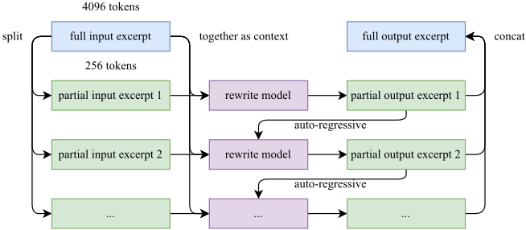
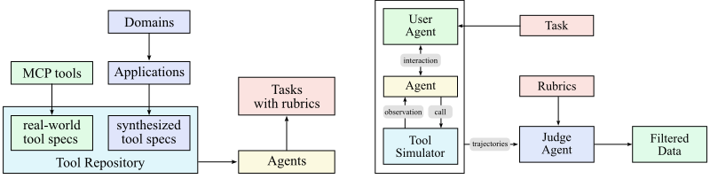
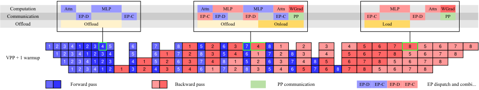
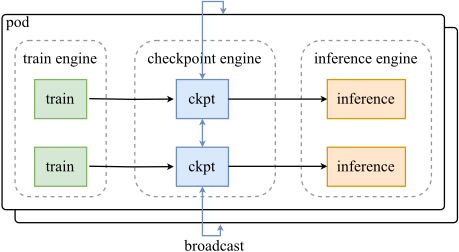
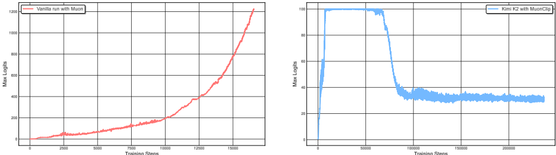
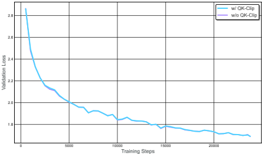
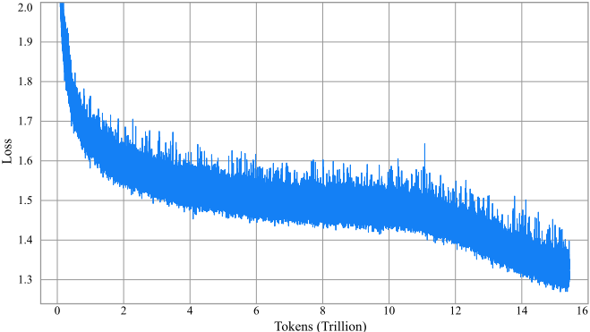
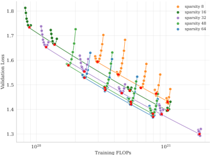
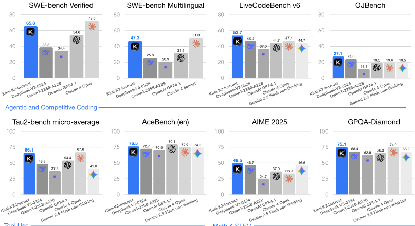

# 08 · Kimi K2: Open Agentic Intelligence 深度解读：换优化器 + 造 agent 数据工厂

> 本篇是「论文解读」系列第 2 批 08 篇，方向：**大模型·Agent**（与 01 篇 DeepSeek-V3 同属 MoE 路线，内含对照表）。所有数字均与 arXiv 2507.20534 PDF 原文核对；图片截取自原论文（版权归 Moonshot AI，仅作学习解读之用）；标注"解读视角"的内容为本文推断。

## 1. 论文档案

| 项目 | 内容 |
| --- | --- |
| 标题 | Kimi K2: Open Agentic Intelligence |
| 机构 | Kimi Team（Moonshot AI，按姓氏字母序集体署名，附录 A） |
| 发表处 | arXiv 预印本，2025-07 提交（模型权重 2025-07-11 开放） |
| arXiv | [2507.20534](https://arxiv.org/abs/2507.20534)（约 32 页含附录 A-G） |
| 开源仓库 | [MoonshotAI/Kimi-K2](https://github.com/MoonshotAI/Kimi-K2)：代码与权重均为 **Modified MIT License**——允许商用，但产品月活超 1 亿或月营收超 2000 万美元时须在界面显著位置展示 "Kimi K2" 品牌 |
| 权重可得性 | HuggingFace `moonshotai/Kimi-K2-Base` 与 `moonshotai/Kimi-K2-Instruct`；仅提供 **block-FP8** 格式（1T 总参，约 1 TB 磁盘），无官方 BF16 版本 |
| 配套开源 | RL 参数同步组件 [MoonshotAI/checkpoint-engine](https://github.com/MoonshotAI/checkpoint-engine) 独立开源（论文 §3.3.2） |

## 2. 速览

**一句话 TL;DR**：Moonshot 把 1T 总参/32B 激活的 MoE（架构沿用 DeepSeek-V3 路线但拉到"超稀疏"）压在 **MuonClip** 优化器上——Muon 换来约 2 倍 token 效率，QK-Clip 用对 W_q/W_k 的逐头缩放堵住 Muon 特有的 attention logit 爆炸——15.5T tokens 训练**零 loss spike**；后训练用"工具库合成 + 世界模型模拟器 + rubric 过滤"的 agent 数据工厂和 RLVR+自评 rubric 的联合 RL，把一个**不开思维链**的模型推到 SWE-bench Verified 65.8、Tau2-Bench 66.1 的开源最强。

| 维度 | 内容 |
| --- | --- |
| 问题 | ① 高质量人类数据见顶，预训练必须提高"每个 token 的学习信号"（token efficiency）；② Muon 优化器 token 效率高但放大到 1T 规模会出现 attention logit 爆炸（loss spike/发散）；③ agentic 能力（多步工具调用）在自然数据中极稀缺，无法靠爬数据获得 |
| 创新 | ① MuonClip = Muon（权重衰减 + 更新 RMS 对齐版）+ QK-Clip 逐头权重裁剪；② 超稀疏 MoE：384 选 8（sparsity 48）+ 注意力头砍半到 64，各自有 scaling law 支撑；③ 知识/数学语料 rephrasing 提高 token utility；④ 三段式 agent 轨迹合成管线（工具规格→agent/任务→轨迹）+ 真实沙箱混合；⑤ RLVR + Self-Critique Rubric Reward 的联合 RL 与 budget control |
| 证据 | Instruct：SWE-bench Verified 65.8（multi-attempt 71.6）、SWE-bench Multilingual 47.3、Tau2-Bench 66.1、ACEBench 76.5、LiveCodeBench v6 53.7、AIME 2025 49.5、GPQA-Diamond 75.1（全部 non-thinking 设定）；LMSYS Arena（2025-07-17）开源第 1、总榜第 5 |

## 3. 背景与动机

**2025 年中开源格局**：DeepSeek-V3/R1 已确立"MoE + MLA + FP8"路线；Qwen3-235B-A22B 把同路线做到 22B 激活。Moonshot 的差异化选择有两个：**预训练侧**换掉 AdamW（全行业默认）改用 Muon——理由是高质量 token 见顶后，"每 token 学到多少"成了新的 scaling 系数；**后训练侧**不追长思维链（K2 是 reflex-grade 瞬时响应模型），而是把"agent 能力"做成数据与 RL 的系统性工程。论文开篇引 Silver & Sutton 的"Era of Experience"来定位：静态模仿人类数据有上限，agent 通过与环境交互才能获得超出数据分布的能力。

**三个具体瓶颈**（每条对应一项创新）：

1. **token 效率瓶颈**：同算力同数据下 AdamW 已被 Moonlight（同团队前作，arXiv 2502.16982）证明不如 Muon——同等性能 Muon 只需约 52% 的训练 FLOPs。但 Muon 从未被用于 1T 级 MoE，稳定性未知。
2. **Muon 的 logit 爆炸**：注意力 logit（softmax 的输入）在训练中无界增长，达到 1000+ 量级时必然出现 loss spike 甚至发散。Muon 训练中比 AdamW 更频繁出现（论文原话），且已有两种缓解手段都不适用于 K2：Gemma 2 式 logit soft-cap 只在算完点积后截断（点积本身已经先涨上去了）；QK-Norm 在 MLA 上不可用——**MLA 推理时不完整 materialize K 矩阵**（KV 是压缩潜向量现算的），没有地方插归一化层。
3. **agent 数据荒**：真实环境建不了几百万条（成本/隐私/可及性），ToolLLM/Self-Instruct 类纯合成又有保真度问题。需要"合成可扩展 + 真实可验证"的混合管线。

**时机点**：ACEBench、τ²-Bench 等 agent 基准 2025 年成熟，使"agentic 能力"第一次可以被量化比较——这也是论文把"Open Agentic Intelligence"写进标题的评测论据。

## 4. 核心创新拆解

### 4.1 MuonClip：Muon 的 token 效率 + QK-Clip 的稳定性

- **是什么**：Muon 优化器（对动量矩阵做正交化后再更新，见 §5.1）加上 QK-Clip——每次前向统计每头的最大 attention logit $S_{\max}^h$，超过阈值 τ 就**按比例缩小该头的 W_q/W_k 权重**，把下一轮 logit 的增长上限压回 τ。MuonClip = Muon + weight decay + 一致的更新 RMS 匹配 + QK-Clip（Algorithm 1）。
- **为什么之前不行**：Muon 在 16B（Moonlight）验证过 token 效率，但放大到 1T 时 logit 爆炸频发；soft-cap 治标（logit 已涨），QK-Norm 不兼容 MLA，两者都不"治权重"。
- **怎么做到**：QK-Clip 直接操作权重本身（数学见 §5.2），且只对超阈值的少数头触发——K2 全程仅 12.7% 的头触发过（§6.5）。它是"最小干预"设计：logit 回落后自动停用。
- **代价与权衡**：每步要统计全模型所有头的 max logit（前向顺手可得，开销小）；理论上裁剪会改变有效学习率，论文用 0.5B/3B 小模型 + 激进阈值 τ=30 的消融证明对 loss 曲线无可测影响（附录 D，图见 §6.5）。

### 4.2 超稀疏 MoE：sparsity 48 与 64 头的两笔 scaling law 账

- **是什么**：384 个 routed expert 每 token 激活 8 个（sparsity = 384/8 = 48，DeepSeek-V3 是 256/8 = 32），共享专家 1 个；注意力头从 V3 的 128 砍到 64；稠密层从 3 层减到 1 层；总参 1.04T（↑54%）而激活 32.6B（↓13%）。
- **为什么之前不行**：稀疏度（总专家数/激活专家数）是不是越大越好，此前没有系统实验；砍注意力头会掉质量是普遍直觉。
- **怎么做到**：两条可控实验曲线（§2.3）：① **稀疏度 scaling law**——固定激活专家数 8 与共享专家 1，只变总专家数，同验证损失 1.5 下 sparsity 48 比 8/16/32 分别省 1.69×/1.39×/1.15× FLOPs（图见 §6）；② **头数消融**——iso-token 下头数翻倍只换来 0.5%–1.2% 验证损失改善，而 128k 上下文时 128 头比 64 头推理 FLOPs 多 83%。
- **代价与权衡**：sparsity 48 带来基础设施复杂度（专家更多、EP 通信更碎）；64 头降低了注意力带宽利用（V3 设 128 头部分理由是打满显存带宽），K2 用更小的 EP=16 来补；agent 场景吃长上下文，所以推理侧省的 FLOPs 优先于训练侧的少量质量损失。

### 4.3 Rephrasing：把一批高质量 token 变成多批

- **是什么**：用 LLM 对高质量语料做**忠实改写**扩充 token 量——知识域用"风格/视角多样化提示 + 分块自回归改写 + 保真校验"（WRAP 式）；数学域按 SwallowMath 方法改写成"学习笔记"体，并把非英文数学材料翻译成英文。每个语料库最多改写 2 遍。
- **为什么之前不行**：简单重复多 epoch 收益递减且过拟合；普通 LLM 改写长文档会丢全局连贯性（LLM 输出长度上限）。
- **怎么做到**：分块（保留上下文）逐段改写再拼接（管线图见 §6），SimpleQA 对照实验（表 1）：原始 wiki 重复 10 epoch 23.76 → 改写 1 遍重复 10 epoch 27.39 → 改写 10 遍只训 1 epoch **28.94**——同样 10 倍数据预算，改写比重复高 5 个点。
- **代价与权衡**：改写质量依赖自家 LLM 的忠实度（有保真校验兜底）；论文自认"扩展到更多领域、控制幻觉与毒性、大规模可扩展性"仍是 open challenge（§8 争议 2）。



### 4.4 大规模 agent 数据合成：工具库 → agent/任务 → 轨迹

- **是什么**：三段式管线（图见 §6）：① 工具规格库 = **3000+ 真实 MCP 工具**（从 GitHub 抓取）+ **20000+ LLM 合成工具**（层级式"领域→应用→工具"演化，t-SNE 显示两类工具覆盖互补）；② 每个工具组合生成数千个 system prompt 各异的 agent + 带 rubric 的任务（难度从简单到复杂）；③ 轨迹生成 = LLM 模拟用户（多人设多风格）× **工具模拟器**（功能等价于世界模型：维护状态、引入受控随机性制造成功/部分失败/边界情况）→ LLM judge 按 rubric 过滤（等价于大规模拒绝采样）。
- **为什么之前不行**：真实环境贵/慢/涉及隐私；纯 LLM 合成轨迹没有执行反馈，工具参数错误无人发现。
- **怎么做到**：**混合真执行**——编码/软件工程类场景用真实沙箱（Kubernetes 支撑 **10000+ 并发沙箱实例**），以测试通过率等客观指标提供 ground truth 反馈；其余场景用世界模型式模拟器保规模。
- **代价与权衡**：模拟器保真度是天花板（论文自己承认）；合成轨迹的多样性受生成 LLM 限制（§8）。



### 4.5 联合 RL：RLVR + 自评 rubric，把"不可验证任务"也拉进 RL

- **是什么**：一个 Gym 风格可扩展 RL 框架，两类奖励并行：① **可验证奖励**（数学/STEM/逻辑答案核对、指令遵循的规则+LLM judge+防 hack 三层校验、代码单元测试、GitHub PR/issue 构建的 SE 环境、忠实度句子级 judge、安全的攻击/目标/评判三模型红队）；② **Self-Critique Rubric Reward**——K2 自己当 critic 对自己的输出做两两排序（rubric = 核心价值观 + 防作弊规定条款 + 人工标注条款），把 RL 对齐从可验证域扩展到创作/开放问答。
- **为什么之前不行**：RLVR 只覆盖有客观答案的任务；纯 RM 打分又容易被 reward hack。
- **怎么做到**：**闭环 critic 校准**——用可验证任务上的 on-policy 轨迹持续微调 critic，把客观信号"蒸馏"进主观评判，使 critic 与 policy 共同进化。三项训练期修正：**Budget Control**（按任务类型设 token 预算，超限截断+惩罚，治 RL 拉长输出的通病）、**PTX loss**（高质量 SFT 数据作为辅助 LM loss 防灾难遗忘）、**温度衰减**（前期高温探索后期收敛）。
- **代价与权衡**：rubric 惩罚自我保留式措辞（"我可能不对"），附录 F 自认副作用是模型过度自信、缺乏认知谦逊（§8）。

## 5. 方法细节（公式均对照原文手工重写为 LaTeX；docling 公式占位符零残留）

### 5.1 Muon 本体与 MuonClip 算法（原文 Algorithm 1）

Muon 只处理隐藏层的二维权重矩阵，核心是"动量 + 正交化"：

$$M_t = \mu M_{t-1} + G_t, \qquad O_t = \mathrm{NewtonSchulz}(M_t)\cdot\sqrt{\max(n,m)}\cdot 0.2$$

其中 Newton–Schulz 迭代把 $M_t \in \mathbb{R}^{n\times m}$ 的奇异值全部压向 1（即近似计算 $M_t = U\Sigma V^\top$ 的 $UV^\top$，论文附录 E 称之为 msign 算子），$\sqrt{\max(n,m)}\cdot 0.2$ 是与 Adam 更新 RMS 对齐的尺寸匹配（Moonlight 引入，原版 Muon 用固定系数）。最终更新：

$$W_t = W_{t-1} - \eta\,(O_t + \lambda W_{t-1})$$

embedding、最终输出头等非隐藏层参数按 Muon 谱系惯例仍走 AdamW（Keller Jordan 原版设定；K2 论文未单独说明——解读视角，引自 [34][47]）。**token 效率证据在本文里是引用而非重跑**：Moonlight（16B/3B MoE）在完全同架构、同数据、同超参下对比 AdamW，compute-optimal 设定下达到同等性能只需约 52% FLOPs，即同算力下约 2 倍 token 效率。

QK-Clip 步（接在每个 Muon 步之后）：

```
for each attention head h:
    obtain S_max^h (前向已算得)
    if S_max^h > τ:  γ ← τ / S_max^h
        W_qc ← √γ · W_qc ;  W_kc ← √γ · W_kc ;  W_qr ← γ · W_qr
```

### 5.2 QK-Clip 的数学（原文式 1–5）

每头的 Q/K 投影与最大 logit 定义（$\mathbf{X}$ 为训练样本，$\mathcal{B}$ 为当前 batch）：

$$\mathbf{q}_{t,h} = W_q^h \mathbf{x}_t,\quad \mathbf{k}_{t,h} = W_k^h \mathbf{x}_t, \qquad S_{\max}^h = \max_{\mathbf{X}\in\mathcal{B}}\ \max_{i,j\in\mathbf{X}}\ \mathbf{q}_{i,h}^{\top}\mathbf{k}_{j,h}$$

$S_{\max}^h$ 即该头 softmax 输入的最大值。**朴素版**对所有头一次性缩放（$\gamma = \min(1, \tau/S_{\max})$，$S_{\max} = \max_h S_{\max}^h$；α 为 Q/K 分配比例，典型 0.5）：

$$W_q \leftarrow \gamma^{\alpha}\, W_q, \qquad W_k \leftarrow \gamma^{1-\alpha}\, W_k$$

要点：缩放乘在**权重**上而非 logit 上，故不影响当前步的前向/反向（下一步才生效），$S_{\max}^{\top}$ 只是"控制权重增长的引导信号"。实践中只有少数头爆，因此改成**逐头** $\gamma_h = \min(1, \tau/S_{\max}^h)$。对 MLA 的拆分处理（K2 论文最有信息量的细节）：

| 分量 | 角色 | 缩放 | 原因 |
| --- | --- | --- | --- |
| $\mathbf{q}^C, \mathbf{k}^C$ | 头专属压缩分量 | 各乘 $\sqrt{\gamma_h}$ | 两者相乘得 $\gamma_h$，对半分摊 |
| $\mathbf{q}^R$ | 头专属 RoPE 分量 | 乘 $\gamma_h$ | 它与共享的 $\mathbf{k}^R$ 相乘，独自承担全部缩放 |
| $\mathbf{k}^R$ | **跨头共享** RoPE 分量 | 不动 | 改它会波及所有头，等于回到朴素全局版 |

三种组合的乘积都精确缩放 $\gamma_h$——logit 上界被压住，但不同头之间互不干扰（per-head 而非 per-layer，避免过度正则化没超标的头）。

### 5.3 为什么 Muon 比 AdamW 更容易 logit 爆炸（附录 E 推理）

RMSNorm 使 $\|\mathbf{x}_i\|\|\mathbf{x}_j\|$ 有界，logit $s_{i,j}^h = \mathbf{x}_i^\top (W_q^h)^\top W_k^h \mathbf{x}_j$ 的无界增长只能来自 $\|W_q\|_2$ 或 $\|W_k\|_2$（谱范数）的增长。而注意力天然放大这个问题：

$$\|(W_q)^\top W_k\|_2 \le \|W_q\|_2\,\|W_k\|_2 \quad\Rightarrow\quad \text{任一矩阵谱范数的增长都被乘法复合}$$

Muon 的结构性风险：msign 更新矩阵**所有奇异值相等（满有效秩）**；Adam 更新矩阵谱倾斜，少数大奇异值主导（低有效秩）——高阶 muP 也做了同样的低秩假设。16B Moonlight 实测：Muon 训出的权重奇异值熵更高，印证了满秩直觉。SVD 视角：$W_{t-1} = \sum_i \sigma_i u_i v_i^\top$，更新 $\Delta$ 同样是奇异向量外积之和——满有效秩意味着 $(u_i v_i^\top)$ 与 $\Delta$ 的奇异向量对**对齐概率更高**，对齐时 $W_t$ 的对应奇异值**加性增长**且无 AdamW 那样的二阶矩自适应收缩来对冲。这就是"Muon 好 token 效率（谱均匀，全矩阵方向被均匀利用）"与"Muon 易 logit 爆炸（谱均匀，最大奇异值也持续增长）"的同一枚硬币两面。

### 5.4 训练基础设施：为"研究效率"放弃 DualPipe

- 集群：H800，每节点 2TB RAM + 8 卡 NVLink/NVSwitch，跨节点 8×400Gbps RoCE。并行策略 = **16 路 PP（virtual stages）+ 16 路 EP + ZeRO-1 DP**，可在任意 32 的倍数节点数上运行；BF16 参数 + FP32 梯度累计约 6TB 摊在 256 卡模型并行组上，每卡状态约 30GB（节点少时优化器状态 offload 到 CPU）。
- **明确不用 DualPipe**（01 篇 V3 的选择）：DualPipe 参数/梯度双份，1T 模型下代价不可接受。改用 interleaved 1F1B + 加大 warm-up micro-batch 数来重叠 EP all-to-all；再把**权重梯度计算从 micro-batch 反向中解耦**、与 PP 通信并行，使除 warm-up 外全部 PP 通信被遮盖。
- EP=16（最小可行）：K2 注意力计算时间被砍半（64 头），要保住 1F1B 阶段完全重叠就必须压缩 EP 时间；小 EP 还放松了专家均衡约束。
- 激活优化三板斧：选择性重算（LayerNorm/SwiGLU/MLA 上投影/MoE 下投影）；不敏感激活 FP8-E4M3 1×128 tile **存储**（仅存储！论文明确"我们不在计算中用 FP8"，与 V3 的全 FP8 GEMM 形成鲜明对照，理由是初步实验观察到性能风险）；其余激活全量 CPU offload，专用 copy engine 与计算/通信重叠。



### 5.5 RL 目标函数与工程

RL 目标沿用 K1.5 的组相对式 PPO 变体（依 K1.5 [36] 与本文文字重写）：每个问题采 $k$ 个回答，优势即奖励减去组均值：

$$\mathcal{J}(\theta) = \mathbb{E}_{x}\,\mathbb{E}_{\{y_i\}\sim\pi_{\theta_{\text{old}}}}\left[\frac{1}{k}\sum_{i=1}^{k}\Big(\min\big(\rho_i A_i,\ \mathrm{clip}(\rho_i,1\!-\!\epsilon,1\!+\!\epsilon)A_i\big)\Big)\right] - \tau\, D_{\mathrm{KL}}(\pi_\theta\,\|\,\pi_{\mathrm{ref}}), \quad A_i = r(x,y_i) - \bar{r}(x)$$

$\bar{r}(x) = \frac{1}{k}\sum_i r(x,y_i)$，τ 为稳定性正则系数。SFT 与 RL 全程仍用 Muon 优化器（Muon 预训练的 checkpoint 用 Muon 微调效果最好——Moonlight 结论）。工程侧：训练/推理引擎**同卡部署（colocated）**轮流让出显存；1T 参数的跨引擎同步用 checkpoint engine 全量广播（理论上按需传输更省，但全量广播解耦了两个引擎的 sharding 设计，实际反而更快），**单次全参数更新 < 30 秒**；H800 上 H2D 与 broadcast 会打满 PCIe，三段流水线退化成两段（附录 G）。长尾 agent 任务用 **partial rollout** 暂停续跑防阻塞。



## 6. 实验证据复盘

### 6.1 稳定性证据（MuonClip 三级实验链）

1. **中规模复现问题**：9B 激活/53B 总参 MoE 用 vanilla Muon——max attention logit 快速冲破 1000（论文图 2 左），这个量级通常伴随显著 loss spike 与偶发发散。
2. **无损性消融**：0.5B 激活/3B 总参 MoE，MuonClip 用激进阈值 τ=30——验证损失曲线与 vanilla Muon 重合（下图），下游任务无统计显著退化。
3. **全规模验证**：K2（τ=100）——logit 先被钳在 100，约 **30% 训练步之后**所有头自然回落到 100 以下（QK-Clip 自动停用）；全程 loss 曲线无 spike（下图，无平滑无抽样）。附录 D 给出精确数字：**前 70000 步中 12.7% 的头至少触发过一次 clip**；70000 步后所有头的 $S_{\max}$ 都降回 100 以下。（解读视角：15.5T/67M batch ≈ 23 万步，70000 步 ≈ 30%，与图 2 右的"30%"自洽。）







训练配方（§2.5）：4K 上下文，WSD 调度；前 10T tokens 恒定学习率 2e-4（500 步 warm-up），后 5.5T 余弦衰减至 2e-5；weight decay 0.1；全局 batch 67M tokens；末期退火（2e-5→7e-6）400B @4k + 60B @32k，YaRN 扩到 128K。

### 6.2 Kimi-K2-Instruct：agentic 与编程评测（原文表 3，全部数字与 PDF 核对；评测口径全部为 non-thinking）

| 基准 | K2-Instruct | DeepSeek-V3-0324 | Qwen3-235B-A22B | Claude Sonnet 4 | Claude Opus 4 | GPT-4.1 |
| --- | --- | --- | --- | --- | --- | --- |
| SWE-bench Verified（Agentic 单次） | **65.8** | 38.8 | 34.4 | 72.7* | 72.5* | 54.6 |
| SWE-bench Verified（Agentic 多次） | 71.6 | - | - | **80.2*** | 79.4* | - |
| SWE-bench Verified（Agentless 单补丁） | **51.8** | 36.6 | 39.4 | 50.2 | 53.0 | 40.8 |
| SWE-bench Multilingual | **47.3** | 25.8 | 20.9 | 51.0 | - | 31.5 |
| Multi-SWE-bench | **18.3** | 8.0 | 9.0 | 29.2 | - | 11.7 |
| SWE-Lancer | 39.1 | 30.5 | 24.1 | **40.8** | - | 23.0 |
| TerminalBench（Terminus） | 25.0 | 16.3 | 6.6 | - | - | **30.3** |
| Aider-Polyglot | 60.0 | 55.1 | 61.8 | 56.4 | **70.7** | 52.4 |
| LiveCodeBench v6（Pass@1） | **53.7** | 46.9 | 37.0 | 48.5 | 47.4 | 44.7 |
| OJBench（Pass@1） | **27.1** | 24.0 | 11.3 | 15.3 | 19.6 | 19.5 |
| Tau2 retail / airline / telecom（Avg@4） | 70.6 / 56.5 / **65.8** | 69.1 / 39.0 / 32.5 | 57.0 / 26.5 / 22.1 | 75.0 / 55.5 / 45.2 | 81.8 / **60.0** / 57.0 | 74.8 / 54.5 / 38.6 |
| AceBench（en） | 76.5 | 72.7 | 70.5 | 76.2 | 75.6 | **80.1** |

（带 * 的数字取自对应厂商技术报告而非统一重跑；Gemini 2.5 Flash 列略——多数 agentic 项缺席。τ²-Bench 三域平均 66.1。）

读法：**对开源（DSv3/Qwen3）是碾压级**——SWE-bench Verified 65.8 vs 38.8；**对闭源是"接近 Sonnet 4、单次 agentic 持平略超 Opus 4 之外的多数档位"**，但 multi-attempt（71.6 vs 80.2）、Multi-SWE-bench、TerminalBench、Aider-Polyglot 仍落后 Claude。论文标题级的宣称"surpassing most open and closed-sourced baselines in non-thinking settings"成立，但要带 two qualifiers：non-thinking 口径 + Claude 4 Opus 在部分基准因成本缺席（SWE-bench Multilingual 只测了 Sonnet）。

### 6.3 Kimi-K2-Instruct：数学/STEM/通用（原文表 3 续）

| 基准 | K2-Instruct | DeepSeek-V3-0324 | Qwen3-235B-A22B | Claude Sonnet 4 | Claude Opus 4 | GPT-4.1 |
| --- | --- | --- | --- | --- | --- | --- |
| AIME 2024（Avg@64） | **69.6** | 59.4* | 40.1* | 43.4 | 48.2 | 46.5 |
| AIME 2025（Avg@64） | **49.5** | 46.7 | 24.7* | 33.1* | 33.9* | 37.0 |
| MATH-500 | **97.4** | 94.0* | 91.2* | 94.0 | 94.4 | 92.4 |
| GPQA-Diamond（Avg@8） | **75.1** | 68.4* | 62.9* | 70.0* | 74.9* | 66.3 |
| SuperGPQA | **57.2** | 53.7 | 50.2 | 55.7 | 56.5 | 50.8 |
| ZebraLogic / AutoLogi | **89.0 / 89.5** | 84.0 / 88.9 | 37.7* / 83.3* | 79.7 / 89.8 | 59.3 / 86.1 | 58.5 / 88.2 |
| Humanity's Last Exam（Text） | 4.7 | 5.2 | 5.7 | 5.8 | **7.1** | 3.7 |
| MMLU / MMLU-Pro | 89.5 / 81.1 | 89.4 / 81.2* | 87.0 / 77.3 | 91.5 / 83.7 | **92.9 / 86.6** | 90.4 / 81.8 |
| IFEval（Prompt Strict） | **89.8** | 81.1 | 83.2* | 87.6 | 87.4 | 88.0 |
| Multi-Challenge（多轮指令） | **54.1** | 31.4 | 34.0 | 46.8 | 49.0 | 36.4 |
| SimpleQA | 31.0 | 27.7 | 13.2 | 15.9 | 22.8 | **42.3** |
| DROP / MRCR / FRAMES / LongBench v2 | 93.5 / 55.0 / 77.1 / 49.1 | 91.2 / 50.8 / 79.2 / 51.1 | - | 92.0 / 74.4 / 76.3 / 52.5 | - | 79.1 / 66.9 / 87.4 / 54.3 |

读法：数学/STEM/指令遵循全面领先（AIME 2024 69.6 超 DSv3 10.2 点）；HLE 只有 4.7——non-thinking 模型在极限学术基准上仍乏力，这是"瞬时响应"设计的代价；长上下文推理（FRAMES/LongBench v2）略输 DSv3 约 2 点，MRCR 检索大幅落后 Claude（55.0 vs 74.4）。事实性（SimpleQA 31.0）超所有开源但不及 GPT-4.1 的 42.3。开放域：Arena-Hard v2 创作写作胜率 85.0、难提示 54.5；中文自建 held-out 评测对 ChatGPT-4o-latest 胜率 65.4%、对 Claude Sonnet 4 胜 64.6%、败率稳定在约 17%。

### 6.4 Kimi-K2-Base：预训练模型评测（原文表 4 选摘）

| 基准 | K2-Base | DeepSeek-V3-Base | Llama4-Maverick | Qwen2.5-72B |
| --- | --- | --- | --- | --- |
| 架构（总参/激活） | MoE **1043B/32B** | MoE 671B/37B | MoE 400B/17B | Dense 72B |
| MMLU / MMLU-Pro | **87.79 / 69.17** | 87.10 / 60.59 | 84.87 / 63.47 | 86.08 / 62.80 |
| MMLU-Redux / SuperGPQA | **90.17 / 44.67** | 89.53 / 39.20 | 88.18 / 38.84 | 87.77 / 34.23 |
| SimpleQA | **35.25** | 26.49 | 23.74 | 10.31 |
| BBH / AGIEval | **88.71 / 84.23** | 88.37 / 81.57 | 87.10 / 67.55 | 84.09 / 76.87 |
| EvalPlus / CRUXEval-I-cot / LCB v6 | **80.33 / 74.00 / 26.29** | 65.61 / 62.75 / 24.57 | 65.48 / 67.13 / 25.14 | 66.04 / 61.12 / 22.29 |
| MATH / GSM8K-Platinum | **70.22 / 94.21** | 61.70 / 93.38 | 63.02 / 88.83 | 62.68 / 92.47 |
| C-Eval / CMMLU / CSimpleQA | **92.50 / 90.90 / 77.57** | 90.04 / 88.84 / 72.13 | 80.91 / 81.24 / 53.47 | 90.86 / 90.55 / 50.53 |
| GPQA-Diamond（avg@8） | 48.11 | **50.51** | 49.43 | 40.78 |
| HellaSwag | 94.60 | 89.44 | 86.02 | **95.27** |

读法：12 项英文基准中 10 项 SOTA；代码类优势最大（EvalPlus 80.33 vs 65.61）；中文全线第一（CSimpleQA 77.57 vs 72.13）。诚实的两处失利：GPQA-Diamond 48.11 输 DSv3 的 50.51，HellaSwag 输 Qwen2.5——32B 激活的"覆盖面"边界仍然存在。

### 6.5 安全评测（原文表 5/6，Promptfoo 红队 + 人工复核）

自报的弱项值得注意：Harmful-Crescendo 通过率 64.71（与 DSv3 持平，低于 Qwen3 86.27）；**Security-Iterative Jailbreak 43.90** 为全表最低之一（Qwen3 78.04）；Criminal-Prompt Injection 75.76（DSv3 91.67、Qwen3 98.47）。强项：Harmful/Criminal/Misinformation-Iterative Jailbreak 显著高于 DSv3/R1。论文没有为评测场景做定向优化（这值得肯定），但对一个**能执行工具的 agent 模型**，注入与越狱的边际风险比纯 chat 模型更高——这是读完表 6 后应有的警觉。

### 6.6 系列对照：Kimi K2 vs DeepSeek-V3（01 篇）

| 维度 | DeepSeek-V3（01 篇） | Kimi K2（本篇） | 解读 |
| --- | --- | --- | --- |
| 注意力 | MLA（128 头，57× KV 压缩） | MLA（**64 头**，同压缩思路） | K2 用头数减半换 128K 长上下文推理 FLOPs -45%（128 头会 +83%） |
| 路由方式 | sigmoid 亲和度 top-8，device-limited（每 token ≤4 节点），256 routed experts | 论文未单独披露路由实现，声明"follows DeepSeek-V3 设计"；routed experts 增至 **384**、**取消 expert grouping**、sparsity 32→48 | K2 的增量在稀疏度而非路由算法 |
| 负载均衡 | 无辅助损失（bias 只进路由），序列级 α=0.0001 兜底 | 未披露（沿用 V3 类设计的合理推断——解读视角） | 论文把笔墨全部给了优化器与数据 |
| 共享专家 | 1 个共享 expert + 细粒度 routed | 相同（1 共享 + 8 激活） | 两条路线在 MoE 微观结构上同源 |
| 稠密层 | 前 3 层稠密 | 前 1 层稠密 | 更极致的稀疏化 |
| 优化器 | AdamW（β2=0.95）+ Bucketed ZeRO-1 | **MuonClip**（Muon + QK-Clip），SFT/RL 也用 Muon | 本篇最大的路线分野；Muon 换约 2× token 效率 |
| 训练精度 | **全链路 FP8 计算**（E4M3 + 1×128/128×128 细粒度缩放） | BF16 计算；FP8 仅用于不敏感激活的**存储**（明确不做 FP8 计算） | K2 更保守——MLA/Muon 组合下 FP8 计算的风险收益比变了 |
| 流水线 | DualPipe（双向 + 通信全重叠，参数双份） | interleaved 1F1B + 权重梯度解耦；**明确拒绝 DualPipe**（1T 下双份内存不可接受） | 同一问题在两个规模下的相反答案 |
| EP 规模 | 64（跨节点 all-to-all，DeepEP） | 16（小 EP 保重叠 + 放松均衡约束） | 头数减半后 EP 时间占比上升，缩小 EP 换时间 |
| 数据规模 | 14.8T tokens（2.788M H800 GPU 时） | 15.5T tokens（GPU 时数未披露；含 rephrasing 合成数据） | K2 首次把"合成数据挤 token 效率"写进预训练主配方 |

**一句话总结对照**：V3 的创新是"把已知件组装到极致 + 省钱"；K2 是在 V3 架构地基上换了**优化器（AdamW→MuonClip）**和**数据哲学（爬→合成+改写）**，并把后训练的全部赌注押在 agent 能力上。





## 7. 开源仓库导读

仓库：[MoonshotAI/Kimi-K2](https://github.com/MoonshotAI/Kimi-K2)（Modified MIT License）。仓库本体是**配置与文档型**（不含训练代码），权重在 HuggingFace：`moonshotai/Kimi-K2-Base` / `moonshotai/Kimi-K2-Instruct`（block-FP8 safetensors，另有社区 GGUF 量化供 KTransformers 使用）。

**关键工程事实**：

- `config.json` 的 `model_type` 为 `kimi_k2`，但**复用 `DeepSeekV3CausalLM` 架构类**——印证 §6.6 的"V3 地基"论；不支持 K2 的框架可临时改 `model_type` 为 `deepseek_v3` 绕过（官方文档给出的 workaround，工具调用需手工解析）。
- 原生工具调用协议（论文附录 B）：工具声明用 **TypeScript** 表达（比 JSON Schema 紧凑且有类型系统），兼容 OpenAI JSON 格式的子集；支持单轮**并行多工具调用**，call_id 格式 `functions.{tool-name}:{counter}`；推理时用受约束解码模块 **enforcer**（仿 lm-format-enforcer）保证 `<|tool_call_section_begin|>` 后的 token 严格符合模板与 schema——从"模型可能偶尔生成坏格式"到"解码层面硬保证"，这是 agent 可靠性容易被忽略的一层。
- 官方推荐推理温度 **0.6**（README 明示）。
- 部署路径（`docs/deploy_guidance.md`）：

```bash
# vLLM（需 ≥ v0.10.0rc1；FP8 权重 128k 上下文最少 16×H200/H20）
vllm serve $MODEL_PATH --trust-remote-code --tensor-parallel-size 16 \
  --enable-auto-tool-choice --tool-call-parser kimi_k2
# 大规模 DP+EP 双机：--data-parallel-size 16 --enable-expert-parallel ...（可装 DeepEP/DeepGEMM）

# SGLang（TP16 双机；也支持 prefill-decode 分离 + DeepEP MoE）
python -m sglang.launch_server --model-path $MODEL_PATH --tp 16 --trust-remote-code \
  --tool-call-parser kimi_k2 --dist-init-addr $MASTER_IP:50000 --nnodes 2

# TensorRT-LLM：源码构建 v1.0.0-rc2，mpirun 启动 trtllm-serve（--tp_size 16 --ep_size 8）
# KTransformers（消费级路线）：GGUF 权重 + AMX 优化规则，CPU/GPU 混合跑 1T 模型
python ktransformers/server/main.py --model_path /path/to/K2 --gguf_path /path/to/K2 --cache_lens 30000
```

- 工具调用细节（流式解析、手动解析兜底）在 `docs/tool_call_guidance.md`；RL 基建组件 checkpoint-engine 单独开源。

**工程亮点**：官方"全家桶"仍缺训练侧（MuonClip 训练框架未开源），但 FP8 权重 + DeepSeek-V3 兼容架构 + kimi_k2 tool parser 三件事合起来，使 K2 在发布当周就被 vLLM/SGLang 主线支持——对生态的"可接入性"设计本身就是发布策略。

## 8. 局限与争议

**论文自认的局限**（§5 + 附录 F）：① 难推理/工具定义不清晰时生成 token 过多，输出被截断或工具调用不完整；② 不需要工具的任务开了工具反而掉分；③ 完整软件项目一次性提示不如 agentic coding 框架内使用；④ rubric 惩罚自我保留式措辞（"我可能不对"被当作无信息），副作用是**过度自信、缺乏认知校准**——对一个 agent 来说这条比看起来严重（错误自信 + 工具执行权 = 更大事故半径）。

**社区真实争议**（已查证出处）：

1. **Muon 大规模训练无第三方复现**：截至论文发布，Muon 在 LLM 上的验证只有 Moonshot 自家的 Moonlight（16B）与 K2 本身；QK-Clip 的"无损性"证据是 0.5B/3B 小模型消融 + K2 自身曲线。其他大厂截至 2025 年内未见公开用 Muon 训练旗舰的案例。反方观点：Keller Jordan 的 Muon 本就出自社区（Kaggle 竞赛谱系），K2 之后 Muon 系（含 Kaiwa、各种复现）活跃度大增，但 1T 级复现成本让"独立验证"短期不可能。
2. **合成数据/自蒸馏的多样性担忧**：rephrasing 用自家 LLM 改写维基等语料，等于"用模型产出喂模型"；SimpleQA 23.76→28.94 的提升来自同源 token 的变体扩张，社区长期担心知识多样性收窄与幻觉固化。论文自己在 §2.2 承认这是 open challenge；HuggingFace 模型卡讨论区也有对合成数据来源与许可的疑问帖。
3. **蒸馏争议的大背景**：2025 年中 Anthropic 指控部分中国实验室使用 Claude 输出做蒸馏的报道（媒体广泛转载），加上社区观察到 Kimi 偶有自称 Claude 的输出案例——这些报道**并非针对 K2 的事实认定**，K2 论文也未承认任何蒸馏，但它给"agentic 数据全部自研合成"的宣称增加了解释负担。写作视角：这属于舆论环境风险，不是论文缺陷。
4. **评测口径可质疑处**：全部对比限定 non-thinking（R1/o3 类推理模型不在列）；带 * 数字取自厂商报告而非统一重跑；SWE-bench Verified multi-attempt 用内部 verifier 做 best-of-N（71.6 这一行依赖自建验证器）；Claude 4 Opus 因成本在部分基准缺席；GitHub/HF 有复现分数低于宣称的零星报告。K2 的"开源最强 agent"结论在 SWE-bench Verified agentic 单次口径下最稳，在 multi-attempt/TerminalBench/Aider-Polyglot 上 Claude 仍领先。
5. **权重格式与部署门槛**：只有 block-FP8（1T ≈ 1TB），无官方 BF16；vLLM 最少 16×H200/H20 才能以 128k 上下文服务；消费级只能走 KTransformers GGUF/社区量化路线——"open weight"对个人用户更多是研究意义而非部署意义。
6. **安全表中的短板**：Security-Iterative Jailbreak 43.9、Criminal-Prompt Injection 75.76（见 §6.5），对 agent 模型是比 chat 模型更敏感的维度。

**后续改进线索**（均已在后续版本发生）：K2-0905（2025-09）把上下文扩到 256K；**Kimi K2 Thinking**（2025-11-06，开放权重）补上思维链——HLE（带工具）44.9%、SWE-bench Verified 71.3%、原生 INT4、可靠执行 200-300 步连续工具调用，直接回应了本篇"non-thinking HLE 4.7"与"一次性不如 agentic 框架"两大局限。

## 9. 与本知识库的衔接

| 主题 | 本库文件 | 衔接点 |
| --- | --- | --- |
| 工具调用协议 | `/home/yyl/ObsidianLibraries/Agent 开发/03-工具调用与FunctionCalling.md` | K2 的 TypeScript 工具声明、并行调用、call_id、enforcer 受约束解码（附录 B）是该章 Function Calling 规范的工业级实例 |
| MCP | `/home/yyl/ObsidianLibraries/Agent 开发/04-MCP协议详解.md` | K2 数据管线直接抓取 **3000+ 真实 MCP 工具**做训练种子——MCP 生态第一次成为大模型训练语料源 |
| Agent 评测 | `/home/yyl/ObsidianLibraries/Agent 开发/13-进阶-Agent评测体系.md` | τ²-Bench（dual-control）、ACEBench（NORMAL/SPECIAL/AGENT 分轨）、SWE-bench 三种口径（Agentless/单次/多次）的评测设计学，正是该章"评测体系"的考题库 |
| 沙箱与安全 | `/home/yyl/ObsidianLibraries/Agent 开发/08-权限与沙箱安全.md` | K2 RL 的 K8s 10000+ 并发沙箱、攻击/目标/评判三模型红队是该章"沙箱隔离"的规模化案例；Security-越狱弱项呼应注入风险 |
| 生产可观测 | `/home/yyl/ObsidianLibraries/Agent 开发/14-进阶-生产部署与可观测性.md` | 推荐温度 0.6、tool-call parser、budget control（token 预算）都是"生产部署 agent 模型"的直接参数 |
| RLHF 谱系 | `/home/yyl/ObsidianLibraries/强化学习/10-RLHF-从奖励模型到PPO-DPO.md` 与 `/home/yyl/ObsidianLibraries/强化学习/11-现代RL前沿概览.md` | K2 的 RL = 组相对 PPO（K1.5 式，与 GRPO 同族）+ 自评 rubric reward——"critic 用 RLVR 闭环校准"是 11 章 RLVR 讨论的新变体；与 02 篇 R1（纯推理 RLVR）构成"RL 两翼" |
| 优化器与训练稳定性 | `/home/yyl/ObsidianLibraries/PyTorch与深度学习/09-训练稳定性与优化器.md` | Muon（动量正交化）是 AdamW 谱系外的第四类主流选择；logit 爆炸、loss spike、QK-Clip 是该章"训练稳定性"的超大规模续篇 |
| SVD/谱视角 | `/home/yyl/ObsidianLibraries/数学基础/03-特征值与SVD.md` | 附录 E 整个论证（msign 满有效秩 vs Adam 谱倾斜、奇异值加性增长、$W_q^\top W_k$ 谱范数乘积放大）就是该章 SVD 语言的实战应用 |
| MLA 与 KV cache | `/home/yyl/ObsidianLibraries/模型性能优化/Stage 5-vLLM 与 SGLang 推理引擎深潜/教程/第1周-KVCache与PagedAttention实现层.md` | "MLA 推理不 materialize K 矩阵→QK-Norm 不可用→QK-Clip 治本"的因果链，要理解 MLALayout 在 vLLM/SGLang 里的实现才能体会；K2 的 kimi_k2 parser 与 DeepSeek-V3 兼容层也在该 Stage 生态里 |
| 分布式训练 | `/home/yyl/ObsidianLibraries/分布式系统/12-分布式存储案例与LLM时代的分布式.md` | 16 路 PP + 16 路 EP + ZeRO-1、激活 CPU offload 的 copy engine 流水线、checkpoint engine 全量广播（<30s/1T 参数）是该章"LLM 时代分布式"的样本 |
| 系列内对照 | `/home/yyl/ObsidianLibraries/论文解读/01-DeepSeek-V3/解读报告.md` | §6.6 对照表的前置阅读：MLA 公式（01 篇 §5.1）、无辅助损失均衡（01 篇 §5.2）、DualPipe（01 篇 §5.4） |

## 10. 面试视角

**Q1：Muon 和 AdamW 的本质区别是什么？为什么它 token 效率更高？**
答题要点：AdamW 对每个标量参数用一/二阶矩做逐元素自适应缩放（更新矩阵有效秩低、谱倾斜）；Muon 对**整个动量矩阵**做 Newton–Schulz 正交化（msign，奇异值全压到 1），得到谱均匀的更新方向，再用 RMS 匹配对齐 Adam 的更新尺度。谱均匀 = 矩阵的各方向被均匀利用，在同算力下收敛更快——Moonlight 对照实验：同架构同数据达到同等性能只需约 52% FLOPs。追问点：为什么只用在隐藏层 2D 权重（embedding/输出头保留 AdamW）；NS 迭代是近似而非精确正交化。

**Q2：为什么 Muon 放大到 1T 会出现 attention logit 爆炸？QK-Clip 怎么治、为什么 MLA 上要特殊处理？**
要点：logit 上界由 $\|W_q\|_2\|W_k\|_2$ 控制；msign 的满有效秩更新使奇异向量对齐概率更高→$W_q/W_k$ 最大奇异值加性增长→乘法复合。QK-Clip 在每步后对超阈头做 $W_q \leftarrow \gamma^{1/2} W_q,\ W_k \leftarrow \gamma^{1/2} W_k$（逐头，γ=τ/S_max）；MLA 上按分量拆：q^C/k^C 各 √γ、q^R 全 γ、k^R（跨头共享）不动——每个 logit 分量都精确缩 γ 但不波及其他头。治的是权重而非激活：不影响当前步前反向。追问点：为什么 soft-cap 治标（点积先涨）、QK-Norm 为何不兼容 MLA（K 不 materialize）。

**Q3：K2 为什么选 sparsity 48 和 64 个注意力头？各用什么实验支撑？**
要点：稀疏度 scaling law——固定激活 8 专家，总专家 384（sparsity 48）在同验证损失下比 8/16/32 省 1.69×/1.39×/1.15× FLOPs；头数减半是 agent 场景的长上下文取舍——128 头在 128K 下推理 FLOPs +83%，而 iso-token 训练只换来 0.5%-1.2% 验证损失改善。追问点：为什么 K2 敢砍头而 V3 设 128 头（V3 短上下文优先带宽利用；K2 面向 agent 长上下文）。

**Q4：K2 的 agent 数据合成管线如何同时保证规模和质量？**
要点：三段式（工具规格→agent/任务→轨迹）；规模来自 3000 真实 MCP + 2 万合成工具、数千 agent、rubric 任务；质量来自四道闸：工具模拟器（世界模型式状态维护+受控随机性）、LLM judge 按 rubric 过滤（=大规模拒绝采样）、真实沙箱（K8s 1 万并发，测试通过率 ground truth）、保真校验（预训练 rephrasing 侧）。追问点：模拟器与真实沙箱各自负责什么类型任务（模拟=覆盖面，真实=编码/SE 保真）。

**Q5：RLVR 之外 K2 为什么还要自评 rubric reward？闭环校准怎么防 reward hack？**
要点：可验证奖励只覆盖数学/代码/逻辑，创作与开放问答没有 ground truth；K2 让模型当自己的 critic（两两比较+核心价值观/防作弊/人工三类 rubric），并用可验证任务上的 on-policy 数据持续微调 critic——主观判断被客观信号持续"接地"，critic 与 policy 同步进化防漂移。三个训练期修正：budget control（治 RL 拉长输出）、PTX loss（防遗忘）、温度衰减（探索→收敛）。追问点：rubric 惩罚 hedging 的副作用（附录 F 自认过度自信）。

**Q6：同是 MoE，K2 和 DeepSeek-V3 的路线差异一句话？**
要点：架构同源（MLA+细粒度专家+共享专家），K2 把 V3 的两个默认值翻新——优化器（AdamW→MuonClip，买 2× token 效率，付 QK-Clip 复杂度）与数据（爬取→合成/改写，买 token 数量，付多样性风险）；并行上 V3 用 DualPipe 而 K2 在 1T 规模明确拒绝（参数双份内存），FP8 上 V3 全链计算而 K2 只用于存储——"同一家族、规模翻倍后的工程答案可以相反"。

---

*上一篇：[07 · DeepSeek-V2 MLA](../07-DeepSeek-V2-MLA/解读报告.md)｜下一篇：[09 · Moshi 全双工语音](../09-Moshi/解读报告.md)*
