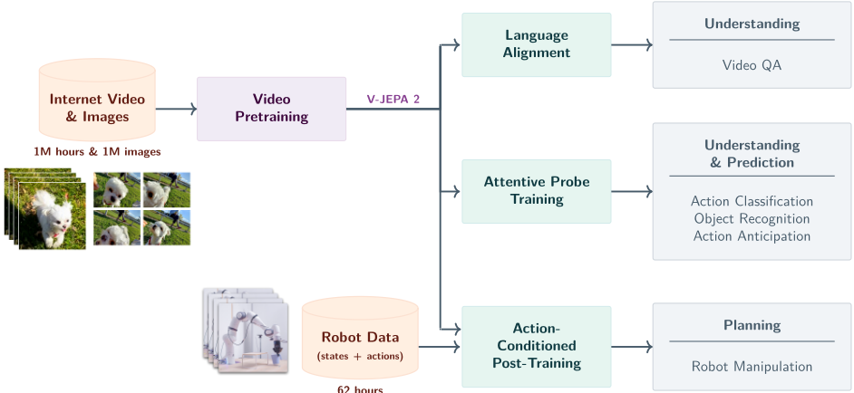
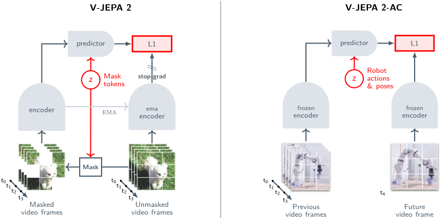
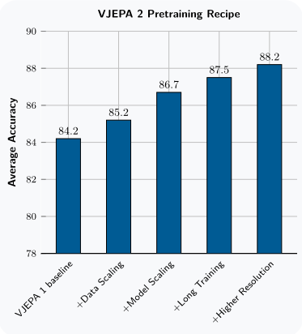
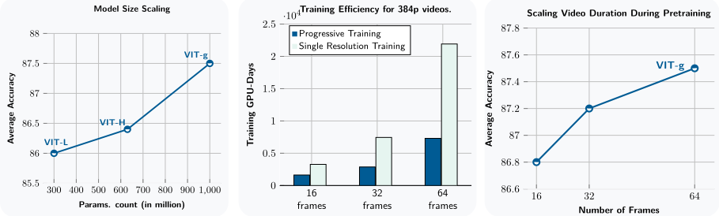
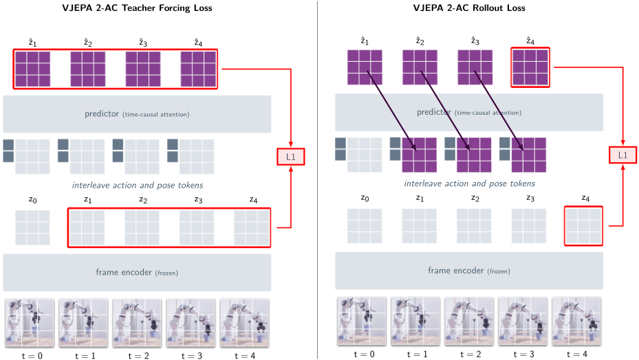
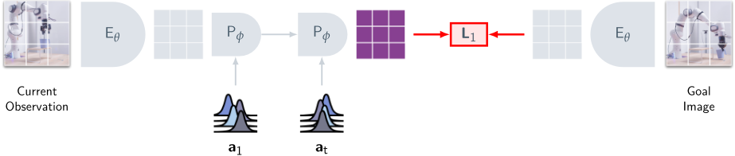
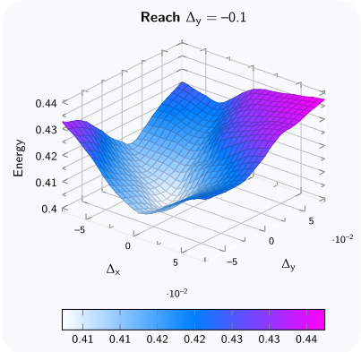
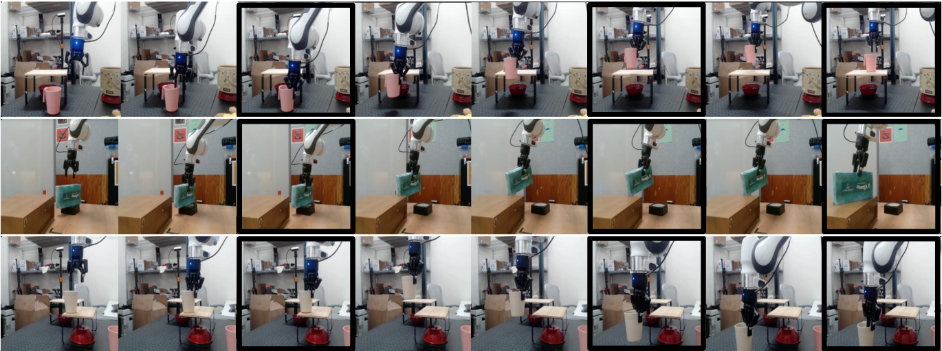
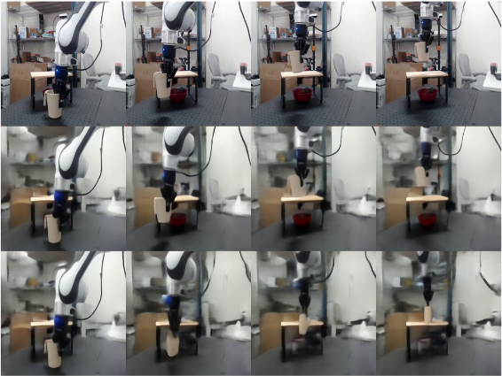
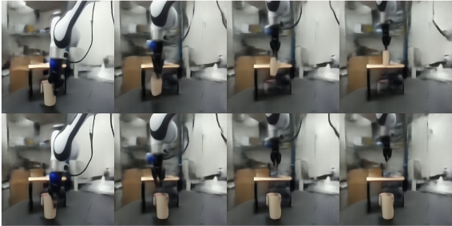

# 10 · V-JEPA 2 深度解读：不生成一帧像素，也能"理解、预测、规划"的世界模型

> 本篇是「论文解读」系列第 10 篇，方向：**世界模型**，与第 04 篇 NVIDIA Cosmos 同领域对照（JEPA 潜空间路线 vs 像素生成路线）。所有数字均与 arXiv 2506.09985 PDF 原文核对（48 页版，2025-06-11 v1）；图片截取自原论文（版权归 Meta FAIR，仅作学习解读之用）；标注"解读视角"的内容为本文推断。

## 1. 论文档案

| 项目 | 内容 |
| --- | --- |
| 标题 | V-JEPA 2: Self-Supervised Video Models Enable Understanding, Prediction and Planning |
| 机构 | FAIR at Meta（核心作者 Mahmoud Assran、Adrien Bardes、Quentin Garrido、Franziska Meier、**Yann LeCun**、Michael Rabbat、Nicolas Ballas 等 35 人；合作单位 Mila – Quebec AI Institute / Polytechnique Montréal） |
| 发表处 | arXiv 预印本，2025-06-11 提交（技术报告，未投会议） |
| arXiv | [2506.09985](https://arxiv.org/abs/2506.09985)（48 页含附录） |
| 开源仓库 | [facebookresearch/vjepa2](https://github.com/facebookresearch/vjepa2)；许可证：**代码与权重均为 MIT**（仅 `randaugment.py`、`randerase.py`、`worker_init_fn.py` 三个数据工具文件为 Apache-2.0） |
| 权重可得性 | HuggingFace 合集 `facebook/v-jepa-2`（`vjepa2-vitl/vith/vitg-fpc64-256/384`）+ 官方 CDN（vitl/vith/vitg/vitg-384 的 PyTorch checkpoint）；`vjepa2-ac-vitg.pt`（动作条件版）开放；另有后论文的 V-JEPA 2.1 家族（80M~2B）。torch.hub 一行加载 |
| 训练规模 | 预训练 VM22M 数据集（2200 万视频样本 ≈ **超过 100 万小时**互联网视频 + 100 万张 ImageNet 图像）；ViT-g 64 帧/384 分辨率全分辨率直训约需 **60 GPU-年**（A100），渐进分辨率策略省 **8.4×**；总算力未披露（对比 Cosmos 的 10,000 H100 × 3 个月） |

## 2. 速览

**一句话 TL;DR**：V-JEPA 2 把 LeCun 的 JEPA（联合嵌入预测架构）第一次推到互联网规模——**在学到的表示空间里做掩码预测、不重建任何像素**——用 100 万小时无标注视频练出一个 1B 视觉编码器，再冻结它、只用 **62 小时**无标注机器人视频后训练出一个动作条件预测器 V-JEPA 2-AC，靠"潜空间能量最小化 + MPC"让 Franka 机械臂**零样本**完成抓取与 pick-and-place；理解、预测、规划三件事在同一套表示里闭环。

| 维度 | 内容 |
| --- | --- |
| 问题 | 世界模型的训练数据本来该是"状态-动作"交错序列，但真实交互数据采集昂贵危险、规模上不去；而互联网视频只有"状态序列"没有动作标签——能否主要靠**观察**学到既懂世界又能支撑规划的世界模型？ |
| 创新 | ① 掩码潜空间预测目标规模化：ViT-g 1B / 100 万小时视频 / 渐进分辨率（16→64 帧、256→384，省 8.4× GPU 时）；② 动作条件化只加一个 300M block-causal 预测器、冻结大编码器，62 小时 Droid 数据完成"观察→交互"的迁移；③ 规划不靠策略网络，靠**能量最小化**：在潜空间里搜索使"想象的未来状态表示"最接近"目标图表示"的动作序列（CEM 优化 + receding horizon） |
| 证据 | SSv2 77.3 top-1（attentive probe，超 InternVideo2-1B 的 69.7）；EK100 动作预判 39.7 recall@5（超 PlausiVL +12.1 点 = 相对提升 44%）；8B 级 VidQA 五项 SOTA（PerceptionTest 84.0、MVP 44.5）；零样本 pick-and-place 成功率 65~80%（两实验室 × 10 次试验），同任务用微调后的 Cosmos 世界模型做 MPC 只有 0%（且每步规划 4 分钟 vs V-JEPA 2-AC 的 16 秒） |



## 3. 背景与动机

**世界模型的两难**。认知科学视角（Craik 1967、Friston 2010）：人和动物通过观察建立世界的内部模型，用于预测与规划。但 AI 要复刻它，立刻撞上数据问题——以往的世界模型（Ha & Schmidhuber 2018、Dreamer 系、TD-MPC 系）从**交互数据**（状态-动作序列 + 奖励）学，规模受限于真实交互的采集成本；近年转向"互联网视频 + 动作条件视频生成"（Genie、Cosmos、UniPi 等），但论文指出：这条线"强调预测保真度与画面质量，而不是规划能力"——因为用视频生成做规划，每想象一步都要跑一遍生成模型，算力上不划算，所以没人真用它去控机器人。

**JEPA 的第三条路**。LeCun 2022 的Position Paper《A Path Towards Autonomous Machine Intelligence》提出 JEPA：在**学到的表示空间**里做预测，而不是在像素空间。V-JEPA（Bardes et al. 2024）验证了小规模（ViT-L，200 万视频，16 帧短片），I-JEPA（Assran et al. 2023）验证了图像。这篇论文要回答的问题是：**JEPA 路线能不能 scale？scale 之后的表示能不能承载动作条件化与真实机器人规划？**三个继承点：① 掩码特征预测目标沿用 V-JEPA；② 数据 curation 管线改编自 DINOv2 的聚类检索（Oquab et al. 2023）；③ 后训练思路对应 Cosmos 式"预训练 + 后训练"的阶段化范式——但把"后训练改生成"换成了"后训练改预测"。

**论文的一句话立场**（引言原文意译）：生成式目标被迫预测场景中**不可预测的细节**（每片草叶、每片树叶的精确位置），而 JEPA 把容量花在**可预测的抽象语义**上（运动物体的轨迹、动作的后果）——这正是它敢用 1B 参数、100 万小时数据却完全不重建像素的理由。

## 4. 核心创新拆解

### 4.1 掩码潜空间预测：把"重建"换成"预测特征"（JEPA 路线的地基）

- **是什么**：把视频切成 2×16×16 的 tubelet token 序列，随机丢掉一部分（multiblock 掩码），编码器只看**没被丢**的部分；预测器拿着编码器输出 + 可学习的掩码 token（标记被丢位置），去预测**被丢部分的表示**；损失是被丢位置上"预测的表示"与"目标表示"的 L1 距离——目标表示由编码器的 EMA（指数滑动平均）副本算出，并对它施加 stop-gradient。
- **为什么之前不行**：视频自监督的主流是像素重建（VideoMAE 系：掩码 90% 的 token 再重建像素）或对比学习（时间对称性手工设计）。像素重建把模型容量压在"每根草叶"的不可预测细节上——论文引言的原话；对比学习则依赖人工增强与负样本设计，且学到的是"不变性"而不是"动态"。V-JEPA 本身已验证该目标可行，但停在 ViT-L / 200 万视频 / 16 帧，"JEPA 能不能吃下互联网规模"是开放问题。
- **怎么做到**：见 4.2 的四个规模化成分。目标函数本身几乎没变（式 1，见 §5.1），改动是工程性的：绝对 sincos 位置编码换成 **3D-RoPE**（特征维按时间/高/宽三段分别做 1D 旋转）——作者发现这对最大模型的训练稳定性关键；固定 EMA 系数（0.99925）与固定 weight decay（0.04），简化掉 V-JEPA 的 ramp-up 调度。
- **代价与权衡**：表示空间**不可直接看**——想知道模型"想象"了什么，得另训一个 ViT-L 像素解码器（附录 B.3，仅作可视化工具）；信号全是 L1 回归，没有分布信息（对比生成模型的采样能力）；掩码策略里 Temporal Mask Scale 固定 [1.0, 1.0]（附录表 9），即掩码基本只在空间维随机、时间维贯穿整段——"预测未来的帧"这件事在预训练阶段并没有被显式逼出来，预测能力要到 AC 阶段才接上。



### 4.2 四个规模化成分：从 2M 到 22M 视频、300M 到 1B 参数

- **是什么**：图 3 的链式消融（ViT-L/16 基线，6 个分类任务平均）：数据 2M→22M 视频 **+1.0** 点；模型 300M→1B **+1.5** 点（图 5 冷却后测得 +1.7）；训练 90K→252K 迭代 **+0.8** 点；训练/评测分辨率与时长提升（256→384、16→64 帧）累计到 **88.2**，共 +4.0 点。
- **为什么之前不行**：视频 SSL 的规模化.recipe 不成熟——视频 token 数是图像的几十倍，ViT-g 在 64 帧 × 384² 分辨率直训约 60 GPU-年，没人付得起；且长视频 clip 的高分辨率训练在旧调度（半余弦）下超参难调。
- **怎么做到**：① **数据**：VM22M = SSv2 168K + Kinetics 733K + HowTo100M 1.1M + YT-Temporal-1B 19M（检索式 curation，见下）+ ImageNet 1M（图像复制 16 帧当"静止视频"实现图文联合训练），采样权重 0.056/0.188/0.318/0.188/0.25；YT1B（140 万小时原始池）curation 管线：PySceneDetect 切场景（≥4 秒，3.16 亿段）→ DINOv2 ViT-L 嵌入 → 150 万聚类 → 只保留被目标分布（K710/SSv2/COIN/EpicKitchen，检索权重 0.7/0.125/0.125/0.05）命中的 21 万簇（1.15 亿段），**curation 本身 +1.4 点**；② **模型**：ViT-L/H/g 三档（表 12：g 档宽 1408 / 深 40 / 22 头），预测器统一用 ViT-s（22M，各档共享）；③ **调度**：warmup-constant-decay——恒定学习率阶段可长跑 228K 迭代，冷却阶段从任意检查点出发（一次长跑多次收割）；④ **渐进分辨率**：16 帧 256² 训完主阶段，最后 12K 迭代冷却期才升到 64 帧/384²——省 8.4× GPU 时间。
- **代价与权衡**：64 帧以上（128/256 帧）在理解任务上**没有**进一步收益（§2.4）——"看更长的视频"这个 JEPA 卖点在本轮实验里只兑现到 16 秒；curation 权重偏 Kinetics（0.7），K400 类表现受益、分布变窄的风险论文未系统讨论（附录 A.4.1 里 ViT-L 上混合 curation 数据反而在 SSv2 掉 0.5 点，直到 ViT-g 才全面占优——数据配方与模型规模存在交互）。

**VM22M 数据构成**（原文表 1 全量复述；图像在训练中被复制成 16 帧"静止视频"实现图文联合训练）：

| 数据源 | 样本数 | 类型 | 总时长 | Curation | 采样权重 |
| --- | --- | --- | --- | --- | --- |
| Something-Something v2 | 168K | EgoVideo | 168 h | 否 | 0.056 |
| Kinetics（400/600/700） | 733K | ExoVideo | 614 h | 否 | 0.188 |
| HowTo100M | 1.1M | ExoVideo | 134K h | 否 | 0.318 |
| YT-Temporal-1B（检索 curation 后） | 19M | ExoVideo | 1.6M h | 是 | 0.188 |
| ImageNet | 1M | Images | n/a | 否 | 0.250 |

注意两点：① 表 1 中 YT1B 的 1.6M 小时是 curation 池的统计口径，摘要的"超过 100 万小时"是保守表述（两者不矛盾，论文未给出 VM22M 精确去重后的总时长）；② HowTo100M 占 0.318 权重但只有 13.4 万小时——"教程类视频"对 COIN 类任务的帮助是这份配方的隐含假设。





### 4.3 V-JEPA 2-AC：动作怎么注入"冻结的世界"

- **是什么**：冻结 V-JEPA 2 ViT-g 编码器，逐帧编码成 16×16×1408 的特征图；新训一个 **~300M** 的 block-causal Transformer 预测器（24 层/16 头/1024 维），输入按时间交错排列的 $(a_k, s_k, z_k)$（动作、本体感受状态、特征图，各自经独立可学习仿射变换投到 1024 维），自回归地预测**下一帧的特征表示** $\hat{z}_{k+1}$。动作是相邻帧末端执行器（EE）状态的差分：7 维实向量（3 位置 + 3 欧拉角 + 1 夹爪）。block-causal 注意力 = 每个时间步的 patch 可看见**本步及之前**所有步的动作、位姿与 patch。
- **为什么之前不行**：从零训练动作条件世界模型要海量交互数据（Droid 全集也才 76K 轨迹）；而"视频生成 + 动作条件"路线（UniPi、Genie、Cosmos-ActionCond）每步规划要跑生成模型，算力与实时性都不允许闭环控制。JEPA 的机会：**编码器里已经装了 100 万小时的世界先验**，动作条件化只需要学"动作 → 表示空间里怎么动"这一个映射——数据需求可以从"百万小时"降到"几十小时"。
- **怎么做到**：62 小时 Droid 原始视频（弃掉 <4 秒的片段后不足 62 小时；23K 条轨迹，**含成功与失败**，无任何奖励/任务/成功标注）+ 两个损失：teacher-forcing（真实历史 → 预测下一帧表示）+ 两步 rollout（把自己上一帧的预测当输入再预测一步，只回传一步梯度），见式 2-4。只用 Droid 左侧外视角相机（左右同训但不加相机位置条件会掉点，附录 B.1）。batch 256、4 秒 clip、4fps、256²、AdamW 峰值 LR 4.25e-4。
- **代价与权衡**：动作坐标系**隐式**地从单目 RGB 里推断——相机摆位不同，模型推断的动作轴会转（附录 B.4：旋转误差随相机角度近似线性增长；作者手动试出可用机位后全程固定）；只覆盖桌面操作 + EE 命令这一种具身形态，换机器人本体/控制器要重新后训练；62 小时数据里没有任何语言指令——"听人话干活"要等 VQA 对齐那套东西接上（论文列为 future work）。



### 4.4 能量最小化规划：世界模型当"控制器"用

- **是什么**：不给策略网络，规划即推理——给定当前帧 $x_k$ 与目标图 $x_g$（各自编码成 $z_k, z_g$），在每个控制步求解 $\arg\min_{\hat{a}_{1:T}} \mathcal{E}(\hat{a}_{1:T}; z_k, s_k, z_g)$（式 5，能量 = 想象的 T 步后状态表示与目标表示的 L1 距离），用 **CEM（交叉熵方法）**做无梯度优化：各时间步的动作坐标从高斯（初始 μ=0, σ=1）采样 → 按 top-k 轨迹的统计量更新 μ/σ → 迭代数轮 → 返回均值轨迹；**只执行第一个动作**，观测新状态后重规划（receding horizon / MPC）。实际部署：800 采样 × 10 轮精化 × 规划视野 1，动作限制在半径 0.075 的 L1 球内（单步位移 ≤~13cm，超出分布），单张 RTX 4090 上 **16 秒/动作**。
- **为什么之前不行**：像素生成世界模型做同样的 MPC，每步要在像素空间 rollout 再编码比较——论文实测 Cosmos（7B 潜扩散）80 采样 × 10 轮要 **4 分钟/动作**，一条 pick-and-place 轨迹跑下来超过 1 小时；而潜空间模型的"想象"是一次前向，采样空间又是低维动作序列，CEM 才跑得动。
- **怎么做到**：多目标任务拆成子目标序列——pick-and-place 给三张图（抓住物体 / 物体接近目标位 / 放好），按 4/10/4 步自动切换优化目标；能量地形（图 9）验证了可规划性：单目标 reaching 任务里能量最小值出现在真值动作附近，且曲面光滑、局部凸。
- **代价与权衡**：CEM 是采样式零阶优化，每步 16 秒仍远慢于前馈策略（VLA 一前向出一个动作）；规划视野实际只用 1（任务偏贪心，长视野误差累积 + 搜索空间指数膨胀，§4.3 自认）；目标只能给**图片**，语言目标未接。





## 5. 方法细节（公式均从原文重写）

### 5.1 预训练目标：掩码特征预测 + 双重防坍缩

原文式 (1)。编码器 $E_\theta$ 看未掩码视图 $x$，预测器 $P_\phi$ 拿编码输出与可学习掩码 token $\Delta_y$（标记被丢 patch 的位置），回归 EMA 目标编码器 $E_{\bar\theta}$ 对完整视频 $y$ 的表示，L1 损失只施加在被掩码位置的预测上：

$$\operatorname{minimize}_{\theta,\phi,\Delta_y}\ \ \big\|\, P_\phi(\Delta_y,\, E_\theta(x)) \;-\; \operatorname{sg}\big(E_{\bar\theta}(y)\big) \,\big\|_1$$

两个防坍缩机制（与 PDF 核对）：**stop-gradient** $\operatorname{sg}(\cdot)$ 切断目标侧梯度（梯度只走在线编码器-预测器路径），**EMA** $\bar\theta$（系数 0.99925，附录表 9）让目标缓慢移动。与对比学习对照：这里**不需要负样本、不需要VICReg式的方差-协方差正则**——目标本身是非对称的两塔结构（在线塔学、目标塔缓），靠架构而非损失项防坍缩；与 BYOL/SimSiam 的区别在于预测的不是"自己"而是"被掩码的另一部分视图"，掩码提供了额外的预测性约束。解读视角：这条目标可以概括为"**L = ||f(x_context) − sg(g(y_masked))||**"的 JEPA 家族通用形（本篇的 $f = P_\phi \circ E_\theta$ 是复合的"编码-补全"）。

### 5.2 为什么不重建像素：JEPA 与生成式路线的本质分歧

**LeCun 论证的三层逻辑**（论文引言 + LeCun 2022 Position Paper，解读视角整理）：

1. **信息论层**：视频的像素级细节大部分**不可预测**（草叶的精确位置、树叶的晃动、背景纹理），把它们压进损失函数，模型容量与梯度预算被花在建模"噪声"上；可预测的部分（物体身份、位置、运动轨迹、动作后果）只占像素空间的极小维度。
2. **表示层**：预测目标决定表示结构。重建像素 → encoder 必须保留全部像素级信息（Decoder 后置补偿，语义被稀释）；预测潜表示 → encoder 可以自由丢弃不可预测细节，把表示推向"抽象、可预测"的子空间。I-JEPA/V-JEPA 的探针实验反复显示：特征预测学到的表示在运动理解上远强于像素重建（本篇表 4：SSv2 75.3 vs VideoMAEv2 的 56.1，同为 1B 级）。
3. **规划层**：控制只需要"状态的足够统计量"，不需要"世界的照片"。MPC 要比较的是"未来状态像不像目标状态"——在抽象表示空间比 L1 一次前向就能完成；在像素空间则要生成整帧再比较（贵 15 倍，见 §6.4）。**潜空间预测是规划的计算可行性前提**，这是本篇相对 V-JEPA 最实质的增量论点。

**与生成式路线（Cosmos/Sora）的本质分歧**（对照 §8 系列对照表）：生成式路线赌"像素预测的通用性"（一个模型既能出视频又能当世界模型），JEPA 路线赌"表示预测的充分性"。分歧的实锤落在两处：① V-JEPA 2-AC 不能给你看一段视频（想象必须另接解码器，图 15 那样的模糊重建），Cosmos 的想象直接可看；② Cosmos 做 MPC 每步 4 分钟且抓取/放置成功率 0-20%，V-JEPA 2-AC 16 秒且 60-80%——**规划这关，潜空间路线目前压倒性领先**（详见 §6.4）。

### 5.3 V-JEPA 2-AC 训练损失（原文式 2-4）

teacher-forcing（$T=15$，$z_k = E(x_k) \in \mathbb{R}^{16\times16\times1408}$，特征图展平为 token）：

$$\mathcal{L}_{\text{teacher-forcing}}(\phi) := \frac{1}{T}\sum_{k=1}^{T} \|\hat{z}_{k+1} - z_{k+1}\|_1 = \frac{1}{T}\sum_{k=1}^{T} \Big\| P_\phi\big((a_i, s_i, E(x_i))_{i\le k}\big) - E(x_{k+1}) \Big\|_1$$

rollout 损失（把自身预测回喂，$T=2$，只回传一步递归梯度）：

$$\mathcal{L}_{\text{rollout}}(\phi) := \big\| P_\phi(\hat{a}_{1:T}, s_1, z_1) - z_{T+1} \big\|_1$$

总目标（对预测器权重 $\phi$ 最小化，编码器 $\theta$ 全程冻结）：

$$L(\phi) := \mathcal{L}_{\text{teacher-forcing}}(\phi) + \mathcal{L}_{\text{rollout}}(\phi)$$

细节：注意目标表示 $z_{k+1}$ 出自**冻结**编码器，所以这里不需要 EMA/stop-grad 防坍缩（目标不动，坍缩无从发生）——防坍缩成本被转移到了预训练阶段，这是两阶段设计的隐藏收益（解读视角）。

### 5.4 规划算法（原文式 5 + 图 7 + 附录 B.2）

能量函数（$\hat{a}_{1:T}$ 为候选动作序列，$z_g$ 为目标图表示）：

$$\mathcal{E}(\hat{a}_{1:T};\ z_k, s_k, z_g) := \big\|\, P(\hat{a}_{1:T};\, s_k, z_k) - z_g \,\big\|_1, \qquad (a_i^\star)_{i\in[T]} := \arg\min_{\hat{a}_{1:T}} \mathcal{E}(\hat{a}_{1:T}; z_k, s_k, z_g)$$

CEM-MPC 每控制步的伪代码（按原文图 7 说明与附录 B.2 参数整理）：

```text
# 超参: 规划视野 T=1, 采样数 N=800, 精化轮数 R=10, top-k=10, 动作约束 ‖a‖₁ ≤ 0.075
μ, σ ← 0, 1                      # 每个动作坐标的初始高斯
repeat R 次:
    A ← { clip_L1ball( sample(N) from N(μ, σ) ) }      # 采样 N 条候选动作序列
    E_i ← ‖ P(A_i; s_k, z_k) − z_g ‖₁                  # 世界模型一次前向 = 一次"想象"
    A_top ← top-k(A, 按 E 升序)                         # 精英集
    μ, σ ← mean(A_top), std(A_top) + ε                  # 更新采样分布
a* ← mean of final μ                                  # 返回均值轨迹
execute a* 的第一个动作; 观测新帧; 重规划                  # receding horizon
# pick-&-place 的多子目标: 依次用 目标图1(抓住)/图2(接近)/图3(放好) 作为 z_g,
# 分别优化 4 / 10 / 4 个控制步后自动切换 (附录 B.2)
```

### 5.5 掩码策略与架构速查表

预训练掩码与优化超参（附录表 9 与表 12 核对）：tubelet 2×16×16、patch 16；**空间掩码尺度 [0.15, 0.7]**、**时间掩码尺度 [1.0, 1.0]**（掩码块贯穿整段 clip 的时间轴，只做空间随机）、掩码长宽比 [0.75, 1.5]；batch 3072（全局）、LR 峰值 5.25e-4 → 冷却期线性降至 1e-6、weight decay 0.04、EMA 0.99925（全程固定，简化掉前代的 ramp-up 调度）。

| 模型（编码器家族） | 参数 | 宽度 | 深度 | 注意力头 | MLP 宽 |
| --- | --- | --- | --- | --- | --- |
| ViT-L | 300M | 1024 | 24 | 16 | 4096 |
| ViT-H | 600M | 1280 | 32 | 16 | 5120 |
| ViT-g | 1B | 1408 | 40 | 22 | 6144 |
| 预测器 ViT-s（各档共享） | 22M | 384 | 12 | 12 | 1536 |

输入嵌入为 2×16×16 strided conv；预测器输出经可学习仿射变换映射回编码器嵌入维再对齐目标。AC 阶段的 300M 预测器是另一套独立设计（24 层/16 头/1024 维/GELU，见 §4.3），不要与预训练用的 22M ViT-s 预测器混淆（解读视角：论文两处 "predictor" 重名，写作上略欠友好）。

## 6. 实验证据复盘

### 6.1 理解评测三件套之一：动作与物体分类（原文表 4，attentive probe，冻结编码器）

| 方法 | 参数 | 平均 | SSv2 | Diving-48 | Jester | K400 | COIN | IN1K |
| --- | --- | --- | --- | --- | --- | --- | --- | --- |
| VideoMAEv2（文献值） | 1B | - | 56.1 | - | - | 82.8 | - | 71.4 |
| InternVideo2-6B（文献值） | 6B | - | 67.7 | - | - | 88.8 | - | - |
| DINOv2（图像编码器，同协议） | 1.1B | 81.1 | 50.7 | 82.5 | 93.4 | 83.6 | 90.7 | 86.1 |
| PEcoreG（同协议） | 1.9B | 82.3 | 55.4 | 76.9 | 90.0 | 88.5 | 95.3 | 87.6* |
| SigLIP2（同协议） | 1.2B | 81.1 | 49.9 | 75.3 | 91.0 | 87.3 | 95.1 | 88.0 |
| V-JEPA ViT-H（前代） | 600M | 85.2 | 74.3 | 87.9 | 97.7 | 84.5 | 87.1 | 80.0 |
| InternVideo2s2-1B（同协议） | 1B | 87.0 | 69.7 | 86.4 | 97.0 | 89.4 | 93.8 | 85.8 |
| **V-JEPA 2 ViT-L** | 300M | 86.0 | 73.7 | 89.0 | 97.6 | 85.1 | 86.8 | 83.5 |
| **V-JEPA 2 ViT-H** | 600M | 86.4 | 74.0 | 89.8 | 97.7 | 85.3 | 87.9 | 83.8 |
| **V-JEPA 2 ViT-g** | 1B | 87.5 | 75.3 | 90.1 | 97.7 | 86.6 | 90.7 | 84.6 |
| **V-JEPA 2 ViT-g384** | 1B | **88.2** | **77.3** | **90.2** | **97.8** | 87.3 | 91.1 | 85.1 |

读法：① **运动理解碾压**——SSv2 77.3 比同协议最强对照（InternVideo2s2-1B 69.7）高 7.6 点、比 6B 的 InternVideo2 还高近 10 点，Diving-48 90.2 也是全场最高；② 外观类（K400/COIN/IN1K）只是"有竞争力"而非碾压——图文对比预训练的编码器（PEcoreG 95.3 COIN）仍占 COIN 之类任务上风；③ SSv2/Diving-48/Jester 三个运动任务与三个外观任务的分离模式，恰好支持"掩码特征预测把容量花在动态上"的路线论点。

### 6.2 理解评测之二：预测——EK100 动作预判（原文表 5，recall@5，预判窗口 1 秒）

| 方法 | 参数 | Verb | Noun | **Action** |
| --- | --- | --- | --- | --- |
| InAViT | 160M | 51.9 | 52.0 | 25.8 |
| Video-LLaMA | 7B | 52.9 | 52.0 | 26.0 |
| PlausiVL（前 SOTA） | 8B | 55.6 | 54.2 | 27.6 |
| V-JEPA 2 ViT-L | 300M | 57.8 | 53.8 | 32.7 |
| V-JEPA 2 ViT-H | 600M | 59.2 | 54.6 | 36.5 |
| V-JEPA 2 ViT-g | 1B | 61.2 | 55.7 | 38.0 |
| **V-JEPA 2 ViT-g384** | 1B | **63.6** | **57.1** | **39.7** |

读法：**300M 的 V-JEPA 2 就超过 8B 的专用模型**（32.7 vs 27.6）；1B + 384 分辨率达到 39.7，+12.1 点 = **44% 相对提升**——这是"预测未来"能力被量化得最狠的一张表。预判探针的做法值得记住：编码器吃上下文片段，预测器对"1 秒后的那帧"的掩码位置出表示，concat 后过三头分类器（verb/noun/action），focal loss。局限（论文自认）：预判窗口拉长精度下降（附录 D.2）；EK100 只覆盖厨房 + 封闭词表。

### 6.3 理解评测之三：VidQA——无语言监督的编码器对齐 LLM（原文表 8 节选，88.5M 对齐样本，Llama 3.1 8B）

| 方法 | Enc/LLM | 平均 | PerceptionTest | MVP | TempCompass | TemporalBench | TOMATO | TVBench | MVBench |
| --- | --- | --- | --- | --- | --- | --- | --- | --- | --- |
| InternVL-2.5 | 300M/7B | 52.1 | 68.9 | 39.9 | 68.3 | 24.3 | 29.4 | 61.6 | 72.6 |
| Qwen2.5VL | 1B/7B | 49.7 | 70.5 | 36.7 | 71.7 | 24.5 | 24.6 | 50.5 | 69.6 |
| PLM 8B（前 SOTA） | 1B/8B | 56.7 | 82.7 | 39.7 | 72.7 | 28.3 | 33.2 | **63.5** | **77.1** |
| **V-JEPA 2 ViT-g384** | 1B/8B | **59.5** | **84.0** | **44.5** | **76.9** | **36.7** | **40.3** | 60.6 | 73.5 |

读法：① 五项 SOTA（PerceptionTest +1.3、MVP +4.8、TempCompass +4.2、TemporalBench +8.4、TOMATO +7.1），且全部集中在**时序/物理理解**类基准；TVBench/MVBench 两项输给 PLM 8B——通识/外观偏置的基准不占优，赢输模式与 §6.1 一致；② 受控实验（表 6，18M 数据、冻结编码器、同 Qwen2-7B）里 V-JEPA 2 平均 52.3 > PE 49.1 > SigLIP2 48.1 > DINOv2 45.7——**"无语言监督的纯视频编码器做 MLLM 视觉塔反而更好"**，直接反了"视觉塔必须图文对齐"的惯例（作者点名这是反 conventional wisdom 的证据）；③ 消融显示编码器 300M→1B 与分辨率 256→512 都单调涨（表 7）。

### 6.4 规划评测：零样本真机操作（原文表 2/表 3，两实验室 × 各 10 次试验）

**表 2：三任务七配置成功率（两实验室平均，与 Octo-base-1.5 对照——后者用整个 Droid 数据集做了 BC 微调 + 事后重标注，还吃了 1M+ 轨迹的 Open-X 预训练）**

| 方法 | Reach | 抓取-杯 | 抓取-盒 | 持物移动-杯 | 持物移动-盒 | 放置-杯 | 放置-盒 |
| --- | --- | --- | --- | --- | --- | --- | --- |
| Octo（BC 微调 Droid 全集） | 100% | 15% | 0% | 15% | 70% | 15% | 10% |
| **V-JEPA 2-AC（仅 62h，零样本）** | **100%** | **65%** | **25%** | **75%** | **75%** | **80%** | **65%** |

**表 3：与世界模型基线 Cosmos 正面对决（Lab 2，同一 CEM-MPC 框架，单卡 RTX 4090）**

| 方法 | 采样数 | 精化轮 | 视野 | 每步耗时 | Reach | 抓取-杯 | 抓取-盒 | 放置-杯 | 放置-盒 |
| --- | --- | --- | --- | --- | --- | --- | --- | --- | --- |
| Cosmos-7B（动作条件微调，潜扩散） | 80 | 10 | 1 | **4 分钟** | 80% | 0% | 20% | 0% | 0% |
| **V-JEPA 2-AC** | 800 | 10 | 1 | **16 秒** | **100%** | **60%** | 20% | **80%** | **50%** |

读法：① 表 2 的公平性要注意——Octo 吃了 Droid 全部数据还做了任务特定微调，V-JEPA 2-AC 只用 62 小时且在**没见过的两个实验室**零样本跑，对比其实是"潜空间世界模型 + 规划"对"模仿学习策略"的路线级对比；② 表 3 是本篇最具杀伤力也最具争议性的实验（详见 §8）：Cosmos 每步 4 分钟意味着 pick-and-place 一条轨迹超过 1 小时，且抓取/放置成功率接近 0——**像素生成路线的规划能力首次被定量证伪**（作者注明这是 Cosmos 模型第一次被用于机器人控制）；③ 定性证据：闭环 rollout 解码可视化（图 15）显示模型"想象"的机械臂运动贴合真值、背景与未交互物体保持不动，开/合夹爪的动作序列能正确改变"杯子跟不跟着手走"（图 15b）——直觉物理（物体恒存、重力）在潜空间里有涌现迹象。







### 6.5 附录消融补充：curation、冷却与评测时长的收益拆分

- **数据 curation 的规模交互**（附录表 13，abbreviated 90K 步配方）：ViT-L 上 Curated-YT1B 全面优于 Uncurated（SSv2 73.1 vs 70.9、K400 84.6 vs 82.9），但混入其他数据源后部分任务反而回落（SSv2 72.8 vs 73.3）；到 ViT-g 规模，VM22M 在全部四个任务上胜出（SSv2 75.6、K400 86.2）——**"脏数据在放大模型时惩罚更重"**是附录里最值得带走的一条。
- **训练不干净的代价随时间放大**（附录图 12）：用/不用 curation 的模型在前 600 个"epoch"（每单位=300 步）几乎同速提升，之后 Uncurated 版本停止改善——curation 的收益是"能不能继续学下去"，不是早期速度。
- **冷却期（cooldown）是主要收益来源**（附录表 14，ViT-g）：恒定 LR 阶段（无冷却）IN1K 83.8 / SSv2 75.1 / K400 85.8；256² 冷却后 84.6/75.3/86.6；384² 冷却后 85.1/76.5/87.3——冷却期换分辨率拿走约 +1.3 的 SSv2 增量。
- **评测时长本身是免费午餐**（附录图 13）：64 帧预训练的模型，评测 clip 从 16 帧加长到 64 帧（单 clip 协议），平均 **+9.7 点**——理解任务对"每段视频多看几秒"的敏感度远超多数论文的消融展示；这也反衬预训练阶段只用到 64 帧的妥协。

**哪些结论被后续工作验证/动摇**（解读视角）：① "无语言监督视频编码器做 MLLM 视觉塔"的结论与 Meta 后续 PerceptionLM 的开源生态互为支撑，PerceptionEncoder 的"最佳嵌入不在网络输出层"（多层拼接）思路与本篇多层探针设计同源；② 62 小时后训练的极端数据效率成为"世界模型先验 + 少量交互数据"叙事的招牌案例，但**没有第三方在论文协议下复现过表 2/表 3**（两实验室细节、相机摆位敏感，附录 B.4 自己承认机位是"手动试出来的"）；③ LeCun 于 2025-11 宣布离开 Meta 创办世界模型公司（AMI Labs），JEPA 路线在 Meta 内部的延续性存疑（见 §8）。

## 7. 开源仓库导读

**仓库结构**（[facebookresearch/vjepa2](https://github.com/facebookresearch/vjepa2)，2025-11 查证）：

```text
vjepa2/
├── app/          # 训练入口: vjepa(预训练)/vjepa_2_1/vjepa_droid(AC后训练), main.py, main_distributed.py
├── configs/      # train / train_2_1 / eval / inference 四组 YAML
├── evals/        # attentive-probe 评测: video_classification_frozen, image_classification_frozen,
│                 #                          action_anticipation_frozen (EK100)
├── src/          # datasets / models(ViT + predictor) / masks(multiblock 3D) / utils
├── notebooks/    # demo + 能量地形可视化 (energy landscape)
└── tests/
```

**最小跑通路径**（torch.hub，权重自动下载）：

```python
import torch
# 预训练编码器全家桶
vjepa2_vit_large = torch.hub.load('facebookresearch/vjepa2', 'vjepa2_vit_large')
# vjepa2_vit_huge / vjepa2_vit_giant / vjepa2_vit_giant_384 同理
# 视频预处理器（切帧/归一化/打 tubelet）
processor = torch.hub.load('facebookresearch/vjepa2', 'vjepa2_preprocessor')
# 动作条件世界模型（编码器 + AC 预测器成对返回）
vjepa2_encoder, vjepa2_ac_predictor = torch.hub.load('facebookresearch/vjepa2', 'vjepa2_ac_vit_giant')
```

**权重清单**（官方 CDN + HuggingFace 合集 `facebook/v-jepa-2`）：V-JEPA 2 = ViT-L 300M / ViT-H 600M / ViT-g 1B（256 与 384 两种分辨率档，`fpc64` 表示预训练 64 帧）；V-JEPA 2-AC = `vjepa2-ac-vitg.pt`（ViT-g 编码器 + Droid 配置训练的 AC 预测器）；后论文发布的 V-JEPA 2.1 家族（ViT-B 80M / ViT-L 300M / ViT-g 1B / **ViT-G 2B**，统一 384 分辨率）也已上架。HF 侧支持 `AutoModel.from_pretrained` + `AutoVideoProcessor.from_pretrained`。

**工程与许可要点**：① 许可证宽松——**MIT**（仅三个数据增广工具文件 Apache-2.0），权重无附加条款，商用无障碍（与 Cosmos 的 NVIDIA Open Model License 形成对比）；② 训练/评测代码即论文配置：`app/vjepa_droid` 对应 §3 的 AC 后训练，`configs/train` 里的掩码参数（空间掩码 [0.15,0.7]）与附录表 9 一一对应，复现路径完整；③ 依赖 Python 3.12 + PyTorch + timm/einops，视频解码用 decord（不支持 macOS，需换 eva-decord/decord2）；④ 预训练数据 VM22M 不随仓库发布（各源为公开数据集，YT1B curation 管线在附录 A.2 有配方但未提供脚本），完整数据复现仍需自建。

## 8. 局限与争议

**论文自认的局限**（§4.3 + §9 + 附录）：① **相机摆位敏感**——动作坐标系靠单目 RGB 隐式推断，旋转误差随相机角度近似线性增长（附录 B.4，平均绝对预测误差 ~1.6cm vs 真值步长 ~5cm），作者手动试机位、并提出"随机动作 + 最小二乘自校准"的补救但实验未采用；② **长视野规划失效**——自回归 rollout 误差累积 + 搜索空间指数膨胀，本篇所有任务都退化为贪心（视野=1），不喂子目标图就做不了 pick-and-place；③ **目标只能是图片**，语言目标待做；④ **预判窗口仅 1 秒**，拉长即退化（附录 D.2）；⑤ 模型只 scale 到 1B（作者称"modest"），64 帧以上无收益。

**社区真实批评与争议**（均已查证出处）：

1. **"潜空间预测 ≠ 生成能力"的路线级质疑**。JEPA 放弃像素生成，代价是模型**无法输出可观看、可编辑的想象**（本篇要靠另训 ViT-L 解码器才能把 rollout 模糊地画出来）。生成派的观点是：像素级生成本身是对世界一致性的强测试——骗不过判别器的世界模型谈不上懂物理；LeCun 的回击是其一贯立场：LMM/生成式路线"注定失败"（doomed to fail / dead end），行业的分水岭会出现在 2027 年前后。HN 上对 V-JEPA 2 的主流态度是把"物理世界建模"与"符号推理"（ARC 类任务）分开讨论——本篇证据只覆盖前者。
2. **与 Cosmos 对照的公平性问题**。表 3 是本篇传播最广的对比，但有三处可挑剔：Cosmos 是**动作无关**的通用世界模型微调而来（论文作者自己调参：降 LR、去 dropout、噪声系数 ×e²，属于"尽力而为"的一次适配）；规划超参对 Cosmos 更苛刻（80 vs 800 采样）；且 Cosmos 的设计目标是视频生成质量而非 MPC 延迟。公平的结论是"**潜空间表示做 MPC 在算力上可行、像素生成做 MPC 目前不可行**"，而非"Cosmos 世界模型差"——NVIDIA 后续的 Cosmos-Transfer/Reason 系列走向的是合成数据与物理常识问答赛道，没有跟进 MPC 路线。
3. **62 小时数据：太少还是正好？** 62h/23K 轨迹（含失败）是论文最大卖点，但存在隐藏前提：Droid 的轨迹全部来自**同样的 Franka Panda + 双指夹爪 + EE 命令控制**的本体分布，而 V-JEPA 2 预训练数据（YT1B 等）本身包含大量人类手部操作视频——"100 万小时先验 + 62 小时适配"里的 62 小时到底补了什么（动作到像素的因果映射？还是只是本体运动学的对齐？）论文没有消融。此外它无法回答"换一台全新构型的机器人需要多少数据"。
4. **"理解-预测-规划"三能力的评测不对等**。理解（SSv2/K400）与预测（EK100）是标准基准、可复现；规划（表 2/3）是自建协议（两实验室、10 次试验、自选机位、自定子目标切换时刻），样本量小且未开放实验环境细节，第三方复现门槛高。社区评测讨论（HN 44248165 等）多聚焦"这算不算真正的 world model"的定义之争：V-JEPA 2-AC 满足"可交互、可干预、反事实预测"，比条件视频生成更接近定义，但任务空间窄（桌面抓放）。
5. **JEPA 系没有大语言能力**。本篇的 VidQA 结果靠"外挂 LLM 对齐"拿到，JEPA 预训练目标本身不产出任何语言/推理能力；LeCun 宏大叙事（JEPA 分层 → 记忆 → 推理的 H-JEPA 蓝图）里，本篇只兑现了最底层的感知-预测层。批评者指出：从"潜空间预测"到"因果推理、规划语言任务"之间的整段楼梯（LeCun 2022 Position Paper 的 V/JEPA 栈）至今没有论文级证据。LeCun 2025-11 离开 Meta 创办 AMI Labs（估值目标 50 亿美元级，巴黎）后，这条路线能否在工业界持续获得算力投入成为开放问题。
6. **数据与算力披露不完整**。VM22M 各源的许可证构成未披露（YT1B 是 YouTube 派生数据，版权风险自担）；总算力、GPU 数量、训练时长均未报告（只有"60 GPU-年"的对照性换算）；与 Cosmos 的 10,000 H100 × 3 个月相比无法直接比拼"每算力的能力"。

### 系列对照：V-JEPA 2（潜空间路线） vs 04 篇 Cosmos（像素生成路线）

| 维度 | V-JEPA 2（本篇，JEPA 潜空间） | Cosmos（04 篇，像素生成） |
| --- | --- | --- |
| 预训练目标 | 掩码**特征**预测：L1 回归 EMA 编码器表示，零像素重建（式 1） | 视频 token **重建**：扩散去噪（EDM）+ 自回归 next-token 交叉熵，两条并行 |
| 输出空间 | 16×16×1408 特征图——**不可直接观看**，可视化需外接解码器 | RGB 视频——想象直接可看、可编辑、可当合成数据 |
| 预训练数据 | VM22M：2200 万样本 ≈ **>100 万小时**（YT1B 140 万小时池检索 curation）+ 1M ImageNet 图 | 2000 万小时原始视频 → 1 亿段 2-60 秒片段（VILA 标注 + 语义去重） |
| 模型规模 | 编码器最高 **1B**（ViT-g，1408×40 层）+ AC 预测器 300M；作者自认"modest" | 扩散 7B/14B + 自回归 4B/12B，全系最大 14B |
| 动作注入 | **冻结编码器**，新训 300M block-causal 预测器，7 维 EE 增量 + 本体状态与特征交错（token 级拼接后进注意力） | 新增 action embedder MLP：5B 走 cross-attention、7B 加到时间步嵌入；动作 = 7 维 Δpose |
| 规划方式 | **潜空间能量最小化 + CEM/MPC**：一次前向一次想象，16 秒/动作（RTX 4090 实测） | 论文未做规划实验（自列 future work）；本篇代其实测：4 分钟/动作，抓取/放置成功率 0-20% |
| 机器人数据 | **62 小时** Droid（23K 轨迹，含失败，零标注） | Bridge 数据集动作条件后训练（合成数据管线 Cosmos-1X 200 小时为人形样例） |
| 真机成绩 | 零样本 pick-and-place 65-80%（两实验室） | 未报真机成功率（以 FVD/人类评测为主） |
| 算力 | 未披露总量（渐进分辨率省 8.4×；60 GPU-年换算基准为 A100） | **10,000 H100 × 3 个月**（论文明示） |
| 许可证 | **MIT**（代码+权重；3 个数据工具文件 Apache-2.0） | 代码 Apache-2.0；权重 NVIDIA Open Model License（商用需遵守使用政策） |
| 语言能力 | 预训练零语言监督；后对齐 LLaVA 式 MLLM 达 8B 级五项 VidQA SOTA | T5-XXL 文本 cross-attention 原生支持 Text2World |
| 路线软肋 | 想象不可见、无生成/采样能力、语言与推理层缺失 | 逐帧生成贵（MPC 不可行）、离散 token 画质债（需 7B 扩散解码器补救）、物理对齐未随规模改善 |

## 9. 与本知识库的衔接

| 主题 | 本库文件 | 衔接点 |
| --- | --- | --- |
| VLA 与动作离散化 | `/home/yyl/ObsidianLibraries/VLM & VLA/Stage 10-VLA 与具身智能/教程/第1-2周-VLA架构与动作离散化.md` | VLA（policy 学习，前馈出动作 token）与 V-JEPA 2-AC（world model + MPC，推理时搜索）是具身智能两条控制范式；Droid 数据、7 维 EE 动作向量在两处都是接口 |
| Sim2Real 与零样本部署 | `/home/yyl/ObsidianLibraries/VLM & VLA/Stage 10-VLA 与具身智能/教程/第10周-SimToReal与结课总结.md` | "两实验室零样本、不采集部署环境数据"是世界模型泛化叙事的实证样本；对照 Sim2Real 的域随机化路线 |
| 闭环评测 | `/home/yyl/ObsidianLibraries/VLM & VLA/Stage 10-VLA 与具身智能/教程/第5-6周-SimplerEnv闭环评测.md` | 表 2/3 的"真机 10 次试验"闭环协议与 SimplerEnv 的仿真闭环评测互补，都是对"离线指标 ≠ 会干活"的回应 |
| BEV 与显式中间表示 | `/home/yyl/ObsidianLibraries/自动驾驶/Stage 5-BEV感知-稠密与稀疏/教程/第1周-为什么需要BEV与坐标变换基础.md` | 世界模型概念在自动驾驶的落点：JEPA 选"抽象潜空间"与 BEV 选"结构化鸟瞰空间"都是**放弃像素保真换可预测性**的表示选择，可对照讨论 |
| 梯度与优化 | `/home/yyl/ObsidianLibraries/数学基础/09-梯度与优化入门.md` | CEM 是零阶（无梯度）随机优化：能量对动作的梯度在本篇不可用（预测器内嵌 argmin 采样），一阶方法失效的典型场景 |
| Model-based RL 与规划 | `/home/yyl/ObsidianLibraries/强化学习/03-动态规划-已知环境的求解.md` 与 `11-现代RL前沿概览.md` | MPC + receding horizon 是模型已知时的经典控制结构（对照动态规划的"模型已知"前提）；世界模型 + 规划 vs 策略学习的取舍在 model-based RL 脉络里延续 |
| Transformer 与 ViT 实现 | `/home/yyl/ObsidianLibraries/PyTorch与深度学习/08-Transformer从零实现.md` | ViT patchify、3D-RoPE（特征维三段分轴旋转）、block-causal 注意力掩码——都是该章骨架的直接变体 |

## 10. 面试视角

**Q1：JEPA 为什么"在潜空间预测"而不重建像素？怎么防表示坍缩？**
答题要点：① 像素级细节大部分不可预测（草叶/树叶），重建目标把容量花在建模噪声上；预测表示允许 encoder 丢弃不可预测细节，表示自动推向可预测的抽象子空间——证据是同为 1B 级，掩码特征预测 SSv2 77.3 vs 像素重建 VideoMAEv2 56.1；② 防坍缩是**架构性**的：stop-gradient 切断目标侧梯度 + EMA 目标编码器（0.99925）缓动，不需要对比学习的负样本、也不需要 VICReg 的方差-协方差正则；③ 到 AC 阶段目标出自**冻结**编码器，坍缩风险天然消失——防坍缩成本被转移到预训练。追问点：与 BYOL/SimSiam 的区别（掩码带来"预测另一部分"的约束 vs 预测自己的增广视图）；为什么 L1 不用对比损失。

**Q2：62 小时机器人数据凭什么够？V-JEPA 2-AC 的动作是怎么"注入"的？**
答题要点：迁移逻辑 = 100 万小时预训练把"世界怎么动"装进编码器，AC 阶段只学"动作 → 表示空间位移"这一个映射，所以数据需求从百万小时级掉到几十小时级；注入方式 = 动作 a_k（7 维 EE 差分）、本体状态 s_k、逐帧特征 z_k 经各自仿射变换投到预测器隐维后**按时间交错**，block-causal 注意力保证"本步 patch 能看到本步及过去的动作/位姿/patch"；两个损失 = teacher-forcing（稳定学单步动力学）+ 两步 rollout（把预测回喂，抑制推理时自回归误差累积，只回传一步梯度防训练不稳）。追问点：为什么编码器冻结（保留通用先验 + 防止 62h 小数据过拟合）；为什么不用全部 Droid（76K 轨迹里 <4 秒的丢弃，以及左相机单视角策略）。

**Q3：用能量最小化做 MPC 规划的完整流程？为什么不用策略网络（BC/VLA）？**
答题要点：流程 = 目标图与当前帧编码 → CEM 在动作序列上采样（高斯，初始 μ=0/σ=1，每轮取 top-k 更新分布）→ 能量 = 想象的 T 步后表示与目标表示的 L1 → 只执行第一个动作、receding horizon 重规划；部署参数 800 样本 × 10 轮 × 视野 1、动作限 L1 球半径 0.075、16 秒/动作（RTX 4090）。与 policy 学习的取舍：MPC 推理时计算、可利用失败数据（训练目标与成败无关）、任务换图即换无需重训；代价是 16 秒/步远慢于 VLA 单前向、长视野搜索空间指数膨胀（本篇实际视野=1，多步靠子目标切换）。追问点：CEM 为什么可行（能量地形光滑局部凸，图 9）；能量对动作不可导为什么还能优化（零阶方法 + top-k 精英采样）。

**Q4：为什么 Cosmos 做 MPC 每步 4 分钟而 V-JEPA 2-AC 只要 16 秒？**
答题要点：结构差 = Cosmos 是 7B 潜扩散，"想象一步未来"要跑完整个去噪链（且 rollout 出像素再编码比较），一次采样 = 几十次网络前向；V-JEPA 2-AC 想象一步 = 300M 预测器**一次前向**，采样多 10 倍（800 vs 80）仍快 15 倍；结果差（抓取/放置 0-20% vs 60-80%）叠加了扩散 rollout 的误差累积与像素比较的脆弱性。公平性提醒（面试加分项）：Cosmos 非为 MPC 设计、动作条件微调只是作者的一次适配，结论应表述为"潜空间预测是 MPC 可行性的计算前提"，不是"生成式世界模型更差"的全面判词。

**Q5：这条 JEPA 路线最大的未兑现承诺是什么？**
答题要点：LeCun 蓝图里 JEPA 只是感知-预测底座，其上要叠分层抽象（H-JEPA）、记忆、因果推理——这些都没有论文级证据；本篇的"规划"也只到贪心视野的抓放（子目标还得人工给图）。语言与推理能力的缺席是路线级软肋：VidQA 靠外挂 LLM，JEPA 预训练目标本身不产生推理。此外想象不可见（无生成能力）让"模型到底学了什么"的验证成本高（要另训解码器）。可以提的平衡观点：2025-11 LeCun 出走创业（AMI Labs）说明工业界愿意为该路线单独下注，但 Meta 主线已转向超级智能/LLM 产品化，V-JEPA 系的后续算力保障存疑。

---

*参考与争议出处：[arXiv 2506.09985](https://arxiv.org/abs/2506.09985) · [facebookresearch/vjepa2](https://github.com/facebookresearch/vjepa2) · [Meta AI Blog: V-JEPA 2](https://ai.meta.com/blog/v-jepa-2-world-model-benchmarks) · [HN 讨论帖 44248165](https://news.ycombinator.com/item?id=44248165) · [LeCun 离开 Meta 创办世界模型公司（Reuters）](https://www.reuters.com/technology/yann-lecun-leave-meta-launch-ai-startup-focused-advanced-machine-intelligence-2025-11-19) · [LeCun "LLM 死胡同"访谈（MIT Tech Review 中文）](https://www.mittrchina.com/news/detail/15520) · [04 · NVIDIA Cosmos 解读报告](../04-NVIDIA-Cosmos/解读报告.md)*
