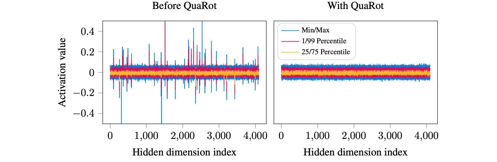
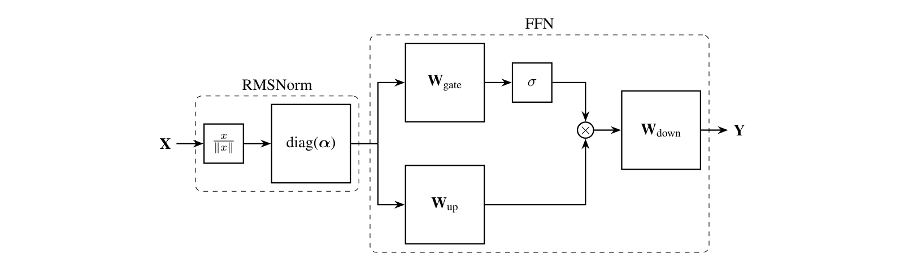
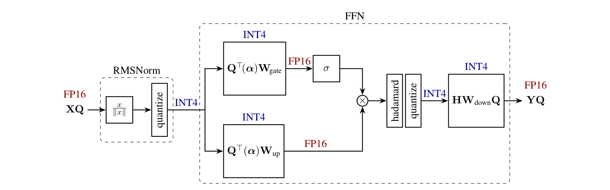
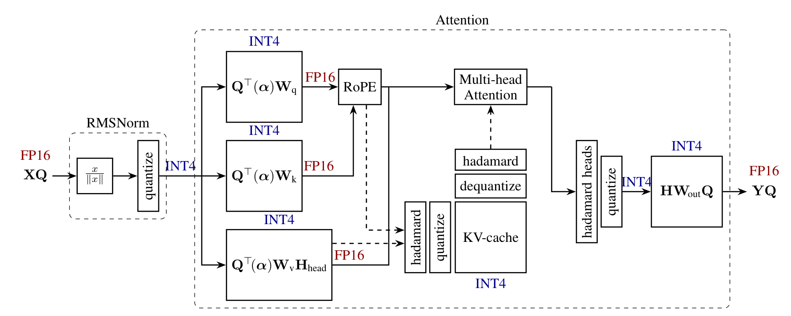
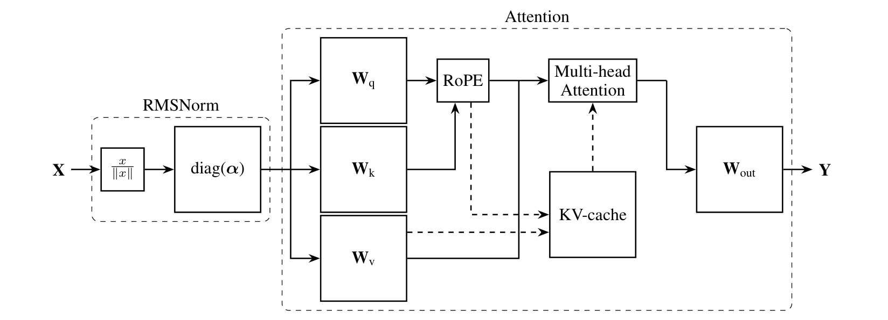
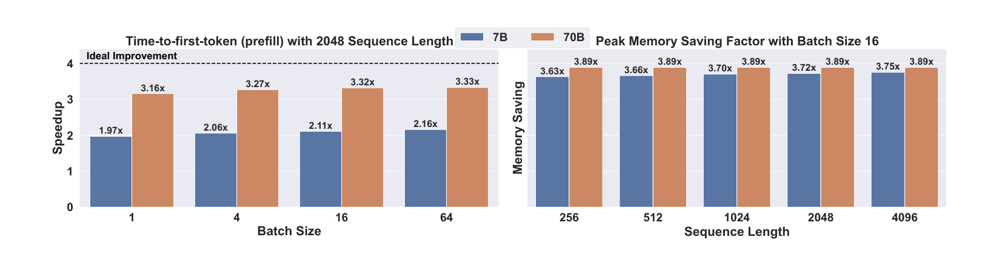
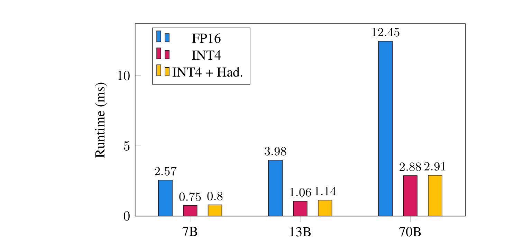

# 11 | QuaRot：用 Hadamard 旋转"洗掉"离群值，把 LLM 推理整体按进 4 bit

> **一句话**：利用"计算不变性"（正交旋转不改变模型输出），把随机 Hadamard 矩阵融进权重、把少量在线旋转插进前向图，从激活与 KV cache 中**整体消除离群值**——于是权重、激活、KV cache 可以全部走 INT4 张量核矩阵乘，**不留任何 FP16 高精度通道**；LLaMA2-70B 的 W4A4KV4 只损失 0.47 WikiText-2 困惑度、保留 99% 零样本精度，prefill 加速最高 3.33×。
>
> 标题勘误：本篇官方标题是 "…in **Rotated** LLMs"（旋转后的 LLM），不是 "Recurrent LMs"——以 arXiv 页面与 PDF 首页为准。

---

## 1. 论文档案

| 项目 | 内容 |
| --- | --- |
| 标题 | QuaRot: Outlier-Free 4-Bit Inference in Rotated LLMs |
| 作者与机构 | Saleh Ashkboos（ETH Zurich）、Amirkeivan Mohtashami（EPFL）、Maximilian L. Croci（Microsoft Research）、Bo Li（ETH Zurich）、Pashmina Cameron（Microsoft）、Martin Jaggi（EPFL）、Dan Alistarh（IST Austria & NeuralMagic）、Torsten Hoefler（ETH Zurich）、James Hensman（Microsoft Research）——ETH/EPFL/MSR/IST 四方合作 |
| 发表处 | **NeurIPS 2024**（PDF 首页脚注 "38th Conference on Neural Information Processing Systems"）；arXiv v1 2024-03-30，v2 2024-10-29（camera-ready，增加 LLAMA-3 / Phi-3 附录） |
| arXiv | [2404.00456](https://arxiv.org/abs/2404.00456) |
| 开源仓库 | [spcl/QuaRot](https://github.com/spcl/QuaRot)，**Apache-2.0** 许可证（LICENSE 文件查证） |
| 权重可得性 | 官方未发布已量化权重；`fake_quant/` 提供论文全部精度结果的仿真脚本（LLaMA-2 家族，从 HF 权重现场旋转+量化），`e2e/checkpoint_utils/quantize_llama_checkpoint.py` 可自行生成旋转+量化 checkpoint 用于 INT4 kernel 推理 |

---

## 2. 速览

**TL;DR**：QuaRot 把"离群值让 4 bit 激活量化崩溃"这个 PTQ 死结，转化成了一个线性代数问题：既然激活分布难看，就换一组基看它——用 Hadamard 正交矩阵旋转隐藏状态，离群能量被摊平到所有坐标，而**模型输出严格不变**。旋转大部分离线融入权重（零运行时开销），仅在 FFN down-proj 前和 attention 内部保留少量在线快速 Hadamard（论文口径：每层约 1.5 次变换），最终所有矩阵乘都落在 INT4×INT4 张量核上，无任何离群通道豁免。

- **问题**：LLM 激活呈 heavy-tail 分布，少数通道幅值高出均值 10 倍以上；4-bit 激活量化时 per-token 缩放被尖峰拉爆，其余值全部挤到量化噪底。既有方案要么给离群通道留 FP16/FP8 豁免（LLM.int8、Atom、QUIK），要么用校准集逐通道缩放"搬走"离群（SmoothQuant/AWQ），要么对每个权重矩阵做两次在线旋转（QuIP 系）——都无法做到干净的端到端 4 bit。
- **创新**：① 把 SliceGPT 的计算不变性定理从剪枝场景移植到量化：随机 Hadamard 旋转可融入权重而输出不变，同时天然完成激活的 incoherence 处理（离群消失）；② 四个插入点（模型级 Q / FFN down-proj / attention 逐头 value / 在线 QK 旋转）覆盖全模型，含 RoPE 之后的 KV cache（Post-RoPE 旋转缓存）；③ 端到端 W4A4KV4：CUTLASS INT4 GEMM + FlashInfer 量化 attention，无 FP16 通道。
- **证据**：LLaMA-2 7B/13B/70B 的 W4A4KV4 WikiText-2 ppl 6.10/5.40/3.79（基线 5.47/4.88/3.32，70B 损失 0.47），全面优于 SmoothQuant（83.12）/OmniQuant（14.26）/QUIK-4B（8.87@7B）；零样本平均至多掉 4.18%（70B 仅 1.09%）；RTX 3090 上 prefill 加速 1.97×–3.33×，解码峰值内存省 3.63×–3.89×；6/8 bit 用免校准 RTN 即无损。

---

## 3. 背景与动机

这篇论文出现之前，"把 LLM 压到 4 bit 并用 4 bit 算"卡在一堵墙上：**激活的离群值（outlier features）**。

权重本身好量化——它的分布温和，per-channel 对称量化 + GPTQ 就能把权重压到 4 bit 几乎无损（weight-only 路线：GPTQ、AWQ、SpQR、QuIP#）。但激活不行。自 LLM.int8（Dettmers 2022）起，多篇工作反复确认：transformer 的隐藏状态里存在少数"钉子户"通道，幅值比中位数大一到两个数量级，且跨 token 持续存在。后果是：per-token（按行）取 absmax 做缩放时，缩放因子被尖峰决定，其余 99% 的正常值除以一个巨大的 scale 后 round 到了量化格点附近——4 bit 下每行只有 15 个可用档位，信息直接归零。

当时的四条应对路线（论文 §2 相关工作梳理）：

1. **离群通道豁免**：LLM.int8（8 bit）、Atom、QUIK 在推理时识别离群特征，把它们留在 16 bit 走混合精度 MatMul。代价是 kernel 复杂（Atom 专门写了混合精度 GEMM）、 QUIK 把 down-proj 留 8 bit——总有"FP 尾巴"，达不到纯净 INT4。
2. **校准缩放**：SmoothQuant 用校准集统计把离群幅度从激活"搬"到权重上（$\mathbf{X} \rightarrow \mathbf{X} \cdot \text{diag}(s)$，$\mathbf{W} \rightarrow \text{diag}(s)^{-1}\mathbf{W}$），AWQ 反向保护显著权重。8 bit 档很成功，但 4 bit 档 SmoothQuant 直接崩（本文表 1：W4A4 下 ppl 83.12），且引入一组需要调的超参。
3. **旋转（incoherence processing）**：QuIP（Chee 2024）证明把权重左右各乘一个正交矩阵可以降低权重的非相干性（incoherence，见 §5.1 定义），从而更好量化；QuIP# 沿用并加格点码本。但这条路线把旋转当作"权重预处理 + 前向时在线反旋"，每个权重矩阵两侧各要一次在线 Hadamard，激活侧的收益没有单独兑现。
4. **KV cache 量化**：KVQuant、KIVI 等发现 **key 向量也有离群**（集中在少数维度，且与 RoPE 交互），不得不用特征维分组、非均匀表示、保精度离群等复杂手段才能压到 3/2 bit。

论文的切入点：这四条路都在"迁就"离群值，而 Hadamard 旋转能做到**让离群值根本不存在**——前提是旋转可以合法地"塞进"网络而不改变输出。SliceGPT（Ashkboos 2024，同一作者群）在剪枝场景已经证明计算不变性可行；QuaRot 把它完整移植到量化场景，并补上了 SliceGPT 没有的两块拼图：attention 内部（RoPE 挡路的地方）和 KV cache。



图 1 是全文的"存在性证明"：左图（HuggingFace 原始权重）第 10 层 FFN 输入有大量超出 1/99 分位带的尖峰；右图（QuaRot 旋转后）所有坐标被压进同一条窄带。没有离群值，4 bit 量化就只是一个普通的舍入问题。

---

## 4. 核心创新拆解

### 4.1 计算不变性：让旋转"免费"



- **是什么**：对任意正交矩阵 $Q$（$QQ^\top = I$），把块的输入权重左乘 $Q$、输出权重右乘 $Q^\top$（或按行向量约定反之，见 §5.4），模型输出逐位不变。QuaRot 用**随机 Hadamard 矩阵**充当 $Q$：隐藏状态整体换基 $X \leftarrow XQ$，RMSNorm 的线性部分 diag(α) 先融入相邻权重，之后每个矩阵乘都在旋转基下进行。
- **为什么之前不行**：QuIP 系虽然也旋转，但旋转是"权重侧的预处理"，前向时要在线做两次 Hadamard 才能算对（一次右乘、一次左乘反旋），且激活分布的收益被当作副产品。计算不变性视角下，旋转可以**只融不旋**——能融进权重的全部离线完成，前向图里只剩少数不得不在线的点。
- **怎么做到**：RMSNorm 的交换律（§5.4 公式 3）是关键豁免——归一化只除以范数，而旋转不改变范数，所以旋转可以穿过 RMSNorm 传播到下一块。RMSNorm 的缩放参数 diag(α) 是逐通道的、会破坏正交性，所以第一步先把它吸收进权重（$W_k \leftarrow Q^\top\,\text{diag}(\alpha)\,W_k$，原文公式 4）。
- **代价与权衡**：数值上输出"几乎不变"而非逐位不变（FP16 下有微小数值漂移）；附录 A.7 验证在线 Hadamard 用 FP16 计算也只有 <0.1 ppl 变化（论文判为噪声）。embedding 与 lm_head 也需同步旋转（属于模型级 Q 的一部分），首 token 之前多一次输入旋转。

### 4.2 四个插入点：把"不得不在线"的旋转压到最少



- **是什么**：论文 §4 按 Stage 1a–1d 组织（见 §5.5 逐个展开）：1a 模型级 $Q$ 融入全部权重；1b FFN down-proj 前插在线 Hadamard（因为 σ/门控逐元素操作破坏了不变性）；1c attention 的 value 侧逐头融合 $(I \otimes H_{d_h})$；1d 因为 RoPE 挡在 $W_k/W_q$ 与注意力打分之间，Q/K 用在线逐头旋转。
- **为什么之前不行**：逐元素非线性（σ、门控乘）和 softmax 都不是"旋转等变"的——这是旋转无法全离线的数学根源。之前的旋转方案要么绕开（只做权重侧），要么全在线（代价高）。
- **怎么做到**：识别出每个不可交换点，在不可交换处插最小粒度的在线变换（FFN 是一次全宽度 $H$；attention 是逐头 $H_{d_h}$ 和跨头 $H_{n_h} \otimes I$，都比全宽度变换便宜），在可交换处全部融入权重。论文口径：每层只需 **1.5 次**在线 Hadamard（对比 QuIP 每权重矩阵 2 次）。
- **代价与权衡**：在线变换虽便宜但非零（§6.3：给 4-bit 线性层增加至多 7% 开销）；attention 里插了两个在线点，decode 路径每次都要旋转当前 query/key。

### 4.3 KV cache 4 bit：Post-RoPE 旋转缓存

- **是什么**：旋转后的 key/value 直接以 4 bit 存入 KV cache（逐头不对称量化，group size 128，clip 0.95）。key 的旋转在 RoPE **之后**在线做（Post-RoPE Caching），query 同步旋转，注意力分数不变。
- **为什么之前不行**：KVQuant/KIVI 已发现 key 离群集中在 RoPE 相关的少数维度，但需要非均匀量化、保精度离群通道等复杂机制；RoPE 的存在使任何融合进 $W_k$ 的旋转变换失效（旋转矩阵与 RoPE 的旋转矩阵不可交换）。
- **怎么做到**：Q 和 K 同乘同一个正交矩阵 $H$，则 $(QH)(KH)^\top = QHH^\top K^\top = QK^\top$——注意力 logits 严格不变。于是"旋转 K、缓存旋转后的 K、旋转 Q"三者闭环，全部 4 bit。
- **代价与权衡**：论文对比了替代方案 Pre-RoPE Caching（Hooper 2024，缓存 RoPE 前的 key，用的时候在线反旋+RoPE）：那条路不用旋转 query，但要对缓存里**每个历史 key** 都做一次反旋+位置编码，decode 时是"1 个 query vs N 个缓存 key"的账；Post-RoPE 只旋转当前 token，decode 更划算。代价是缓存的是"RoPE 后"的 key，无法再复用 Pre-RoPE 路线针对 key 的特殊量化技巧。

### 4.4 端到端 INT4 前向：无 FP 通道 + kernel 支撑

- **是什么**：全部线性层 INT4 权重 × INT4 激活（CUTLASS TensorCore GEMM，INT32 累加器，输出 cast 回 FP16 并乘行/列尺度反量化）；attention 用 FlashInfer 改造的量化 kernel（Init/Append/Decode 三段式，分页管理 KV cache）；RMSNorm（去缩放版）留 FP32，在线 Hadamard 留 FP32（可降 FP16）。
- **为什么之前不行**：SmoothQuant 有 INT8 GEMM 但 4 bit 激活崩；Atom/QUIK 的 kernel 需要 carry 高精度离群通道与重排序逻辑；没有任何方案敢把 down-proj（离群重灾区）也压进 4 bit。
- **怎么做到**：旋转把"离群值问题"消灭在数据层面之后，kernel 只需要处理"好分布"——论文 §5.2 的量化配置全部是最朴素的：激活 per-token 对称 RTN（scale = max/7，clip 0.9），权重 per-channel 对称 + GPTQ。
- **代价与权衡**：研究级 kernel 未做深度优化（论文自述可把量化操作融合进 MatMul 再提速度）；4-bit KV cache 在小 batch（≤8）下反比 FP16 慢（§6.3），它的收益本质是省 IO，量化开销盖过 IO 收益时亏损。

### 系列对照：与 05 篇 BitNet b1.58（同领域两条路线）

| 维度 | QuaRot（本篇，PTQ 主流前沿） | BitNet b1.58（05 篇，范式挑战） |
| --- | --- | --- |
| 对象 | 已训好的 FP16 存量模型（LLaMA-2/3、Phi-3），数小时级后处理 | 从头训练的新模型（100B~2T tokens 完整预算） |
| 手段 | 改**数据的坐标表示**（正交旋转），数值分布变好，计算仍是低位乘加 | 改**数值本身**（三值权重 {-1,0,+1}），矩阵乘退化为整数加减 |
| 位宽 | 权重/激活/KV 全 4 bit（INT4 张量核），离群通道=0 | 权重 1.58 bit（信息量口径，2-bit 容器），激活 8 bit，KV 未量化 |
| 数学工具 | 正交性、能量守恒、Kronecker 分解、快速变换 O(d log d) | absmean 三值化函数 + STE 直通估计器 |
| 硬件假设 | 现有 GPU 的 INT4 张量核（CUTLASS 可直接编译），无需新硬件 | 理想终点是加法器阵列/查表内核；通用 GPU 上只能借 LUT 类内核近似 |
| 精度口径 | 70B ppl +0.47、零样本保留 99%——"几乎无损"有完整任务证据 | ≤3.9B 追平 FP16 基线，7B+ 只有成本数字无质量数字 |
| 生态就绪度 | 思想已被 llm-compressor（SpinQuantModifier）/AMD Quark 吸收，服务生产量化管线 | 独立推理框架 bitnet.cpp；一线模型无一重训为三值发布 |
| 两者交汇点 | QuaRot 证明"分布好 → 低位宽可行"；BitNet 证明"训练时适应约束 → 更低位宽可行"——4 bit PTQ 与 1.58 bit QAT 之间隔着的正是"能否重训"这个工程约束 | |

**解读视角**：两篇连读的要点是——PTQ 路线的每一步（GPTQ 的二阶补偿、SmoothQuant 的缩放、QuaRot 的旋转）都是在**不重训**的约束下与既定分布做斗争；BitNet 则直接改写分布的生成过程。QuaRot 是"存量模型 4 bit 化"这个真实需求的最优解代表，BitNet 是"下一代原生低位模型"的赌注。

---

## 5. 方法细节（数学深挖）

### 5.1 离群值从哪来：heavy-tail 激活与非相干性

LLM 激活的离群不是随机噪声，而是**结构性的 heavy-tail**：训练动力学使少数隐藏维度承载了超额幅值（与注意力 sink、位置编码高维等机制相关，跨 token 持续出现）。论文用**非相干性（incoherence）**给它一个可操作的度量（原文公式 2，沿用 QuIP）：

$$
\max(W) \;\le\; \mu \,\frac{\lVert W \rVert_F}{\sqrt{mn}},
\tag{2}
$$

其中 $\max(W)$ 是矩阵元素最大值，$\mu$ 是非相干系数：最大元素相对"均方根幅值 × √(mn)"的倍数。$\mu$ 越大，分布越 heavy-tail，量化越难——因为 per-token/per-channel 的 scale 被最大值决定，其余元素被挤到分辨率为零。同样的度量反过来描述激活：图 1 左图的尖峰通道就是激活矩阵中 $\mu$ 大的来源。**与 05 篇衔接**：BitNet 的答案是让模型从头学习在 {-1,0,+1} 约束下表达信息（分布生成时就没有离群）；PTQ 面对的分布是既成事实，只能换一个"看它的坐标系"。

### 5.2 Hadamard 矩阵与 O(d log d) 快速变换

Hadamard 矩阵是元素只取 $\{+1, -1\}$ 的正交矩阵。Walsh-Hadamard 矩阵按 Kronecker 积递归定义（原文公式 1）：

$$
H_2 = \frac{1}{\sqrt{2}}\begin{pmatrix} 1 & 1 \\ 1 & -1 \end{pmatrix},
\qquad
H_{2^n} = H_2 \otimes H_{2^{n-1}}.
\tag{1}
$$

这个递归结构直接给出**蝶形快速算法**（与 FFT 同构）：$H_{2^n}x$ 只需 $O(d \log_2 d)$ 次加减法，而不是稠密矩阵乘的 $O(d^2)$——这是选 Hadamard 而非任意正交矩阵的**算法动机**。仓库里 `fast-hadamard-transform`（Tri Dao 的 CUDA 库）就是它的 GPU 实现。

维度不是 2 的幂时，Hadamard 矩阵的存在性无保证（已知阶仅限 1、2 与 4 的倍数，Sloane 维护了已知矩阵库）。论文的做法：分解 $d = 2^n \cdot m$，$m$ 取一个已知 Hadamard 阶，用 $H_d = H_{2^n} \otimes H_m$ 混合计算——$2^n$ 部分走快速变换、$m$ 部分用稠密小矩阵，合计 $O(d(m+n))$。例如 LLaMA-2-7B 的 FFN 中间维 11008 = 64 × 172（172 是已知 Hadamard 阶）；仓库 `get_hadK` 里硬编码了 172/156/140/108/60/52/40/36/28/20/12 这组因子。

**随机化**：取 $s \in \{+1,-1\}^d$（随机符号向量），$\widetilde{H} = H\,\text{diag}(s)$。$\widetilde{H}$ 仍是正交矩阵（对角 ±1 不改变正交性），且保持了 $H$ 的所有元素仍是 ±1、快速算法照常适用。随机化打破旋转方向与权重结构之间可能的一致性（防止某个坐标轴恰好对齐权重的主方向），是"随机 Hadamard"的标准做法（沿用 QuIP#）。

### 5.3 为什么旋转能打散离群：能量守恒 + 能量摊平

**直觉一：正交变换是"换基不换长度"。** 对任意正交 $Q$（Hadamard 是其特例）：

$$
\lVert Qx \rVert_2^2 = x^\top Q^\top Q\, x = \lVert x \rVert_2^2,
\tag{Parseval}
$$

旋转不创造也不消灭能量（L2 范数平方 = 各坐标平方和），只搬运能量在坐标之间的分布。

**直觉二：Hadamard 把"单点尖峰"摊成"全场毛毛雨"。** 设激活向量只有一个离群值 $x = M \cdot e_k$（第 $k$ 坐标幅值 $M$，其余为 0）。用行向量 $h_i$ 表示 $\widetilde{H}$ 的第 $i$ 行，则旋转后每个坐标变为：

$$
(\widetilde{H}x)_i = \frac{1}{\sqrt{d}}\sum_j s_{ij}\,x_j = \frac{\pm M}{\sqrt{d}}
\qquad \forall i,
$$

原本集中在 1 个坐标的能量 $M^2$，被均匀摊到 $d$ 个坐标、每个承担 $M^2/d$——**离群幅值稀释 $\sqrt{d}$ 倍**（4096 维下约 64 倍）。真实激活是"少数大尖峰 + 多数正常值"的叠加，旋转后每个新坐标都是全部原坐标的随机符号加权和（$\pm 1/\sqrt{d}$ 权重），大尖峰对每个新坐标的贡献都被 $\sqrt{d}$ 摊薄，而正常值之间的贡献因符号随机相互抵消——分布从 heavy-tail 收敛为近高斯的窄带（图 1 右图）。

**直觉三：与傅里叶的对偶。** Walsh-Hadamard 变换就是"方波频率域"的正交变换，与 DFT 同构属同一族："时域的尖脉冲 ↔ 频域的平坦谱"是信号处理的经典现象——离群值就是激活的"尖脉冲"，旋转到 Hadamard 基下必然平坦。这就是变换去相关的通用直觉（详见本库数学基础 14 篇）。**为什么不用 DFT/DCT**：Hadamard 元素只有 ±1，快速算法里连乘法都没有（纯加减法 + 移位归一化），是 GPU/INT 域最便宜的正交变换；且附录 A.5 实证 Hadamard 优于随机 QR 正交矩阵（7B：6.10 vs 7.45 ppl）——±1 结构在打散 heavy-tail 上有真实效果，不只是"随便一个正交阵"。

### 5.4 计算不变性定理：为什么输出严格不变

核心恒等式一行（$H$ 正交）：

$$
Wx \;=\; W(H^\top H)x \;=\; \underbrace{(W H^\top)}_{\text{新权重}}\;\underbrace{(H x)}_{\text{新激活}}.
\tag{*}
$$

把权重改写成 $WH^\top$、激活改写成 $Hx$，乘积逐位不变——"旋转激活 + 反旋权重"两步相消。逐块推广到 transformer 有两个障碍，QuaRot 各给了一个解法：

**障碍一：RMSNorm 挡在块与块之间。** RMSNorm 按行归一化 $x_i \leftarrow x_i / \lVert x_i \rVert$。旋转不改变范数（Parseval），于是有交换律（原文公式 3）：

$$
\text{RMSNorm}(X) = \text{RMSNorm}(XQ^\top)\,Q.
\tag{3}
$$

（行向量约定：$X$ 的每行是一个 token，$XQ^\top$ 是右乘旋转。）旋转后的激活过归一化再右乘 $Q$，与原始激活过归一化完全一致。所以"隐藏态已被旋转 + 下一块输入权重融入 $Q$"之后，块间信号无缝衔接。RMSNorm 的**缩放参数** diag(α) 是逐通道的、不满足正交交换，必须先吸收进权重（原文公式 4，行向量约定）：

$$
W_k \leftarrow Q^\top\,\text{diag}(\alpha)\,W_k.
\tag{4}
$$

**障碍二：逐元素非线性与 softmax 不可交换。** $\sigma(\cdot)$、门控逐元素乘、softmax 都不满足 $f(Qx) = Qf(x)$。这决定了两处必须"现场旋转"：
- FFN：$W_{gate}/W_{up}$ 输出处于非旋转基（它们的输入侧已融 $Q^\top$ 抵消了输入旋转），$\sigma$ 和门控乘在非旋转基完成，然后**在线**乘 $H$ 进入旋转基，与融合了 $H$ 的 down-proj 相消（图 3 中 `hadamard → quantize → HW_down Q`）。融合的 $H$ 与在线的 $H$ 满足 $HH^\top = I$（Hadamard 对称，$H = H^\top$，故 $HH^\top = H^2 = I$）。
- Attention：注意力分数依赖 softmax。但 Q、K **同乘同一个正交阵**时打分不变：

$$
\text{softmax}\big(\alpha\,(Q_h H)(K_h H)^\top \odot M\big) = \text{softmax}\big(\alpha\,Q_h H H^\top K_h^\top \odot M\big) = \text{softmax}\big(\alpha\,Q_h K_h^\top \odot M\big).
$$

这个"$QK$ 同旋不变性"是 KV 量化的数学基石（Stage 1d）。

### 5.5 四类旋转逐一拆解（Stage 1a–1d，对应 SpinQuant 的 R1–R4 命名）

**命名说明**：QuaRot 原文用的是 Stage 1a–1d；流行的 R1–R4 记号来自后续工作 **SpinQuant**（Meta，ICLR 2025）对同一框架的分类学。对照关系如下（R1/R2 在 SpinQuant 中改为**学习得到**，R3/R4 保持固定 Hadamard——"R4 自动搜索"是常见误传，SpinQuant 对 R1/R2 用的是 Cayley 变换上的梯度学习，R3/R4 因在线执行而保持 Hadamard）：

| QuaRot 原文 | SpinQuant 记号 | 作用位置 | 离线/在线 | 数学形式 |
| --- | --- | --- | --- | --- |
| Stage 1a | R1 | 残差流（块间隐藏态），融入 embedding/lm_head 与所有块输入输出权重 | 离线 | $X \leftarrow XQ$，$W_{in} \leftarrow Q^\top \text{diag}(\alpha) W_{in}$ |
| Stage 1c | R2 | attention 的 V 侧，逐头 | 离线（融权重） | 公式 (7)(8)，见下 |
| Stage 1d | R3 | KV cache / QK 打分，逐头 | **在线**（RoPE 挡路） | 公式 (13)(14)，见下 |
| Stage 1b | R4 | FFN down-proj 输入 | **在线**（σ/门控不可交换） | $z \leftarrow zH$，$W_{down} \leftarrow H W_{down}$ |

**Stage 1c（R2）——value 侧逐头旋转。** 注意力输出可写成逐头求和（原文公式 5–6）：

$$
Y = \text{concat}\big[(P_1V_1)\cdots(P_{n_h}V_{n_h})\big]W_{out} = \sum_{h=1}^{H} P_h\,X\,W_v^{(h)}W_{out}^{(h)},
\tag{6}
$$

$P_h$ 是 softmax 后的注意力权重矩阵。$W_v$ 与 $W_{out}$ 在每头内隐式连乘，中间没有任何非线性——于是可以两头各融一个 $H_{d_h}$（$d_h$ 是头维）：

$$
W_v^{(h)} \leftarrow W_v^{(h)} H_{d_h}, \qquad W_{out}^{(h)} \leftarrow H_{d_h} W_{out}^{(h)},
\tag{7}
$$

连乘中 $H_{d_h}H_{d_h}^\top = I$ 相消。由于多头权重在存储上按列拼接，等价于一个 Kronecker 乘（原文公式 8）：

$$
W_v \leftarrow W_v (I \otimes H_{d_h}), \qquad W_{out} \leftarrow (I \otimes H_{d_h}) W_{out}.
\tag{8}
$$

**Stage 1d（R3）——QK 在线旋转。** RoPE 在 $W_q/W_k$ 之后施加位置旋转（原文公式 10–12：$P_h \leftarrow \text{softmax}(\alpha\,\text{Pos}(Q_h)\text{Pos}(K_h^\top)\odot M)$），任何融进 $W_k$ 的矩阵都会被 RoPE 隔开失效，所以 Q、K 在 RoPE **之后**在线旋转（原文公式 13–14）：

$$
Q \leftarrow \text{Pos}(XW_q)(I \otimes H_{d_h}) = \text{concat}[\text{Pos}(Q_1)H_{d_h}, \dots], \qquad
K \leftarrow \text{Pos}(XW_k)(I \otimes H_{d_h}).
\tag{13,14}
$$

由 §5.4 的同旋不变性，注意力分数不变；缓存中存的就是旋转后的 K/V，天然 4 bit 友好。

**Stage 1c 的补全——跨头旋转。** 要让 attention 输出完整进入旋转基（残差流处处是 $XQ$ 基），还需一个"跨头"变换。当 $n_h$ 与 $d_h$ 都是 2 的幂时有恒等式（原文公式 9）：

$$
H_{n_h \times d_h} = (I \otimes H_{d_h})(H_{n_h} \otimes I).
\tag{9}
$$

$(I \otimes H_{d_h})$ 已通过 (8) 融进权重；剩下 $(H_{n_h} \otimes I)$ 作为在线块"hadamard heads"插在 $W_{out}$ 之前——它对注意力输出张量只是 reshape 后沿头维做一次 Walsh-Hadamard，代价远小于全宽度变换。合并后 $W_{out} \leftarrow H_{n_h \times d_h} W_{out} Q$。

**开销总账**：论文 §2 口径"每层 1.5 次 Hadamard"= 1 次 FFN down-proj 前的全宽度 $H$ + attention 侧两个 Kronecker 结构的部分变换（**解读视角**：逐头 $H_{d_h}$ 与跨头 $H_{n_h}\otimes I$ 各自只覆盖 $d_{model}$ 的一部分算术强度，合计远低于一次全宽度变换；论文未给出精确分解，1.5 是其口径）。



（对照原始 attention 数据流：  ）

### 5.6 在线量化算术（Stage 2）

- **激活**：对称 per-token（按行）RTN。scale = 行最大绝对值 / 7（INT4 对称域最大可表示值），clip 比例恒取 0.9（附录 A.2 网格搜索验证 0.9 最优）。INT4×INT4 GEMM 在 TensorCore 上输出 INT32，立刻 cast 到 FP16 并乘"行尺度 × 列尺度"反量化。
- **权重**：per-channel（按列）对称，GPTQ（默认，128 条 WikiText-2 样本、seq 2048 校准；clip 比例对 MSE 线性搜索）或 RTN（免校准）。
- **KV cache**：不对称 4 bit，group size 128（= 头维），clip 0.95。旋转后的 K/V 满足近高斯分布，不对称 RTN 即可（仓库 `kv_cache.py` 的 `asym_quantize_and_pack_i4`：min/max 尺度 + 零点，两个 4-bit 打包进一个 uint8）。
- **attention 执行**：query 保持 FP16，在线 softmax（FlashAttention 式）；KV 分段从显存加载后反量化，点积在 FP16 完成——省的是 KV 的 IO（解码瓶颈），算力侧点积不降。
- **成本**：单张 A100 上对 LLaMA2-70B 完成 Stage 1 旋转改造 5 分钟，GPTQ 再 2 小时——PTQ 路线的"数小时出货"卖点保持。

---

## 6. 实验证据复盘

### 6.1 主表：W4A4KV4 的 WikiText-2 困惑度（论文表 1，seq 2048，GPTQ 权重）

| 方法 | 权重量化 | #离群通道 | LLaMA-2 7B | 13B | 70B |
| --- | --- | --- | --- | --- | --- |
| FP16 基线 | - | - | 5.47 | 4.88 | 3.32 |
| SmoothQuant | RTN | 0 | 83.12 | 35.88 | - |
| OmniQuant | RTN | 0 | 14.26 | 12.30 | - |
| QUIK-4B | GPTQ | 256 | 8.87 | 7.78 | 6.91 |
| **QuaRot** | GPTQ | **0** | **6.10** | **5.40** | **3.79** |
| Atom-128G | GPTQ-128G | 128 | 6.03 | 5.26 | - |
| **QuaRot-128G** | GPTQ-128G | **0** | **5.93** | **5.26** | **3.61** |

解读：① **70B 只损失 0.47 ppl**（3.79 − 3.32），是"端到端 4 bit 首次可行"主张的核心证据；② 对比 QUIK（保留 256 个离群通道）仍全面更优——消除离群比豁免离群更划算；③ 分组量化档（128G）上与 Atom 打平或反超（7B：5.93 vs 6.03），且 Atom 需要保留 128 个高精度通道与重排序操作，QuaRot 是 0；④ SmoothQuant/OmniQuant 在无离群豁免的 W4A4 下崩溃，印证"缩放路线在 4 bit 档失效"。70B 显著好于 7B 的规律贯穿全文：**模型越大，旋转后分布越温和**（离群问题随规模加剧，摊平收益也随规模加大）。

### 6.2 零样本精度（论文表 2，A4W4KV4，LM-Eval Harness）

| 模型 | 方法 | PQ | WG | HS | A-e | A-c | LA | 平均 |
| --- | --- | --- | --- | --- | --- | --- | --- | --- |
| LLaMA2-7B | FP16 | 79.11 | 69.06 | 75.99 | 74.58 | 46.25 | 73.90 | 69.82 |
| | QuaRot | 76.77 | 63.77 | 72.16 | 69.87 | 40.87 | 70.39 | 65.64（−4.18） |
| LLaMA2-13B | FP16 | 80.47 | 72.22 | 79.39 | 77.48 | 49.23 | 76.75 | 72.59 |
| | QuaRot | 78.89 | 70.24 | 76.37 | 72.98 | 46.59 | 73.67 | 69.79（−2.80） |
| LLaMA2-70B | FP16 | 82.70 | 77.98 | 83.84 | 80.98 | 57.34 | 79.58 | 77.07 |
| | QuaRot | 82.43 | 76.24 | 81.82 | 80.43 | 56.23 | 78.73 | 75.98（−1.09） |

解读：70B 保留 99% 零样本精度（摘要口径）；最大损失出现在 7B 的 Arc-Challenge（−5.38）。与小模型 ppl 损失更大的规律一致。

### 6.3 Kernel 性能（论文图 4 + 表 16/17，单 transformer 块，RTX 3090）



| 场景 | 7B | 70B |
| --- | --- | --- |
| prefill 加速（batch 1→64，seq 2048） | 1.97× → 2.16× | 3.16× → 3.33× |
| 解码峰值内存节省（batch 16） | 3.63×（seq 256）→ 3.75×（seq 4096） | 3.89×（几乎恒定） |

- **4-bit 线性层微基准**（图 7/表 14，batch 1、seq 2048）：含在线 Hadamard 后相对 FP16 加速 3.2×（7B 的 4096×4096：2.57ms → 0.80ms）～4.3×（70B 的 28672×8192：12.45ms → 2.91ms）；在线 Hadamard 开销论文口径**至多 7%**（图 7：7B 尺寸 0.75 → 0.80ms ≈ 6.7%，13B ≈ 7.5%，70B 仅 1%；表 14 中个别尺寸如 5120×5120 的开销比例实际更高，约 19%——引用时注意口径）。
- **4-bit KV 解码微基准**（表 15）：batch ≤ 8 时 4-bit cache **反比 FP16 慢**（7B 头配置 32×128：FP16 0.713ms vs INT4 1.033ms），batch ≥ 16 后反超、最高 **1.72×**——4-bit KV 的收益本质是省 IO，只有 IO 节省 > 量化开销时才兑现（长上下文/大 batch 场景）。
- **注意**：结论页（第 10 页）写 "3.39× memory saving"，与正文/摘要的 3.89× 矛盾——查表 17 可确认 3.89× 正确，结论页是笔误。70B 的内存节省比 7B 高，因为 70B 用 GQA、KV cache 占比更小、常数对象摊薄更充分。



### 6.4 RTN vs GPTQ 与 6/8 bit 无损（论文表 3/9）

| 模型 | 方法 | INT4 ppl | INT6 | INT8 | INT4 平均零样本 | INT8 平均 |
| --- | --- | --- | --- | --- | --- | --- |
| 7B | QuaRot-RTN | 8.37 | 5.56 | 5.50 | 58.26 | 69.65 |
| 7B | QuaRot-GPTQ | 6.10 | 5.52 | 5.50 | 65.64 | 69.81 |
| 70B | QuaRot-RTN | 4.14 | 3.36 | 3.33 | 73.63 | 77.17 |
| 70B | QuaRot-GPTQ | 3.79 | 3.35 | 3.33 | 75.98 | 77.28 |

解读：① **6/8 bit 免校准 RTN 完全无损**（7B INT8：5.50 vs 5.47，部分任务还反超）——旋转后连校准都不需要，这是部署上很实用的档位；② 4 bit 下 RTN 与 GPTQ 的差距随规模收窄（7B 差 2.27、70B 差 0.35，正文写 0.34），模型越大越不需要 GPTQ 的二阶补偿。

### 6.5 分组大小消融（论文表 4，GPTQ，KV group 固定 128）

| 方法 | 7B | 13B | 70B |
| --- | --- | --- | --- |
| QuaRot（per-channel） | 6.10 | 5.40 | 3.79 |
| QuaRot-256G | 5.98 | 5.28 | 3.63 |
| QuaRot-128G | 5.93 | 5.26 | 3.61 |
| QuaRot-64G | 5.88 | 5.25 | 3.58 |

规律清晰：group 越小精度越高，代价是 scale 存储增多、kernel 更复杂。

### 6.6 KV cache 位宽消融（论文表 6，其余全 FP16，group 128 不对称）

| K bits | V bits | 7B | 13B | 70B |
| --- | --- | --- | --- | --- |
| 16 | 16 | 5.47 | 4.88 | 3.32 |
| 4 | 4 | 5.51 | 4.91 | 3.33 |
| 4 | 3 | 5.54 | 4.93 | 3.35 |
| 4 | 2 | 5.75 | 5.09 | 3.43 |
| 3 | 4 | 5.65 | 5.01 | 3.38 |
| 3 | 3 | 5.68 | 5.02 | 3.39 |
| 2 | 4 | 8.06 | 6.42 | 3.89 |
| 2 | 2 | 9.23 | 7.07 | 4.13 |

解读：旋转后 **K4V4 几乎免费**（7B 仅 +0.04），K3V3 也可接受（+0.21）；**key 比 value 敏感**——K4V2 掉 0.28（5.75），K3V4 只掉 0.18（5.65），与 KVQuant/KIVI 对 key 离群的观察互相印证；2-bit key 崩得很快（K2V4：8.06），说明旋转摊平并不能让 key 也适应 2 bit。

### 6.7 旋转对 weight-only 也有效（论文表 7，激活/KV 保持 FP16，非对称 per-column）

| 方法 | A16W4 (7B) | A16W3 | A16W2 | A16W2 (70B) |
| --- | --- | --- | --- | --- |
| RTN | 6.99 | Inf | Inf | Inf |
| GPTQ | 8.25 | NaN | NaN | 25.30 |
| QuaRot-RTN | 6.76 | Inf | Inf | Inf |
| QuaRot-GPTQ | **5.60** | **6.09** | **22.07** | **5.60** |

解读：融入权重的 Hadamard 本身降低了权重的非相干性（呼应 QuIP#），4 bit 下 GPTQ 提升 2.65 ppl；2 bit 档把 GPTQ 从 25.30/NaN 拉回到 5.60/22.07——但论文不声称 2 bit SOTA（QuIP# 的格点码本在那档更强），旋转在这里是"改善"而非"解锁"。

### 6.8 Hadamard vs 随机正交矩阵（论文表 8）与其它消融

- **随机正交（QR 分解生成）**：7B 7.45 vs Hadamard 6.10（差 1.35）；70B 4.07 vs 3.79（差 0.28）。Hadamard 更好且差距随规模收窄；由于在线部分仍用快速 Hadamard kernel，换随机正交不改变计算量。这回答了"为什么偏偏是 Hadamard"：快速算法 + 实证更优。
- **在线 Hadamard 用 FP16**（表 10）：7B ppl 6.08 vs FP32 的 6.10，判为噪声——在线变换可以放心降精度。
- **LLAMA-3 更难**（表 11/12）：8B ppl 6.14 → 8.16（128G 下 7.36），零样本平均 73.22 → 65.18；70B 2.86 → 6.66、79.94 → 69.21。新一代模型离群结构更极端，固定随机旋转明显不够（→ §8 的 SpinQuant 接力）。
- **Phi-3-mini**（表 13）：INT4-GPTQ ppl 7.85 vs 6.35，零样本 66.34 vs 73.11——非 LLaMA 架构也可用，但损失偏大。

### 6.9 后续验证状态

**被验证/推进**：SpinQuant（ICLR 2025）证明把 R1/R2 从"随机 Hadamard"换成学习的旋转可进一步缩小差距（LLaMA-3 8B 上相对 QuaRot 把与全精度的差距再降 45.1%），方法论被 vLLM 的 llm-compressor 以 SpinQuantModifier 形式产品化；AMD Quark 也内置了同款旋转预处理。**被修正/挑战**：LLaMA-3 结果暴露固定随机旋转对新一代模型的不足（§6.8）；DuQuant（DuQuant++）等后续工作指出均匀旋转不如"分块+细粒度旋转"。**未被推翻**：计算不变性本身是数学事实，所有后续旋转系工作（SpinQuant/QuaRot 变体/DuQuant/ROSAQ）都建立在它之上。

---

## 7. 开源仓库导读

仓库 [spcl/QuaRot](https://github.com/spcl/QuaRot)，**Apache-2.0**，定位是论文配套的**研究原型**（15 个 commit、单 branch，README 只有安装与一句话指引；生产级功能不在本仓库范围内）。安装即编译 CUDA kernel：

```bash
git clone https://github.com/spcl/QuaRot.git
cd QuaRot
pip install -e .   # 通过 setup.py/CMakeLists 编译 quarot/kernels 下的 CUDA 扩展
```

依赖锁版（requirements.txt）：`torch==2.2.1`、`transformers==4.38.0`、`accelerate==0.27.2`、`datasets==2.17.1`、lm-evaluation-harness（固定 commit）；CUDA 侧三方库以 git submodule 引入：**CUTLASS**（INT4 GEMM）、**fast-hadamard-transform**（Tri Dao 的快速 Hadamard CUDA kernel）、nvbench。

**目录结构与角色**（GitHub API 全树核对）：

- `fake_quant/`——论文全部**精度结果**的仿真复现（伪量化，不跑 INT4 kernel）。入口 `main.py`，核心开关：`--rotate`（启用旋转）、`--a_bits/--w_bits/--v_bits/--k_bits`、`--w_clip/--a_clip_ratio/--k_clip_ratio/--v_clip_ratio`、`--w_asym/--a_asym/...`、`--cal_dataset`。复现论文主表的命令（fake_quant/README 原文）：

  ```bash
  /bin/python main.py --model meta-llama/Llama-2-7b-hf \
      --rotate --a_bits 4 --v_bits 4 --k_bits 4 --w_bits 4 --w_clip
  ```

  关键实现文件：`hadamard_utils.py`（`get_hadK` 硬编码 LLaMA 各维度的 Kronecker 因子 172/156/140/...，`matmul_hadU_cuda` 调 fast-hadamard-transform）、`rotation_utils.py`（R1–R4 全部融合逻辑）、`monkeypatch.py`（把 HF LLaMA 的 Linear/RMSNorm/attention 换成旋转+伪量化版）、`gptq_utils.py`。
- `e2e/`——**真实 INT4 推理**。`checkpoint_utils/quantize_llama_checkpoint.py` 把旋转融合 + GPTQ/RTN 量化落成 checkpoint（参数：`--w_groupsize/--w_asym/--w_rtn/--w_clip/--nsamples/--percdamp/--act_order`）；`quantized_llama/modeling_llama.py` 定义 `QuarotLlamaForCausalLM`（INT4 GEMM + 在线 Hadamard + 量化 attention 的完整前向）；`benchmark.py` 对照 FP16 与 INT4 的端到端延迟/显存（默认 LLaMA-2-7b，`benchmark_dtypes = ["int4", torch.float16]`）。
- `quarot/`——kernel 与算子库：`kernels/`（`gemm.cu` CUTLASS INT4 GEMM、`quant.cu` 在线量化、`flashinfer.cu` 量化 attention）、`nn/`（`linear.py` 的 `Linear4bit` 对称 4-bit 层、`hadamard.py`、`normalization.py` 去缩放 RMSNorm）、`functional/`（`hadamard.py`/`quantization.py` 的在线算子）、`transformers/kv_cache.py`——**4-bit KV cache 的完整实现**：`asym_quantize_and_pack_i4`（min/max 尺度+零点、两个 nibble 打包进 uint8）+ FlashInfer 式**分页缓存接口**（`kv_indptr/kv_indices/last_page_offset`，与 vLLM PagedAttention 的分页思想同源，见本系列 06 篇）+ `init_kv_i4/append_kv_i4`。
- `benchmarks/`——kernel 级微基准：`qlinear_benchmark.py`（表 14）、`qattention_benchmark.py`（表 15）、`hadamard_benchmark.py`。

**最小跑通路径**：① 精度复现走 `fake_quant`（有 GPU + LLaMA-2 权重即可，无需编译特别多东西）；② 性能复现走 `e2e/benchmark.py`（需编译 CUDA kernel，消费级卡即可——论文用 RTX 3090）。注意 `fake_quant` README 明言 "Currently, we only support **LLaMa-2** models"。

**工程亮点**：KV cache 的量化/打包/分页全部下沉到 CUDA（`quarot/kernels/flashinfer.cu` 改造自 FlashInfer 的 decode/prefill 模板）；在线 Hadamard 直接复用 fast-hadamard-transform 而非自研；量化注意力拆成 Init（prefill 建缓存，attention 本体走 FlashAttention）/Append（解码时量化并追加当前 K/V）/Decode（加载量化缓存做 FP16 点积）三段式——与 §5.6 的算法口径一一对应。

**如实说明两点**：① README 摘要写 "losses of at most **0.29** WikiText perplexity"，与论文 v2 正文的 **0.47** 不同步（仓库未注明口径出处），引用请以论文正文为准；② 论文 kernel 栈是 CUTLASS INT4 + FlashInfer + fast-hadamard-transform，本仓库不存在名为 "fpCUDA" 的组件（若在其他材料见到该说法，指的是通用 FP16 CUDA 基线或其他仓库的 kernel，非 QuaRot 内容）。

**生产生态承接**（查证于 llm-compressor 官方文档与 RFC）：QuaRot 的思想经 SpinQuant（学习旋转）进入 vLLM 官方量化工具链 **llm-compressor** 的 `SpinQuantModifier`（当前版本支持可融合的离线 R1 Hadamard 旋转，配 W4A16/W4A8 量化，产物经 compressed-tensors 可被 vLLM 原生加载；在线 R3 与学习型旋转在 roadmap/RFC 中，见 vllm-project/llm-compressor issue #3387）；AMD Quark 框架同样内置 R1–R4 旋转预处理。HF transformers 主库本身未内置 QuaRot（旋转需改前向图，与"即插即用量化器"的设计不兼容），生产部署走 llm-compressor 路线。

---

## 8. 局限与争议

以下均有出处（论文原文 / 官方仓库 / 后续论文 / 生态文档），标注"解读视角"的为本人推断。

1. **只覆盖 4 bit 档，2–3 bit 仍要靠 QuIP# 系**。QuaRot 的证据链全部在 4/6/8 bit；表 7 显示旋转把 2 bit 从 NaN/25.30 拉回 5.60/22.07，但与 QuIP# 的格点码本路线在该档位比并无优势主张。低比特量化的"终极答案"仍是开放问题。
2. **固定随机旋转对新代际模型明显不足**。附录 A.8：LLaMA-3-8B W4A4 零样本平均掉 8.04 分（65.18 vs 73.22），70B 掉 10.73 分——离群结构随训练配方演化，"随机 Hadamard 一把梭"的普适性被自己的附录证伪。接力者 SpinQuant（ICLR 2025，arXiv 2405.16406）把 R1/R2 改为 Cayley 梯度学习：LLaMA-2 7B W4A4KV4 零样本差距缩到 2.9 分，LLaMA-3 8B 相对 QuaRot 差距再降 45.1%。
3. **R1–R4 记号的常见误传**。R1–R4 分类学出自 SpinQuant（QuaRot 原文用 Stage 1a–1d）；SpinQuant 中**学习的是 R1/R2（可离线融合的旋转）**，R3/R4 因在线执行保持固定 Hadamard——"R4 自动搜索"的说法不准确（既非 R4、也非搜索，是梯度学习）。另外检索不到名为 "RoSE" 的旋转量化后续论文（易与 QAT 微调工作 RoSTE、arXiv 2502.09003 混淆）；原生 FP4 训练方向对应的是 Quartet（NeurIPS 2025，arXiv 2505.14669），属于"重训改范式"路线而非 QuaRot 的修正。
4. **维度约束是硬限制**。Hadamard 阶只存在于 1、2 与 4 的倍数；任意 $d$ 若不能分解为 $2^n \times K$（$K$ 为已知 Hadamard 阶，仓库硬编码 172/156/140/108/60/52/40/36/28/20/12），代码会直接 assert 失败（`get_hadK` 的 `assert is_pow2(n)`）。LLaMA 系维度（4096/11008/13824 等）恰好都有分解，自定义架构（如奇数维、素数维）需要自己构造或退化为随机正交（附录 A.5 显示有精度代价）。
5. **在线开销真实存在，且 kernel 尚未调优到极限**。4-bit KV 在 batch ≤ 8 时比 FP16 慢（表 15）；prefill 加速 1.97×–3.33× 距 INT4 算力的理想值（约 4×）仍有距离——论文自述可通过把量化操作融合进 GEMM 继续优化，但仓库未兑现（研究原型定位）。decode 阶段的端到端加速本文未报告（只报内存节省）。
6. **与 AWQ/SmoothQuant 缩放路线的路线之争**。缩放路线（逐通道对角变换）破坏激活通道间的统计结构、依赖校准集且引入超参，但它不改前向图、部署侵入性为零，在 W4A16/W4A8 档至今是工业默认（AWQ 至此仍是 GPTQ 类工作流的最常见搭档）；旋转路线改变数据分布本身、4 bit 以下无对手，代价是前向图必须插在线算子。两条路线在 llm-compressor 中并存（QuIPModifier/SpinQuantModifier vs AWQ/GPTQ modifiers）——**解读视角**：这实质是"量化自由度放在数据分布上还是放在权重误差补偿上"的分歧，4 bit 档最终由旋转系收编（FP4/MXFP4 硬件落地进一步强化），8 bit 档缩放系继续守擂。
7. **Post-RoPE 缓存的权衡未被社区完全采纳**。QuaRot 选择缓存 RoPE 后的 K（每步在线旋转 query/key），替代方案 Pre-RoPE Caching（KVQuant）缓存 RoPE 前的 K（省 query 旋转，但每步要对全部历史 key 反旋+重编码）。两者在不同 workload 下各有胜负，后续 KV 量化工作（KIVI 等）并未统一到 QuaRot 的选择上。
8. **复现面窄**。fake_quant 只官方支持 LLaMA-2（README 原文）；LLaMA-3/Phi-3 结果在附录给了数字但仓库脚本未同步适配；官方不发布量化权重，所有部署都要自己跑 checkpoint 生成流程。对比 vLLM/HF 上 AWQ/GPTQ 权重"下载即用"的生态，QuaRot 的可用性差距明显——这正是它需要 llm-compressor 接力的原因。

---

## 9. 与本知识库的衔接

- **量化数学地基**：`/home/yyl/ObsidianLibraries/模型性能优化/Stage 1-剪枝与量化基础实战/教程/第1周-量化数学地基与手写量化器.md`——§5.6 的 per-token 对称量化（scale=max/7）、clip 比例、不对称 KV 量化都是这份"手写量化器"作业的直接应用场景。
- **PTQ 校准流程**：`/home/yyl/ObsidianLibraries/模型性能优化/Stage 1-剪枝与量化基础实战/教程/第2周-PTQ校准流程全拆解.md`——GPTQ 校准（128 样本 WikiText-2、percdamp、act_order）与 QuaRot Stage 2a 的参数一一对应。
- **GPTQ 深挖**：`/home/yyl/ObsidianLibraries/模型性能优化/Stage 2-大模型进阶量化与 QAT/教程/第1周-GPTQ逐层最优二阶量化.md`——QuaRot 默认的权重量化器；先懂 Hessian 补偿再看"旋转改善 Hessian 条件数"更透。
- **缩放路线对照**：`/home/yyl/ObsidianLibraries/模型性能优化/Stage 2-大模型进阶量化与 QAT/教程/第2周-AWQ与SmoothQuant.md`——§8.6 路线之争的对手盘；SmoothQuant 的 diag(s) 缩放与 QuaRot 的正交旋转同属"线性变换家族"，一个牺牲信息一个保信息。
- **KV cache 量化**：`/home/yyl/ObsidianLibraries/模型性能优化/Stage 2-大模型进阶量化与 QAT/教程/第3周-FP8与NF4新一代数值格式与KVCache量化.md`——§4.3/§6.6 的 KV 4 bit 与该教程的 KV 量化章节互为印证。
- **正交矩阵数学**：`/home/yyl/ObsidianLibraries/数学基础/02-矩阵与线性变换.md`——QQᵀ=I、范数不变（Parseval）、换基视角是 §5.3/§5.4 的前置；Kronecker 积结构（公式 8/9）也在其中。
- **变换去相关直觉**：`/home/yyl/ObsidianLibraries/数学基础/14-傅里叶分析与综合应用.md`——"尖脉冲↔平坦谱"的能量重分布直觉（§5.3 直觉三），Walsh-Hadamard 与 DFT 的同族关系。
- **性能工程**：`/home/yyl/ObsidianLibraries/C++进阶/06-性能工程与代码优化.md`——§6.3 的 kernel 数字（INT4 GEMM 3.2×–4.3×、Hadamard ≤7% 开销、KV 量化的 IO 账）如何读、为什么小 batch 下省 IO 不等于加速。
- **系列内对照**：`../05-BitNet-b1.58/解读报告.md`（§4 系列对照表的完整版；PTQ vs QAT 两条路线）；`../06-vLLM-PagedAttention/解读报告.md`（FlashInfer 式分页 KV cache 与 PagedAttention 的同源思想）；本系列第 12 篇 FlashAttention-3（规划中，见系列 README）——低精度 attention 的算子级视角：FP8 块级缩放与 QuaRot 的在线反量化点积互补。

---

## 10. 面试视角

**Q1：为什么一个不改变输出的变换能解决量化问题？说出计算不变性的完整逻辑链。**
要点：① 恒等式 $Wx = (WH^\top)(Hx)$，$H$ 正交时两步相消，输出逐位不变；② 传播条件：RMSNorm 只除范数而旋转保范数，故有交换律 $\text{RMSNorm}(X) = \text{RMSNorm}(XQ^\top)Q$，缩放参数 diag(α) 先吸收进权重；③ 断点：逐元素非线性与 softmax 不可交换——FFN 在 down-proj 前在线旋转、attention 用 QK 同旋保打分不变；④ 旋转选 Hadamard 的双重理由：O(d log d) 快速算法 + 实证优于随机正交（6.10 vs 7.45）。答出"不变性是数学事实、代价只在数值精度与在线开销"是完整答案。

**Q2：为什么 Q/K 必须在线旋转而 V 可以离线融合？RoPE 在其中的角色？**
要点：$W_v$ 与 $W_{out}$ 之间只有线性注意力加权（$P_h$ 是系数矩阵），中间无非线性，所以 $H_{d_h}$ 可以两头各融一份在乘积中相消（公式 7）；$W_q/W_k$ 与打分之间隔着 RoPE——RoPE 自己是逐位置旋转矩阵，与 Hadamard 不可交换，融合进去会被 RoPE 破坏。解法是 RoPE 后 Q、K 同乘 $(I \otimes H_{d_h})$，$(QH)(KH)^\top = QHH^\top K^\top = QK^\top$，打分不变，且缓存里存的就是旋转后的 K（KV 4 bit 顺带解决）。追问 Post-RoPE vs Pre-RoPE 缓存：前者每步只旋 1 个 query + 1 个 key，后者要旋 N 个历史 key——decode 时后者更贵。

**Q3：Hadamard 旋转"消除"离群值的数学本质是什么？和 SmoothQuant 的缩放有何本质不同？**
要点：① Hadamard 行向量是 $\pm 1/\sqrt{d}$ 的满宽度采样，每个新坐标是全部旧坐标的随机符号加权和——单点尖峰能量 $M^2$ 被 Parseval 守恒地摊到 $d$ 个坐标（每个 $M^2/d$），幅值稀释 √d 倍；heavy-tail → 近高斯，这是**保信息的酉变换**（可精确逆）。② SmoothQuant 的 diag(s) 是**逐通道缩放**：把离群通道的幅值除掉、对应权重放大补偿——激活分布变好但信息在"挤压"中重新分布到权重侧精度压力，且需要校准集定 s；正交旋转是全局可逆的、不丢任何信息、免校准。③ 证据：SmoothQuant W4A4 83.12 ppl vs QuaRot 6.10。能量守恒 + 换基这两个词必须出现。

**Q4：KV cache 4 bit 为什么在 QuaRot 里几乎免费（K4V4 +0.04 ppl）？key 和 value 谁更敏感？**
要点：① 离群来源被消除——key 的离群集中在 RoPE 相关少数维度，value 的离群在 $W_v$ 输出，两者分别被在线旋转/逐头融合摊平，剩下近高斯分布用朴素不对称 RTN（group 128）即可；② 表 6：K4V2 掉 0.28 而 K3V4 只掉 0.18——key 更敏感（与 KVQuant/KIVI 结论一致）；③ 2-bit key 崩（K2V4 8.06），旋转不是万能；④ 工程收益在 IO：batch ≤ 8 时反而更慢，大 batch/长上下文才兑现 1.72×（表 15），内存省 3.63×–3.89×。

**Q5：QuaRot 之后这条路线的演化？固定随机旋转的天花板在哪里？**
要点：① LLaMA-3 附录自证天花板：8B 零样本掉 8 分——新一代模型离群更极端，随机 Hadamard 不够；② SpinQuant（ICLR 2025）：R1/R2 改为 Cayley 梯度学习（初始化仍是 Hadamard），LLaMA-3 8B 相对差距再降 45.1%，方法论已进 llm-compressor（SpinQuantModifier，vLLM 生产管线）；③ 其他分支：DuQuant（分块细粒度旋转）、ROSAQ（显著性感知旋转）、Quartet（干脆原生 FP4 训练，回到 QAT 范式）；④ 大局判断：旋转把 W4A4KV4 从"不可能"变成"可行基线"，之后的竞争在"旋转怎么选"（随机 → 学习 → 搜索）与"和什么量化器配"（GPTQ → 格点码本 → MXFP4）两个维度上展开。

---

## 附：图片资产清单

| 文件 | 来源 | 内容 |
| --- | --- | --- |
| `assets/fig1-outlier-distributions-before-after.png` | 论文 Fig 1（第 2 页，4× 重渲） | LLaMA2-7B 第 10 层 FFN 输入激活分布：旋转前离群尖峰 vs 旋转后窄带 |
| `assets/fig2-ffn-block-baseline.png` | 论文 Fig 2（第 4 页，4× 重渲） | 原始 LLaMA 式 FFN：RMSNorm + diag(α) + Wgate/Wup/Wdown 数据流 |
| `assets/fig3-quarot-ffn-rotation.png` | 论文 Fig 3（第 5 页，4× 重渲） | QuaRot 处理后的 FFN：Q⊤(α)W 融合权重、在线 hadamard→quantize→HWdownQ、各段位宽标注 |
| `assets/fig4-prefill-speedup-memory-saving.png` | 论文 Fig 4（第 8 页，4× 重渲） | prefill 加速（1.97×–3.33×）与解码内存节省（3.63×–3.89×） |
| `assets/fig5-attention-block-baseline.png` | 论文 Fig 5（第 13 页，4× 重渲） | 原始 self-attention：RoPE 位置、KV-cache 读写路径 |
| `assets/fig6-quarot-attention-rotation.png` | 论文 Fig 6（第 13 页，4× 重渲） | QuaRot 处理后的 attention：Q⊤(α)WvHhead 融合、KV 4bit、hadamard heads 在线块 |
| `assets/fig7-int4-linear-kernel-runtime.png` | 论文 Fig 7（第 18 页，4× 重渲） | 4-bit 线性层运行时：FP16 vs INT4 vs INT4+Hadamard（7B/13B/70B 尺寸） |

> 图片全部由 arXiv 原文 PDF（2404.00456v2）经 pymupdf 4× 缩放裁切重渲，版权归原论文作者（ETH Zurich / EPFL / Microsoft Research / IST Austria），仅用于学习解读。
> 数字核对说明：本报告所有表格数字、公式编号（1/2/3/4/5-14）均与 PDF 原文逐项核对（pymupdf 全文提取与 docling 解析交叉验证）；仓库细节（目录结构、CLI 参数、依赖版本、Apache-2.0 许可证、README 数字与论文不同步处）核对自 GitHub 官方仓库与 API；SpinQuant R1–R4 定义核对自其 arXiv HTML（2405.16406v3）；llm-compressor/Quark 生态表述核对自官方文档与 RFC issue #3387；标注"解读视角"的段落为本人推断，非论文原文内容。
