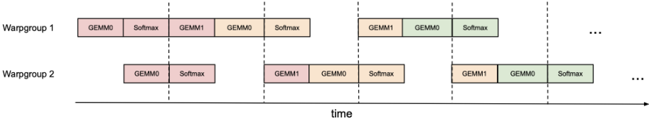
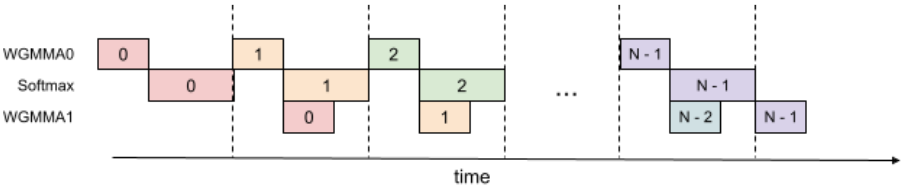
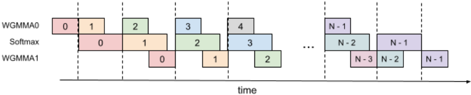
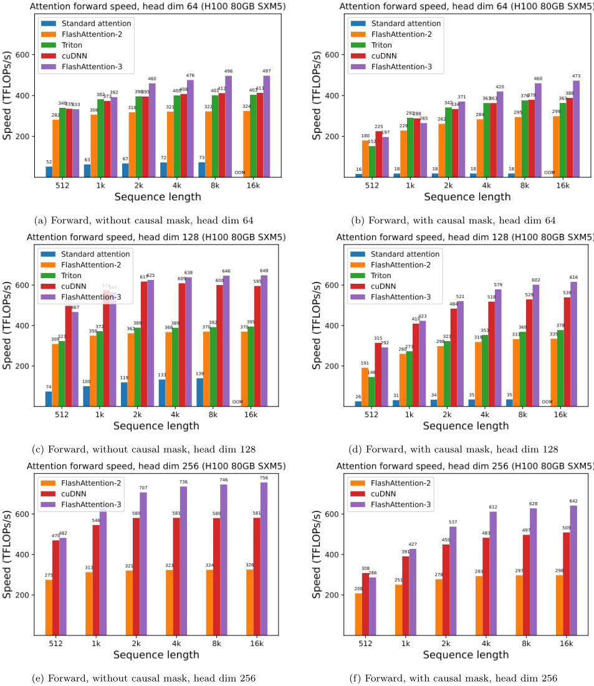
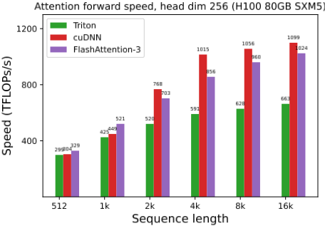
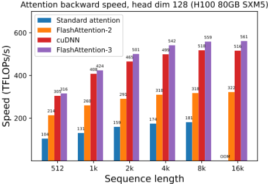
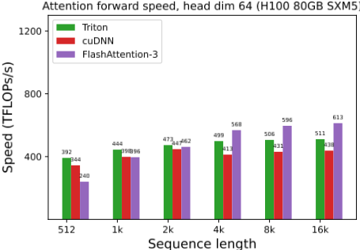
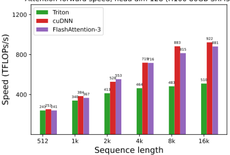

# 12 · FlashAttention-3 深度解读：用异步与低精度吃满 Hopper 的注意力算子

> 本篇是「论文解读」系列第 12 篇，方向：**加速·算子级**（系统级加速是第 06 篇 vLLM）。所有数字均与 arXiv 2407.08608（NeurIPS 2024）PDF 原文核对；图片截取自原论文（版权归原论文作者，仅作学习解读之用）；标注"解读视角"的内容为本文推断。

## 1. 论文档案

| 项目 | 内容 |
| --- | --- |
| 标题 | FlashAttention-3: Fast and Accurate Attention with Asynchrony and Low-precision（经核对，arXiv 与 NeurIPS 收录版标题均**没有** "on NVIDIA Hopper GPUs" 后缀） |
| 作者与机构 | Jay Shah*、Ganesh Bikshandi*（共同一作，Colfax Research）、Ying Zhang（Meta）、Vijay Thakkar（NVIDIA / Georgia Tech）、Pradeep Ramani（NVIDIA）、Tri Dao（Princeton / Together AI）——注意一作是 Colfax 的 Jay Shah，Tri Dao 是末位作者 |
| 发表处 | arXiv 2024-07-11 提交（PDF 版式日期 2024-07-16），NeurIPS 2024 收录 |
| arXiv | [2407.08608](https://arxiv.org/abs/2407.08608)（22 页，含附录 A/B/C） |
| 开源仓库 | [Dao-AILab/flash-attention](https://github.com/Dao-AILab/flash-attention)，**BSD-3-Clause** 许可证；FA3 代码在 `hopper/` 子目录，作为独立 beta 包（flash-attn-3）发布 |
| 权重可得性 | 不涉及模型权重——这是一个 GPU kernel 库；硬件要求 **H100/H800，CUDA ≥ 12.3**（官方建议 12.8+），Ampere/Ada 卡用 FA2 |

## 2. 速览

**一句话 TL;DR**：FlashAttention-2 在 H100 上只跑到 **35% 利用率**——它把 Ampere 时代"同步执行"的算法原样搬进了异步硬件；FA3 用三招翻盘：warp 专业化让 TMA 加载与 wgmma 计算重叠、softmax 与 GEMM 交错流水线、FP8 块级缩放 + 随机 Hadamard 非相干处理——FP16 前向推到 **740 TFLOPs/s（75% 利用率）**、FP8 推到**接近 1.2 PFLOPs/s**，且 FP8 误差比逐张量缩放基线低 **2.6×**，证明了"吃满新硬件"必须做**算法-硬件协同设计**。

| 维度 | 内容 |
| --- | --- |
| 问题 | FA2 在 H100 利用率 35%（GEMM kernel 80-90%）；根因有二：算法 adheres to 同步执行模型，TMA/异步 wgmma/FP8 Tensor Core 三个新能力一个没用上；且非矩阵乘运算吞吐是断崖——H100 special function（exp 所在单元）仅 3.9 TFLOPS，是 FP16 matmul（989 TFLOPS）的 1/256，hdim 128 时 softmax 的 exp 理论上可占掉一半时钟周期 |
| 创新 | ① 生产者-消费者异步：warp 专业化（producer 发 TMA、consumer 发 wgmma）+ s-stage 环形 SMEM 缓冲 + 双 warpgroup ping-pong 调度；② softmax 与 GEMM 重叠：2-stage WGMMA-softmax 流水线，寄存器双缓冲打破"softmax 依赖 S、PV 依赖 P"的块内串行链；③ FP8：k-major 布局合规改造（LDSM/STSM 核内转置 + 字节重排）+ 块级缩放（block quantization）+ 非相干处理（incoherent processing） |
| 证据 | H100 SXM5 实测：FP16 前向对 FA2 加速 1.5-2.0×（最高 740 TFLOPs/s = 989 峰值的 75%）、反向 1.5-1.75×；FP8 接近 1.2 PFLOPs/s；FP8 RMSE 9.1e-3 vs 基线 2.4e-2（2.6×）；消融确认两项异步技术各自有效（570→661 TFLOPs）；FP16 精度与 FA2 持平且优于标准实现 |

## 3. 背景与动机

**FA 系列的既有路线**。FlashAttention（NeurIPS 2022）的核心贡献是 IO 感知的分块算法：利用 softmax 的局部性（分块先算局部 max/sum、事后统一重缩放），把 S、P 两个 N×N 中间矩阵挡在片上，消掉对 HBM 的二次方读写，融合成单 kernel。FlashAttention-2（2023）重排了并行维度（同时沿序列维并行）与内循环归属（K/V 块循环放在 warp 内），把 A100 上的利用率推到理论 GEMM 的级别。但 FA2 的算法骨架是**同步**的：加载 K 块 → 等加载完成 → 算 QK^T → 等算完 → softmax → 算 PV → 下一块，每一步都 stall 在前一步上。

**为什么 FA2 在 Hopper 上"吃不满"**（§1、§2.2，本篇立论的核心账）：

1. **没用异步指令**。FA2 的 CUDA 实现面向 Ampere：`cp.async`（异步拷贝到 SMEM）+ `mma.sync`（同步 warp 级 MMA，操作数经寄存器）。Hopper 给了三样新东西——专用的 **TMA** 硬件拷贝单元、**异步且能直接从 SMEM 读操作数**的 warpgroup 级 `wgmma` 指令、**吞吐翻倍**的 FP8 Tensor Core——FA2 一个都没用。
2. **加载与计算没有分工**。同步模型里，同一个 warp 既管搬数据又管算数：搬数据的地址计算、指令发射、等待全部挤占 Tensor Core 的执行时间。Hopper 的异步执行允许"搬数据的 warp"和"算数的 warp"物理分离，FA2 的算法结构没给这个分离留接口。
3. **非矩阵乘的吞吐鸿沟**。H100 SXM5 的 FP16 matmul 是 989 TFLOPS，而 special function（exp 由 multi-function unit 执行，每 SM 每周期 16 个）只有 16 × 132 SM × 1830 MHz ≈ **3.9 TFLOPS**——差 256 倍。hdim 128 的 FP16 前向里，matmul FLOPS 是 exp 的 512 倍，折算下来 **exp 可占 ~50% 的周期**（512/989 ÷ 1/3.9 ≈ 0.495，原文 §3.1 同款计算）。FP8 更糟：matmul 吞吐翻倍而 exp 吞吐不变，softmax 从"配角"变成"第二瓶颈"。
4. **前人已示范了可能性**。ThunderKittens（Stanford）与 cuDNN 9（NVIDIA 官方）证明：用上 Hopper 指令与 tile 抽象，注意力可以显著提速且实现更简洁——FA3 是把这个方向推到极致的学术化完整答卷。

**问题的本质**（解读视角）：FA1/FA2 的优化轴是"少搬数据"（minimize HBM reads/writes），而 H100 的矛盾已经转移成"让数据、计算、低精度单元**同时**忙起来"。同一层里的三种硬件单元（TMA 拷贝、Tensor Core、CUDA core 上的 exp/归约）各自全速运转的条件互相冲突，需要用软件流水线把它们的节奏错开——这本质上是把 CPU 体系结构课里的"指令级并行/硬件调度"手工搬到了 GPU kernel 里。

## 4. 核心创新拆解

### 4.1 生产者-消费者异步：warp 专业化 + ping-pong 调度

- **是什么**：一个 CTA 内把 warp 分成两类角色——producer warpgroup 只发 TMA 加载（Q 块一次、每轮 K/V 块各一次），consumer warpgroup 只发 wgmma 计算与 softmax；两者通过 s-stage 环形 SMEM 缓冲 + barrier 同步。再进一步，两个 consumer warpgroup 用 `bar.sync` 具名 barrier 强制 GEMM 交错执行（ping-pong），让 WG1 的 softmax 与 WG2 的 GEMM 在时间上重合。
- **为什么之前不行**：FA2 的同步模型里加载与计算在同一个执行流里串行；Ampere 的 `mma.sync` 是同步指令，issue 它的 warp 必须等待完成，没有"发射后不管"的余地。
- **怎么做到**：Hopper 的 TMA 是独立硬件单元（地址计算全部下放硬件，单线程即可发射整块多维拷贝）；wgmma 是异步指令（commit 后可继续跑别的指令，`wgmma.wait_group` 才阻塞）；`setmaxnreg` 允许 producer warpgroup 释放寄存器（TMA 只需单线程发射）给 consumer 换取更大寄存器空间。ping-pong 调度改编自 CUTLASS 的 warp-specialized ping-pong GEMM（论文致谢中注明）。
- **代价与权衡**：寄存器在 producer/consumer 之间此消彼长；两个 consumer warpgroup 各占一份 SMEM 缓冲与 accumulator 寄存器，块尺寸受限；实测 ping-pong 把 hdim128/seqlen8192 的 FP16 前向从 570 提到 620-640 TFLOPs——增益真实但"调度图只是 caricature"，实际执行没有图上那么干净（原文自己承认）。

### 4.2 softmax 藏进异步 GEMM：2-stage WGMMA-softmax 流水线

- **是什么**：即使在一个 warpgroup 内部，也可以把第 j 轮的 softmax 与第 j-1 轮的 PV GEMM 重叠——关键是**寄存器双缓冲**：维护 Scur（上一轮的分数，正在做 softmax）与 Snext（本轮刚算完的分数）两块寄存器，把"算 S → softmax → 算 PV"的串行链拆成跨轮交叠。
- **为什么之前不行**：块内有两条硬依赖：softmax 要吃 S（第一个 GEMM 的输出），PV GEMM 要吃 softmax 的输出 P̃——不跨轮缓冲，就只能在每个 GEMM 后 `wait`，softmax 与 GEMM 完全串行。
- **怎么做到**：把 P̃V GEMM 与 QK^T GEMM 都改成 commit-but-not-wait 的异步发射，在等待期间做另一轮的 softmax；O 的重缩放推迟到 PV GEMM 完成之后、用寄存器里跨轮携带的缩放因子执行（见 §5.5 的"延迟重缩放"细节）。
- **代价与权衡**：多出的 Snext 寄存器开销 = Br × Bc × sizeof(float)/CTA，与"加大块尺寸"这一惯用优化直接抢寄存器；2-stage 是甜点，3-stage 变体（再叠一层）实测**更差**——编译器没有按预期把第二个 WGMMA 与 softmax 交叠，寄存器压力还更大（附录 B.3）。这是全篇少见的"负结果"，工程上非常有价值。

### 4.3 FP8：布局合规 + 块级缩放 + 非相干处理

- **是什么**：把 QK^T 与 PV 两个 GEMM 打到 FP8 Tensor Core（吞吐是 FP16 的 2 倍），并用两项技术把量化误差压回去：块级缩放（Q/K/V 按块各存一个 scale，而非逐张量一个）与非相干处理（量化前给 Q、K 同乘一个随机正交矩阵 M，用 Hadamard 变换把离群值"摊平"）。
- **为什么之前不行**：① FP8 wgmma 只接受 k-major 操作数布局，而注意力里 V 天然按 head 维连续，且 FP8 wgmma 的 FP32 累加器布局与操作数 A 的寄存器布局不一致——两个背靠背 GEMM 的中间结果格式对不上；② LLM 有离群激活值，FP8 e4m3 只有 3 位尾数，逐张量缩放误差很大。
- **怎么做到**：布局上，用 LDSM/STSM（warp 级 128 字节粒度 SMEM↔RMEM 拷贝指令，支持转置模式）在核内转置 V 块，配上一处字节重排 `{d0 d1 d4 d5 d2 d3 d6 d7}` 把累加器变成第二个 GEMM 想要的 A 布局，并让 V 的转置写出匹配的行置换（这招免掉了此前 FP8 FA2 方案里的 shuffle 换主）；精度上，块级缩放可以融进 attention 前的 rotary embedding（访存受限、不加时延），Hadamard 矩阵乘 O(d log d) 同样可融合（思想源自 QuIP#，Chee et al. / Tseng et al.）。
- **代价与权衡**：FP8 仅前向支持；非相干处理对 Q、K 各引入一次额外变换（虽可融合，但实现复杂度上升）；块级缩放要求上游在进 attention 前就完成分块量化（工程上要动 rotary/量化管线）；V 转置占用 producer warpgroup 的执行资源，须排在两个 WGMMA 的阴影里才不亏。

## 5. 方法细节

### 5.1 前置速修：FA1/FA2 的在线 softmax（与 PDF 逐步核对）

标准注意力（论文 §2.1）：单头 Q, K, V ∈ R^(N×d)，α = 1/√d，逐行 softmax，减行最大值防 exp 溢出：

$$O = \text{softmax}\!\left(\alpha\, Q K^{\top}\right) V, \qquad \alpha = \tfrac{1}{\sqrt{d}}$$

FlashAttention 的分块在线 softmax（t 沿 K/V 块推进；对应论文 Algorithm 1 第 17-21、24 行）：设当前累计的行最大值 $m_i$、行指数和 $\ell_i$、部分输出 $O_i$，每来一个新块 $S_i^{(j)} = Q_i K_j^{\top}$ 就做一次"重缩放 + 合并"：

$$m_i \leftarrow \max\!\left(m_i^{\text{old}},\; \text{rowmax}\!\left(S_i^{(j)}\right)\right)$$

$$\tilde{P}_i^{(j)} = \exp\!\left(S_i^{(j)} - m_i\right)$$

$$\ell_i \leftarrow \exp\!\left(m_i^{\text{old}} - m_i\right)\ell_i + \text{rowsum}\!\left(\tilde{P}_i^{(j)}\right)$$

$$O_i \leftarrow \text{diag}\!\left(\exp\!\left(m_i^{\text{old}} - m_i\right)\right)^{-1} O_i + \tilde{P}_i^{(j)} V_j$$

循环结束后统一收尾（Algorithm 1 第 24 行）：

$$O_i \leftarrow \text{diag}(\ell_i)^{-1} O_i, \qquad L_i = m_i + \log(\ell_i) \;\;(\text{logsumexp，反向重算用})$$

这套"局部 softmax + 延迟归一化"在数学上与标准 softmax 精确等价（推导见 FA2 论文 §2.3.1），是 FA 家族一切后续优化的地基。**FA3 的全部技巧，就是在 Hopper 上让这五行公式里的 exp/乘加（CUDA core 慢单元）与两次 GEMM（Tensor Core 快单元）同时跑起来。**

### 5.2 Hopper 硬件特性拆解（本篇最有复用价值的部分）

内存层级（论文 Table 1 复述，H100 SXM5）：

| 层级 | 归属 | 容量 @ 带宽 |
| --- | --- | --- |
| GMEM（HBM） | 全 GPU | 80 GiB @ 3.35 TB/s |
| L2 | 全 GPU | 50 MiB @ 12 TB/s |
| SMEM | 每 SM，CTA 内可直接寻址 | 228 KiB/SM；全 GPU ~31 TB/s（按 128 B/clk/SM × 132 SM × 1830 MHz 估算） |
| RMEM（寄存器） | 每线程最多 256 个 | 每 SM 256 KiB |

三个关键硬件能力，逐个说清"它替你干了什么"：

| 特性 | Ampere 时代做法 | Hopper 做法 | 解决的问题 |
| --- | --- | --- | --- |
| TMA（Tensor Memory Accelerator） | `cp.async`：warp 内每线程发自己的拷贝，地址计算占指令槽， warp 必须等 | 专用硬件单元：**单线程**描述一次多维批量拷贝（基址/形状/步长），异步执行完成再通知 | 地址计算下放硬件、释放 warp；拷贝粒度大到一次搬整块 K/V tile |
| wgmma（warpgroup MMA） | `mma.sync`：32 线程 warp 级，操作数从寄存器读，**同步**（发射即等待） | 128 线程 warpgroup 级，操作数可**直接从 SMEM 读**（SS 变体），异步 commit/wait，甚至可与后续指令交叠 | 免掉 SMEM→寄存器的手动搬运；"发射后不管"给 softmax 腾出重叠窗口 |
| FP8 Tensor Core | 无 | wgmma 目标 FP8，吞吐 ×2（989→~1979 TFLOPS） | 同功耗同面积的算力翻倍；代价是布局限制与精度（见 5.6） |

配套机制：**warp 专业化**（warp 们专职化成 producer/consumer，编译器得以生成更优指令调度——这一思想 2011 年的 CUDADMA 论文就有，Hopper 硬件首次给了完整支撑）；**setmaxnreg**（warpgroup 间动态重分配寄存器：producer 只要一点点，剩下的让给 consumer 的 accumulator）；**线程层级**新增 threadblock cluster（CTA 簇，同一 GPC 内协同调度）。

**为什么 FA2 在 Hopper 上吃不满**（解读视角小结）：FA2 的 kernel 里，加载等待、地址算术、mma 发射、softmax 全挤在同一批 warp 的执行槽上——Tensor Core 等数据时全 SM 停摆，exp 跑起来时 Tensor Core 又闲着。利用率 35% 不是"FA2 写得烂"，而是**同步算法 + 异步硬件**的结构性错配。FA3 的三招分别对应三条错配：producer/consumer 分工（搬与算错开）、2-stage 流水线（softmax 与 GEMM 错开）、FP8（把 GEMM 的时间减半，同时用软件把精度补回来）。

### 5.3 Algorithm 1：warp 专业化流水线的骨架

论文 Algorithm 1（无块内重叠版本）的 CTA 级视图，producer 与 consumer 两条循环：

- **producer warpgroup**：`setmaxnreg` 释放寄存器 → 发射 Q 块 TMA 加载 → 完成后 commit 通知 → 循环：等缓冲第 j%s 段被消费完 → 发射 K_j、V_j 的 TMA 加载 → commit。注意发射 TMA 不阻塞（异步），前 s 轮根本不用等（缓冲在填充）。
- **consumer warpgroup**：`setmaxnreg` 领取寄存器 → 片上初始化 O=0、ℓ=0、m=-∞ → 循环：等 K_j 到 SMEM → SS-GEMM 算 S（wgmma，commit+wait）→ softmax 三行（5.1 的递推）→ 等 V_j → RS-GEMM 算 P̃V 并重缩放 O → 释放第 j%s 段缓冲给 producer → 收尾写 O 与 L。

这就是 GPU 版的"生产者-消费者 + 有界缓冲"：`s-stage 环形 SMEM 缓冲` = 信号量保护的环形队列，`commit/wait` = P/V 操作。与操作系统课的互不相同之处在于：同步原语是硬件 barrier（mbarrier/bar.sync），且"消费"是 Tensor Core 指令。

### 5.4 ping-pong 调度：两个 warpgroup 的 1-2-1-2 交错



动机见 §3 的吞吐账：exp 单元与 Tensor Core 是不同硬件，理想情况是 exp 恰好在 matmul 执行期间被调度。做法：用 `bar.sync` 具名 barrier 强制 "WG1 的 GEMM1（本轮 PV）+ GEMM0（下轮 QK^T）"先于 "WG2 的 GEMM" 发生，于是 WG1 做 softmax 时 WG2 在做 GEMM，随后角色互换——两个 consumer warpgroup 按 1→2→1→2 交替。这一调度因其次序在作者讲座（GPU Mode 第 36 讲）与社区资料中常被称作 **"1-2-1-2 ping-pong schedule"**（论文正文只叫 ping-pong scheduling，图 1 即其示意）。实测收益：hdim128/seqlen8192 FP16 前向 570 → 620-640 TFLOPs；且支持 MQA/GQA（沿 FA2 的做法调整索引，不在 HBM 复制 K/V）。

### 5.5 2-stage WGMMA-softmax 流水线：寄存器双缓冲打破依赖



**依赖为什么存在**：softmax 吃第一个 GEMM（QK^T→S）的输出，第二个 GEMM（PV）吃 softmax 的输出 P̃——Algorithm 1 里第 17、21 行的两个 wait 把一切串行化。**打破方式**：跨轮流水线（Algorithm 2，替换 Algorithm 1 的 consumer 侧）：

1. 先算 Scur = Q·K_0^T（commit+wait），做第一轮 softmax；
2. 主循环（第 j 轮）：等 K_j → 发射 **Snext = Q·K_j^T**（commit，**不等待**）；等 V_{j-1} → 发射 **O += P̃cur·V_{j-1}**（commit，**不等待**）；等 Snext 的 wgmma 完成 → 对 Snext 做本轮 softmax（得 P̃next、更新 ℓ）→ 等 PV 的 wgmma 完成 → **重缩放 O** → 释放缓冲段 → Snext→Scur 滚动；
3. 收尾：最后一个 PV GEMM + epilogue 重缩放、写回。

两个要点：

- **双缓冲的角色**：Scur 服务于 softmax 与 PV GEMM，Snext 让下一个 QK^T GEMM 提前开工——两个寄存器块 + 两个异步 wgmma 在飞行中，softmax 正好填进两个 GEMM 之间的等待缝隙。
- **O 的重缩放（解读视角，对"细粒度重缩放"的核对）**：论文原文**没有**"每 128 列重缩放一次"的字面表述（我们核对了 arXiv 当前版与 NeurIPS 收录版全文）。论文的实际机制是**延迟重缩放**：每次重缩放必须等 PV GEMM 完成（exp(m_old−m) 因子要乘进 O），FA3 把缩放因子以标量形式存在寄存器里跨轮携带，Algorithm 2 第 14 行在 PV wgmma 等待完成后才应用一次重缩放；3-stage 变体（Algorithm 4）更进一步，用专门的 `scale_o` 寄存器存跨轮累计缩放，把重缩放推迟到 PV 发射前。由于 FA3 典型 KV 块宽 Bc=128，"每轮对 O 重缩放一次"等效于"约每 128 列分数重缩放一次"——但这是结合代码（`softmax.rescale_o` 每迭代调用一次）与算法的解读，不是论文原文承诺。

**3-stage 的负结果**（附录 B.3，值得记住）：想把 j+2 的 WGMMA0、j+1 的 softmax、j 的 WGMMA1 三级全叠，理论更美，但 SASS 显示编译器只重叠了第一个 WGMMA（原因不明，原文直言 "It's not clear why"），加上需要多存一份 P̃ 与 scale_o，块尺寸被迫变小——实测劣于 2-stage。教训：**在 nvcc 的指令重排面前，精心设计的软件流水线不保证可编程兑现**；FA3 的做法是用 SASS 反汇编验证（附录 B.2 给出了主循环的 SASS 证据：第一个 WGMMA 与 exp2/rowsum/F2FP 交叠、第二个 WGMMA 独占）。



### 5.6 FP8：布局合规、块级缩放与非相干处理

**布局合规（效率侧）**。FP8 wgmma 只收 k-major 操作数；V 天然按 head 维连续而算法需要按序列维连续；TMA 不能顺手转置。四条路里 FA3 选了核内转置：producer warpgroup 用 LDSM/STSM（带转置模式、128 字节粒度、寄存器友好）转置 V tile，且排在先前两个 WGMMA 的阴影里执行；再用字节重排 `{d0 d1 d4 d5 d2 d3 d6 d7}`（每 8 字节复制一遍）把 FP8 wgmma 的 FP32 累加器布局变成第二个 GEMM 要求的操作数 A 布局——等价于对 P tile 做了列置换，于是让 V 转置写出匹配的行置换来配平（论文图 3/图 4 给出了两个布局的线程-元素映射）。

**精度侧两项技术**。FP8 e4m3 只有 4 位指数 + 3 位尾数，而 LLM 激活有离群值（幅度远大于其余值），逐张量缩放（一个 tensor 一个 scalar）误差大：

1. **块级缩放**：Q/K/V 各按块（Br×d 或 Bc×d）分块，每块一个 scale；FA3 天然分块运算，把块 scale 融进 S 的缩放即可，**零额外计算成本**；块量化本身可融进 attention 前的 rotary embedding（访存受限，不加时延）。
2. **非相干处理（incoherent processing）**：给 Q、K 同乘随机正交矩阵 M 再量化。因 MM^⊤ = I，有 (QM)(KM)^⊤ = QK^⊤，**输出数学不变**；而 QM/KM 的每个元素是原矩阵一整行的随机线性组合，离群值被"摊"进所有元素——量化误差随之摊平。实践取 M = diag(±1)·H（随机符号对角阵 × Hadamard 矩阵），用快速 Walsh-Hadamard 变换 O(d log d) 完成，同样可融合进 rotary embedding。思想出处是 QuIP#/QuIP（Chee et al.、Tseng et al.，论文自引）。

**与 11 篇 QuaRot 的呼应**（解读视角）：QuaRot 用"计算不变性 + Hadamard 旋转"给 4bit LLM 推理移除离群值（在线旋转逐层嵌入网络），FA3 把同款武器搬进了**注意力算子内部**处理 FP8 量化——一处是模型级 PTQ 管线，一处是 kernel 级临时变换，但数学内核完全同源：**用随机正交变换把"少数大值"打散成"普遍中值"，让低精度格式的量化噪声均匀化**。读完 11 篇再看本文 5.6，会发现"离群值-旋转-摊平"是 2024 年量化领域反复出现的同一母题。

## 6. 实验证据复盘

### 6.1 基准设置（附录 C.1 复述核对）

| 项 | 值 |
| --- | --- |
| GPU | H100 80GB SXM5（700W），时钟**定频 1830 MHz**（989 TFLOPS FP16 理论峰值的折算基准），重复 100 次取均值 |
| 软件 | CUDA 12.3、cuDNN 9.1.1.17、CUTLASS 3.5、FlashAttention 2.5.8、Triton nightly（2024-04）、PyTorch 2.3.0 |
| 形状 | seqlen ∈ {512, 1k, …, 16k}，batch 凑总 tokens = 16k；hidden 2048 → hdim 64/128/256 对应 32/16/8 头 |
| FLOPs 口径 | 前向 = 4·seqlen²·hdim·nheads（QK^T 与 PV 各 2·N²d）；因果掩码 ÷2（约一半分数不计算）；反向 = 前向 × 2.5（反向 5 个 matmul 对前向 2 个） |
| FP8 | seqlen ∈ {512, 1024, 2048, 4224, 8448, 16896}（≥4k 时取 132 的倍数，对齐 SM 数避免 wave quantization） |

### 6.2 FP16/BF16 前向（原文图 5，图上读数为约值）



| 设置（非因果，16k） | 标准实现 | FA2 | cuDNN | FA3 | FA3/FA2 |
| --- | --- | --- | --- | --- | --- |
| hdim 64 | OOM | 329 | 462 | **497** | 1.51× |
| hdim 128 | OOM | 370 | 539 | **640** | 1.73× |
| hdim 256 | — | 328 | 580 | **756** | 2.31× |

- 论文口径：FA3 前向对 FA2 **1.5-2.0×**、对 Triton 版 FA2 最高 1.5×、对标准实现最高 **3-16×**；**最高 740 TFLOPs/s = 75% 利用率**（图上 hdim256 长序列读数 736-756）。
- 对 cuDNN：**seqlen ≥ 1k 后 FA3 全面反超**（短序列 cuDNN 仍略优）。
- 值得注意的细节（解读视角）：FA2 在 hdim256 并未因算术密度更大而变快（仍 ~330 TFLOPs/s），而 FA3 随头维增大持续逼近峰值（756，倍数拉开到 ~2.3×）——大 tile 正是 TMA/wgmma 异步供给的用武之地；倍数区间的中低段（1.5×）则出现在 hdim 64/128 的短序列处。

### 6.3 FP16/BF16 反向（原文图 6）



反向对 FA2 **1.5-1.75×**（图 6b：16k 处 FA3 561 vs FA2 322 TFLOPs，约 1.74×）。反向的 warp 专业化多一个角色：**dQ-writer warp**——每个 CTA 只算局部 dQ，需要对全局 dQ 做原子累加，独立 warp + 异步写避免阻塞 MMA（附录 B.1，Algorithm 3）。

### 6.4 FP8 前向（原文图 7 与附录图 9）



- **绝对值**：FA3 FP8 最高 **1139 TFLOPs/s**（16k、hdim256、非因果，图上读数），论文口径"接近 1.2 PFLOPs/s"——约为 FP16 的 1.5-1.7×（理论上限 2×，未能吃满）。
- **对 cuDNN 的分形状结论**（原文脚注 2 的精确表述）：hdim 64 **FA3 领先**（图 9c：16k 处 FA3 613 vs cuDNN 431）；hdim 128/256 非因果**打平**、因果**落后**（图 9d：16k 处 FA3 901 vs cuDNN 922）。
- 原因（论文脚注 10 自认）：FP16 FA3 有 persistent kernel + 负载均衡调度，**FP8 FA3 没有**——短序列 + 因果掩码时负载不均、wave quantization 吃掉收益，恰是 cuDNN 的强项。





### 6.5 消融：两项异步技术各自贡献几何（原文 Table 2 复述）

固定 {batch, seqlen, nheads, hdim} = {4, 8448, 16, 128}，非因果 FP16：

| 配置 | 耗时 | TFLOPs/s |
| --- | --- | --- |
| FlashAttention-3（全量：warp 专业化 + 2-stage 流水线） | 3.538 ms | **661** |
| 仅 warp 专业化（去掉 GEMM-softmax 流水线） | 4.021 ms | 582 |
| 仅 GEMM-softmax 流水线（去掉 warp 专业化） | 4.105 ms | 570 |

两个组件**各自**带来 ~10-16% 的增益、可叠加（570 → 661，约 1.16×）；论文正文引用的另一组数字是 ping-pong 单项 570→620-640。结论：异步不是单一魔法，而是分工（warp 专业化）与交叠（流水线）两个正交杠杆。

### 6.6 数值误差（原文 Table 3 复述）

误差构造（模拟 LLM 离群激活）：Q/K/V 元素 ~ N(0,1)，另外 **0.1%** 的元素叠加独立 N(0,10²) 项；以 FP64 参考实现为基准测 RMSE：

| 方法 | RMSE | 相对基线 |
| --- | --- | --- |
| 标准实现 FP16 | 3.2e-4 | 1×（基线） |
| FA2 FP16 | 1.9e-4 | 1.7× 更优 |
| **FA3 FP16** | **1.9e-4** | 1.7× 更优（与 FA2 持平） |
| 标准实现 FP8（逐张量缩放，softmax 中间量 FP16） | 2.4e-2 | 1×（基线） |
| **FA3 FP8（块缩放 + 非相干处理）** | **9.1e-3** | **2.6× 更优** |
| FA3 FP8 去掉块级缩放 | 9.3e-3 | 与全量接近（本设置下贡献小） |
| FA3 FP8 去掉非相干处理 | 2.4e-2 | **全部贡献来自非相干处理** |

- FP16 侧 FA3 与 FA2 同为 1.9e-4 且优于标准实现：中间量（softmax 重缩放）全程 FP32 的红利。
- FP8 侧的诚实发现：在这组 0.1% 离群值的合成分布上，**2.6× 几乎全部来自非相干处理**（去掉它误差回到 2.4e-2），块级缩放只贡献 9.1e-3 vs 9.3e-3——离群值是主要矛盾，摊平离群值是主要手段（解读视角：这也解释了为什么 QuaRot/QuIP# 一系都在押注旋转）。

### 6.7 哪些结论被后续验证 / 修正（解读视角，均已查证）

1. **"Hopper 需要算法-硬件协同设计"成为共识**：cuDNN 9 的注意力 kernel、TensorRT-LLM、vLLM/SGLang 的 Hopper 后端全部走向 warp 专业化 + TMA + wgmma 路线。
2. **cuDNN 的追赶是真威胁**：论文里 cuDNN 9.1 已在 FP8 因果、短序列上反超（FA3 自认缺 persistent kernel）；到 FA4 时代，cuDNN 9.13 已是官方对比基线。
3. **Blackwell 上的演进（FA4）**：Tri Dao 等于 2025 年中预告、2026-03 发表 FlashAttention-4（arXiv 2603.05451）：Blackwell 的 MMA tile 扩到 128×128、累加器进 TMEM（256 KB/SM）、完全异步 MMA，Hopper 的 wgmma 寄存器瓶颈不复存在，但非矩阵乘（softmax/exp）占比反升——FA4 用软件多项式逼近 exp（FMA 单元执行）+ 条件跳过 softmax 重缩放 + 2-CTA MMA 分摊 SMEM 流量，B200 FP8 达 ~1613 TFLOPs/s（71% 利用率），对 cuDNN 9.13 最高 1.3×。
4. **FP8 注意力的精度风险有独立文献**：Golden et al. "Is Flash Attention Stable?"（arXiv 2405.02803，本文引用 [21]）系统测量了 FP8/BF16 attention 的训练不稳定性——低精度注意力不是免费的，FA3 的 2.6× 误差改善是对这一风险的工程回应。
5. **工程采用广泛但分层**：FA3 已进 vLLM（Hopper 上自动选择 FA3 后端，经 vllm-flash-attention 分发版）与 SGLang（Hopper + CUDA 12.3+ 默认 fa3 后端，支持 FP8 attention）；PyTorch 官方博客 2024-07 发文介绍 FA3；Hugging Face kernels 库提供 flash-attn3 直接调用。但 FA2 仍是跨架构默认（Ampere/Ada/ROCm），FA3 局限 Hopper。

## 7. 开源仓库导读

仓库：[Dao-AILab/flash-attention](https://github.com/Dao-AILab/flash-attention)（**BSD-3-Clause**）。FA1/FA2 在 `src/` 与 `csrc/`（Python 接口 `flash_attn_func / flash_attn_qkvpacked_func / flash_attn_with_kvcache`）；**FA3 是 hopper/ 子目录下的独立 beta 包**（README 原话："This is a beta release for testing / benchmarking before we integrate that with the rest of the repo"）。

```
flash-attention/
├── src/  csrc/              # FA1/FA2（Ampere/Ada/Hopper/ROCm，接口最全）
├── hopper/                  # FA3（仅 Hopper）——2025-11 核实的主要文件：
│   ├── flash_attn_interface.py     # Python 接口：flash_attn_func / flash_attn_varlen_func /
│   │                               #   flash_attn_with_kvcache（含 Q/K/V descale、block table 分页支持）
│   ├── flash_api.cpp               # C++ 绑定与参数检查
│   ├── mainloop_fwd_sm90_tma_gmma_ws.hpp  # 前向主循环：producer/consumer 流水线、
│   │                               #   warp_scheduler_barrier_sync/arrive（= ping-pong 的 bar.sync）、
│   │                               #   IntraWGOverlap 开关、softmax.rescale_o 延迟重缩放
│   ├── softmax.h                   # 在线 softmax（exp2 基、跨轮 scores_scale）
│   ├── mainloop_bwd_sm90_tma_gmma_ws.hpp  # 反向主循环（dQ-writer 角色）
│   ├── tile_scheduler.hpp          # persistent kernel 的 tile 调度/负载均衡
│   ├── paged_kv.h  mask.h  seqlen.h  rotary.h  packing...
│   ├── benchmark_attn.py  test_flash_attn.py  # 基准与正确性测试
│   └── setup.py                    # 独立包 flash-attn-3
├── usage.md                 # 谁在用 FA 的不完整清单
└── LICENSE                  # BSD-3-Clause
```

**最小跑通路径**（README 核实）：

```bash
# 要求：H100/H800，CUDA >= 12.3（官方推荐 12.8+）
cd hopper
python setup.py install          # 或 uv pip install --no-build-isolation flash-attn-3
```

```python
from flash_attn_3 import flash_attn_interface as fa3

out, lse = fa3.flash_attn_func(q, k, v, causal=True)   # FP16/BF16 前向；FP8 传 q_descale/k_descale/v_descale
```

**能力边界**（README 核实）：FA3 提供 **FP16/BF16 前向+反向、FP8 仅前向**；FA2 则覆盖全部头维（≤256）、causal/sliding-window/ALiBi/dropout/softcapping/MQA/GQA/分页 KV 等全量变体并支持 ROCm。选择逻辑很简单：Hopper 专用、要 FP8 → FA3；其他一切 → FA2。

**代码里找论文概念**（解读视角，对照 §5 的三招）：

- warp 专业化与 ping-pong：`mainloop_fwd_sm90_tma_gmma_ws.hpp` 里 `warp_scheduler_barrier_sync()/arrive()` 封装了具名 `bar.sync`（`named_barrier.hpp` 的 FwdNamedBarriers），两个 consumer warpgroup 由此交替——论文图 1 的代码实体。
- 2-stage 流水线与延迟重缩放：同文件中 `softmax.rescale_o(tOrO, scores_scale)` 每迭代调用一次、`scores_scale` 跨轮携带（Algorithm 2 第 14 行的落地）。
- FP8 布局改造：`flash::permute_Aregs_fp8`（论文的字节重排）、V 核内转置（LDSM/STSM）与 `V_colmajor` 开关。
- 3-stage 的教训没有进主路径——当前代码的 `IntraWGOverlap` 即 2-stage 的开关系数。

**生态现状**：PyTorch 官方博客（2024-07）专题介绍 FA3 及其 FP8；vLLM 在 Hopper 上自动选择 FA3 后端（内嵌 vllm-flash-attention 分发版）；SGLang 自 2025-03 起 FA3 后端全功能化（含 FP8），Hopper + CUDA 12.3+ 时默认 `--attention-backend fa3`；Hugging Face `kernels` 库提供 `kernels-community/flash-attn3` 免编译调用。至此 06 篇 vLLM 的 attention 后端清单闭环：FlashAttention-2/3、FlashInfer、Triton、TRTLLM-GEN。

## 8. 局限与争议

**论文自认的局限**（§5 + 脚注 10）：① 未针对 LLM **推理**优化（decode 阶段 GEMV 形态、KV cache 读取是另一套瓶颈）；② FP8 kernel 没有 persistent kernel 设计（FP16 有），这直接解释了 FP8 在短序列 + 因果掩码下输给 cuDNN；③ 低精度注意力在**大规模训练**中的影响未研究。

**社区视角的边界与争议**（均已查证）：

1. **适用面窄：仅 Hopper**。FA3 依赖 wgmma/TMA/setmaxnreg，官方要求 H100/H800、CUDA ≥ 12.3——A100（仍是存量主力）、Ada 消费卡、AMD ROCm 全部只能用 FA2。硬件特定的协同设计换来极致性能，也牺牲了可移植性（论文脚注 1 自辩：算法适用于任何有足够异步执行与低精度能力的架构——但代码不会自动跟上去）。
2. **功能覆盖在 2024-07 发布时明显少于 FA2**：FP8 仅前向、变体支持不全；此后 hopper/ 目录持续演进（当前代码已含 local/sliding-window 掩码、softcapping、分页 KV、GQA/MQA、MLA decode kernel 等），读旧解读文章要注意版本时效。
3. **cuDNN 9 的后发追赶**：论文自己把 cuDNN 9.1 作为基线并承认短序列/FP8 部分场景落后；NVIDIA 随后在 cuDNN 9.x 持续强化 attention kernel（其内核与 CUTLASS/CuTe 同源），到 FA4 论文时代 cuDNN 9.13 已是与 FA4 对比的官方基线（FA4 对其最高 1.3×）。"开源 kernel vs 厂商闭源库"的竞速还在继续，且厂商有最新硬件的先发优势。
4. **编译器不可控是真实的工程痛点**：3-stage 流水线的失败（§5.5）暴露了 nvcc 指令重排对精细软件流水线的破坏——FA3 用 SASS 反汇编事后验证而非编译器指令约束；这也是随后 kernel 工程（含 FA4）更依赖 CUTLASS/CuTe 抽象与手写 PTX 的原因之一。
5. **FP8 注意力的精度争议未终结**：FA3 的 2.6× 是相对"逐张量缩放 + FP16 softmax 中间量"基线的相对改善，RMSE 绝对值 9.1e-3 仍比 FP16 的 1.9e-4 高约 50 倍；Golden et al.（2024）指出 FP8 attention 在训练中的稳定性风险与序列/头部维度相关。"FP8 训练敢不敢全开 attention"至今是实践分歧点（各家 FP8 训练配方多对 attention 保留更高精度或依赖 FA3 式的误差控制）。
6. **Blackwell 时代的三点转向**（FA4，2026-03）：MMA 完全异步化 + TMEM 使 FA3 的 wgmma 寄存器双缓冲不再必要；非矩阵乘（softmax/exp）占比因 MMA 提速而进一步恶化，FA4 用 FMA 单元软件模拟 exp、条件跳过重缩放；backward 的原子加瓶颈用 2-CTA MMA + TMEM 化解。Hopper 时代的方法论（warp 专业化、软件流水线）被继承，具体机制全部换代——**读 FA3 的价值在方法论而非可迁移的代码细节**（解读视角）。

## 9. 与本知识库的衔接

### 9.1 系列对照：加速三层次之算子级 vs 系统级

| 维度 | 06 · vLLM / PagedAttention（系统级） | 12 · FlashAttention-3（算子级） |
| --- | --- | --- |
| 优化对象 | KV cache 的**显存管理与调度**（引擎层：block table、continuous batching、抢占） | 单个 attention kernel 的**微架构利用率**（SM 内：TMA/wgmma/softmax/FP8） |
| 面对的瓶颈 | 显存碎片与过预留浪费 60-80% → batch 上不去 | 利用率 35%：同步算法 vs 异步硬件的结构性错配 |
| 收益来源 | KV 有效利用率 20.4-38.2% → 96.3%，省出的显存全换成并发 | TFLOPs/s：FP16 ~350 → 740（1.5-2.0×），FP8 接近 1.2 PFLOPs/s |
| 典型收益倍数 | 吞吐 2-4×（vs Orca/FasterTransformer，serving 场景） | kernel 层 1.5-2.0×（FP16）、~2×（FP8）；vs 标准实现 3-16× |
| 数学等价性 | 分页只改访存布局，与标准注意力精确等价 | FP16 精确等价 + FP32 中间量更稳；FP8 是**有损**近似（2.6× 误差控制） |
| 相互正交性 | **完全正交、可叠加**：PagedAttention 决定"数据放哪、谁跟谁算"，FA3 决定"一块数据算多快"——vLLM 在 H100 上默认调用的正是 FA3 后端，SGLang 亦然 |
| 一句话类比（解读视角） | 给 attention 的"内存"装上 OS 虚拟内存 | 给 attention 的"执行"装上超标量流水线 |

（加速第三层次"算法级"——投机解码少算 token——按系列规划留给后续批次，届时可与 06/12 合成完整对照。）

### 9.2 文件级交叉引用

| 主题 | 本库文件 | 衔接点 |
| --- | --- | --- |
| 在线 softmax 的推导与手写实现 | `/home/yyl/ObsidianLibraries/模型性能优化/Stage 3-CUDA 与算子优化入门到实战/教程/第3周-融合算子与FlashAttention拆解.md` | 本文 §5.1 的公式在该教程"1.3 FlashAttention：在线 softmax 推导（必须闭卷）"有可运行版本；读完本文回头看 FA3 只是给同一数据流装了异步骨架 |
| GPU 硬件模型与访存层级 | `/home/yyl/ObsidianLibraries/模型性能优化/Stage 3-CUDA 与算子优化入门到实战/教程/第1周-GPU硬件模型与CUDA编程模型.md` | 本文 Table 1 的 GMEM/SMEM/RMEM 层级与该教程"1.2 访存层级（必须背下的数字级直觉）"同构；Roofline 判断瓶颈的方法直接适用于 §3 的吞吐账 |
| GEMM 优化与 Tensor Core | `/home/yyl/ObsidianLibraries/模型性能优化/Stage 3-CUDA 与算子优化入门到实战/教程/第2周-MatMul优化三阶.md` | wgmma 是该教程 GEMM 分块/流水线思想的 Hopper 指令级落地；ping-pong 调度原型即 CUTLASS 的 warp-specialized GEMM |
| 引擎侧如何消费 FA3 | `/home/yyl/ObsidianLibraries/模型性能优化/Stage 5-vLLM 与 SGLang 推理引擎深潜/教程/第1周-KVCache与PagedAttention实现层.md` | PagedAttention 的分块 KV 布局如何喂给 FA3 的 varlen/分页接口（`flash_attn_with_kvcache` 支持 block table） |
| 调度与后端选择 | `/home/yyl/ObsidianLibraries/模型性能优化/Stage 5-vLLM 与 SGLang 推理引擎深潜/教程/第5-6周-单引擎调优方法论与复盘.md` | vLLM/SGLang 在 Hopper 上选择 FA3 后端、FP8 attention 开关的调优实践 |
| 数据并行的 CPU 直觉 | `/home/yyl/ObsidianLibraries/C++进阶/03-SIMD与向量化.md` | "标量 → AVX2 向量化"与"mma.sync → wgmma"是同构升级：更宽的寄存器通道 + 异步化；SIMD 教程里的对齐/带宽账是 TMA 搬运效率直觉的 CPU 版 |
| 异步执行思想的软件源头 | `/home/yyl/ObsidianLibraries/操作系统/07-中断与系统调用深入.md` | producer/consumer + 环形缓冲 + barrier = 中断上下半部思想的 GPU 版：快单元（Tensor Core）不被慢路径（访存等待）阻塞，靠异步提交/完成通知解耦 |
| 同系列量化对照 | `/home/yyl/ObsidianLibraries/论文解读/11-QuaRot/解读报告.md` | §5.6 非相干处理与 QuaRot 的 Hadamard 旋转同源（模型级 PTQ vs 算子级临时变换），先读 11 篇再看本文 FP8 一节事半功倍 |

## 10. 面试视角

**Q1：FA2 在 H100 上为什么只有 35% 利用率？FA3 的三招分别打哪个瓶颈？**
答题要点：① FA2 是 Ampere 同步模型（cp.async + mma.sync），加载/计算串行、softmax 与 GEMM 串行、FP8 没用上；② 三招对应三个错配：warp 专业化（TMA 硬件拷贝单元 vs 计算单元分工）、2-stage 流水线 + ping-pong（softmax 的 exp 单元 3.9 TFLOPS vs matmul 989 TFLOPS，hdim128 时 exp 可占 50% 周期）、FP8 + 误差控制（Tensor Core 吞吐 ×2）；③ 消融数字：570 → 661 TFLOPs，两个组件各 ~10-16%。追问点：为什么 exp 吞吐账要按"hdim128 时 matmul FLOPS 是 exp 的 512 倍、吞吐差 256 倍"算。

**Q2：TMA 和 wgmma 相比 Ampere 的 cp.async / mma.sync 到底新在哪？**
要点：TMA——单线程描述批量多维拷贝、地址计算下放硬件、异步完成通知（cp.async 是每线程发自己的拷贝）；wgmma——128 线程 warpgroup 粒度、操作数直接从 SMEM 读（省一次 SMEM→寄存器搬运）、异步 commit/wait（mma.sync 同步阻塞）；配套 setmaxnreg 让 producer 释放寄存器给 consumer。追问：SS/RS GEMM 前缀含义（第一操作数来自 SMEM 还是寄存器）；为什么"异步"是 softmax 重叠的前提。

**Q3：softmax 为什么难与 GEMM 重叠？FA3 用什么打破依赖？**
要点：块内两条硬依赖——softmax 吃 QK^T 的输出 S，PV GEMM 吃 softmax 的输出 P̃，不跨轮缓冲就只能串行 wait；FA3 用寄存器双缓冲（Scur/Snext）把第 j 轮 softmax 与第 j-1 轮 PV GEMM 交叠，配合 wgmma 的 commit-but-not-wait；O 的重缩放依赖 PV 完成，故以标量缩放因子跨轮携带、每迭代应用一次（典型 KV 块 128 列一次）；warpgroup 之间再用 bar.sync 做 ping-pong（社区称 1-2-1-2）。追问：3-stage 为什么失败（编译器重排不可控 + 寄存器压力）；怎么验证流水线真的发生了（SASS 分析）。

**Q4：FP8 注意力的误差从哪来？块级缩放和非相干处理各起什么作用？**
要点：误差源——e4m3 只有 3 位尾数 + LLM 离群激活（0.1% 元素可大 10 倍），逐张量缩放顾此失彼；块级缩放——每块一个 scale、融入 S 的缩放零计算成本（本组实验贡献小：9.1e-3 vs 9.3e-3）；非相干处理——Q、K 同乘随机正交阵 M（diag(±1)·Hadamard，O(d log d)），(QM)(KM)^⊤ = QK^⊤ 输出不变、离群值被摊平（本组实验 2.6× 全部来自它）；可融合进 rotary embedding 不加时延。追问：与 QuaRot 的 Hadamard 旋转什么关系（同源思想，模型级 vs 算子级）；FP8 FA3 与 FA2 FP16 的 RMSE 差多少（9.1e-3 vs 1.9e-4，约 50×，低精度注意力训练风险仍是争议）。

**Q5：FA3 的局限是什么？如果面试官追问"Blackwell 上还适用吗"？**
要点：仅 Hopper（H100/H800 + CUDA ≥ 12.3），Ampere/Ada/ROCm 用 FA2；FP8 仅前向；发布初期变体少于 FA2（后逐步补齐）；FP8 无 persistent kernel 导致短序列+因果落后 cuDNN；没做 decode/推理优化。Blackwell 转向：MMA 写 TMEM 完全异步、128×128 tile、exp 软件模拟、条件重缩放——FA3 的具体机制不迁移，但"warp 专业化 + 软件流水线 + 算法-硬件协同设计"的方法论延续到 FA4（B200 FP8 ~1613 TFLOPs/s，对 cuDNN 9.13 最高 1.3×）。

---

*上一篇：[11 · QuaRot](../11-QuaRot/解读报告.md)｜下一篇：无（本系列第 12 篇）*
